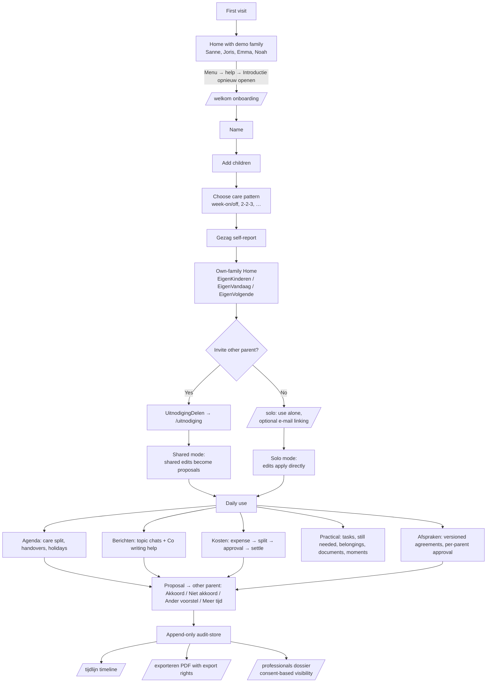

# Ouderschap & Co — Complete Platform & Feature Documentation

> Full functional and technical documentation of the **Ouderschap & Co** co-parenting app ("De app die ouders verbindt" — the app that connects parents), derived from a complete read of the source in this repository (`src/`).
> Dutch UI labels are kept in quotes with an English gloss, e.g. "Wisselmoment" (handover moment).
>
> Generated: 23 November 2026.

## Table of contents

- [0. Platform overview](#0-platform-overview)
  - [0.1 What the app is](#01-what-the-app-is)
  - [0.2 Who uses it (roles)](#02-who-uses-it-roles)
  - [0.3 Tech stack](#03-tech-stack)
  - [0.4 Project structure](#04-project-structure)
  - [0.5 App shell & navigation](#05-app-shell--navigation)
  - [0.6 Demo family vs own family](#06-demo-family-vs-own-family)
  - [0.7 State, persistence & storage keys](#07-state-persistence--storage-keys)
  - [0.8 AI features ("Co")](#08-ai-features-co)
  - [0.9 Core design principles](#09-core-design-principles)
  - [0.10 Complete route map](#010-complete-route-map)
  - [0.11 End-to-end platform workflow](#011-end-to-end-platform-workflow)
  - [0.12 Languages (Dutch / English)](#012-languages-dutch--english)
  - [0.13 Start screen, sign-in and sign-out](#013-start-screen-sign-in-and-sign-out)
  - [0.14 Icons and mobile layout](#014-icons-and-mobile-layout)
- [1. Home, onboarding, account & global UI](#1-home-onboarding-account--global-ui)
- [2. Agenda, care schedule & handovers](#2-agenda-care-schedule--handovers)
- [3. Communication, AI coach "Co" and child-centric guidance](#3-communication-ai-coach-co-and-child-centric-guidance)
- [4. Costs, practical family items and the menu](#4-costs-practical-family-items-and-the-menu)
- [5. Agreements, legal, history & export, support, professionals portal](#5-agreements-legal-history--export-support-professionals-portal)
- [6. Known gaps, dead code & observations](#6-known-gaps-dead-code--observations)

---

# 0. Platform overview

## 0.1 What the app is

Ouderschap & Co is a Dutch-language, mobile-first web app for **separated parents who share the care of their children** (co-parenting). It puts everything around co-parenting on "one calm place":

| Domain | What parents do there |
|---|---|
| **Agenda & care split** | Shared calendar, the weekly care schedule per child ("verdeling van de week"), handover moments, holidays and special days, change proposals |
| **Messages** | Conversations per topic, with AI writing help that de-escalates tone; calls; a private sparring partner ("Sparren met Co") |
| **Costs** | Expenses per child, split percentages, budgets, fixed costs, settlement ("afrekenen"), receipt scanning |
| **Practical** | Tasks, "still needed" shopping list, belongings that travel between houses, handover packing list, documents, moments/photos |
| **Children** | Child profiles (school, medical, contacts), the child's circle of important people ("kring"), age-based tips for talking to children about the separation |
| **Agreements & legal** | Versioned agreements between parents with per-parent approval, decisions, parental authority ("gezag"), parenting-plan import, legal help |
| **History & export** | Append-only change history ("tijdlijn"), PDF overview/dossier export with export rights |
| **Professionals** | A separate cockpit for mediators / social workers / counsellors with dossiers, journals, consent-based visibility |

The core philosophy: **nothing shared changes without the other parent agreeing**. Every change to a shared item is a *proposal*; final statuses are immutable; history is append-only; the AI never acts on its own.

## 0.2 Who uses it (roles)

| Role | How it appears in code | Main entry |
|---|---|---|
| **Parent (logged-in viewer)** | Always "Sanne" (`id: "sanne"`) in the demo family | `/` (Home) |
| **Other parent** | "Joris" (`id: "joris"`), shown as "de andere ouder" | Simulated (seed data, dev-only "demo: akkoord" buttons) |
| **Solo parent** | Own family, other parent not invited (`start-store.uitgenodigd = false`), optionally with e-mail linking | `/solo` |
| **Kring / caregiver** | Grandparents, babysitter, step-parent with per-person permissions | `/verzorger`, `/kring/$kindId` |
| **Professional** | Mediator / social worker / counsellor with a dossier per family | `/professionals` (cockpit), `/ondersteuning`, `/begeleider-gesprek` |

There is **no real authentication or backend**: all identities are simulated on the device.

## 0.3 Tech stack

| Layer | Technology |
|---|---|
| Framework | React 19 SPA, Vite 8 (`npm run dev` on port 5173) |
| Routing | TanStack Router 1.170 with file-based routes (`src/routes`, generated `src/routeTree.gen.js`) |
| Data fetching | TanStack Query (provider only; almost no queries) |
| State | Hand-written module stores using `useSyncExternalStore` in `src/lib/*-store.js` |
| UI | Tailwind CSS v4 (`@tailwindcss/vite`), shadcn/ui-style Radix components in `src/components/ui`, `lucide-react`, `sonner` toasts, `vaul` drawers, `recharts` |
| Forms/validation | `react-hook-form`, `zod` |
| PDF | `jspdf` (`src/lib/pro-pdf.js`, `/exporteren`) |
| AI | `fetch` to `https://ai.gateway.lovable.dev/v1/responses` (model `openai/gpt-6-astra`) and `/v1/audio/transcriptions`, wrapped by a client-side shim `src/lib/server-fn.js` replacing `@tanstack/react-start` server functions |
| Weather | Open-Meteo geocoding + forecast (Living Home) |
| Device lock | WebAuthn platform authenticator (Face ID / Touch ID / PIN) in `src/lib/app-slot.js` / `voorkeuren-store.js` |
| Tests | `*.test.js` files written for `bun:test` (no test script in `package.json`; run with `bun test`) |
| Fonts | Nunito, Nunito Sans, Lora (italic for page titles, class `lora`) |
| Languages | `i18next` + `react-i18next` + `i18next-browser-languagedetector`; Dutch (default) and English (§0.12) |

Origin: the project was converted from a Lovable / TanStack Start (SSR, TypeScript) app to a pure Vite SPA with `.jsx/.js`. Some comments and `AGENTS.md` still refer to `.ts/.tsx` files — the actual files are `.js/.jsx`.

## 0.4 Project structure

```
index.html              Pre-paint theme script, fonts, #root
vite.config.js          React + Tailwind plugins, "@" → ./src alias
src/
  main.jsx              Mounts <RouterProvider>
  router.jsx            createRouter(routeTree) + QueryClient context
  routeTree.gen.js      Generated route tree (do not edit by hand)
  styles.css            Tailwind v4 theme tokens (brand, ink, ai-*, meter-*), light/dark
  routes/               ~48 screens (one file per URL)
    __root.jsx          Root: <Outlet/>, <AppSlot/>, <SpoedScherm/>, <Toaster/>, 404 + error pages, search-hash highlight
  components/           Feature components (~60) + pro/ (professional dossier) + ui/ (shadcn primitives)
    AppShell.jsx        Page wrapper, bottom nav, BackButton, PageHeader, Card
  lib/                  Stores, pure domain logic, AI functions, demo data, tests
    AGENTS.md           Architecture decision log — the rules every change must respect
  assets/               Demo avatars, logo
```

## 0.5 App shell & navigation

- Every parent screen is wrapped in **`AppShell`** (`src/components/AppShell.jsx`): a centred mobile column (`max-w-md`, optionally `breed` for wider layouts) plus a floating **bottom navigation** with 5 tabs:

  | Tab | Route | Notes |
  |---|---|---|
  | "Home" | `/` | Dashboard |
  | "Agenda" | `/agenda` | Calendar + holidays |
  | "Berichten" (Messages) | `/berichten` | Badge with unread count (demo only) |
  | "Kosten" (Costs) | `/kosten` | Also active for `/boodschappen` |
  | "Menu" | `/meer` | Active for ~30 sub-pages (taken, spullen, documenten, kinderen, afspraken, professionals, instellingen, …) |

- **`PageHeader`** gives each sub-page a back button (app-internal history, falls back to `/meer`), a Lora title, subtitle, the page **Assistent** (search & arrange sheet) and an optional action.
- "← Terug naar overzicht" chip appears when a page was opened from the Home overview (`terug-store`).
- **Root-level overlays** on every route: `AppSlot` (device lock screen), `SpoedScherm` (urgent "Nu afstemmen" overlay), `Toaster` (single confirmation toast via `bevestig()`).
- **Search deep-links**: a URL hash `#item-<id>` scrolls to and briefly highlights the element (`zoekdoel-aan` class) — used by the Assistent search results.
- The professional cockpit (`/professionals`) uses its own `.pro-cockpit` layout instead of the parent AppShell.

## 0.6 Demo family vs own family

The app runs in one of two modes, decided by `start-store.eigen`:

| | **Demo family** (default) | **Own family** (`eigen = true`) |
|---|---|---|
| Parents | Sanne de Vries (viewer) & Joris Bakker | The user's name; other parent only after invite |
| Children | Emma (9) & Noah (6) from `src/lib/demo-data.js` | Children added in onboarding (ids `k-…`), colour, birth date, optional profile image |
| Date | Agenda frozen on demo date 2025-03-12 | Real current date |
| Data | Rich seeded data (appointments, messages, costs, proposals, pro dossiers) | Empty sources; screens show `EigenLeeg` empty states |
| Persistence | Mostly in-memory (resets on reload) | `onzeapp-eigen-start` in localStorage |
| Shared edits | Become proposals to Joris | Applied directly while no other parent is invited |

A first visit always shows the demo family. The user switches to an own family via `/welkom` (reached from the Menu help sheet "Introductie opnieuw openen"); finishing it calls `start.begin`, which **resets** existing own-family data. Demo data must never render as real data in own-family mode (AGENTS.md rule).

## 0.7 State, persistence & storage keys

All stores follow the same pattern: a module-level `state`, a `Set` of listeners, a `zet()`/setter that replaces state immutably and notifies, and a `useX()` hook using `useSyncExternalStore`. There is **no server persistence**; many stores are memory-only and reset on a full page reload.

**localStorage keys in use**

| Key | Owner | Contents |
|---|---|---|
| `onzeapp-eigen-start` | `start-store` | Own family: name, children, care pattern, gezag, agenda, message drafts, costs, cost agreement, invite flag |
| `onzeapp-sessie` | `sessie-store` | Session: `eigen` / `voorbeeld` / `uit` (start point `/welkom`) |
| `onzeapp-taal` | `src/i18n.js` | Chosen UI language (`nl` / `en`); absent = Dutch |
| `onzeapp-voorkeuren` | `voorkeuren-store` | Theme, Living Home, quiet hours, smart-help toggles, muted chats, pinned items, app-lock credential id, read activity ids, "extra houvast" |
| `onzeapp-slimme-hulp` | `slimme-hulp` | Snoozed/dismissed smart suggestions, routines |
| `onzeapp-laatste-bezoek` | `slimme-hulp` | Last-visit timestamp |
| `onzeapp-kring-personen` | `kring-store` | People in each child's circle |
| `onzeapp-verhaal-toestemming` / `onzeapp-verhaal-bewaard` | `verhaal` | Consent and saved "Sparren met Co" chat |
| `onzeapp-spoed-snooze` | `SpoedScherm` | Snooze of the urgent overlay |
| `onzeapp-agenda-weergave` | `/agenda` | Week/month view (written, never read back) |
| `onzeapp-meer-recent` | `/meer` | Recently opened menu items (sessionStorage: `onzeapp-meer-scroll`) |
| `onzeapp-plan-wijziging-gezien-8-maart` | Home | Seen-flag for a plan change notice |
| `onzeapp-ontgrendeld` | `AppSlot` | Unlocked state (session) |
| `overdracht-v1` | `overdracht-store` | Handover notes |
| `evaluaties-v1` | `evaluatie-store` | Half-yearly evaluations |
| `kosten-rust-v1` | `/kosten` | Calm view toggle |
| `kindtips-uitleg-gezien` | `/kind-tips` | Intro seen |
| `lastige-momenten-houvast-v1`, `-log-v1`, `-wisselhulp-v1` | `/lastige-momenten` | Personal anchors, log, handover help |
| `berichten-pauze-tot-v1` | `/lastige-momenten` | Message pause end time (written, not read by `/berichten`) |
| `onthoud-*` | `onthouden.js` | Remembered filter choices |

**Memory-only stores (reset on reload)** include: `zorg-store` (care proposals), `vakantie-store`, `aanwezigheid-store`, `wissel-store`, `kosten-store`, `budget-store`, `taken-store`, `momentjes-store`, `afspraken-store`, `audit-store`, `pro-journaal-store`, `gesprekken-store`, `email-koppeling-store`, `nu-afstemmen-store`, `checkin-store`, `abonnement`.

## 0.8 AI features ("Co")

"Co" is the app's calm AI assistant persona. All AI calls go to the Lovable AI gateway with model `openai/gpt-6-astra` and structured JSON output. The API key is read from `process.env.LOVABLE_API_KEY` or `import.meta.env.VITE_LOVABLE_API_KEY` — **in this SPA build it is read in the browser**, so a `VITE_` key would be exposed to users.

| Function file | Feature | Screen |
|---|---|---|
| `assistent.functions.js` | Search & arrange assistant: picks one *intent* (add appointment, swap day, add cost, …) and prefills the existing flow; also voice transcription | Every `PageHeader` (Assistent) |
| `coach.functions.js` | Writing help: rewrites a message calmer and clearer, reply help, "meaningful change" signal | `/berichten` |
| `verhaal.functions.js` | "Sparren met Co": empathetic chat, can draft a message; uses conflict-coaching rules + 3 best-matching example situations | `/verhaal` |
| `samenvatting.functions.js` | Conversation summary | `/berichten` |
| `bon.functions.js` | Read a receipt photo (amount, shop, category) | `BonScanner` in `/kosten`, `/documenten` |
| `schoolinfo.functions.js` | Extract dates/items from a school letter | `/documenten` |
| `schoolbericht.functions.js` | Draft a message to school about attendance | `/agenda` (AanwezigheidAfstemmen) |
| `ouderschapsplan.functions.js` | Import a parenting plan into agreements | `/afspraken` (OuderschapsplanImport) |

Non-negotiable AI rules (from prompts and AGENTS.md): Co **never executes anything itself** — it only opens an existing flow with prefilled fields for the parent to confirm; uses only the given context, never invents; never judges the other parent; receives only a minimal family line (speaking parent's name + children's names/ages); cached rewrites are keyed by exact text/context/style so stale results can't approve a message. Several screens labelled with Co (`/gesprekken`, `/lastige-momenten`, `/kind-tips`) use fixed texts, not AI.

## 0.9 Core design principles

These rules come from `src/lib/AGENTS.md` and are enforced throughout the code:

1. **One source per concept.** Agreements live only in `afspraken-store`; care schedule only in `zorg-store`; open proposals are *derived* (`openstaande-voorstellen.js`) and never stored twice.
2. **Proposals, not edits.** Shared changes are proposals; only acceptance changes planning. Final statuses are frozen (`Object.freeze`) and cannot revert. Response dates are requests, never binding — expiry changes nothing.
3. **Append-only history.** `audit-store` events are frozen; no edit/delete. Timeline and PDF read the same events.
4. **Money is never guessed.** Budget coverage is decided only by `beoordeelKosten` (`kosten-akkoord.js`); unknown → "uncertain". A budget is never an expense until "Uitgave toevoegen" runs. Payment declarations never prove receipt.
5. **Privacy by default.** Private agenda items (`gedeeld=false`) never reach the other parent, exports, audit or professionals. Professional visibility defaults to none; parents only see `voorOudersVan` output, never internal notes. Linking an e-mail address grants no app access.
6. **Demo never looks real.** Own-family mode hides all demo sources.
7. **Calm UX.** One toast at a time (`bevestig()`), "Geregeld!" only for definitive confirmations, quiet hours, muting, max 3 smart suggestions, Living Home effects never move/hide content.
8. **Explainable signals.** Communication pressure is computed from objective signals only and never judges people.

## 0.10 Complete route map

| Route | Title (EN) | Section |
|---|---|---|
| `/` | Home dashboard | 1 |
| `/welkom` | Welcome / onboarding | 1 |
| `/rondleiding` | Guided tour | 1 |
| `/uitnodiging` | Accept invitation | 1 |
| `/solo` | Use the app solo | 1 |
| `/veranderd` | "Nu afstemmen" – something changed today | 1 |
| `/activiteiten` | Notifications & open proposals | 1 |
| `/abonnement` | Subscription | 1 |
| `/instellingen` | Settings | 1 |
| `/privacy` | Who sees what | 1 |
| `/agenda` | Shared calendar + holidays | 2 |
| `/zorgregeling` | Weekly care split (→ redirects to `/agenda`) | 2 |
| `/wissel` | Prepare handover | 2 |
| `/vakantie/$id` | Holiday detail | 2 |
| `/planning` | Holidays & special days (legacy) | 2 |
| `/overdracht` | Handover: packing list, note, look-back | 2 |
| `/halen-brengen` | Pick-up & drop-off | 2 |
| `/berichten` | Messages + writing help | 3 |
| `/gesprekken` | Calls via the app | 3 |
| `/verhaal` | "Sparren met Co" | 3 |
| `/lastige-momenten` | Difficult moments toolkit | 3 |
| `/kind-tips` | Your child and the separation | 3 |
| `/begeleider-gesprek` | Conversation with counsellor | 3 |
| `/kosten` | Costs, budgets, settlement | 4 |
| `/boodschappen` | Still needed | 4 |
| `/taken` | Tasks | 4 |
| `/spullen` | Belongings | 4 |
| `/momentjes` | Moments | 4 |
| `/documenten` | Documents | 4 |
| `/meer` | Menu | 4 |
| `/kinderen`, `/kinderen/$kindId` | Children & child profile | 4 |
| `/kring/$kindId` | Important people (circle) | 4 |
| `/afspraken` | Agreements between parents | 5 |
| `/afspraken-veiligheid` | (→ redirect to `/afspraken`) | 5 |
| `/beslissingen` | Decisions | 5 |
| `/gezag` | Parental authority | 5 |
| `/juridisch` | Legal & privacy | 5 |
| `/juridische-hulp` | Legal help | 5 |
| `/tijdlijn` | Looking back / timeline | 5 |
| `/exporteren` | Save or share overview (PDF) | 5 |
| `/evaluatie` | Evaluation moment | 5 |
| `/ondersteuning` | Professional guidance | 5 |
| `/extra-ondersteuning` | Extra structure ("Extra houvast") | 5 |
| `/contact` | Making contact easier | 5 |
| `/samen-regelen` | (legacy → `/activiteiten`) | 5 |
| `/verzorger` | Caregiver circle view | 5 |
| `/professionals` | Professional cockpit & dossiers | 5 |

## 0.11 End-to-end platform workflow



**Daily-life loop for a parent**

1. **Open Home** — sees today (who has the children, next handover), open proposals waiting for them, smart suggestions (max 3), notifications bell, quick "Ik ben later" (I'm late) and "Nu afstemmen" (something changed today).
2. **Plan** — in Agenda, add appointments (private or shared), propose care changes ("Alleen deze keer" / "Vanaf nu"), plan holidays; prepare handovers with packing list and handover note.
3. **Communicate** — message per topic; the writing help checks for insults/threats, suggests a calmer rewrite, and the pressure indicator may suggest a pause. For emotional moments, "Sparren met Co", "Lastige momenten" and child tips help privately.
4. **Pay** — add expense (or scan receipt), choose split, the other parent approves, budgets are checked by `beoordeelKosten`, settle via "Afrekenen".
5. **Agree** — formal agreements are versioned, need approval from both parents; a parenting plan can be imported with AI.
6. **Look back & share** — every change lands in the immutable timeline; export a PDF overview; give a professional consent-based access.
7. **Professional** — the mediator works in their cockpit: intake, dossier tabs, contact journal, actions, documents, and closes involvement while keeping only their own summary.

Each domain section below ends with detailed **Workflow notes** for its flows.

## 0.12 Languages (Dutch / English)

The whole app is available in **Dutch (default)** and **English**, using i18next.

| Piece | Where |
|---|---|
| Setup | `src/i18n.js` — initialised synchronously from bundled JSON; exports `i18n`, `TALEN`, `taalLocale()`, `datumLocale()`, `tLijst()`, `zetTaal()` |
| Translations | `src/locales/nl.json` and `src/locales/en.json` — identical key structure, ~7,450 strings each |
| Switcher | Settings → "Weergave" → "Taal · Language" (`src/components/TaalKiezer.jsx`) |
| Remembered choice | `localStorage["onzeapp-taal"]`; without a saved choice the app is Dutch |
| Live switch | `__root.jsx` remounts the route tree (key = language) and calls `router.invalidate()`, so every screen, label from `src/lib` and page title updates without a reload; `<html lang>` follows |
| Page titles | Each route's `head()` title is applied to `document.title` by `__root.jsx` (the SPA has no `<HeadContent/>`) |

**Key structure** — one namespace per source file: `routes.<file>`, `components.<File>`, `pro.<File>`, `lib.<file>` (camelCased, `$`/dots removed, e.g. `routes.kinderenKindId`, `lib.demoData`), plus shared `common.*` (buttons, weekdays, months). Plurals use `_one` / `_other`; variables use `{{name}}`; inline markup uses `<Trans>`.

**How the code reads translations**
- Components: `const { t } = useTranslation(); t("routes.kosten.titel")`.
- Route `head()` and `src/lib` code: `i18n.t(...)` at call time. Module-level data (seed items, option lists, labels) uses **getters** (`get titel() { return i18n.t(...) }`) so it resolves in the current language when read.
- Money, dates and numbers use `taalLocale()` (`nl-NL` / `en-GB`); currency stays EUR. date-fns uses `datumLocale()`.

**Stored values stay language-neutral.** Values that logic compares or parses (statuses, categories, roles such as `"Oma"`, Dutch date labels like `"5 oktober 2026"`) are kept as Dutch ids and translated only when displayed (e.g. `rolNaam()`, `categorieLabel()`, `toonDatum()`, `datumWeergave()`). Text a user types, and records created at runtime (history lines etc.), keep the language they were created in.

**AI ("Co")** — system prompts stay Dutch; each AI function appends a language rule at call time so answers, rewrites, summaries and suggestions come back in English when the UI is English. Detection lists (insults, threats, deadlines, search keywords, suggestion triggers) contain both Dutch and English words.

**English feature names** (keep consistent): Nu afstemmen → *Coordinate now* · Wisselmoment → *Changeover* · Overdracht → *Handover* · Mee met de wissel → *Handover packing list* · Verdeling van de week → *Weekly schedule* · Kosten → *Costs* · Nog nodig → *Still needed* · Momentjes → *Moments* · Belangrijke personen → *Important people* · Lastige momenten → *Difficult moments* · Mijn houvast → *My anchors* · Extra houvast → *Extra support* · Rustmodus → *Quiet mode* · Sparren met Co → *Talk it through with Co* · Ik ben later → *I'm running late* · Terugkijken → *Look back* · Wie ziet wat → *Who sees what* · Afrekenen → *Settle up* · Samen regelen → *Arrange together* · Gezag → *Parental authority* · Ouderschapsplan → *Parenting plan*.

**Adding a language** — add `src/locales/<code>.json` with the same keys, import it in `src/i18n.js` and add one entry to `TALEN` (id, name, locale, date-fns locale). The switcher picks it up automatically.


## 0.13 Start screen, sign-in and sign-out

- **Start point:** `/welkom`. Without a session (first launch or after signing out) `__root.jsx` redirects every route except `/welkom` and `/uitnodiging` (invite links for the circle) to `/welkom`.
- **Session** (`src/lib/sessie-store.js`, `localStorage["onzeapp-sessie"]`): `eigen` (own family), `voorbeeld` (example family) or `uit`. Devices that already had an own family before the session existed are treated as signed in.
- **Welcome screen** (mobile layout, NL/EN switch top-right): app logo + four benefits → "Get started" (name → photo/avatar, optional → together or just me → Home) or "Look at the example family first". If a family already exists on the device: "Welcome back · Continue as {name}" and "Start a new family" (with confirmation, replaces the device data).
- **Sign out:** a row at the bottom of Settings and Menu → confirmation sheet → session ends, back to `/welkom`. Family data stays on the device.
- **Logo:** `AppLogo` = app icon (`/favicon.png`) + "Ouderschap & Co" wordmark (`formaat="groot" | "klein"`). The original logo PNG was only on the Lovable asset server; drop a real file in `public/` and point `AppLogo` at it to replace the wordmark.

## 0.14 Icons and mobile layout

- All icons are lucide-react: `AppIcon` (semantic, coloured badge), `src/components/Tekens.jsx` (`Chevron`, `MetChevron`, `Vinkje`, `MetVinkje`, `Kruis`, `Pijl`). No text glyphs (› ‹ ⌄ ✓ ✕) or emoji in the UI, data or translations.
- Bottom-tab pages (`/`, `/agenda`, `/berichten`, `/kosten` + `/boodschappen`, `/meer`) are app-bar screens without a back button; every other screen has the round `TerugKnop` (chevron-left). In-page sub-views (open conversation, steps, detail views) use the same button.
- AppShell respects the phone safe areas (top padding, bottom navigation).

---

# 1. Home, onboarding, account & global UI

Scope: the Home dashboard, the first-run/onboarding screens, account & settings screens, and the global overlays mounted in the root layout. All paths are relative to `src/`.

General conventions observed in this area:

- Stores are module-level `useSyncExternalStore` stores. Some persist to `localStorage`. Others are in-memory only and reset on reload. Each section below says which.
- The **demo family** (parent "Sanne", co-parent "Joris", kids Emma & Noah) is the default. The **own family** ("eigen gezin") is switched on by `start.begin()` in `lib/start-store.js`, which sets `eigen: true`. `start.naarVoorbeeld()` / `start.terugNaarEigen()` flip only the `eigen` flag. The own-family data stays stored while you look at the demo.
- The demo "today" is hard-coded in several places: Home uses `huidigeDag = 12` from the demo `zorgweek`, `slimme-hulp` uses `DEMO_VANDAAG = "2025-03-12"`, and the Assistent context says "donderdag 12 maart 2026".

---

## Screens

### `/` — "Home" (Home)
- **File(s):** `routes/index.jsx` (component `Dashboard`), `components/EersteHome.jsx` (own-family blocks), `components/LivingHome.jsx`, `components/NuAfstemmen.jsx`, `components/IkBenLater.jsx`, `components/Activiteiten.jsx` (`ActiviteitenBel`, `useActiviteiten`), `components/AppShell.jsx` (wrapper).
- **Purpose:** A calm daily overview. It shows where the children are today, the next handover ("wissel"), upcoming appointments and how many things are waiting for you. One component serves both modes. In own-family mode the demo blocks are swapped for `EigenKinderen` / `EigenVandaag` / `EigenVolgende`.
- **Features:**
  - **"‹ Terug naar mijn eigen gezin" (back to my own family)** button at the very top. It only appears when you are viewing the demo (`!st.eigen`) and an own family already exists (`st.naam` set). It calls `start.terugNaarEigen()`.
  - **Living atmosphere layer** (`LivingSfeer`): a decorative background behind the top of Home that cannot be clicked (`pointer-events-none`). See Global components.
  - **Header (top right):**
    - **"Co"** round button. Links to `/verhaal` (aria-label "Praat met Co", talk with Co).
    - **Bell** (`ActiviteitenBel inBalk`). Links to `/activiteiten`. It shows a small dot (never a number) when something is unread (`heeftNieuws`).
    - **Profile initial** (first letter of the own name, or "S" for Sanne). Links to `/instellingen`.
  - **Greeting (h1):**
    - When "Levendige Home" (lively Home) is on, it uses `begroeting()` based on the time of day: "Goedemorgen" (good morning), "Fijne middag" (nice afternoon), "Fijne avond" (nice evening), "Een rustige avond" (a calm evening). It is followed by the name.
    - When that setting is off, it says "Fijne {weekday}, {name}".
    - Demo only: if "Bijzondere momenten" (special moments) is on and a special moment applies, a subtitle shows either "Vandaag is {kind} jarig" (it's {child}'s birthday today) or "Vandaag · wisselmoment om 14:30" (handover today at 14:30).
  - **Children chips:**
    - Demo: one coloured initial plus name per demo child. Each links to `/kinderen/$kindId`.
    - Own family: `EigenKinderen` shows `ProfielBeeld` (photo, avatar or initial) plus name. Each links to `/kinderen/$kindId`.
  - **"Nu afstemmen" cards (align now)** (`NuAfstemmenKaart`): one card for each *open* item in `nu-afstemmen-store`. For an own family the seeded `na-demo` item is filtered out. See Global components.
  - **"Vandaag" card (today), demo version:**
    - Weekday and date. Headline is "Vandaag is een wisseldag" (today is a handover day) or "Emma & Noah zijn bij jou" (Emma & Noah are with you).
    - Next handover line ("Volgende wissel · morgen/vrijdag 14:30" = next handover tomorrow/Friday 14:30).
    - **Week line:** a two-colour bar from the demo `zorgweek` with a dot for "now", a handover icon at the 14:30 position, and weekday labels.
    - **Departure mode (vertrekmodus):** only on the handover day, between 11:30 and 14:30, when there are items to bring and the handover form is not yet filled in. It shows:
      - "Bijna tijd · …" (almost time).
      - The `IkBenLater` (I'm late) action.
      - A checklist of items to bring (`meeLijst` of the handover moment). Toggling an item calls `kring-store.toggleMee`.
      - A counter ("Alles afgevinkt ✓" = all ticked, or "N dingen nog niet afgevinkt" = N things not ticked yet).
      - A link "Mee met de wissel ›" (bring along for the handover) to `/overdracht`.
    - Otherwise, if the handover is within 1 day, there is a compact link to `/overdracht`. It reads "Alles klaar voor de wissel" (all ready for the handover) or "Mee met de wissel" plus how many items still need to go.
  - **"Vandaag" card, own-family version** (`EigenVandaag`). It changes as more data is entered:
    1. **No children:** "Voor wie wil je de app gebruiken?" (who do you want to use the app for?) with a **"Kind toevoegen"** (add child) button. This opens `KindSheet`.
    2. **Child plus a valid schedule:**
       - "{names} zijn vandaag bij jou / bij de andere ouder" ({names} are with you / with the other parent today).
       - Next handover date and time (plus place if set).
       - A coloured week line for the own schedule.
       - A toggle "Verdeling van de week bekijken/verbergen" (show/hide weekly split). It shows a two-week J/A grid ("J" = with you, "A" = with the other parent) with a legend.
       - A pencil button ("Verdeling aanpassen", adjust split) opens `RegelingSheet`.
    3. **Schedule = "later" (no fixed pattern):**
       - "Jullie planning volgt geen vast schema" (your planning has no fixed schedule).
       - **"Wisselmoment toevoegen"** (add handover) goes to `/agenda?nieuw=true&titel=Wisselmoment`.
       - **"Toch een vast patroon"** (use a fixed pattern after all) opens `RegelingSheet`.
    4. **Child but no schedule:** "Wanneer is het volgende wisselmoment?" (when is the next handover?) with **"Verdeling van de week toevoegen"** (add weekly split), which opens `RegelingSheet`.
  - **`KindSheet` (add child sheet).** It has four phases:
    - "kind" (child): first name (required), birth date (optional), and `BeeldKiezer` (photo/avatar/skip). "Opslaan" (save) calls `start.kindToevoegen` and creates id `k-…` with an automatic colour.
    - "vervolg" (next): "Voor nu afronden" (finish for now), "Nog een kind toevoegen" (add another child) or "Familielid toevoegen" (add family member).
    - "familie" (family member): name, role (`rolOpties` select), phone/e-mail (optional). Save calls `kring-store.voegPersoonToe` with `uitgenodigd:false` and no rights for every child. This stores a contact only. If storage fails it shows a retry message.
    - "klaar" (done): a short note and a "Verder" (continue) button.
  - **`RegelingSheet` (weekly split sheet):**
    - Step "patroon" (pattern): pick a preset. Options are "Om de week" (alternate weeks), "Weekenden afwisselen" (alternate weekends), 2-2-3, 2-2-5-5, "Vaste dagen per week" (fixed days per week), "Eén weekend per twee weken" (one weekend per two weeks), "Wisselende regeling" (varying arrangement) and "Zelf instellen" (set up yourself). Each preset shows a mini 14-day preview.
      - "Wisselende regeling" and "Nog niet afgesproken — later instellen" (not agreed yet, set later) store `regeling: "later"`.
    - Step "aanpassen" (adjust):
      - Tap a day in the two-week grid to toggle it between "ik" (me) and "ander" (other parent). "Andersom: begin bij de andere ouder" (the other way round: start with the other parent) inverts all days.
      - Handover time (default 14:30) and an optional place.
      - A live preview: "Vandaag is X bij jou… Volgende wissel …" (today X is with you… next handover …).
      - **"Verdeling opslaan"** (save split) stores `{patroon, dagen, wisseltijd, plek, startMaandag}`. This is blocked when the other parent is marked `uitgenodigd` (invited) and a schedule already exists; the sheet then says the existing split stays.
      - "Ander patroon kiezen" (choose another pattern) goes back to the first step.
  - **Overdracht reminder card (handover notes), demo only.** It shows when the w1 handover has not been shared in `overdracht-store` and the handover is 0–48 h away (`demoUrenTotWissel`).
    - Title: "Overdracht voor Joris" (handover notes for Joris).
    - Text adds "Jullie zien elkaar niet bij de wissel" (you won't see each other at the handover) when the handover place matches school/opvang (daycare).
    - Links to `/overdracht#overdracht`.
  - **"Binnenkort" (coming up):**
    - Demo: up to 3 demo `afspraken` from day 12 onward, excluding handovers. Each row has day/time and a child-colour dot, and links to `/agenda?afspraak=id`. The header link "Alle afspraken" (all appointments) goes to `/agenda`.
    - Own family: the next 2 occurrences from `start-store.agenda` (recurrences expanded via `voorkomens` over 365 days). Each row links to `/agenda?afspraak=id&dag=date`.
  - **"Nog te regelen" (still to arrange) card:**
    - The count comes from `useActiviteiten().voorstellen` that are `aanJou` (waiting on you) and not final.
    - If the count is above 0, the card shows the number and the first item's title plus "en N andere" (and N others). It links to `/activiteiten?onderdeel=regelen`.
    - If the count is 0, the card shows a ✓ and "Alles is afgestemd." (everything is aligned).
    - For an own family `voorstellen` is always empty, so the card always reads "Alles is afgestemd".
  - **`EigenVolgende`, own family only:**
    - **"Handig als volgende stap" (useful next step):** up to 3 items, chosen by state.
      - "Hoe is het gezag geregeld?" (how is custody arranged?) opens `GezagSheet`. Choices: "Gezamenlijk gezag" (joint custody), "Eén ouder heeft gezag" (one parent has custody), "Anders geregeld" (arranged differently), "Nog onbekend" (not known yet). The choice is stored as self-reported `gezag` and is display-only.
      - "Zet de eerste afspraak in de agenda" (add the first appointment) goes to `/agenda?nieuw=true` and marks `afspraakToegevoegd`.
      - "Nodig de andere ouder uit" (invite the other parent) appears only when `gebruik === "samen"` (use together). It goes to `/solo` and marks `uitgenodigd: true` on click.
      - "Wat moet er mee bij de wissel?" (what goes along at the handover?) appears when a schedule exists. It goes to `/overdracht`.
    - **"Je start · N van 4 klaar" (your start · N of 4 done):** a progress card from `basisStappen`. Steps are name, child, weekly split and custody. Inviting the other parent does not count. The card can be collapsed ("Inklappen"/"Toon") or hidden for good ("Niet meer tonen" sets `voortgangVerborgen`).
    - Footer: "Alles aanvullen kan altijd via het Menu" (you can always fill in more via the Menu) plus a **"Bekijk het voorbeeldgezin"** (view the demo family) button, which calls `start.naarVoorbeeld()`.
  - **"Punten om af te stemmen" sheet (points to align):** a bottom sheet listing `openActies`, grouped into "Wacht op jou" (waiting for you) and "Afstemming loopt" (alignment in progress).
    - Demo sources:
      - Outstanding settlement balance ("Nog te betalen", still to pay). Tapping it opens the cost-breakdown sheet instead of navigating.
      - Budget proposals.
      - Holiday proposals.
      - Parenting-plan import items to check.
      - Own agreement proposals.
      - Open care-schedule proposals.
      - One static "Voorgestelde afspraak" (proposed agreement).
      - Requests from the professional (`voorOudersVan(..., "bakker", "Sanne")`).
    - Quick buttons:
      - Budget items waiting on Sanne get "Akkoord" (agree), which calls `budget-store.reageer`.
      - Care proposals from the other parent get "Akkoord" / "Afwijzen" (agree / decline), which call `zorg-store.accepteer` / `wijsAf`.
    - A collapsible **"Afgerond · N" (completed)** list shows agreed budgets, closed care proposals and agreed holidays, read-only.
    - Own family: only own agreement proposals.
    - The sheet opens only through `terug-store.neemHeropen()`. That happens when the user returns via AppShell's "← Terug naar overzicht" (back to overview) after leaving from this sheet; rows call `markeerVanOverzicht()`.
  - **Cost sheet:** "Nog € X te betalen" / "Je ontvangt nog € X" (still € X to pay / you'll still receive € X). It splits the balance into "Jouw aandeel in kosten van de andere ouder" (your share of the other parent's costs) and "Aandeel van de andere ouder in jouw kosten" (the other parent's share of your costs), from `berekenSaldo`. A link "Betaling bekijken →" (view payment) goes to `/kosten`.
  - **Code that is present but has no trigger in this file:**
    - The "add" bottom sheet (`toevoegenOpen`). It contains "Nu afstemmen" → `/veranderd`, "Wat wil je toevoegen?" (what do you want to add?) with Afspraak (appointment type sub-menu → `/agenda?nieuw&categorie`), "Voorstel doen" (make a proposal, sub-menu of 10 proposal types → `/zorgregeling`, `/veranderd`, `/afspraken`, `/planning`, `/kosten`), Taak, Kosten, Momentje, Document, Overdracht.
    - A "spullen" (items) sheet (`spullenOpen`).
    - Neither state is ever set to `true` in `index.jsx`.
    - Variables computed but unused: `planGezien` (localStorage key `onzeapp-plan-wijziging-gezien-8-maart` is read only), `zwemtasNodig`, `jaarMomentjes`, `tip`, `zorgVoorJou`, `maandKort`.
- **Demo vs own-family behavior:**
  - Own family drops all demo-seeded sources: the demo agenda, the demo week line, the Overdracht reminder, the static action, the professional items, costs, budgets, care, holidays, import, and the `na-demo` Nu afstemmen item.
  - Own family uses `start-store` children, schedule and agenda. The greeting uses the own name.
  - The living-moment subtitle is demo only (`LivingSfeer moment={null}` for an own family).
- **Data / stores:**
  - Read: `start-store` (localStorage `onzeapp-eigen-start`), `voorkeuren-store` (`onzeapp-voorkeuren`), `nu-afstemmen-store`, `kring-store`, `taken-store`, `wissel-store`, `overdracht-store`, `kosten-store` + `verrekening`, `momentjes-store`, `budget-store`, `zorg-store`, `afspraken-store`, `vakantie-store`, `import-store`, `acties-store`, `pro-journaal-store`, `terug-store`, `demo-data`.
  - Write: `start-store` (children, schedule, custody, flags), `kring-store` (`toggleMee`, `voegPersoonToe`), `budget-store.reageer`, `zorg-store.accepteer/wijsAf`.
- **AI usage:** None directly. The "Co" button links to `/verhaal`.
- **Navigates to:** `/verhaal`, `/activiteiten`, `/instellingen`, `/kinderen/$kindId`, `/overdracht`, `/agenda`, `/activiteiten?onderdeel=regelen`, `/kosten`, `/afspraken`, `/zorgregeling`, `/planning`, `/documenten`, `/ondersteuning`, `/solo`.

### `/welkom` — "Welkom" (Welcome)
- **File(s):** `routes/welkom.jsx`, `components/ProfielBeeld.jsx` (`BeeldKiezer`).
- **Purpose:** A lightweight 3-step introduction that creates the own family and lands on Home. It is a standalone card layout and does not use AppShell.
- **Features:**
  - App logo with slogan.
  - **Step 0, "Fijn dat je er bent." (glad you're here):** "Hoe mogen we je noemen?" (what may we call you?) first-name input. **"Verder"** (continue) is disabled until the name is non-empty, then goes to step 2.
  - **Step 2, "Een foto of avatar?" (a photo or avatar?):** optional. Uses `BeeldKiezer`:
    - Upload or take a photo.
    - Pick one of 12 SVG avatars.
    - "Voorlopig overslaan" (skip for now). With no image chosen, this jumps straight to step 1.
    - "Verder" appears once an image is chosen. "Terug" (back) goes to step 0.
  - **Step 1, "Hoe wil je de app beginnen?" (how do you want to start?):** two choice cards.
    - "Samen gebruiken" (use together, default): you intend to use it with the other parent, and can invite later.
    - "Voor mezelf" (for myself): organise for yourself first.
    - Note: "Je kunt dit later aanpassen" (you can change this later).
    - **"Naar mijn Home"** (to my Home) calls `start.begin(naam, gebruik)` and `start.zetOuderBeeld(beeld)`, then navigates to `/`. "Terug" goes to step 2.
  - Footer link **"Eerst het voorbeeldgezin bekijken"** (view the demo family first) calls `start.naarVoorbeeld()` and goes to `/`.
- **Demo vs own-family behavior:** `start.begin` **resets the whole start-store** to empty plus `eigen:true`. Any earlier own-family data on this device is replaced (children, agenda, costs, etc.). The `/meer` help sheet warns about this before linking here.
- **Data / stores:** Writes `start-store` (`onzeapp-eigen-start`): `eigen`, `naam`, `gebruik`, `beeld`.
- **AI usage:** None.
- **Navigates to:** `/`.

### `/rondleiding` — "Rondleiding" (Guided tour)
- **File(s):** `routes/rondleiding.jsx`.
- **Purpose:** A step-by-step card tour of the main app sections. It never changes data.
- **Features:**
  - PageHeader. The subtitle is personalised for an own family: "Welkom {naam}, we lopen samen door de app" (welcome {name}, we'll walk through the app together). The back button goes to `/meer`.
  - "Stap X van N" (step X of N) plus a segmented progress bar.
  - Step card with icon, title, text and an action link. A step that is already done shows "Al ingesteld" (already set up). Steps:
    1. "Home" → `/`.
    2. "Je kinderen" (your children) → `/kinderen` (own family: `/`). Done when children exist. Button reads "Bekijk je kinderen" (view your children) or "Kind toevoegen" (add child).
    3. "Verdeling van de week" (weekly split) → `/zorgregeling` (own family: `/`). Done when a schedule exists.
    4. "Agenda" → `/agenda`. Done when `afspraakToegevoegd`.
    5. "Berichten" (messages) → `/berichten`.
    6. "Kosten" (costs) → `/kosten`.
    7. "De andere ouder" (the other parent) → `/instellingen`. Only shown when `gebruik === "samen"`. Done when `uitgenodigd`.
    8. "Menu" → `/meer`.
  - "Vorige" (previous; disabled on the first step) and "Volgende" (next). On the last step the forward button becomes "Klaar, naar Home" (done, to Home).
  - Footer: "Je kunt de rondleiding altijd opnieuw starten via het Menu" (you can restart the tour from the Menu any time).
  - The global `SpoedScherm` is suppressed on this route.
- **Demo vs own-family behavior:** The children's names are used in the Home text, the subtitle is personalised, and the kids/schedule links point to `/` for an own family.
- **Data / stores:** Reads `start-store` only.
- **AI usage:** None.
- **Navigates to:** `/`, `/kinderen`, `/zorgregeling`, `/agenda`, `/berichten`, `/kosten`, `/instellingen`, `/meer`.

### `/uitnodiging` — "Uitnodiging" (Invitation acceptance)
- **File(s):** `routes/uitnodiging.jsx`, link built by `components/UitnodigingDelen.jsx`.
- **Purpose:** The landing page for a "kring" (circle of carers) invite link (`?t=<sleutel>`). The invitee "logs in" and confirms the invite. The page is marked `noindex`.
- **Features:**
  - If the token does not resolve (`persoonVoorUitnodiging`): "Deze uitnodiging werkt niet" (this invitation doesn't work). The link may be used, revoked or wrong.
  - Otherwise "Hoi {naam}" (hi {name}), the role, and the demo children this person has rights for.
  - Step "open": privacy note plus **"Inloggen of account maken"** (log in or create account).
  - Step "inloggen" (log in): e-mail field. **"Doorgaan"** (continue) is enabled on a basic e-mail regex and sets `ingelogd=true`. Note: "Voorbeeld: in deze demo wordt nog geen echt account aangemaakt" (example: no real account is created in this demo).
  - Step "bevestig" (confirm): "Wat je straks kunt zien" (what you'll be able to see) lists, per child, `rechtenSamenvatting` (rights summary). **"Uitnodiging bevestigen"** (confirm invitation) calls `bevestigUitnodiging(sleutel, ingelogd)`.
  - Step "klaar" (done): "Welkom in de kring" (welcome to the circle), then "Naar de app ›" → `/verzorger`.
- **Demo vs own-family behavior:** Always uses demo children and `kring-store` people. No own-family handling.
- **Data / stores:** `kring-store` (read person by token, write confirmation).
- **AI usage:** None.
- **Navigates to:** `/verzorger`.

### `/solo` — "Solo gebruiken" (Use solo)
- **File(s):** `routes/solo.jsx`, `components/EmailKoppelingInstellen.jsx`.
- **Purpose:** Explains and supports using the app alone when the other parent doesn't take part. This includes a private log and linking the other parent's e-mail.
- **Features:**
  - Intro card with a **"Solo-modus aan/uit"** (solo mode on/off) toggle. This is local component state only. When on: "✓ Je gebruikt de app nu alleen…" (you're now using the app alone).
  - **"Wat je solo kunt doen" (what you can do solo):** 4 static benefit cards:
    - Own agenda & weekly split.
    - Track costs.
    - Personal log.
    - Documents.
  - **"Mijn logboek" (my log):**
    - Textarea "Wat is er vandaag gebeurd?" (what happened today?) plus **"Toevoegen"** (add), which prepends a "Vandaag" (today) entry.
    - Starts with 3 seeded demo entries.
    - Local state only, not persisted.
  - **"Communicatie" (communication):** `EmailKoppelingInstellen` (anchor `#email-koppeling`). See Global components.
  - **"Jouw account" (your account):** e-mail field prefilled with `sanne@voorbeeld.nl`. Local state only.
  - **"Toch samen verder?" (continue together after all?) card:**
    - **"Samen verder in de app"** (continue together in the app) opens checkboxes for what to share: Agenda & weekly split (on by default), Kosten (costs, on), Documenten (documents, off), Persoonlijk logboek (personal log, off).
    - **"Uitnodiging klaarzetten"** (prepare invitation) shows a confirmation that nothing is shared until the other parent accepts. Local state only; nothing is sent.
    - Link **"Of vraag hulp aan een mediator ›"** (or ask a mediator for help) → `/professionals`.
- **Demo vs own-family behavior:** No `eigen` checks. The content is the same in both modes. Own-family Home, Berichten and others link here as the "invite the other parent" target and set `start-store.uitgenodigd = true` on click.
- **Data / stores:** Component state only, plus `email-koppeling-store` (in memory).
- **AI usage:** None.
- **Navigates to:** `/professionals`, `/berichten` (via the e-mail link card).

### `/veranderd` — "Nu afstemmen" (Align now: something changed unexpectedly)
- **File(s):** `routes/veranderd.jsx` (sub-components `Ziek`, `Halen`, `AfspraakWijzigen`, `Later`, `MomentKeuze`, `KindKeuze`), uses `components/HulpVragen` (`HulpForm`).
- **Purpose:** A flow that starts from the situation for unexpected changes: sick child, running late, pickup failing, plan changed. It always works through existing kring moments and proposals.
- **Features:**
  - Search params: `situatie` (one of ziek / later / halen / anderhaalt / afspraak / taak / anders), `moment` (kring moment id), `kind` (emma / noah).
  - PageHeader "Nu afstemmen". The subtitle is the chosen situation's title. Back goes to `/`. When a moment is selected, a header line shows day · time · title, the children and the place.
  - **Situation list (no `situatie` yet):**
    - "Kind is ziek" (child is sick).
    - "Ik ben later" (I'm late).
    - "Ophalen of overdracht lukt niet" (pickup or handover isn't possible).
    - "Planning is onverwacht veranderd" (plan changed unexpectedly).
    - "Iets anders" (something else).
  - **Ziek (sick):**
    - "Wie is ziek?" (who is sick?) Emma/Noah chips.
    - "Heeft dit gevolgen voor de planning?" (does this affect the plan?) checkboxes: School/opvang (school/daycare), Ophalen of brengen (pickup or drop-off), Wisselmoment (handover), Activiteit/afspraak (activity/appointment), "Geen gevolgen" (no consequences; exclusive).
    - Contextual output:
      - School: "Ziekmelden … doe je zelf" (you report the absence yourself).
      - Wisselmoment: shows the planned handover plus "Wijziging voorstellen →" (propose a change) → `/zorgregeling?actie=wijziging&bron=ziek`.
      - Halen: "Iemand anders laten halen of brengen →" (have someone else pick up or drop off) switches to `anderhaalt` with that moment.
      - Activiteit: "Afspraak aanpassen →" (adjust appointment) switches to `afspraak` with that moment.
      - Always: "De andere ouder laten weten →" (let the other parent know) → `/berichten`, plus the disclaimer that the app gives no medical advice.
  - **Halen / anderhaalt (pickup / someone else picks up):**
    - If no moment is chosen, "Om welk moment gaat het?" (which moment is it about?) lists kring moments for the child.
    - Options:
      - "Iemand uit de kring vragen" (ask someone from the circle).
      - "Andere oplossing voorstellen" (propose another solution) → `/zorgregeling`.
      - "Tijd wijzigen" (change time) and "Locatie wijzigen" (change location) both go to `afspraak`.
      - "Hulp vragen aan je netwerk" (ask your network for help) shows the inline `HulpForm`.
    - Circle mode: candidates with access (`kandidatenVoor`) and contact-only people (`contactKandidaten`, labelled "· contact, zonder app" = contact, without the app). Choosing one calls `zetWie` and shows a check mark.
      - Empty state: "Nog niemand in de kring heeft toegang tot dit moment" (nobody in the circle has access to this moment yet).
      - "+ Andere verzorger toevoegen" (add another carer) → `/kring/$kindId`.
      - Explanation that asking is not yet an agreement.
      - A preview "Wat {persoon} te zien krijgt" (what {person} will see): day, title, time, place, items to bring, "daarna" (afterwards), and no messages/costs/proposals.
  - **Afspraak (change appointment):**
    - Time and location inputs, prefilled from the moment.
    - For a handover moment: **"Voorstel versturen"** (send proposal) calls `zorg-store.dienVoorstelIn` (a one-off proposal; nothing changes until agreed).
    - For other moments: **"Opslaan"** (save) calls `kring-store.wijzigMoment` directly ("vastgelegd in de geschiedenis" = recorded in the history).
    - The button is disabled when nothing changed.
  - **Later (I'm late):**
    - Chips +10 / +20 / +30 min or "Andere tijd" (other time, time input).
    - Builds a polite preview message. **"Bericht versturen"** (send message) only shows "Bericht klaargezet … (voorbeeld)" (message prepared … example). Nothing is stored.
  - **Taak (task):** explanation plus "Naar taken" (to tasks) → `/taken`.
  - **Anders (something else):** links "Bericht sturen" (send message) → `/berichten` and "Iets samen regelen" (arrange something together) → `/samen-regelen`.
  - "← Andere situatie kiezen" (choose another situation) clears the search params.
- **Demo vs own-family behavior:** Hard-wired to demo children (emma/noah) and `kring-store` demo moments. No `eigen` branch.
- **Data / stores:**
  - `kring-store`: read moments and status; write `zetWie`, `wijzigMoment`.
  - `zorg-store.dienVoorstelIn`.
  - `taken-store`: `meeLijst`.
- **AI usage:** None.
- **Navigates to:** `/`, `/zorgregeling`, `/berichten`, `/kring/$kindId`, `/taken`, `/samen-regelen`.

### `/activiteiten` — "Meldingen" (Notifications / activity)
- **File(s):** `routes/activiteiten.jsx`, `components/Activiteiten.jsx` (`useActiviteiten`), `lib/activiteiten.js`, `components/VoorstellenOverzicht`.
- **Purpose:** One feed of what was added, changed or is waiting for your response. It is derived from existing sources; only read-marks are stored.
- **Features:**
  - Back button to `/`. Title "Meldingen".
  - **"Alles gelezen"** (mark all read) appears when there are new items. It adds all of their ids to the `activiteitGelezen` preference.
  - **"Wacht op jou · N" (waiting for you) card.** Its items are:
    - "Regelen" items that are not proposals: the demo handover reminder "Overdracht voor Joris" (within 24 h, not yet shared) and "Tijd voor jullie evaluatiemoment" (time for your evaluation moment, from `evaluatie-store`).
    - Open proposals waiting on you, from `openstaande-voorstellen`.
    - The card shows the first item with a **"Bekijk"** (view) pill that navigates to its route, plus "En nog N: …" (and N more).
    - **"Alles ›" / "Minder"** (all / less) toggles the full `VoorstellenOverzicht` (proposals overview) below. It starts expanded when `?onderdeel=regelen`.
  - **Feed groups "Nieuw" (new) and "Eerder" (earlier).** Each row has an actor initial with a small icon badge (or just an icon), the title plus explanation plus relative time, and a dot when unread. Opening a "Nieuw" row marks it read.
  - Feed items (from `verzamelActiviteiten`):
    - Proposals that were agreed or completed ("… geregeld", … arranged).
    - Audit events by others: created, updated (with old → new), deleted, accepted, declined/cancelled. Dossier and export events are excluded.
    - Shared non-private "Momentjes" (moments) from the other parent.
    - Info items with the same title are bundled ("N momenten gedeeld" = N moments shared, "Titel (N)").
  - **Details sheet:**
    - Title, explanation, and bundled sub-items.
    - A "Was / Wordt" (was / becomes) change list.
    - A details table: Wat (what), Datum (date), Tijd (time), Kinderen (children), Door (by), Wanneer (when), Reden (reason).
    - Button **"Bekijken en reageren"** (view and respond, for requests) or **"Openen"** (open), which navigates to the source route.
  - Empty state: check icon, "Alles is bijgewerkt" (everything is up to date), "Er is niets nieuws en er wacht niets op jou" (nothing new and nothing waiting for you).
- **Demo vs own-family behavior:** Own family: no proposals, no momentjes, no handover reminder. Only audit events by others and the evaluation reminder can appear.
- **Data / stores:**
  - Reads: `zorg-store`, `afspraken-store`, `budget-store`, `vakantie-store`, `audit-store`, `momentjes-store`, `overdracht-store`, `evaluatie-store`, `start-store`, `voorkeuren-store`.
  - Writes: `voorkeuren-store.activiteitGelezen` (localStorage `onzeapp-voorkeuren`).
- **AI usage:** None.
- **Navigates to:** the source route of each item (`/agenda`, `/zorgregeling`, `/afspraken`, `/kosten`, `/taken`, `/momentjes`, `/overdracht`, `/evaluatie`, …), `/`.

### `/abonnement` — "Abonnement" (Subscription)
- **File(s):** `routes/abonnement.jsx`, `lib/abonnement.js`.
- **Purpose:** View, buy, change or cancel the subscription. It also covers the separate account-deletion flow. Prices and plans are config.
- **Features:**
  - Back to `/instellingen`.
  - **Buy/resume view** (status ≠ "actief"):
    - Headline:
      - "proef" (trial): "Rust en overzicht, samen." (calm and overview, together)
      - Otherwise: "Welkom terug." (welcome back)
    - Status-specific text:
      - bewaren (data-keeping plan): data kept.
      - opgezegd (cancelled): access until the renewal date.
      - verwijderaanvraag (deletion requested): you can still resume.
    - 4 benefit tiles ("voordelen"):
      - "Rustiger communiceren" (calmer communication).
      - "Alles op één plek" (everything in one place).
      - "Eerlijk verrekenen" (fair settlement).
      - "Je kind centraal" (your child at the centre).
    - "Eén abonnement voor jullie gezin" (one subscription for your family) note: the other parent uses it free.
    - Plan radio group, yearly first: "Jaarlijks" (yearly, € 49,00, per-month equivalent, "Voordeligst" = best value badge) and "Maandelijks" (monthly, € 4,99).
    - Main button:
      - Trial: **"Probeer 14 dagen gratis"** (try 14 days free). Only shows an explanation that the App Store payment will open here; nothing is charged.
      - Otherwise: **"Abonnement hervatten"** (resume subscription), which sets status "actief" with the chosen plan.
    - "Aankopen herstellen" (restore purchases) shows an explanation text. "Voorwaarden" (terms) → `/juridisch`.
    - Trial only: demo link "Voorbeeld: terug naar een actief abonnement" (example: back to an active subscription).
  - **Active view:**
    - Status card: "Actief" (active), plan name, price per period, "Verlengt op …" (renews on …), "Betaald via de App Store" (paid via the App Store).
    - "Jij betaalt voor jullie gezin" (you pay for your family) card mentioning Joris.
    - **"Beheren in de App Store"** (manage in the App Store) expands a plan switcher (demo).
    - "Aankopen herstellen" (restore purchases).
    - "Wat zit erin" (what's included): the `inbegrepen` list, showing the first 4 with "Alles bekijken / Minder" (view all / less).
    - Footer actions: **"Opzeggen en je gegevens"** (cancel and your data), "Voorwaarden" (terms), **"Account verwijderen"** (delete account).
    - Demo link "Voorbeeld: zo ziet het eruit voor een nieuwe ouder" (example: what a new parent sees) sets status "proef".
  - **Cancel/delete bottom sheet (multi-step):**
    - "Abonnement opzeggen?" (cancel subscription?): "Abonnement behouden" (keep subscription) or "Doorgaan met opzeggen" (continue cancelling).
    - "Wat wil je met je gegevens?" (what do you want with your data?):
      - "Alleen opzeggen" (cancel only): status "opgezegd".
      - "Opzeggen en gegevens bewaren · € 2,00 per maand" (cancel and keep data · € 2.00 per month).
      - "Account en gegevens verwijderen" (delete account and data).
    - "Je gegevens bewaren" (keep your data): lists what stays stored, what remains available, and what is switched off. Max 24 months. **"Kies gegevens bewaren"** (choose keep data) sets status "bewaren".
    - "Account verwijderen?" (delete account?): explains this differs from cancelling. "Eerst dossier exporteren" (export the dossier first) → `/exporteren`. **"Verwijdering aanvragen"** (request deletion) sets status "verwijderaanvraag". "Annuleren" (cancel).
- **Demo vs own-family behavior:** No `eigen` branch. Always mentions Sanne/Joris ("S"/"J" avatars).
- **Data / stores:** `abonnement.js` store, **in memory only**. Default `{status:"actief", planId:"jaar", verlengdatum:"2027-01-14"}`, reset on reload.
- **AI usage:** None.
- **Navigates to:** `/instellingen`, `/juridisch`, `/exporteren`.

### `/instellingen` — "Instellingen" (Settings)
- **File(s):** `routes/instellingen.jsx` (helpers `Groep`, `Rij`, `Uitklap` (expandable row), `Wissel` (switch), `Keuze` (radio cards)).
- **Purpose:** Profile, family, account, display, Co/AI, notifications, smart help and security settings.
- **Features:**
  - Back to `/meer`. Profile card always shows **demo Sanne**: avatar, full name, "Ouder · gekoppeld aan {Joris}" (parent · linked to {Joris}).
  - **"Gezin" (family):**
    - "Gezin beheren" (manage family) → `/kinderen`.
    - "Gezag en toegang" (custody and access) → `/gezag`.
    - Expandable **"Gebruik van de app"** (use of the app): "Samen gebruiken" (use together) / "Alleen gebruiken" (use alone) radio. Local state only, not persisted. Links "Persoonlijke functies ›" (personal features) → `/solo` and "E-mailkoppeling ›" (e-mail link) → `/solo#email-koppeling`.
    - Expandable **"Schoolvakanties"** (school holidays): region noord/midden/zuid (north/middle/south), via `schoolvakanties.zetRegio`.
  - **"Account":**
    - "Abonnement" (subscription) → `/abonnement`. The subtitle reflects whether it is active.
    - "Wie ziet wat" (who sees what) → `/privacy`.
    - "Overzicht bewaren of delen" (save or share overview) → `/exporteren`.
    - "Voorwaarden en privacy" (terms and privacy) → `/juridisch`.
  - **"Weergave" (display):**
    - **Thema** (theme) segmented control: Licht / Donker / Automatisch (light / dark / automatic). Applied immediately via `pasThemaToe`.
    - "Extra houvast" (extra support) → `/extra-ondersteuning`, showing Aan/Uit (on/off).
    - Expandable **"Levendige Home"** (lively Home): master switch. When on, there are sub-switches:
      - "Weereffecten" (weather effects).
      - "Seizoenseffecten" (seasonal effects).
      - "Bijzondere momenten" (special moments).
      - "Minder beweging" (less motion; sets `beweging:"verminderd"`).
      - A "Weer voor" (weather for) place input, saved on blur, default "Haarlem". Note: no GPS.
  - **"Co en berichten" (Co and messages):**
    - Expandable **"Hulp van Co"** (help from Co), "N van 3 aan" (N of 3 on):
      - "Schrijfhulp van Co" (writing help from Co).
      - "Rustiger communiceren" (calmer communication).
      - "Slimme suggesties" (smart suggestions).
      - "Verborgen suggesties weer tonen" (show hidden suggestions again) clears `verborgenCommunicatieSuggesties`.
      - Privacy note about AI.
    - Expandable **"Rustig regelen"** (calm arranging):
      - "Rustig regelen" switch (`gestructureerdAfstemmen`).
      - "Herinneringen bij voorstellen pauzeren" (pause reminders on proposals).
    - "Bellen via de app" (calling via the app) → `/gesprekken`.
  - **"Meldingen en hulp" (notifications and help):**
    - Expandable **"Meldingen"** (notifications):
      - "Rustmodus 's avonds" (evening quiet mode, 21:00–07:00 default).
      - "Meldingen bundelen" (bundle notifications).
      - "Iets voor vandaag altijd doorlaten" (always let through anything for today, `nuAfstemmenAltijd`).
      - "Feestdagen tonen" (show public holidays).
      - "Herinnering voor feestdagen" (holiday reminder).
      - Note that real phone notifications need linked accounts.
    - Expandable **"Slimme hulp"** (smart help), "N van 5 aan" (N of 5 on):
      - "Suggesties op Home" (suggestions on Home, `slimSuggesties`).
      - "Deze week en morgen" (this week and tomorrow, `weekVooruit`).
      - "Hulp bij de overdracht" (help with the handover, `overdrachtHulp`).
      - "Agenda even controleren" (check the agenda, `conflictControle`).
      - "Check-in op de wisseldag" (check-in on handover day, `checkin-store.aan`).
      - Link "Bekijk hoe de check-in eruitziet ›" (see what the check-in looks like) calls `toonVoorbeeld()` and goes to `/`. `DagCheckin` is not mounted anywhere, so no check-in actually appears.
  - **"Beveiliging" (security):**
    - **"App vergrendelen"** (lock app) switch.
    - On: registers a WebAuthn platform credential (`registreerSlot`) and stores its id in `vergrendelId`. It sets sessionStorage `onzeapp-ontgrendeld=1` so the app doesn't lock immediately.
    - Off: clears `vergrendelId`.
    - Disabled with an explanation when the device has no platform authenticator.
    - Status message for success or failure/cancel.
    - Privacy note that no biometrics are stored.
  - Footer: "Ouderschap & Co · De app die ouders verbindt" (the app that connects parents).
- **Demo vs own-family behavior:** No `eigen` branch. The profile is always the demo parent Sanne.
- **Data / stores:**
  - `voorkeuren-store` (localStorage `onzeapp-voorkeuren`; all switches above).
  - `checkin-store` (in memory).
  - `schoolvakanties` region.
  - `abonnement` (read).
  - `app-slot` (WebAuthn).
  - sessionStorage `onzeapp-ontgrendeld`.
- **AI usage:** None directly. The settings toggle AI features used elsewhere.
- **Navigates to:** `/meer`, `/kinderen`, `/gezag`, `/solo`, `/abonnement`, `/privacy`, `/exporteren`, `/juridisch`, `/extra-ondersteuning`, `/gesprekken`, `/`.

### `/privacy` — "Wie ziet wat" (Who sees what)
- **File(s):** `routes/privacy.jsx`.
- **Purpose:** A read-only privacy overview, per child, of who can see what.
- **Features:**
  - PageHeader with back to `/instellingen`. An intro explains that both parents see shared data, others see only what is deliberately shared, and personal notes and private moments are never shared.
  - **Per demo child:**
    - Section with an "Aanpassen" (adjust) link → `/kring/$kindId`.
    - People with any access level: name, role, "Ziet: …" (sees: …, rights summary), and period text.
    - Contact-only people: "Alleen bewaard als contact, ziet niets in de app" (only stored as a contact, sees nothing in the app).
    - Empty state: "Alleen jullie als ouders zien informatie over {kind}" (only you as parents see information about {child}).
    - Revoked people are excluded.
  - **"Professionals":** list of demo professionals with role and status. "Aanpassen" → `/professionals`.
  - Link "Lees de privacyverklaring" (read the privacy statement) → `/juridisch`.
- **Demo vs own-family behavior:** Always demo children and professionals.
- **Data / stores:** `kring-store` (read), `demo-data`.
- **AI usage:** None.
- **Navigates to:** `/instellingen`, `/kring/$kindId`, `/professionals`, `/juridisch`.

---

## Global components

### `AppSlot` — App lock screen
- **File(s):** `components/AppSlot.jsx`, `lib/app-slot.js`. Mounted in `routes/__root.jsx`.
- **Purpose:** A full-screen lock that appears only when "App vergrendelen" (lock app) is on. It also applies the colour theme globally.
- **Features:**
  - On mount and on theme change it calls `pasThemaToe()` and listens to `prefers-color-scheme` changes (for the "automatisch" theme).
  - When `vergrendelId` is set and sessionStorage `onzeapp-ontgrendeld` ≠ "1", it shows the lock: logo, lock icon, "Ouderschap & Co is vergrendeld" (is locked), and an **"Ontgrendelen"** (unlock) button.
  - Unlocking runs WebAuthn `navigator.credentials.get` with `userVerification: required` (Face ID / fingerprint / PIN).
  - Success sets the session flag. Failure shows "Dat lukte niet. Probeer het nog eens." (that didn't work, try again).
  - It re-locks when the tab was hidden for more than 60 s (`visibilitychange`).
- **Demo vs own-family behavior:** None.
- **Data / stores:** `voorkeuren-store` (`vergrendelId`, `thema`), sessionStorage `onzeapp-ontgrendeld`. Only the credential id is stored, never biometrics.
- **AI usage:** None.
- **Navigates to:** None.

### `SpoedScherm` — Urgent "Nu afstemmen" overlay (align now)
- **File(s):** `components/SpoedScherm.jsx`. Mounted in `routes/__root.jsx`.
- **Purpose:** A full-screen alert dialog that appears when there is an *open* "Nu afstemmen" item **from the other parent** (`van === "ander"`).
- **Features:**
  - Hidden on `/welkom` and `/rondleiding`. Hidden entirely for an own family. Items snoozed this session are skipped.
  - Card content:
    - Child initial with a child accent colour, "Ophalen · vandaag" (pickup · today), and a "Nu afstemmen" badge.
    - Title, "De andere ouder stuurde dit zojuist" (the other parent just sent this), and the explanation.
    - If old/new times exist: "Verwachte aankomst" (expected arrival) with the new time plus an "N min later" pill.
    - Note that a reply does not change the agenda.
  - Three buttons:
    - **"Ander voorstel"** (other proposal): a time input plus "Voorstel versturen" (send proposal). Answers "Ander voorstel: HH:MM uur".
    - **Accept** (option 2 text, e.g. "15:35 uur is goed" = 15:35 is fine).
    - **Take over** (option 1, e.g. "Ik haal Emma op" = I'll pick up Emma): a confirmation step, then answers "… · wacht op bevestiging van de andere ouder" (waiting for the other parent's confirmation).
  - **"Later beantwoorden · blijft onder Nog af te stemmen"** (answer later · stays under still to align) snoozes the item in sessionStorage `onzeapp-spoed-snooze`.
  - **"Niet meer actueel · sluiten zonder akkoord"** (no longer relevant · close without agreeing).
  - Answering calls `reageerNuAfstemmen`, which resolves the item and writes an audit event. The screen shows "Geregeld ✓" (sorted) for 1.4 s, then fades out.
- **Demo vs own-family behavior:**
  - Demo only.
  - The seeded demo item `na-demo` is already `status: "opgelost"` (resolved).
  - `startNuAfstemmen` always creates items with `van: "jij"` (from you).
  - So, as the code stands, the overlay only appears if an open `van:"ander"` item is put into the store.
- **Data / stores:** `nu-afstemmen-store` (in memory), `start-store`, `demo-data`, sessionStorage `onzeapp-spoed-snooze`. Writes go through `audit-store` via `reageerNuAfstemmen`.
- **AI usage:** None.
- **Navigates to:** None.

### `NuAfstemmenKaart` / `NuAfstemmenStart` — "Nu afstemmen" card & start sheet (align now)
- **File(s):** `components/NuAfstemmen.jsx`, `lib/nu-afstemmen-store.js`. The card is used on Home and in Berichten; the start sheet is used in `routes/berichten.jsx`.
- **Purpose:** Urgent, same-day coordination items: amber "solution cards" and a short flow to start one.
- **Features:**
  - **Card:**
    - Label "Nu afstemmen · {children}", title, explanation.
    - Origin text: "Van de andere ouder" (from the other parent) or "Door jou gestart · wacht op reactie" (started by you · waiting for a reply).
    - Desired response time.
    - For items from the other parent: option chips (e.g. "Ik haal op", I'll pick up). "Ander voorstel" (other proposal) opens a free-text input plus "Sturen" (send).
    - Note that the agenda doesn't change automatically.
  - **Start sheet "Heeft dit snel aandacht nodig?" (does this need attention soon?):**
    - Category chips: "Ophalen / brengen" (pickup / drop-off), "Kind ziek" (child sick), "Planning gewijzigd" (plan changed), "Iets vergeten / nodig" (something forgotten / needed), "Anders" (other).
    - Child chips (none = both).
    - "Wat is er?" (what's going on?) text.
    - "Reactie gewenst" (response wanted): Zo snel mogelijk (as soon as possible) / 15 / 30 / 60 min / Eigen moment (own time).
    - **"Versturen"** (send) calls `startNuAfstemmen`. Standard answer options are added per category, and an audit "CREATED" event is logged.
- **Demo vs own-family behavior:** The card uses demo child names. Home hides `na-demo` for an own family.
- **Data / stores:** `nu-afstemmen-store` (in memory; seeded with one already-resolved demo item), `audit-store`.
- **AI usage:** None.
- **Navigates to:** None.

### `Assistent` — Search & arrange assistant ("Co" search sheet)
- **File(s):** `components/Assistent.jsx`, `lib/assistent.functions.js`.
  - Rendered in `AppShell`'s page header (unless `zonderZoeken`).
  - Also rendered in `routes/agenda.jsx`, `routes/documenten.jsx`, `routes/kosten.jsx` and `components/EigenLeeg.jsx`.
  - Takes a `pagina` prop (the page title).
- **Purpose:** One search/voice entry point. It finds things in your data, or works out what you want to arrange and opens the right existing flow, prefilled. It never changes data itself.
- **Features:**
  - Round search (magnifier) button that opens the bottom sheet "Waar kan ik je mee helpen?" (what can I help you with?).
  - **Textarea** ("Spreek maar in, ik luister." = go ahead and speak, I'm listening). Enter submits; Shift+Enter adds a new line.
  - **Mic button:**
    - Records with `MediaRecorder`. A square button stops recording, with the status "Ik luister…" (I'm listening).
    - The audio is sent as base64 to `zetSpraakOm`. The transcript is placed in the textarea for editing and is never auto-submitted.
    - A confirm box offers "Wissen" (clear) and "Ja, ga verder" (yes, continue).
    - If the mic is unavailable it shows an error.
  - **"Lastige momenten"** (difficult moments) shortcut card → `/lastige-momenten`. Shown while idle.
  - **"Direct gevonden" (found directly):** instant local keyword matches (max 6), no AI. It searches:
    - 14 app pages (by keyword lists).
    - Demo agenda items.
    - Agreements in `afspraken-store`.
    - Demo documents.
    - Tasks.
    - Kring people.
    - Results navigate with an `#item-…` hash. The root layout scrolls to and highlights that item.
  - **Example chips** per page when the input is empty (e.g. Agenda: "Wat staat er deze week?" = what's on this week?). Otherwise 6 general examples.
  - **AI answer card:**
    - "Dit wil je regelen" (this is what you want to arrange) header when the answer is an action.
    - The answer text.
    - For `verduidelijk` (clarify): option chips that re-ask with "question — option".
    - For actions: a label/value summary table, the note "Er is nog niets veranderd" (nothing has changed yet), then **"Aanpassen"** (edit; refocuses the input) and an action button labelled per intent (e.g. "Ruil openen" = open swap, "Afspraak openen" = open appointment, "Ziekmelding openen" = open sick report).
  - **Intent → route mapping (`openFlow`):**

    | Intent | Opens |
    |---|---|
    | `wissel_ruil` / `extra_nacht` | `/zorgregeling?actie=wijziging&bron=assistent` |
    | `tijd_wisselmoment` | `/veranderd?situatie=halen&kind` |
    | `ziek` | `/veranderd?situatie=ziek&kind` |
    | `afspraak_toevoegen` | `/agenda?nieuw` (prefilled titel, datum, tijd, herhaling, kind) |
    | `afspraak_wijzigen` | `/agenda` |
    | `afspraak_maken` | `/afspraken?nieuw=voorstel&bron=assistent` |
    | `document_zoeken` | `/documenten` |
    | `kring_toevoegen` | `/kring/$kindId?toevoegen&rol` |
    | `vakantie` | `/planning?toevoegen=vakantie` |
    | `taak_toevoegen` | `/taken` |
    | `momentje` | `/momentjes` |
    | `kosten` | `/kosten` |
    | `bericht` | `/berichten` |

  - Errors are shown inline. Errors come from `foutMelding`: 429 busy, 402 AI credits exhausted, 403 no access, and "AI is nog niet ingesteld" (AI is not set up yet) when the key is missing.
- **Demo vs own-family behavior:** The context is always built from **demo data**: "Sanne", demo children, demo agenda, kring moments, school holidays for the chosen region, the holiday split and demo documents. No own-family branch.
- **Data / stores:** Reads `demo-data`, `afspraken-store`, `vakantie-store`, `kring-store`, `taken-store`, `schoolvakanties` (region). No writes.
- **AI usage:**
  - `vraagAssistent` (server fn, POST):
    - Calls `https://ai.gateway.lovable.dev/v1/responses` with model `openai/gpt-6-astra`, streaming, `store:false`, low reasoning effort.
    - System prompt: a calm Dutch assistant that only uses the given context and never executes anything.
    - Strict JSON schema output: `{antwoord, actie (intent enum), samenvatting[{label,waarde}], opties[], kind (emma|noah|""), titel, datum, tijd, rol, herhaling (geen|wekelijks|tweewekelijks|maandelijks)}`.
    - Input: the question (max 1000 chars) plus the context (max 12000 chars).
  - `zetSpraakOm` (server fn):
    - Posts audio to `https://ai.gateway.lovable.dev/v1/audio/transcriptions` with model `google/gemini-3.5-transcribe`, language `nl`, streaming.
    - Returns `{tekst}`.
  - Both read the key from `LOVABLE_API_KEY` / `VITE_LOVABLE_API_KEY`.
- **Navigates to:** see the intent table above, plus `/lastige-momenten` and any "Direct gevonden" target.

### `LivingSfeer` / `WeerTeken` — Living Home atmosphere
- **File(s):** `components/LivingHome.jsx`, `lib/living-home.js`.
- **Purpose:** A decorative, non-interactive mood layer behind the Home header that adapts to time of day, season and special moments.
- **Features:**
  - `LivingSfeer`:
    - Renders a `home-sfeer` div. When "Levendige Home" is on it adds the classes `lh-{dagdeel}` (part of day: ochtend/middag/avond/nacht = morning/afternoon/evening/night), `lh-{seizoen}` (season, if seasonal effects are on), `lh-m-{verjaardag|wisseldag}` (birthday/handover day, if special moments are on) and `lh-stil` (still, for less motion).
    - Draws two soft SVG ellipses.
    - On a child's birthday it shows confetti once per day per session (sessionStorage `lh-jarig-{date}`) for 2 s, unless less motion is on.
    - The weather variable inside `LivingSfeer` is hard-coded to `undefined`, so weather classes and rain/snow particles never render here.
  - `WeerTeken`: a small weather icon plus °C next to a date. It fetches Open-Meteo geocoding and forecast for the user-set place, cached for 30 min. It is **not used by any screen**.
  - Helpers in `living-home.js`:
    - `begroeting` (greeting).
    - `bijzonderMoment`: birthday takes precedence over handover day; at most one moment.
    - `weerVanCode`: maps WMO weather codes.
- **Demo vs own-family behavior:** Home passes `moment={null}` for an own family. The birthday check uses demo children's `geboortedatum` strings such as "14 april 2016".
- **Data / stores:** `voorkeuren-store` (`livingHome`, `seizoenEffecten`, `bijzondereMomenten`, `beweging`, `weerEffecten`, `weerPlaats`).
- **AI usage:** None.
- **Navigates to:** None.

### `IkBenLater` — "Ik ben later" quick action (I'm late)
- **File(s):** `components/IkBenLater.jsx`. Used in Home's departure mode.
- **Purpose:** Tell the other parent you'll be late for a handover and propose the new time, without changing the handover directly.
- **Features:**
  - If an open care proposal already exists for this moment: a status line "Tijdvoorstel verstuurd · HH:MM uur blijft gelden tot akkoord" (time proposal sent · HH:MM stays valid until agreed) with "Bekijk voorstel →" (view proposal) → `/zorgregeling`.
  - Otherwise a link button "Ik ben later" opens a sheet:
    - Day, agreed time and place.
    - +10 / +20 / +30 min buttons (capped before midnight).
    - "Verwachte aankomst" (expected arrival) time input.
    - **"Bericht en voorstel versturen"** (send message and proposal) is enabled only when the new time is later than the agreed time.
  - Sending:
    - Calls `zorg-store.dienVoorstelIn` (a one-off proposal with the moment id and new time).
    - Calls `startNuAfstemmen` (category "planning", with old/new time, response "zsm" = as soon as possible).
    - Shows a toast via `feedback.bevestig("Verstuurd naar de andere ouder ✓", …)` (sent to the other parent).
- **Demo vs own-family behavior:** Only shown inside demo Home (handover moment from `kring-store`; kids limited to emma/noah).
- **Data / stores:** `kring-store` (read), `zorg-store` (write), `nu-afstemmen-store` (write), `feedback`.
- **AI usage:** None.
- **Navigates to:** `/zorgregeling`.

### `ActiviteitenBel` / `useActiviteiten` — Notifications bell & derivation hook
- **File(s):** `components/Activiteiten.jsx`, `lib/activiteiten.js`.
- **Purpose:** One hook that derives the activity list and open proposals from existing sources, plus the bell shown in the Home header.
- **Features:**
  - The bell links to `/activiteiten`. It shows a dot when any item is unread. There is never a counter.
  - The hook returns `{lijst, voorstellen, gelezen}`:
    - `voorstellen` comes from `verzamelVoorstellen` (empty for an own family).
    - `lijst` includes the demo handover reminder (within 24 h, if not shared), the evaluation reminder (if `evaluatieNodig`), and the derived activities.
- **Demo vs own-family behavior:** An own family gets no proposals, no momentjes and no handover reminder.
- **Data / stores:** See `/activiteiten` above.
- **AI usage:** None.
- **Navigates to:** `/activiteiten`.

### `ProfielBeeld` / `BeeldKiezer` — Profile image & picker
- **File(s):** `components/ProfielBeeld.jsx`. Used in Welkom, KindSheet, EigenKinderen and others.
- **Purpose:** One way to render and choose parent/child images.
- **Features:**
  - `ProfielBeeld` renders one of three things:
    - `avatar:n`: a built-in SVG avatar (12 variants of skin, hair and style).
    - `data:image/…`: a photo.
    - Otherwise: a coloured initial.
  - `BeeldKiezer` (picker):
    - An 80 px preview.
    - **"Foto uploaden of maken"** (upload or take a photo). Accepts JPG/PNG/WebP up to 10 MB. The photo is centre-cropped to a square, resized to 320 px and re-encoded as JPEG 0.82, which strips EXIF/location. Shows "Foto verwerken…" (processing photo) while busy and inline errors.
    - **"Avatar kiezen"** (choose avatar): toggles a 4-column grid.
    - The skip/remove button reads "Voorlopig overslaan" (skip for now; customisable) or "Afbeelding verwijderen · terug naar initiaal" (remove image · back to initial).
    - Privacy note: the photo is stored only on this device.
- **Demo vs own-family behavior:** Only the own family stores images (`start-store` `beeld` fields).
- **Data / stores:** Values are saved by callers into `start-store`.
- **AI usage:** None.
- **Navigates to:** None.

### `EmailKoppelingInstellen` — E-mail linking (Solo → Communicatie)
- **File(s):** `components/EmailKoppelingInstellen.jsx`, `lib/email-koppeling-store.js`.
- **Purpose:** Collect e-mails to and from the one address of a non-participating other parent inside the app.
- **Features:**
  - **Not linked:**
    - Form with "E-mailadres andere ouder" (other parent's e-mail, required, validated) and "Naam" (name, optional).
    - Three privacy bullets:
      - Only mail to/from that address comes in.
      - The other parent gets no app access.
      - Originals are never altered.
    - **"E-mailkoppeling instellen"** (set up e-mail link) calls `stelKoppelingIn`. In the demo this filters a simulated mailbox to that address.
  - **Linked:**
    - Shows the linked address and name.
    - Link "Naar de conversatie in Berichten ›" (to the conversation in Messages).
    - **"E-mailadres wijzigen"** (change e-mail address): new address plus Opslaan/Annuleren (save/cancel). Earlier messages move to the archive.
    - **"Koppeling stoppen"** (stop the link):
      - "Stoppen en berichten bewaren als archief" (stop and keep messages as archive).
      - "Stoppen en berichten uit de app verwijderen" (stop and remove messages from the app; the mailbox is untouched).
      - "Annuleren" (cancel).
  - Archive count line: "N eerdere e-mails bewaard in het archief" (N earlier e-mails kept in the archive).
- **Demo vs own-family behavior:** No difference. The demo's own address is `sanne@voorbeeld.nl`.
- **Data / stores:** `email-koppeling-store` (**in memory**, no localStorage).
- **AI usage:** None. `herkenSuggesties` in the store is regex-based.
- **Navigates to:** `/berichten`.

### `UitnodigingDelen` — Share invite link
- **File(s):** `components/UitnodigingDelen.jsx`. Used in `routes/kring.$kindId.jsx`.
- **Purpose:** Share a unique `/uitnodiging?t=<sleutel>` link with a kring person.
- **Features:**
  - Summary line: person, role, children, "Alleen de rechten die je hebt gekozen" (only the rights you chose).
  - Share options:
    - **"Via e-mail"** (`mailto:` with subject and prefilled text).
    - **"Via WhatsApp"** (`wa.me`).
    - **"Link kopiëren"** (copy link; shows "Link gekopieerd" = link copied for 2 s).
    - **"Delen via…"** (share via…, Web Share API, only if supported).
  - Note that the link alone grants no access: the recipient must log in and confirm, and revoking disables the link.
- **Demo vs own-family behavior:** Uses demo children for the names.
- **Data / stores:** None. Reads the person object passed in.
- **AI usage:** None.
- **Navigates to:** None (external share targets).

### `RustigTip` / `useKeuzeTeksten` — Calm tip ("Rustig regelen")
- **File(s):** `components/RustigTip.jsx`, `lib/afstemming.js` (`kiesReminder`, `reminders`). Used in `routes/afspraken.jsx` and `routes/vakantie.$id.jsx`; `useKeuzeTeksten` is also used in `routes/kosten.jsx`.
- **Purpose:** One short, closable, child-focused tip, shown only when "Rustig regelen" (calm arranging) is on. Plus consistent button labels.
- **Features:**
  - Tip line with a "slim" (smart) icon and an X button "Tip sluiten" (close tip). Closing is kept in component state.
  - Never shown for safety-related items.
  - Tip texts per moment: voorstel (proposal), wissel (handover), vakantie (holiday), vastgelopen (stuck), lang (long), bevestigd (confirmed). Example: "Een duidelijke afspraak geeft rust en voorspelbaarheid." (a clear agreement gives calm and predictability).
  - `useKeuzeTeksten` returns the button labels:
    - Rustig regelen on: "Akkoord / Ander voorstel / Niet akkoord" (agree / other proposal / don't agree).
    - Off: "Akkoord / Ander voorstel doen / Afwijzen" (agree / make another proposal / decline).
- **Demo vs own-family behavior:** None.
- **Data / stores:** `voorkeuren-store.gestructureerdAfstemmen`.
- **AI usage:** None.
- **Navigates to:** None.

### `DagCheckin` — Handover-day check-in (not mounted)
- **File(s):** `components/DagCheckin.jsx`, `lib/checkin-store.js`.
- **Purpose:** A bottom modal on a handover day asking how the children are doing, to share with Joris.
- **Features (as coded):**
  - Shows when check-in is `aan` (on), has not been shown yet and today is a handover day in the demo week (`VANDAAG = 12`), or when `voorbeeld` (preview) is set.
  - Per demo child:
    - 5-emoji mood scale.
    - "Geslapen" (slept): Goed / Wisselend / Onrustig (well / mixed / restless).
    - "Gegeten" (ate): Goed / Beetje / Weinig (well / a bit / little).
  - **"Delen met Joris"** (share with Joris) is disabled until something is chosen. It shows "Gedeeld met Joris" (shared with Joris) with "Naar mijn overzicht" (to my overview). Nothing is stored.
  - "Nu niet" (not now) closes it. "Niet meer vragen" (don't ask again) switches check-in off.
- **Note:** This component is **not imported anywhere** in `src`, so it never renders. The Instellingen preview link sets `voorbeeld: true` without any visible effect.
- **Data / stores:** `checkin-store` (in memory).
- **AI usage:** None.
- **Navigates to:** None.

### `Vooruitkijken` — "Vooruitblik" smart-help block (look ahead; not mounted)
- **File(s):** `components/Vooruitkijken.jsx`, `lib/slimme-hulp.js`.
- **Purpose (as coded):** A Home block with smart suggestions, "Sinds je laatste bezoek" (since your last visit) and "Deze week" (this week).
- **Features (as coded):**
  - **"Sinds je laatste bezoek" (since your last visit):**
    - Up to 3 audit changes by others since the previous visit. Only shown if the previous visit was 1 h or more ago.
    - The visit time is stored in localStorage `onzeapp-laatste-bezoek`.
    - Each change is a link. A "Gezien" (seen) button dismisses the block.
  - **"Vooruitblik" (look ahead):** 1 suggestion (from `suggesties()`; when `slimSuggesties` is on). Suggestion rules:
    - Item/location mismatch for an upcoming sport activity.
    - Task deadline within 7 days.
    - Unassigned medical/school appointment, with an "Ik ga" (I'll go) action that logs an audit event.
  - Each suggestion has a "…" menu:
    - "Waarom zie ik dit?" (why am I seeing this?).
    - "Later herinneren" (remind me later): a sheet with Vanavond (tonight), Morgen (tomorrow), or a datetime.
    - "Dit soort niet meer tonen" (don't show this kind again).
  - **"Deze week bekijken →"** (view this week): a per-day list of demo agenda items and routines (when `weekVooruit` is on).
- **Note:** This component is **not imported anywhere** in `src`. The `slimme-hulp` lib is still used elsewhere (e.g. `controleerAfspraak`, `controleerPrive`, `mogelijkMee`).
- **Data / stores:** `slimme-hulp` (localStorage `onzeapp-slimme-hulp`: later, nietMeer, routines, routineNietNodig), `onzeapp-laatste-bezoek`, `audit-store`, `kring-store`, `taken-store`, `voorkeuren-store`.
- **AI usage:** None.
- **Navigates to:** `/overdracht`, `/spullen`, `/taken`, `/samen-regelen`, `/agenda`, audit targets.

---

## Workflow notes

**Entry and onboarding.** There is no automatic redirect to `/welkom`. The start-store begins empty with `eigen: false`. A first visit to `/` therefore shows Home for the **demo family**: Sanne, Emma & Noah, the demo week, appointments and proposals. Onboarding is reached deliberately:

1. Open **`/meer` → "Hulp en uitleg" (help and explanation) → "Introductie opnieuw openen" (reopen introduction)**. A confirmation warns that starting a new family replaces own data on this device. Confirm with "Ik begrijp het, open introductie" (I understand, open introduction), which goes to **`/welkom`**.
2. `/welkom` steps:
   - Name.
   - Optional photo or avatar.
   - "Samen gebruiken" (use together) or "Voor mezelf" (for myself).
   - **"Naar mijn Home"** calls `start.begin()`. This sets `eigen: true`, resets all own data and stores the image.
   - Alternatively, "Eerst het voorbeeldgezin bekijken" (view the demo family first) keeps or returns to the demo.
3. Back on **`/`**, now in own-family mode, the Home grows in place through `EigenVandaag`:
   - "Kind toevoegen" (add child) → `KindSheet`.
   - Then "Verdeling van de week toevoegen" (add weekly split) → `RegelingSheet`. This can also be "later" (no fixed pattern).
   - Then the real "today with you / with the other parent" state and the week line.
4. **`EigenVolgende`** suggests up to 3 next steps: custody (`GezagSheet`), first agenda item, invite the other parent (→ `/solo`), and handover items. It shows "Je start · N van 4 klaar" until name, child, split and custody are done, or until hidden.
5. **`/rondleiding`** can be started any time from the `/meer` help sheet. It is read-only and marks finished steps as "Al ingesteld" (already set up).
6. The user can switch to the demo with "Bekijk het voorbeeldgezin" (view the demo family) and come back with Home's top button "‹ Terug naar mijn eigen gezin" (back to my own family). Own data persists in localStorage `onzeapp-eigen-start`.

**How Home decides what to show.**
- `useStart().eigen` is the single switch.
  - `false`: demo blocks plus all demo-seeded sources (agenda, care/budget/holiday/import proposals, costs, pro requests, handover reminder, living moment).
  - `true`: `EigenKinderen` / `EigenVandaag` / `EigenVolgende`, own agenda from `start-store.agenda`, and every demo-seeded source filtered out.
- Within the demo "Vandaag" card, time decides the extra block:
  - Departure mode (handover checklist plus "Ik ben later") between 11:30 and 14:30 on the handover day.
  - Otherwise a compact handover link when the handover is 1 day away or less.
  - The separate "Overdracht voor Joris" card shows 0–48 h before the handover until the notes are shared.
- "Nog te regelen" (still to arrange) counts open proposals waiting on you, derived live from the source stores.
- Preferences (`voorkeuren-store`) control the greeting style and atmosphere: `livingHome`, `bijzondereMomenten`, `seizoenEffecten`, `beweging`.
- Global overlays on every route come from `__root.jsx`:
  - `AppSlot`: the lock screen when the app lock is on.
  - `SpoedScherm`: urgent "Nu afstemmen" from the other parent; demo only; suppressed on `/welkom` and `/rondleiding`.
  - The toast container.


---

# 2. Agenda, care schedule & handovers

This section covers the shared calendar ("Agenda"), the care schedule ("zorgregeling" / "verdeling van de week" — weekly care split), care-change proposals ("wijzigingsvoorstellen"), holidays and special days ("vakanties & bijzondere dagen"), handover moments ("wisselmoment" / "wissel"), the handover form ("overdracht"), and pick-up/drop-off ("halen en brengen").

General conventions observed in this area:

- The viewing parent is always **Sanne** (internal id `"sanne"`); the other parent is **Joris** (`"joris"`). UI never says "Joris" in most labels but "de andere ouder" (the other parent) / "Bij jou" (with you).
- **Demo date:** the demo family's agenda is frozen on `2025-03-12` (`DEMO_VANDAAG`, a Wednesday). The demo care schedule and many hard-coded demo items only exist for March 2025. An own family ("eigen") uses the real current date.
- Most stores in this area are **in-memory module stores** (reset on page reload). Only a few persist to `localStorage` (listed per screen).
- Every change-of-plan for a shared item is a **proposal**; nothing changes until the other parent accepts. Expiry of a requested response date never changes anything automatically.

---

### `/agenda` — "Agenda" / "Gedeelde agenda" (Shared calendar)

- **File(s):** `src/routes/agenda.jsx`; components `src/components/ZorgAfstemmen.jsx`, `src/components/AgendaWissels.jsx`, `src/components/AgendaVakanties.jsx`, `src/components/AanwezigheidAfstemmen.jsx`, `src/components/VoorstelIntrekken.jsx`; libs `src/lib/agenda-zorg.js`, `src/lib/agenda-datum.js`, `src/lib/agenda-presentatie.js`.
- **Purpose:** One calendar for both parents showing appointments (school, sport, medical, etc.), who has the children each day (care colouring), handover days, school holidays and public/special days. It is also the hub for proposing care-schedule changes and for the holidays tab.

- **Features:**
  - **Header:** title "Agenda" with the month/year of the visible week or month underneath. Right side: the "Assistent" (page assistant, `pagina="Agenda"`) and a "+" context menu ("Wat wil je toevoegen?" — What do you want to add?) with four actions:
    - "Afspraak" (Appointment) — opens the new-appointment form.
    - "Zorgverdeling wijzigen" (Change care split — "Alleen deze keer, of de vaste verdeling") — navigates to `/agenda?zorgActie=wijziging`.
    - "Vakantie of bijzondere dag" (Holiday or special day) — navigates to `/agenda?onderdeel=vakanties&vakantieNieuw=vakantie`.
    - "Iets voor vandaag regelen" (Arrange something for today — e.g. sick child, pick-up not working) — navigates to `/veranderd`.
  - Own family only: subtitle "Jouw agenda. Alleen jij ziet dit." (Your agenda. Only you can see this.)
  - A confirmation banner/toast (`melding`, via `useBevestigPopup`) after actions.
  - **Section switch** (pill buttons): "Agenda" vs "Vakanties" (Holidays). "Vakanties" sets `?onderdeel=vakanties` and renders `AgendaVakanties` (see the `/planning` / holidays section below) instead of the calendar.
  - **Pending-proposals link:** if any proposals (from the derived proposal overview, excluding budget and cost proposals — `agendaReacties`) are waiting for you: "1 voorstel wacht op jou" / "N voorstellen wachten op jou" + "Bekijken ›" (View) — opens the "Voorstellen" (Proposals) sheet.
  - **View toggle:** "Week" / "Maand" (Month). A "dag" (day) view exists in the code but no button switches to it (only reachable internally; unused in practice). When the URL hash starts with `item-` (coming from search) the view switches to month.
  - **Child filter** (only when more than one child): dropdown "Zorgverdeling per kind" (Care split per child) with "Alle kinderen" (All children) plus each child. Also preset by `?kind=<id>`. Filters both the care colouring and appointments.
  - **Private filter chips** (only shown when there is at least one private appointment): "Alles" (All), "Kinderen" (Children — shared only), "Privé" (Private only).
  - **Week view:**
    - Header with "‹" "Vorige week" / "Volgende week ›" (previous/next week) and a range label like "10–16 maart" (`weekBereik`).
    - 7 large day cells (Ma–Zo). Each cell is coloured by care: "zorg-ik" (children with you), "zorg-ander" (with the other parent), or a handover-day striping with direction ("zorg-wissel-naar-ander"/"zorg-wissel-naar-ik", direction derived from the day before/after). Cell content: date number (today circled), a "⇄ <time>" handover badge, a special-day label (e.g. "Koningsdag", if the "bijzonderTonen" preference is on), the first appointment title with child-colour dot (private ones shown with a lock), "+N" overflow, small initials of children who are away (at the other parent), and an underline bar during a school holiday. Full accessible label lists care per child, "wisselmoment", holiday and number of appointments.
    - Legend ("ZorgLegenda"): "Kinderen bij jou", "Bij de andere ouder", "Wisseldag" (handover day), child colour dots, and "Privé".
    - "Terug naar deze week" (Back to this week) when navigated away.
    - Hint "Tik op een dag voor de planning van die dag" (Tap a day for that day's plan) until a day is selected.
    - Own family with no appointments: link "Eerste afspraak toevoegen" (Add first appointment).
    - Under the grid: when a day is selected, its long date and a "+" button ("Afspraak toevoegen op geselecteerde dag"); `AgendaWissels` cards for each handover day (selected day or whole week); a **"Wie is waar"** (Who is where) block — only when the children are at different places or an exception applies (e.g. holiday) — listing each child with "⌂ thuis bij jou" (home with you) or "⇄ bij de andere ouder" + exception reason; demo fixed appointments (`AfspraakRij`) and user-added appointments (`ExtraAfspraakRij`); empty state "Geen afspraken op deze dag." (No appointments on this day).
  - **Month view:** "‹"/"›" month navigation, compact day cells (date, ⇄ marker, up to 3 coloured dots, special-day dot, holiday underline). Tapping a day opens the **day sheet**. Below: a row per school holiday in that month ("<naam>" · dates · "Regio …" · "schoolkalender") with link "Verdeling voorstellen" (Propose split → holidays tab); handover cards for every handover day in the month; all appointments of the month; empty state card "Deze maand is nog rustig." (This month is still quiet) + "Afspraak toevoegen".
  - Footer link "Eerdere wijzigingen bekijken" (View earlier changes) → `/tijdlijn`.
  - **Day sheet ("DagSheet")** — title is the long date, "+" add button. Sections: "Verblijf volgens planning" (Stay according to schedule — per child "Bij jou"/"Bij de andere ouder"; holiday parts with time ranges and "Samen"; a warning when two holiday agreements overlap with different parents: "Deze afspraken overlappen … Stem de verdeling af; er is niets automatisch gewijzigd."), handover card, "Afspraken" (each opens its detail; shows "Hele dag" if no time, "· Afgestemd ✓" if attendance/planning was agreed via the smart-help coordination, "· herhalend"), "School & activiteiten", "Taken" (open tasks with that deadline — demo only), "Bijzonder" (school holiday "(schoolkalender)", public/special day "(kalender)", care exceptions). Empty: "Niets gepland op deze dag." Bottom button "+ Toevoegen".
  - **Appointment row ("ExtraAfspraakRij")**: category icon, title, date, time, child, recurrence label, "Privé" pill; "Reactie open · huidige afspraak blijft gelden" (Response pending · current appointment stays valid) when a proposal is pending; an attendance status line; history button ("GeschiedenisKnop"). When pending: "Bekijk voorstel" (View proposal) and, in DEV builds only, "Demo: akkoord" (simulate the other parent accepting).
  - **Demo fixed appointment row ("AfspraakRij")**: icon, title, date label, time, child, location, a pill "Bij jou"/"Bij de andere ouder", history button. Opens either the "Wisselmoment" sheet (for handover category items) or the fixed appointment sheet. Search deep-link `#item-<id>` auto-opens it.
  - **Fixed appointment sheet ("VasteAfspraakSheet")**: title, date/time/child, "•••" menu with "Tijd wijzigen" (Change time), "Locatie wijzigen" (Change location), "Afspraak annuleren" (Cancel appointment); location; "Afspraak bewerken" (Edit appointment); note that the other parent gets notified once accounts are securely linked, nothing real is sent in the demo, and the appointment stays valid until agreement.
  - **Handover moment sheet ("WisselmomentSheet")**: "Wisselmoment" with date/time; Locatie (location), Kind (child), "Mee te nemen" (number of items to bring, from taken-store `spullen` of type "mee"); buttons "Overdracht bekijken" (→ `/overdracht`), "Overdracht voorbereiden" (only within 24 h before the handover and if the "overdrachtHulp" preference is on — `magOverdrachtVoorbereiden`), "Wijziging voorstellen" (→ `/agenda?zorgActie=wijziging`), "Route / locatie bekijken" (opens Google Maps search in a new tab).
  - **Appointment detail sheet ("AfspraakDetail")**: title, long date + time; a pencil ("Wijziging voorstellen" for shared / "Afspraak bewerken" for direct) and a "•••" menu with only applicable options: "Aanpassen" (direct only), "Verplaatsen" (Move), "Verwijderen" (Delete), "Herhalen aanpassen" (Edit recurrence — series only), "Voorstel tot wijziging doen" (Propose a change — shared only), plus "Kosten toevoegen" (Add costs → `/kosten?uitgave=<title>`). Detail list: Kind, Soort (category), Locatie, Herhaling, Herinnering (reminder), "Zichtbaar voor" ("Beide ouders"/"Alleen jij"). Description text. For shared items: the **attendance block** (`AanwezigheidBlok`, see below) and a "Wijzigingsgeschiedenis" (change history) button. Bottom buttons "Wijziging voorstellen"/"Bewerken" and "Afspraak verwijderen"; hint "Gedeelde afspraak: wijzigen of verwijderen gaat via een voorstel aan de andere ouder." When a proposal is pending: a card "Nieuwe afspraak voorgesteld" / "Verwijdering voorgesteld" / "Wijziging voorgesteld", the proposed new date/time/title, "Reactie open · de huidige afspraak blijft gelden. Geen reactie betekent geen akkoord." and a "Voorstel intrekken" (Withdraw proposal) button with confirmation. A withdrawn proposal shows a read-only sheet: "Ingetrokken · dit voorstel kan niet meer worden goedgekeurd. De huidige agenda blijft gelden."
  - **Deep link to a specific appointment** (`?afspraak=<id>`, e.g. from Home): opens the matching demo item sheet or own item detail; if not found: alert "Deze afspraak bestaat niet meer" (This appointment no longer exists — maybe moved or deleted) with "Sluiten".
  - **Cancel/delete sheet** ("Afspraak annuleren?"): for shared items a note that the other parent is notified once accounts are linked and the appointment stays until agreement. If the appointment had been coordinated ("afgestemd") with the other parent: "Wil je laten weten dat hij niet doorgaat?" with "Bericht voorbereiden" (Prepare message → `/berichten` with a prefilled draft) or "Niet nodig". For a series: radio "Waarop wil je dit toepassen?" — "Alleen deze afspraak", "Deze en toekomstige afspraken", "Hele reeks". Button "Annulering voorstellen" (propose cancellation — shared) or "Afspraak annuleren" (direct), plus "Annuleren".
  - **New / edit appointment form** (overlay dialog):
    - Titles: "Nieuwe afspraak", "Tijd wijzigen", "Locatie wijzigen", "Afspraak verplaatsen", "Herhalen aanpassen", "Afspraak bewerken".
    - Edit mode "aanpassen" shows quick buttons "Tijd wijzigen", "Locatie wijzigen", "Afspraak annuleren".
    - Series scope radio (for recurring items; "herhaling" mode only offers future/series).
    - Move mode shows a "Huidig" (Current) vs "Nieuw" (New) comparison.
    - Fields: Titel (placeholder "Titel, bijv. Tandarts"), Datum, Begintijd, "Eindtijd (optioneel)"; "Herhalen" chips: "Niet herhalen", "Wekelijks", "Om de week", "Maandelijks", "Aangepast" (custom: "Elke N weken/maanden"), plus "Tot en met (optioneel)" end date; "Voor wie is de afspraak?" (For whom) chips — the children (demo: Emma, Noah, "Beide kinderen"; own: each child + "Alle kinderen") and "🔒 Voor mezelf" (For myself — private, with hint "Dit blijft privé en is alleen voor jouw eigen overzicht."); "Categorie (optioneel)" dropdown (from `categorieMeta`); "Locatie (optioneel)"; "Toelichting (optioneel)"; "Herinnering" dropdown ("Geen herinnering", "1 uur van tevoren", "1 dag van tevoren", "2 dagen van tevoren").
    - New shared appointment for a child: collapsible "Aanwezigheid afstemmen (optioneel)" (attendance coordination — see `AanwezigheidFormulier`).
    - Editing a private item: "Wie kan deze afspraak zien?" — "Bewust delen met de andere ouder" (Deliberately share) / "Alleen voor mij"; when sharing: "Na opslaan ziet de andere ouder: titel, datum, tijd, locatie en toelichting".
    - Footer hint depends on mode: proposal ("…melding zodra jullie accounts veilig gekoppeld zijn. In dit voorbeeld wordt geen echte melding verstuurd…"), own family ("Bewaard op dit apparaat. Delen kan zodra de andere ouder echt gekoppeld is."), demo shared add, or private ("…direct opgeslagen").
    - **Private-overlap check** (`controleerPrive`): when saving a private item that overlaps a shared one: "Dit lijkt te overlappen" with "Bekijk planning", "Even afstemmen" (opens an editable message to the other parent that does not mention the private appointment → "Versturen" creates a "Nu afstemmen" request and saves) and "Gewoon opslaan".
    - **Conflict check** (`controleerAfspraak`, only if the "conflictControle" preference is on): "Even controleren" listing issues; buttons "Ja, even vragen" (creates a planning "Nu afstemmen" request linked to the appointment, saved as "wordt afgestemd"), "Toch opslaan", "Andere tijd kiezen", "Bekijk afspraak". For stay/handover conflicts: "Wie brengt of haalt …?" — "Ik" (saves and records you will go) / "Andere ouder vragen" (creates a pick-up request).
    - **School-letter import extras** (when opened with `importBedrag`/`importTaak`/`importMee`): "Ook meenemen uit de schoolbrief" with editable "Budget voorstellen (€)", "Taak", "Voorbereiding"; "Alleen de afspraak bewaren". On save creates tasks (unassigned, deadline = date) and a budget proposal (50/50, "Nog geen betaling geregistreerd").
    - Shared new items show a "HulpKnop" (ask-for-help button) prefilled with child/what/date/time.
    - Submit button label: "Selectie bevestigen" (import), "Wijziging voorstellen"/"Afspraak voorstellen" (proposal), "Afspraak opslaan", "Wijziging opslaan". Disabled when title/date missing, child missing for shared, or proposal mode in own family.
    - Closing with an unsaved title triggers "Afspraak verlaten?" (Leave appointment?) — "Verder bewerken" / "Verlaten".
  - **Prefill via URL** (from Assistant, messages, school letters): `nieuw`, `titel`, `datum`/`dag`, `tijd`, `kind`, `categorie`, `herhaling`, `locatie`, `omschrijving`, `persoonlijk` (private), `voorstel` (propose-new mode), `vanuitBericht`. Titles matching zwem/sport/voetbal/training default to category "sport". Only prefills; the parent saves.
  - **"Voorstellen" sheet** (opened by the pending link, `?zorgActie=…` or `?zorgVoorstel=…`; demo only): "De bestaande afspraken blijven gelden tot het benodigde akkoord." Contains `ZorgAfstemmen` (care-change proposals, see below), links to other non-care proposals (agreements, holidays, attendance) with "Jouw reactie nodig"/"Bekijk voorstel", the session's appointment proposals with status "Ingetrokken"/"Afgesproken"/"Wacht op de andere ouder" + history, and "Bestaande voorstellenoverzicht bekijken" → `/activiteiten?onderdeel=regelen`.
  - **Care-split coloring source** (`agendaZorgOp`): per child per date, the base schedule from `zorg-store.zorgOp` (demo) or the own 14-day pattern (`plekOp`), overridden by agreed holiday splits; handovers are days where a child's parent differs from yesterday.

- **Demo vs own-family behavior:**
  - Demo: date fixed at 12 March 2025; demo fixed appointments (`demo-data.afspraken`, March 2025 only); user-added appointments are kept in component state seeded from `leesChatAfspraken()` (session only, lost on reload); care from `zorg-store`; holiday splits project onto the calendar; shared edits become proposals (component-local list, not persisted); the "Voorstellen" sheet and care proposals are available.
  - Own family: real date; no demo appointments; appointments stored in start-store `agenda` (persisted); care colouring from the own 14-day `regeling` if valid; holiday projections are not applied; all edits apply directly while no other parent is invited (`start.uitgenodigd` false) — otherwise shared edits are proposals; child choices from own children; `?zorgActie` shows "Een gedeelde wijziging voorstellen kan zodra de ouderaccounts veilig gekoppeld zijn. Je huidige verdeling blijft zichtbaar." instead of the proposal sheet; "Voorstel" mode for new items cannot be submitted.
  - Private items (`gedeeld === false`) are never logged to the audit trail and never create a conversation.

- **Data / stores:** reads `zorg-store` (`useZorg`, `zorgDag`, `kindNamen`), `vakantie-store` (`useVakanties`), `schoolvakanties` (`useRegio`, `vakantieOp`, `vakantiesTussen`), `bijzondere-dagen` (`bijzondereDagOp`), `start-store` (`eigen`, `kinderen`, `regeling`, `agenda`, `uitgenodigd`; writes via `start.zetAgenda`), `voorkeuren-store` (`conflictControle`, `bijzonderTonen`, `overdrachtHulp`), `taken-store` (tasks, `voegTaakToe`), `budget-store` (`nieuwBudget`), `aanwezigheid-store` (`startAfstemming`, `aanwezigVoor`, `statusRegel`), `slimme-hulp` (`controleerAfspraak`, `controleerPrive`, `afstemStatus`, `ikGa`, `koppelAfstem`), `nu-afstemmen-store` (`startNuAfstemmen`), `overdracht-store` (via AgendaWissels), `audit-store` (`leg`, `legVerschillen` — events "toegevoegd", "verwijderd", "CREATED", "ACCEPTED", "CANCELLED"), `demo-data` (`afspraken`, `categorieMeta`, `gesprekken` — a new shared appointment pushes a new conversation onto the in-memory demo `gesprekken`), Activiteiten proposals (`useActiviteiten`). localStorage: `onzeapp-agenda-weergave` (view + offsets are written but never read back — the page always opens on the current week); start-store `onzeapp-eigen-start` (own agenda); `onzeapp-voorkeuren`; `overdracht-v1` (read).
- **AI usage:** None directly on this page (the attendance block inside the appointment detail can call the school-message AI, see below; the "Assistent" button is a separate feature).
- **Navigates to:** `/veranderd`, `/tijdlijn`, `/berichten` (draft), `/kosten`, `/overdracht` (incl. `#overdracht`), `/activiteiten?onderdeel=regelen`, `/agenda?…` (self, with search params), `/vakantie/$id` and `/planning?eerder=true` (via Vakanties tab), Google Maps (external).

---

#### Component: `ZorgAfstemmen` — "Wijzigingsvoorstellen" (Care-change proposals)

- **File:** `src/components/ZorgAfstemmen.jsx` (used inside the `/agenda` "Voorstellen" sheet).
- **Features:**
  - Collapsible "Wijzigingsvoorstellen" summary, with "· N om op te reageren" (N to respond to). Opened automatically when targeting a proposal or starting an action.
  - Optional single structured-coordination tip (only if preference `gestructureerdAfstemmen` is on; closable; e.g. "Een duidelijke afspraak geeft rust en voorspelbaarheid.").
  - "Alle voorstellen bekijken →" when opened for one specific proposal.
  - **"Verzoeken om te wijzigen"** (Requests to change) — incoming open proposals from the other parent: card "Voorstel van de andere ouder", type ("Eenmalige wijziging" one-off / "De vaste verdeling aanpassen" permanent) · "wacht op jouw reactie"; quoted text; details Kinderen, Wanneer, "Geldt voor" ("Alleen deze keer" / "Vanaf nu"), "Dan bij" (jou/de andere ouder), "Graag reactie voor … · een verzoek, geen harde grens" (requested response date — a request, not a hard limit), "Status: Nog niets veranderd"; a counter-proposal note "↪ …"; a consequences box ("Dit raakt ook" / "Wat verandert hierdoor?" — affected appointments/items via `useGevolgen`). Buttons: **"Akkoord"** (accept), **"Ander voorstel"** (counter-proposal — opens the proposal sheet prefilled with the original), **"Niet akkoord"** (decline), **"Meer tijd nodig"** (ask for more time — proposal stays open). Accepting demo proposal `v1` also marks the Home action "wijzigingsverzoek" as handled.
  - **Own open proposals:** "Jouw vraag: <datumLabel>", text, "Wacht op antwoord · nog niets veranderd", "· graag reactie voor …", "· de ander heeft meer tijd gevraagd". Buttons "Herinnering sturen" (Send reminder — only when `magHerinnering` allows) and "Voorstel intrekken".
  - **Stalemate notice** (only with `gestructureerdAfstemmen`): "Nog niet geregeld · …" listing all rounds and statuses, "Er is nog geen gezamenlijke bevestiging. De bestaande verdeling blijft gelden. Dit onderwerp blijft openstaan." and that discussing with a professional requires secure shared access.
  - **"Eerdere wijzigingen"** (Earlier changes) — closed proposals with status label and history button.
  - **Proposal sheet** "Wijziging zorgverdeling voorstellen" (opened by `startActie`): headline "Andere vaste verdeling voorstellen" / "Extra overnachting voorstellen" / "Dag ruilen voorstellen" / "Eenmalige wijziging voorstellen"; toggle "Alleen deze keer" (one-off) / "Vanaf nu" (from now on); child toggles (at least one); "Van"/"Vanaf" date, "Tot en met" (one-off only); "Bij wie zijn de kinderen?" / "Eerste week bij" (Bij jou / Bij de andere ouder); "Wanneer wil je graag antwoord?" (requested response date) with note "De andere ouder hoeft niet voor deze datum te reageren…"; "Wisseltijd" (handover time, default 14:30) and "Overdrachtslocatie" (handover location); a "Co" tip about handing over via school/childcare with "School als plek kiezen"; a comparison table "Deze dagen veranderen pas na akkoord" (Day/child · Nu · Voorstel) showing only changed days, toggle "Alle dagen bekijken"; free-text "Licht je vraag kort toe…" (required); warning if an identical proposal was previously closed without agreement (structured mode). "Voorstel versturen". When opened from a message suggestion (`bronOmschrijving`) sending is disabled with an explanation and a link "Zelf de kinderen en dagen kiezen". Confirmation: "Voorstel verstuurd. De verdeling verandert pas na akkoord van de andere ouder."

#### Component: `AgendaWissels` — "Wisseldag" card (Handover-day card)

- **File:** `src/components/AgendaWissels.jsx`.
- Derived (never stored) from care data: one green card per handover date: "Wisseldag", date, each child with time. Buttons "Paklijst" (packing list → `/overdracht`) and "Overdracht invullen" / "✓ Overdracht" (fill in handover → `/overdracht#overdracht`; tick when any handover has been shared in `overdracht-store`). Tapping opens a "Wisselmoment" sheet: per child "<naam> gaat om <tijd> naar jou/naar de andere ouder", from → to, "Overdrachtslocatie: … / Nog niet ingevuld", exception reason; buttons "Paklijst", "Overdracht", "Wijziging voorstellen" (→ `/agenda?zorgActie=wijziging&dag=<date>`).

#### Component: `AanwezigheidAfstemmen` — "Aanwezigheid" (Attendance coordination)

- **File:** `src/components/AanwezigheidAfstemmen.jsx`; store `src/lib/aanwezigheid-store.js` (in-memory).
- **`AanwezigheidFormulier`** (in new-appointment form): collapsible "Aanwezigheid afstemmen (optioneel)" with options "Samen gaan" (go together), "Eén van ons gaat" (one of us goes — sub-choice "Ik kan gaan" / "De andere ouder" / "Nog niet bekend"), "Afzonderlijk deelnemen" (attend separately — sub-choice who contacts school: "Ik neem contact op" / "De andere ouder vragen" / "Nog afstemmen"), "Later afstemmen" (coordinate later). "Je kunt de afspraak ook opslaan zonder dit af te stemmen."
- **`AanwezigheidKiezer`** sheet "Hoe willen jullie deze afspraak regelen?" — same choices; notes it is a practical arrangement not about who is allowed; if active safety agreements exist (afspraken-store `veiligheid`), shows "Er zijn afspraken over veilig contact. Kies wat daarbij past."; button "Voorstel versturen" or "Bewaren" (for later).
- **`AanwezigheidBlok`** (in appointment detail): status line (e.g. "Samen gaan — afgestemd", "Voorstel: … — wacht op antwoord", "Aanwezigheid nog afstemmen"); when the other parent proposed: reaction buttons ("Akkoord"/"Ander voorstel"/"Liever niet samen" for together; "Dat lukt"/"Dat lukt niet"/"Ander voorstel" for one-goes; "Akkoord"/"Ander voorstel" otherwise) with "Je hoeft niet uit te leggen waarom iets niet past. Geen reactie is geen akkoord."; when you proposed: "Wacht op antwoord…" plus DEV-only "Demo: andere ouder — …" buttons; "Aanwezigheid afstemmen"/"Kies een mogelijkheid"/"Opnieuw afstemmen". A linked contact task (when attending separately) shows status and buttons "Ik heb contact opgenomen" / "Uitkomst vastleggen" → outcomes "Afzonderlijke gesprekken zijn mogelijk", "School komt hierop terug", "Afzonderlijk is niet mogelijk", "Anders" + optional note; "niet mogelijk" suggests alternatives with "Andere mogelijkheid kiezen". "Moet er nog iets geregeld worden?" → "Ja" (task text + "Ik regel dit"/"De andere ouder vragen" → "Taak toevoegen" / "Nee, niets regelen") or **"Help met een bericht"** (AI draft). After the appointment date: "Wil je de belangrijkste punten delen?" → "Wat is besproken?" / "Zijn er afspraken gemaakt?" → "Delen"; shown as "Toegevoegd door … · nog niet bevestigd door de andere ouder".
- **AI usage:** "Help met een bericht": choose request type ("Afzonderlijk deelnemen aanvragen", "Afspraak verzetten", "Telefonisch deelnemen navragen", "Dezelfde informatie voor beide ouders", "Een tweede tijdstip aanvragen", "Afspraak bevestigen", "Een andere praktische vraag") → "Maak een concept" calls `schoolBericht` (`src/lib/schoolbericht.functions.js`): POST to `https://ai.gateway.lovable.dev/v1/responses`, model `openai/gpt-6-astra`, streamed, strict JSON schema `{concept}`; instructions: short, neutral, max 5 sentences, start "Goedemiddag," end "Alvast bedankt.", never mention separation/conflict/safety, invent nothing. Draft is editable, "Kopieer bericht" (copy to clipboard); the parent sends it via their own channel. Errors: "AI is nog niet ingesteld.", 429 "Het is even druk…", 402 "De AI-tegoeden zijn op.", retry "Opnieuw proberen".
- Store rules: one current proposal per appointment (a new one replaces the previous, history kept); "later" or "afzonderlijk + nog afstemmen" → phase "open"; "afzonderlijk + I contact" → "afgestemd" immediately (own commitment) and creates a contact task; otherwise phase "voorstel". Only the other party can react; "dat lukt niet"/"liever niet samen" return to "open".

---

### `/zorgregeling` — "Verdeling van de week" (Weekly care split)

- **File(s):** `src/routes/zorgregeling.jsx`.
- **Purpose:** Legacy route; now only a redirect into the agenda's care-proposal flow.
- **Features:**
  - Immediately `Navigate`s (replace) to `/agenda` with mapped search: `actie=regeling|wijziging` → `zorgActie`, `voorstel` → `zorgVoorstel`, plus `kind` and `omschrijving`. Other params (`type` = ruil/nachtje, `bron`) are dropped by the redirect.
  - The file still contains an unused `Zorgregeling` component (a March-2025 month grid per child with "Nu" / "Volgende wissel" summary, exception list "N dagen zijn deze maand anders", "Vaste verdeling aanpassen" etc.). It is not rendered by the route and is dead code.
  - Deep links from the proposal overview (`/zorgregeling?voorstel=<id>`) therefore land on `/agenda` with the "Voorstellen" sheet open, filtered to that proposal.
- **Demo vs own-family behavior:** Same as `/agenda` (own family sees the "kan zodra de ouderaccounts veilig gekoppeld zijn" note instead of the sheet).
- **Data / stores:** none (redirect only).
- **AI usage:** None.
- **Navigates to:** `/agenda`.

---

### `/wissel` — "Wissel voorbereiden" (Prepare the handover)

- **File(s):** `src/routes/wissel.jsx`; `src/lib/wissel-store.js`, `src/lib/zorg-store.js`.
- **Purpose:** Older demo screen to prepare the next handover: packing checklist, quick swap / extra-night requests and incoming requests. (Not linked from the agenda; listed as a known path in `AppShell`.)
- **Features:**
  - Header "Wissel voorbereiden" — "Alles klaar voor de wissel, zonder gedoe", back to `/`.
  - Card "Volgende wissel": hard-coded "Vrijdag 17:00 uur → naar Joris", "Emma & Noah · ophalen bij school"; tiles "📋 1 bijzonderheid" (→ `/overdracht`) and "📸 Nieuw moment" (→ `/momentjes`).
  - Card "Mee te nemen" (To bring) — fixed list from `meeneemLijst` (cuddly toy, nasal spray, swim bag, gym bag, library book); tap to tick/untick; when all ticked: "✓ Alles klaar voor de wissel".
  - Two tiles: **"Dag ruilen"** (Swap a day — "Stel een andere dag voor") and **"Extra nachtje"** (Extra night — "Kan ze bij jou slapen?"). `?actie=ruil|nachtje` preselects and scrolls to the form.
  - Form: for extra night, child select ("Emma & Noah", "Emma", "Noah"); "Huidige dag"/"Welke nacht" select and (swap only) "Gewenste dag" select from fixed days "ma 16"…"wo 25"; note "Bij akkoord wordt de agenda automatisch aangepast."; "Voorstel sturen" / "Annuleren". Submits a one-off care proposal via `dienVoorstelIn`: swap → both children, `naarOuder: "sanne"`, day = desired day, `aanleiding: "ruil"`; extra night → chosen children, `naarOuder: "joris"`, `aanleiding: "nachtje"`.
  - Card "Verzoeken" (Requests): all care proposals with `aanleiding` ruil/nachtje. Incoming open ones: "Akkoord" / "Liever niet" (decline). Own open ones: status "Reactie open · huidige planning blijft gelden" + "Intrekken" (withdraw, no confirmation dialog here). Closed: status label.
  - Card "Wanneer kan ik eventueel bijspringen?" (When could I help out?) — toggle day chips; "Geen afspraak, alleen een signaal voor Joris" (local state only, not stored or sent).
- **Demo vs own-family behavior:** No own-family handling; always shows demo content.
- **Data / stores:** `wissel-store` (in-memory `klaar` set, `toggleMeeneem`), `zorg-store` (`dienVoorstelIn`, `accepteer`, `wijsAf`, `trekIn`, `statusLabel`). No localStorage.
- **AI usage:** None.
- **Navigates to:** `/`, `/overdracht`, `/momentjes`.

---

### `/vakantie/$id` — Holiday detail (title = holiday name, e.g. "Meivakantie")

- **File(s):** `src/routes/vakantie.$id.jsx`; `src/components/AgendaVakanties.jsx` (`VakantieFormulier`, `Reistoestemming`); `src/lib/vakantie-store.js`.
- **Purpose:** Everything about one holiday/special-day agreement: who has the children, proposal status and responses, travel consent, history and preparation links.
- **Features:**
  - Loader looks up the holiday in `vakantieLijst()`; unknown id → "Vakantie niet gevonden" (Holiday not found) with "Terug naar vakanties" → `/planning`.
  - Header: name + period, back to `/planning`.
  - Card "Bij wie" (With whom): "Bij jou" / "Bij de andere ouder" / "Samen" / "Nog niet geregeld"; status text: "Ingetrokken", "Afgesproken" (agreed), "Voorstel verstuurd · wacht op antwoord", "Voorstel van de andere ouder · jouw reactie nodig", "Nog niet geregeld". Unless agreed: "Tot er akkoord is, blijft de huidige verdeling van de week gelden."
  - Status "open": three quick-proposal buttons "Bij jou" / "Bij de andere ouder" / "Samen" (`stelVerdelingVoor`).
  - Proposal from the other parent: **"Akkoord"** (→ "Afgesproken. Fijn dat er duidelijkheid is."), **"Ander voorstel"** (opens the holiday form as a revision), **"Niet akkoord"** (→ "Je gaat niet akkoord. De vakantie is nog niet geregeld; de verdeling van de week blijft gelden.").
  - Own proposal: "Voorstel intrekken" with confirmation dialog.
  - A calm tip ("RustigTip", moment "vakantie") while not agreed.
  - Agreed: "Afspraak wijzigen" (change agreement) → `VakantieFormulier` with existing values. While a revision is pending: "De oorspronkelijke afspraak blijft gelden: <periode>."
  - Abroad trips: "Toestemming buitenland regelen" (arrange travel consent) expandable: explains holiday agreement ≠ signed travel consent, shows dates/destination, checklist (valid passport/ID, who has custody, official form signed if needed, destination rules), button "Officieel formulier en uitleg" (Rijksoverheid PDF page), and that the app checks no custody/signatures and stores no passport data.
  - "Wijzigingsgeschiedenis" `<details>`: date · "Jij"/"De andere ouder" · action ("Ander voorstel", "Afgesproken", "Niet akkoord", "Ingetrokken", "Annulering afgesproken") · period.
  - Card "Reis & afspraken" with the details text.
  - Card "Voorbereiden": "In de agenda bekijken" (`/agenda`), "Paklijst & taken" (`/taken`), "Kosten van deze vakantie" (`/kosten`).
- **Demo vs own-family behavior:** The holiday list is demo data; in own family the form's submit is disabled ("Een vakantievoorstel versturen kan zodra twee ouderaccounts veilig gekoppeld zijn…"). Own families see no holiday entries in the agenda list, so this page is effectively demo-only.
- **Data / stores:** `vakantie-store` (`useVakanties`, `vakantieLijst`, `stelVerdelingVoor`, `accepteerVakantie`, `wijsVakantieAf`, `trekVakantieIn`, `wijzigVakantieVoorstel`), `audit-store` (logged by the store as "schema" events), `start-store`. In-memory, no localStorage.
- **AI usage:** None.
- **Navigates to:** `/planning`, `/agenda`, `/taken`, `/kosten`, Rijksoverheid (external).

---

### `/planning` — "Vakanties & bijzondere dagen" (Holidays & special days)

- **File(s):** `src/routes/planning.jsx`; `src/components/AgendaVakanties.jsx`; `src/components/VerdeelHulp.jsx` (VerdeelHulp, ReisHulp — outside this scope); libs `vakantie-store`, `schoolvakanties`, `bijzondere-dagen`.
- **Purpose:** Holiday planning. By default it redirects into the agenda's "Vakanties" tab; with `?eerder=true` it shows the same holidays component on its own page plus access to legacy planning sections.
- **Features:**
  - Without `eerder`: redirect to `/agenda?onderdeel=vakanties` (with `vakantieNieuw=bijzonder` if `toevoegen=bijzonder`, or `vakantie` for any other `toevoegen`).
  - With `eerder=true` ("EerderePlanning"): header "Vakanties & bijzondere dagen" (back to `/agenda`), the `AgendaVakanties` component, and a link "Eerdere planningsonderdelen bekijken" (View earlier planning parts) that swaps to the legacy `Planning` page with a "Terug naar vakanties" button.
  - **`AgendaVakanties`** (shared by `/agenda` Vakanties tab and this page):
    - Tabs "Vakanties" (Holidays) / "Bijzondere dagen" (Special days).
    - Heading "Jullie vakanties" / "Jullie bijzondere dagen" with button "Vakantie voorstellen" / "Bijzondere dag verdelen".
    - Child filter buttons ("Alle kinderen" + each child).
    - List of agreements (links to `/vakantie/$id`) with period and status ("Afgesproken", "Ingetrokken", "Niet akkoord", "Wacht op reactie van de andere ouder", "Jouw reactie nodig", "Nog niet geregeld") and "Bij jou/Bij de andere ouder/Samen/Nog niet geregeld ›". Empty: "Nog geen aparte afspraken. De gewone verdeling geldt." (No separate agreements; the normal split applies.)
    - Demo, holidays tab: expandable "Samen een verdeling bekijken" (VerdeelHulp — suggests alternating open holidays based on counts; suggestion only).
    - Year/school-year selector (2025–2028).
    - Holidays tab: per child "<naam> · schoolregio" select (Regio Noord/Midden/Zuid); note "Dit zijn kalenderdata, geen aparte zorgafspraken. Controleer de schoolkalender, vooral bij adviesdata."; list of school holidays for that school year (merged across children with the same dates) — name · children, dates · "Adviesdata"/"Vastgestelde data", "Verdeling voorstellen" (prefills form) and "Rijksoverheid" source link; if no data: "Voor dit schooljaar zijn nog geen gecontroleerde data beschikbaar." + official link; "Studiedag of afwijkende schooldag toevoegen" → `/agenda?nieuw=true&categorie=school&titel=Afwijkende schooldag`.
    - Special-days tab: "Geen aparte afspraak. De gewone verdeling geldt." + list of computed days for the year (New Year, Valentine's, Good Friday, Easter 1/2, King's Day (moved to 26 April if Sunday), Liberation Day, Mother's Day, Ascension, Pentecost 1/2, Father's Day, Sint-Maarten, Sinterklaas eve, Christmas Eve, Christmas 1/2, New Year's Eve) plus each child's birthday, each with "Verdeling voorstellen".
    - Link "Eerdere planningsonderdelen bekijken" → `/planning?eerder=true`.
  - **`VakantieFormulier`** sheet ("Vakantie voorstellen" / "Bijzondere dag verdelen" / "Afspraak wijzigen"; "De huidige verdeling blijft gelden totdat jullie akkoord zijn."): Naam; "Voor welke kinderen?" checkboxes; Begindatum/Einddatum; "Hoe wil je verdelen?" — "Hele periode bij één ouder", "Periode samen verdelen" (needs a "Wisseldatum" inside the period), for special days also "Dag samen verdelen" (split one day at the handover time) and "Eerste en tweede feestdag apart" (first and second day to different parents), and "Zelf verdeling maken" (custom parts: begin, end, parent, remove, "Deel toevoegen"); "Bij welke ouder?" / "Eerste deel bij"; Begintijd/Eindtijd; Wisseltijd; Overdrachtslocatie; for special days "Herhalen": "Alleen dit jaar" / "Ieder jaar hetzelfde" / "Ieder jaar afwisselen" (alternate yearly); "Wanneer wil je graag antwoord?" (non-binding); Toelichting; "Reis naar het buitenland" + Bestemming ("Een vakantieafspraak is geen reistoestemming."); when editing an existing one: "Annulering voorstellen" (propose cancellation). Validation errors: "Kies een wisseldatum binnen de periode, na de begindatum.", "Controleer de datums van ieder deel.", "Dit voorstel is al verwerkt. Open de afspraak opnieuw." Submit "Voorstel versturen" → toast "Voorstel verstuurd. De bestaande verdeling blijft gelden tot akkoord."
  - **Legacy `Planning` page** (via "Eerdere planningsonderdelen bekijken"): header with "+" menu (Vakantievoorstel, Schoolvakantie verdelen, Feestdag / bijzondere dag, Andere periode — these navigate to `/planning?toevoegen=…` without `eerder`, so they redirect to the agenda holidays tab); VerdeelHulp and ReisHulp; a legacy proposal card (name, free-text period, parent select, abroad details with passport radio "Ja, gecontroleerd"/"Nog te regelen" → "Als taak voorbereiden →", file picker (only file names kept), Rijksoverheid link; overlap check "Deze periode valt N dagen bij de andere ouder. Wil je dit meesturen als afstemvraag?") — only reachable when the URL has both `eerder=true` and `toevoegen`; section "Vakanties" (demo list sorted open first, with "Test: andere ouder akkoord" in DEV, quick parent buttons); static demo sections "Wie gaat mee" (who comes along), "Dubbelcheck" (seen-confirmations with "Gezien" — "Gezien betekent alleen dat je het gelezen hebt"), "Weekoverdracht" (static week summary), "Beslissen vóór" (decide-by items with "Ja, doen"/"Liever niet"/"Eerst overleggen"), "Even afstemmen" (quick questions with "👍 Prima"/"🤔 Even bellen"/"👎 Liever niet"). All responses in these legacy sections are local component state only.
- **Demo vs own-family behavior:** Own family: agreements list is empty; child profiles come from start-store; regio is set per child (`start.zetKindRegio`, persisted) instead of the global demo regio; birthdays from own children's `geboortedatum`; submitting proposals disabled; VerdeelHulp hidden.
- **Data / stores:** `vakantie-store`, `schoolvakanties` (in-memory regio, default "midden"; hard-coded 2025-26 to 2027-28 school holiday table), `bijzondere-dagen` (computed, display-only), `start-store` (`onzeapp-eigen-start`), `zorg-store` (legacy overlap count), `demo-data.kinderen`. 
- **AI usage:** None.
- **Navigates to:** `/agenda` (incl. holidays tab and new appointment), `/vakantie/$id`, `/planning?eerder=true`, `/taken`, Rijksoverheid (external).

---

### `/overdracht` — "Wissel" (Handover: packing list, handover note, look-back)

- **File(s):** `src/routes/overdracht.jsx`; components `src/components/OverdrachtFormulier.jsx`, `src/components/VasteRoutines.jsx`, `src/components/OnderwegStatus.jsx`, plus `SlimmeMeeLijst` and `IkBenLater` (outside scope); libs `overdracht-store`, `wissel-store`.
- **Purpose:** Prepare the next handover moment (demo moment `w1`, "vrijdag 14:30" via school): what to pack, and a short structured note for the other parent about the child.
- **Features:**
  - Header "Wissel" — "Paklijst en overdracht voor vrijdag 14:30".
  - Tabs: **"Paklijst"** (packing list), **"Overdracht"** (handover note; dot = still to fill in, "✓" = shared), **"Terugblik"** (look-back). URL hash `#overdracht` opens the Overdracht tab.
  - **Paklijst tab:** smart packing list (`SlimmeMeeLijst momentId="w1"`); `OnderwegStatus` ("<naam> is onderweg" — on the way, only when someone flagged it; never location/route/ETA); "Ik ben later" (I'm running late) control; link "Er is iets veranderd? Nu afstemmen" → `/veranderd?moment=w1`; **"Vaste routines"** (Fixed routines — personal, not an agreement with the other parent): list of routines "Elke <dag> · <kind>" with remove ✕; up to 2 suggestions derived from recurring appointments with items to bring ("De <item> hoort bij …. Voortaan vanzelf voorstellen bij de overdracht?" — "Ja, voortaan" / "Niet nodig"); "+ Routine toevoegen" form (item, weekday, child Emma/Noah, "Routine bewaren"). If not yet shared, a call-to-action card "Overdracht voor Joris — Vul in wat Joris moet weten voor de wissel" → Overdracht tab.
  - **Overdracht tab (`OverdrachtFormulier`, `aan="Joris"`, `viaSchool`)**: banner "De wissel gaat via school, dus jullie zien elkaar niet…"; "Wat moet Joris weten? … Alles is optioneel, het kost een minuut."; "Voor wie" chips: "Samen" (both) or each child with age; collapsible blocks:
    - "Gezondheid" (Health): "Alles goed", "Medicijn", "Ziek geweest", "Arts of tandarts"; with Medicijn: child select, "Welk medicijn en hoeveel", "Laatst gegeven" (last given time), "Volgende keer" (next time); optional note when anything other than "Alles goed".
    - "Slaap en eten" (Sleep and food): "Goed geslapen", "Onrustig", "Weinig gegeten".
    - "School": "Huiswerk", "Toets", "Briefje", "Gym" + optional "Wat moet er gebeuren?".
    - "De komende dagen" (Coming days — "uit de agenda"): up to 4 demo appointments on days 14–17 (read-only, "Dit staat al in jullie agenda; Joris ziet het ook.").
    - "Ook het mooie" (The nice things too): "Waar was je kind trots op?".
    - "Nog iets voor Joris?" (Anything else) free text; if filled: "Moet er iets voor gekocht worden?" — "Van de kindrekening" (from the child account) / "Eigen rekening, daarna verrekenen" (own account, settle later) + "Ongeveer €" amount; note that Joris adds the expense with receipt in Kosten and that above the threshold a budget proposal is needed; "Is het een verzoek? Dan kiest Joris zelf of hij het oppakt…".
    - "Co" tone hint on free text: if words like "altijd", "nooit", "jij moet", "jouw schuld", "weer eens", "zoals gewoonlijk" appear: "Zullen we het wat feitelijker maken?…"; otherwise "Kort en duidelijk, goed zo." (regex, not AI).
    - Button "Overdracht delen met Joris" (disabled until something is filled in); "Spullen staan op de paklijst. Medische info ziet alleen Joris."
    - Drafts autosave on every change. After sharing: "✓ Gedeeld met Joris — Joris ziet je overdracht vóór de wissel. Gelezen betekent niet akkoord." + "Aanpassen" (edit — moves the shared note back to draft), and a preview "Zo ziet Joris het" (`OverdrachtWeergave`: "Belangrijk" (medicine/health), "Goed om te weten" (sleep, school), "Ook het mooie", "Nog iets van Sanne" with payment chip and link "Gekocht? Voeg de uitgave en de bon toe" → `/kosten`).
  - **Terugblik tab:** "Een neutraal overzicht van jouw eigen eerdere notities. Alleen voor jou zichtbaar. Er worden geen conclusies getrokken."; child filter ("Allebei", Emma, Noah); counters "Soepele overgang", "Onrustig geslapen", "Mooie momenten"; list of past handover entries (seeded demo log of 5 entries: child, date, direction, mood, sleep, transition, topics, note, positive). (The page also contains an unused older form state/`versturen` function and a computed `nieuweInfo` list of audit events since the last handover that is not rendered.)
- **Demo vs own-family behavior:** No own-family distinction; always uses demo children (`demo-data.kinderen`), demo moment `w1` and demo appointments.
- **Data / stores:** `overdracht-store` (localStorage key **`overdracht-v1`**: `{ gedeeld: [{momentId, aan, gedeeldOp, inhoud}], concept: {[momentId]: inhoud} }`), `wissel-store` (in-memory `laatsteOverdracht`, `overdrachtIngevuld`; `beginOverdracht`, `markeerOverdrachtIngevuld`), `audit-store` (read), `taken-store` (spullen), `slimme-hulp` (routines; localStorage `onzeapp-slimme-hulp`), `kring-store` (moments), `gesprekken-store` (onderweg), `export-rechten` (`magAudit`).
- **AI usage:** None.
- **Navigates to:** `/veranderd?moment=w1`, `/kosten`.

---

### `/halen-brengen` — "Halen en brengen regelen" (Arrange pick-up and drop-off)

- **File(s):** `src/routes/halen-brengen.jsx`; libs `kring-store`, `gesprekken-store`, `gezag-store`; component `IkBenLater`.
- **Purpose:** Make handovers clear and predictable: link to pick-up/drop-off agreements, show the next handover and allow a self-confirmed arrival and an "on my way" signal.
- **Features:**
  - Header "Halen en brengen regelen" — "Maak overdrachten duidelijk en voorspelbaar.", back to `/extra-ondersteuning`.
  - Link row "Afspraken over halen en brengen — Bekijk wat jullie hebben afgesproken." → `/afspraken` (marks the route as used).
  - "Volgende overdracht" (Next handover) card for the first kring-store moment of type "wissel": "Vandaag"/weekday · time · "naar Joris", location. Phase computed against the real time: `later`, `binnen24` (within 24 h), `vandaag` (same day), `voorbij` (more than 2 h past — card hidden). From within-24h: "Overdracht voorbereiden ›" → `/overdracht`.
  - Today: "<naam> is onderweg" status when set.
  - **"Aankomst bevestigen"** (Confirm arrival) — only on the day and within ±45 minutes of the handover. First time shows an explanation ("Je bevestigt zelf dat je op de afgesproken plek bent", only who/which handover/time is stored, location is not used, the app does not track you, visible to you and Joris) with "Duidelijk" (sets the `gps` module flag); then the confirm button. After confirming: "✓ Aankomst bevestigd · <tijd> uur" (check-in stored; clears "onderweg").
  - Before confirming, today or within 24 h: "Ik ben later" control; today and not yet flagged: "Ik ben onderweg" (I'm on my way) — the other parent gets one calm notification text "<naam> is onderweg voor de overdracht van <tijd> uur." with no location/route/ETA (shown as an explanatory line; no real notification exists).
  - DEV only: "Voorbeeld: bekijk de overdrachtsdag" with simulated times ("Nu", "Dag ervoor", "Vandaag, ochtend", "Vlak voor de overdracht", "Na de overdracht"); does not change the planning.
  - Empty / past: "Er staat nu geen overdracht gepland." (No handover planned right now). With the seeded demo moment dated 2027-03-12, the card normally shows in the "later" phase.
- **Demo vs own-family behavior:** No own-family distinction; uses kring-store demo moments.
- **Data / stores:** `kring-store` (`momenten`; persists people under `onzeapp-kring-personen`), `gesprekken-store` (in-memory `checkins`, `onderweg`, `aan.gps`; `voegCheckInToe`, `zetOnderweg`, `zetModule`), `gezag-store` (`markeerGebruikt("/halen-brengen")`).
- **AI usage:** None.
- **Navigates to:** `/extra-ondersteuning`, `/afspraken`, `/overdracht`.

---

### Related components used elsewhere (in scope)

- **`SchoolinfoUitlezen`** — "Schoolbrief uitlezen" (Read a school letter); rendered on `/documenten` (school section). Collapsed button "Plak hier de schoolbrief of nieuwsbrief." → textarea (min. 10 chars), "Sluiten" / "Uitlezen" (Read). Shows "Even lezen…" spinner, errors, or "Ik vond geen activiteiten met een datum." Each found item: title, date, time, child, "· even controleren" when uncertain; "Meenemen" (take along) checkboxes for "Budget voorstellen · € x", the task, the preparation item (always "Afspraak in de agenda"); "Selectie controleren" (Check selection) → `/agenda?nieuw=true&titel=…&datum=…&tijd=…&kind=…&importBedrag/importTaak/importMee` (prefill only; nothing is added until the parent confirms in the agenda form); "Niet nu" hides the item. **AI:** `leesSchoolinfo` (`src/lib/schoolinfo.functions.js`) — POST `https://ai.gateway.lovable.dev/v1/responses`, model `openai/gpt-6-astra`, reasoning low; extracts max. 10 dated activities as JSON (`titel, datum, tijd, kind ∈ emma|noah|"", zeker, bedrag, taak, voorbereiding`), told not to invent tasks/amounts/children/items; input includes today's date and "Kinderen: Emma (emma), Noah (noah)" (hard-coded demo children). Invalid output → empty list.
- **`VoorstellenOverzicht`** — "Nog te regelen" (Still to arrange); rendered on `/activiteiten`. Filter: "Jouw reactie" (open, waiting for you), "Andere ouder" (open, waiting for the other), "Reacties" (counter-proposal received / more time requested), "Eerder" (closed). Each item: title, description, status text; "Gewenste reactiedatum: … Dit is een verzoek, geen verplichting."; "Herinnering sturen" (only for your own open care or budget proposals when `magHerinnering` allows) → toast "Herinnering vastgelegd in het voorbeeld. Er is geen echte melding verstuurd." Empty: "Er staan hier geen voorstellen." Items link to their source page (care → `/zorgregeling?voorstel=…` → agenda; holiday → `/vakantie/<id>`; agreements → `/afspraken?afspraak=…`; budget → `/kosten?budget=…`).
- **`VoorstelIntrekken`** — "Voorstel intrekken" button + confirmation dialog "Voorstel intrekken? Het voorstel blijft in de geschiedenis als ‘Ingetrokken’. Het kan daarna niet meer worden goedgekeurd. De huidige afspraken blijven gelden." — "Terug" / "Ja, intrekken".
- **`OnderwegStatus`** — shows "<wie> is onderweg" for a moment id from `gesprekken-store`; nothing otherwise.
- **`deadline.js`** — `vindDeadline(tekst)` recognises "uiterlijk 18 oktober", "vóór 3 nov", "deadline …", "graag voor …" and returns an ISO date (next year if already past). Suggestion only; used by `/berichten`, not by the agenda screens.

---

## Workflow notes

### 1. How the care schedule ("zorgregeling") is defined

- **Demo family** (`src/lib/zorg-store.js`, in-memory, not persisted): per child a list of **base versions** (`basis`) and **exceptions** (`uitz`).
  - Seed: Emma and Noah each have "Week op, week af · wissel op vrijdag" (week on / week off, handover on Friday) starting with Joris. Exceptions: 28–31 March both children with Joris ("Voorjaarsvakantie"), 25 March Emma with Sanne ("Verjaardag Emma").
  - `zorgOp(state, kind, isoDate)` is the date-based reader used by the agenda: an exception for that date wins; otherwise the latest base version whose start date (`vanafDatum`, or legacy `vanafDag` in March 2025) is ≤ the date; parent alternates every 7 days from the anchor (`vanafDatum`, or 2025-03-07 for the seed). It also returns the handover time (`wisseltijd`, default "14:30") and location (`plek`).
  - `zorgDag(state, kind, dayOfMonth)` is a legacy day-of-month reader for March 2025, still used for parts of the demo day sheet.
  - Base versions are **append-only**: an accepted permanent change adds a new version from a start date; earlier history remains.
- **Own family** (`start-store`, persisted in `onzeapp-eigen-start`): `regeling` = a 14-day pattern of "ik"/"ander" (me/other) from a `startMaandag`, chosen from presets ("Om de week", "Weekenden afwisselen", "2-2-3", "2-2-5-5", "Vaste dagen per week", "Eén weekend per twee weken", "Wisselende regeling" (no pattern), "Zelf instellen"), plus `wisseltijd` and `plek`. `plekOp(regeling, date)` reads it. This is set up during onboarding (outside this section); in the agenda it only colours days. There is no proposal flow for own families until accounts are linked.
- **Agenda projection** (`agendaZorgOp`): base schedule → overridden by agreed holiday splits (demo only) → per-day colour ("ik", "ander", "gemengd" for split/overlapping, "onbekend") → handover entries for children whose parent differs from the previous day. Handovers are always derived, never stored as separate records.
- **Public holidays** (`bijzondere-dagen`) are display-only and never change the care schedule. **School holidays** (`schoolvakanties`) are calendar data per region and also never change care by themselves.

### 2. Proposing a change (swap, extra night, one-off change, permanent change, time/place)

- Entry points: agenda "+" → "Zorgverdeling wijzigen"; handover card/sheet "Wijziging voorstellen"; "Ander voorstel" on an incoming proposal; legacy `/zorgregeling?actie=…` (redirects); `/wissel` quick forms ("Dag ruilen", "Extra nachtje"); `/lastige-momenten` "Wissel voorstellen".
- In `ZorgAfstemmen` the proposer picks **"Alleen deze keer"** (one-off, `soort: "eenmalig"`: date range + which parent has the children) or **"Vanaf nu"** (permanent, `soort: "structureel"`: start date + which parent has the first week), children, optional requested response date, handover time and location, and must write a short explanation. A preview table shows which days would change.
- `dienVoorstelIn` creates a **frozen** proposal `{ id, van: "Sanne", status: "open", soort, kinderen, tekst, datumLabel, dagen, datums, naarOuder, wisseltijd, plek, aanleiding (ruil | nachtje | wijziging | regeling), reactieDatum? }` and logs an audit "schema CREATED" event. Nothing changes in the schedule.
- Appointment changes (time, location, move, cancel, new shared appointment) use a separate, simpler flow inside `agenda.jsx`: in a demo family a shared edit becomes a pending entry (`soort: "nieuw" | "wijzig" | "verwijder"`, with series scope) in component state; the current appointment stays valid ("Reactie open · huidige afspraak blijft gelden"). Private items, and own-family items while no other parent is invited, are applied directly.

### 3. How the other parent responds

- Care proposals (`zorg-store.sluit`): only the **other** parent can respond; only the **proposer** can withdraw. Responses:
  - **"Akkoord"** → status `geaccepteerd`. One-off: adds exceptions (`uitz`) for each child and date with `reden: "Eenmalige wijziging"` and the `voorstelId`. Permanent: appends a new base version per child from the start date (with handover time/place). If the proposal carries a linked handover moment (`v.moment`), its time/place are updated in `kring-store`. Audit event `ACCEPTED`.
  - **"Niet akkoord"** → `afgewezen`, schedule unchanged, audit `DECLINED`. With structured coordination on, the confirmation text says the issue is still unresolved.
  - **"Ander voorstel"** (counter) → original closes as `alternatief` (with the alternative text) and a **new** proposal from the responding parent is created. Audit `DECLINED` + `CREATED`.
  - **"Meer tijd nodig"** → stays `open`, records `meerTijd {door, datum}` and an `UPDATED` audit event; shown to the proposer as "de ander heeft meer tijd gevraagd" and in the overview as "Meer tijd gevraagd".
  - **"Voorstel intrekken"** (proposer, confirmation dialog) → `ingetrokken`, audit `CANCELLED`.
- In the demo, Sanne can only respond to Joris's seeded proposals (`v1` Saturday 21 March swap, `v3` extra night for Noah on 26 March); Sanne's own proposals stay open (there is no simulated Joris response for care proposals, except DEV "Demo: akkoord" for appointment proposals and DEV "Test: andere ouder akkoord" for holidays).
- Appointment proposals: accept (DEV "Demo: akkoord") applies the change via `pasToe`/`verwijder` and logs `ACCEPTED`; withdraw marks `ingetrokken` and logs `CANCELLED`. These pending entries are session-local.
- Attendance proposals have their own lightweight reactions (see `AanwezigheidAfstemmen`).

### 4. Proposal statuses and immutability

- Care statuses: `open` → one final status of `geaccepteerd` ("✓ Geaccepteerd · verwerkt in de planning"), `afgewezen` ("Niet doorgegaan · planning ongewijzigd"), `alternatief` ("Alternatief voorgesteld · planning ongewijzigd"), `ingetrokken` ("Ingetrokken · planning ongewijzigd"). Open label: "Reactie open · huidige planning blijft gelden".
- Proposal objects are `Object.freeze`d; `sluit` refuses any transition from a non-open status, so final statuses can never revert or be accepted later. Accepted changes are added as new exceptions/versions rather than editing old data. Every transition is written to the append-only audit store ("schema" events), which feeds `/tijdlijn` and the history buttons.
- `afstemming.js` derives "topics" (same type + children + days): a topic with ≥ 2 closed rounds without agreement and nothing open is flagged **"geen overeenstemming"** (no agreement), shown as "Nog niet geregeld" — the existing schedule stays valid. It also detects re-sending an identical proposal that was previously declined/withdrawn.
- The unified overview (`openstaande-voorstellen.js`) maps sources to statuses: "Wacht op jouw reactie", "Wacht op reactie", "Meer tijd gevraagd", "Ander voorstel ontvangen", "Reactiedatum verstreken", "Akkoord", "Niet akkoord", "Ingetrokken", "Afgerond". It stores nothing.

### 5. How holidays and special days are split

- Holiday agreements live in `vakantie-store` (in-memory; demo seed for 2026: Voorjaarsvakantie with Joris (agreed, abroad), Pasen "Samen" (agreed), Meivakantie with Sanne (agreed), Zomervakantie deel 1 (open), Zomervakantie deel 2 (proposal from Joris), Kerst (open)).
- Statuses: `open` ("Nog niet geregeld") → `voorstel` (with `van` = proposer) → `afgesproken` (agreed) or back to `open`/previous agreement on "Niet akkoord" (`reactie: "niet-akkoord"`), or `ingetrokken` (withdrawn, final; only by the proposer).
- Ways to propose: quick buttons on an open holiday ("Bij jou"/"Bij de andere ouder"/"Samen" → `stelVerdelingVoor`), or the `VakantieFormulier` with split modes: whole period to one parent; split period at a handover date; split one day at a time; first/second holiday day to different parents; or custom parts. Special days can repeat yearly or **alternate yearly** (`afwisselend`: parent swapped in odd years).
- Changing an agreed holiday (`wijzigVakantieVoorstel`) keeps the old agreement in `afgesproken` (snapshot) — it stays effective (`actieveVakantie`) until the revision is accepted; "Niet akkoord" restores the snapshot. Cancelling is proposed via "Annulering voorstellen" and only takes effect on acceptance. Every step is appended to `geschiedenis` and logged in the audit store.
- Only **agreed** (active) holidays override the weekly schedule in the agenda (`vakantieDelenOp`); "Samen" leaves the day unassigned; two overlapping agreements with different parents leave the day unassigned and show an overlap warning — nothing is resolved automatically.
- Travel abroad: the agreement is explicitly **not** a travel consent; the app links to the official Rijksoverheid form and stores no passport data.
- Own families cannot send holiday proposals until two accounts are securely linked.

### 6. How handovers ("overdracht") work

- Handover days are derived from the care data (`AgendaWissels`) and appear as green "Wisseldag" cards in the agenda with "Paklijst" and "Overdracht invullen".
- The `/overdracht` page (demo moment `w1`, Friday 14:30 via school) has a packing list (smart list, personal fixed routines, running-late/on-the-way signals) and a structured, fully optional handover note (health incl. medicine times, sleep/food, school, coming appointments, a positive moment, a question/request with optional payment method). The draft autosaves to `localStorage` (`overdracht-v1`); "Overdracht delen met Joris" moves it to `gedeeld` and marks the handover as filled in (`wissel-store`). Shared notes can be reopened with "Aanpassen" (moves back to draft). "Gelezen betekent niet akkoord" — a request in the note only becomes an agreement if the other parent says yes.
- Handover reminder helpers in `overdracht-store`: `overdrachtHerinnering` is true within 24 h before the handover when nothing has been shared; "Overdracht voorbereiden" in the handover sheet appears only within 24 h (`magOverdrachtVoorbereiden`, preference `overdrachtHulp`).
- `/halen-brengen` handles the day itself: self-confirmed arrival (no GPS/tracking, ±45 min window), "Ik ben onderweg" (status only, no location), and "Ik ben later".
- Changing a handover time/location is done through a care proposal (wisseltijd/plek fields); on acceptance it updates the base version and, if linked, the kring-store moment.

### 7. Reminders and response dates

- A proposer may set **"Wanneer wil je graag antwoord?"** (requested response date) on care proposals and holiday proposals. It is always presented as a request: "De andere ouder hoeft niet voor deze datum te reageren." Passing the date never changes anything; the overview just shows "Reactiedatum verstreken" (care and budget sources) while the proposal stays open.
- **Reminders** (`herinneringen.js` → `magHerinnering`), available only to the proposer for their own open care proposal (in `ZorgAfstemmen` and `VoorstellenOverzicht`) or budget proposal:
  - Never when reminders are paused (preference `herinneringenGepauzeerd`, e.g. because of safety/contact agreements).
  - Without a response date: at most one reminder per proposal.
  - With a response date: at most one before the date and at most one after it has passed.
  - Sending (`stuurHerinnering`) appends the date to the proposal's `herinneringen` and logs an audit `UPDATED` event. No real notification is sent ("Herinnering vastgelegd in het voorbeeld. Er is geen echte melding verstuurd.").
- Appointment reminders ("Herinnering": none / 1 hour / 1 day / 2 days before) are stored as a field on the appointment and shown in its detail; there is no scheduler that actually fires them.
- "Geen reactie betekent geen akkoord" (no response means no agreement) is repeated throughout: silence never counts as acceptance or rejection.


---

# 3. Communication, AI coach "Co" and child-centric guidance

This section covers messaging between parents ("Berichten"), calling ("Bellen via de app"), the AI companion "Co" ("Sparren met Co"), the offline "difficult moments" toolkit ("Lastige momenten"), child-focused tips ("Je kind en de scheiding") and the joint conversation with a professional ("Gesprek met je begeleider").

Shared background used throughout:

- **Demo family**: Sanne (the viewer, `van: "sanne"`) and Joris (other parent), children Emma (9) and Noah (6), from `src/lib/demo-data.js`. Demo conversations are the `gesprekken` array in `demo-data.js` (topics "Dagelijks" (Daily), "School", "Vakantieplanning" (Holiday planning), "Kosten & betalen" (Costs & paying)). The demo date for date calculations is 12 March 2025.
- **Own family** ("eigen gezin"): `start-store` (`localStorage` key `onzeapp-eigen-start`) flag `eigen`, with `kinderen`, `naam`, `uitgenodigd` (other parent invited) and `onderwerpen` (prepared message topics).
- **Device preferences**: `voorkeuren-store` (`localStorage` key `onzeapp-voorkeuren`). Fields relevant here: `aiSchrijfhulp` (Co writing help, default on), `rustigerCommuniceren` (calmer-communication signal, default on), `communicatieSuggesties` (smart suggestions, default on), `verborgenCommunicatieSuggesties` (suggestion types hidden for good), `vastgezet` (pinned conversations, max 3), `gedempt` (muted-until timestamps per conversation), `rustmodus`/`rustVan`/`rustTot` (quiet hours, default 21:00–07:00). The three Co toggles are under "Hulp van Co" (Help from Co) in `/instellingen`.
- **AI transport**: all AI calls use `POST https://ai.gateway.lovable.dev/v1/responses` with model `openai/gpt-6-astra`, `store: false`, streaming SSE (only `response.output_text.delta` events are collected), low reasoning effort. Key from `LOVABLE_API_KEY` / `VITE_LOVABLE_API_KEY`; without a key the function throws "AI is nog niet ingesteld." (AI is not set up yet). HTTP 429 gives "Het is even druk…" (It's busy), 402 gives "De AI-tegoeden zijn op." (AI credits are used up). Speech-to-text uses `/v1/audio/transcriptions` with `google/gemini-3.5-transcribe` (`zetSpraakOm` in `assistent.functions.js`).

---

### `/berichten` — "Berichten" (Messages)

- **File(s):** `src/routes/berichten.jsx` (page, `NieuwBericht`, `Gesprek`, `GesprekOpties`, `RustSheet`, `AfwijkingHint`, `vraagLabel`, `vraagGegevens`); components `EmailGesprek.jsx`, `EvenMeedenken.jsx`, `Communicatiemeter.jsx`, `CommunicatieSuggestie.jsx`, `Onveilig.jsx` (`HulpKaart`), `NuAfstemmen` (`NuAfstemmenKaart`, `NuAfstemmenStart`); libs `coach.functions`, `coach-cache`, `coach-vergelijking`, `belediging`, `deescalatie`, `communicatiemeter`, `communicatiedruk`, `communicatie-suggesties`, `samenvatting.functions`, `email-koppeling-store`, `chat-afspraken`, `deadline`, `voorkeuren-store`, `start-store`.
- **Purpose:** Calm, topic-based messaging between parents ("Rustig overleg per onderwerp", calm consultation per topic), with optional AI help to phrase messages more neutrally and child-focused, and quick conversion of messages into agenda items, tasks, costs and agreements.
- **Search params:** `concept` (prefilled draft text, e.g. from Co or Lastige momenten) and `gesprek` (open a conversation directly by id).

#### Overview (no conversation open)

- **Header:** back button (to `/`), title "Berichten", search toggle (magnifier, `aria-pressed`), and (demo only) a "+" "Nieuw bericht" (New message) button.
- **Search** ("Zoek op trefwoord, onderwerp, datum of kind" — search by keyword, topic, date or child): matches topic name or last-message time first; otherwise searches message texts/times and shows the matching message as `"{time} · {text}"` instead of the last message. Empty result: `Geen gesprekken gevonden voor "…"` (No conversations found).
- **"Iets voor vandaag regelen"** (Arrange something for today — e.g. a sick child or a pickup that fails): opens the `NuAfstemmenStart` sheet; below it, any open "Nu afstemmen" (align now) cards (`NuAfstemmenKaart`) from `nu-afstemmen-store`. Hidden while searching and in own-family mode.
- **E-mail conversation row** (if an e-mail link exists, both modes): "Communicatie met andere ouder" (Communication with other parent), subtitle "Via e-mail · {last mail text}" → opens `EmailGesprek` (internal id `__email`).
- **Conversation list** (demo): icon, topic name, last message (bold when unread), time, unread badge, pin icon if pinned, bell-off icon if muted. Pinned conversations sort to the top.
- **Quiet mode row:** "Rustmodus · {van} – {tot} uur geen meldingen" (Quiet mode · no notifications) or "Rustmodus staat uit" (Quiet mode is off), with "Aanpassen"/"Instellen" (Adjust/Set up) → `RustSheet`: "Rustmodus aan" checkbox, "Vanaf"/"Tot" (From/Until) time inputs, "Klaar" (Done). Description: no message notifications in that window; "Nu afstemmen" and handovers still come through.
- **New message sheet** (`NieuwBericht`, demo only): "Aan" (To) — only recipients with access to Messages (only Joris; the mediator has no access to parent messages in the demo); "Onderwerp" (Topic) — "Nieuw onderwerp…" or an existing conversation; for a new topic: "Naam van het onderwerp" (topic name) and "Over" (About: "Emma & Noah", "Emma", "Noah"; single child is appended as ` · Emma`); "Bericht" (Message). Validation hint "Geef het onderwerp nog een naam." (Give the topic a name). Button "Bekijk je bericht" (Review your message) creates the conversation (prepended to the in-memory demo array) and opens it with the text in the composer; nothing is sent ("Er wordt nog niets verstuurd. Je leest het eerst na."). When `?concept=` is present the sheet opens prefilled with topic name "Afspraak gaat niet door" (Appointment is off).

#### Conversation view (`Gesprek`)

- **Header:** "‹" back, topic title, subtitle "Sanne en Joris" (demo) or "Concept · de andere ouder is nog niet gekoppeld" (Draft · other parent not yet linked, own family). Demo only: "…" options menu (`GesprekOpties`):
  - "Vat dit gesprek samen" (Summarise this conversation) — only if AI writing help is on and there are messages. Result shown in a card "Samenvatting · alleen voor jou" (Summary · only for you) with close button; loading text "Even samenvatten…".
  - "Bovenaan vastzetten" / "Losmaken in het overzicht" (Pin to top / Unpin). Max three pins; otherwise toast "Maximaal drie gesprekken" (Maximum three conversations).
  - "Meldingen dempen · 8 uur / 1 dag / 1 week" (Mute notifications) with toast "Gedempt voor …" ("Spoed en overdrachten komen wel door" — urgent items and handovers still come through), or "Meldingen weer aan" (Notifications back on).
- **Message list:** "Vandaag" (Today) separator; own messages right ("{time} · Verstuurd" (Sent)), Joris's left ("Joris · {time}").
  - Received message with possibly threatening language (`mogelijkeOnveiligheid`): note "Dit bericht bevat mogelijk bedreigende taal. Je hoeft hier niet direct op te reageren." (May contain threatening language; you need not respond right away) plus expandable "Hulp en veiligheidsopties" (Help and safety options) showing `HulpKaart` (112, Veilig Thuis 0800-2000).
  - Received explicit reproach (`mogelijkVerwijt`, a short list of patterns such as "je doet ook nooit iets goed"): "Je kunt rustig de tijd nemen om te reageren." (You can take your time to respond.)
  - **Question chip**: a received message containing "?", a day word, a time, and an activity (ophalen, brengen, wisselen, tandarts, huisarts, ouderavond, training, zwemles, voetbal, logeren) shows a chip like "Morgen 15:00 · Emma ophalen" with "In de agenda zetten?" (Put in the agenda?). Recognition only; never consent.
  - **"Help me reageren"** (Help me respond) pill under Joris's latest message (when AI help is on and not yet agreed).
  - **Tap a bubble → action menu** (each option opens an existing flow prefilled; the user confirms there):
    - "Help me reageren" (received messages, AI on).
    - "Wijziging voorstellen" (Propose a change) → `/zorgregeling?actie=wijziging&bron=berichten&omschrijving=…` when the text is a care-schedule matter (`herkenPraktisch(...).zorg`); otherwise "In de agenda zetten" (received → agreement sheet) or "Voorstel in de agenda" (own message → `/agenda` with `agendaVanBericht` prefill).
    - "Maak er een taak van" (Make it a task) → `/taken?taak=…&berichtId=…&gesprekId=…`.
    - "Als kosten" (As a cost) → `/kosten?uitgave=…` (first 200 chars).
    - "Leg dit vast" (Record this) → `/afspraken?nieuw=afspraak&bron=…`.
    - "Deadline opslaan" (Save deadline) → `/taken?taak=…&deadline=…` when `vindDeadline` finds "uiterlijk / vóór / deadline / graag voor + day month".
  - **Agreement sheet** "In de agenda zetten": shows the recognised label and quoted message, "Joris vroeg dit. Geef je akkoord?" (Joris asked this. Do you agree?), optional "Bericht erbij" (accompanying message), buttons "Akkoord geven en in de agenda" (Agree and add to agenda) and "Eerst nog bespreken" (Discuss first). On agree: if date and time could be derived (`vraagGegevens`; demo uses the fixed demo day, own family uses today), an agenda item is added via `voegChatAfspraakToe` (session list in `chat-afspraken.js`, `gedeeld: true`) and the toast reads "Akkoord · staat in de agenda"; otherwise "Akkoord gegeven" and the badge offers "In de agenda zetten ›" with prefill. The optional accompanying message is sent through the normal `verstuur` path. A confirmation badge then appears under the message: "Jij gaf akkoord (· staat in de agenda)" with "Joris ziet dit". Agreements are kept in a module-level memory per conversation for the session only.
- **Composer** (white rounded box):
  - "Co" round button (opens `EvenMeedenken`, "Even sparren met Co"), only when AI writing help is on.
  - Auto-growing textarea "Schrijf een bericht…"; typing cancels any running AI request and clears suggestions/warnings.
  - Send button (demo only), disabled while empty or during a pause.
  - Under the textarea: communication signal (`Communicatiemeter`), smart suggestion (`CommunicatieSuggestie`), alignment hint / "Bekijk een andere formulering" (See a different wording) link, style chips, errors/slow notice ("De schrijfhulp heeft meer tijd nodig. Je bericht blijft bewaard." after 8 s, with "Opnieuw proberen" (Try again) and "Gewoon versturen" (Just send)), draft-restored note "Je concept is bewaard. Opnieuw beginnen" (Your draft is saved. Start over).
  - "Help met formuleren" (Help with wording) toggles style chips: "Rustiger" (Calmer), "Korter" (Shorter), "Neutraler" (More neutral), "Duidelijker" (Clearer), "Meer kindgericht" (More child-focused).
  - **Drafts** are auto-saved per conversation in `localStorage` key `onzeapp-concept-{conversationId}` and restored when no `concept` param is passed; cleared when the text is emptied.
- **Warning cards** (see Workflow notes): insult confirmation ("Wil je dit zo versturen?"), "Even anders formuleren?" (Rephrase?), threatening-language card, "Even ruimte nemen?" (Take some space?), pause card "Dit gesprek heeft even pauze" (This conversation is paused) with countdown mm:ss, note that recording and seeking help always remain possible, and `HulpKaart`.
- **Suggestion panel** "Hulp bij formuleren" (Help with wording) with info toggle explaining BIFF and EAR (Bill Eddy, High Conflict Institute), original text, editable proposed text, "Wat is er veranderd" (What changed, max 3 bullets), "Nog niet beantwoord in dit voorstel" (Not yet answered in this proposal) open points, new-details warning, buttons "Gebruik dit voorstel/antwoord" (Use this proposal/answer), "Ander voorstel" (Another proposal), "Terug naar mijn tekst"/"Terug" (Back to my text). Footer: nothing is sent automatically; Joris/the other parent does not see that help was used; Co records no agreements; the draft stays on this device.
- **"Fijn gecommuniceerd" confirmation:** after sending, a small smiling face (`FijnGecommuniceerd`) floats above the composer for ~1.8 s, only for the sender, and only when the stored assessment was reliably calm/friendly/neutral, level "geen" and alignment "passend".
- **Dev-only:** "Demo: snelle reactie van de andere ouder" (Demo: quick reply from the other parent) appends "Dat zie ik anders." from Joris and records a tick for the pause rule (only rendered when `import.meta.env.DEV`).
- **Empty states:** own-family topic shows no messages; demo topics created via "Nieuw bericht" start with an empty list.

#### E-mail conversation (`EmailGesprek`, internal id `__email`)

- Title "Communicatie met andere ouder", subtitle "Via e-mail · {name or address}".
- Chronological mails (filtered to the one linked address), with timestamps ("Vandaag HH:MM" or date), direction label "Jij"/"Andere ouder" · via e-mail.
- Attachments: count and names; incoming ones have "Opslaan bij Documenten" (Save to Documents), which only sets an `inDocumenten` flag ("✓ Bij Documenten").
- Recognised suggestions on incoming mails (`herkenSuggesties`): "Dit lijkt over een wisselmoment te gaan" (handover time) → "Voorstel aanmaken" → `/samen-regelen`; "Afspraak gevonden" (date + optional event/time) → "Toevoegen aan agenda" → `/agenda`; "Mogelijke kostenpost gevonden" (€/euro/betaald/kosten/…) → "Kosten toevoegen" → `/kosten`. Each has "Niet nu" (Not now) to dismiss for the session; note "Er verandert niets tot jij het zelf bevestigt." (Nothing changes until you confirm).
- Composer: textarea, three AI style buttons "Rustiger formuleren", "Korter en feitelijker maken", "Kindgericht formuleren" (calls `coachBericht` with only text + style, no context); proposal card "Voorstel — jij kiest" with "Gebruiken" / "Mijn tekst houden". "Versturen via e-mail" (Send via e-mail) appends a frozen outgoing mail ("Re: {last subject}" or "Over ons kind"). Note: the other parent receives a normal e-mail, needs no account and gets no app access.
- "Demo: antwoord per e-mail nabootsen" (simulate an e-mail reply: "Ja, dat lukt. Tot vrijdag.") is always shown.
- The e-mail view has no insult/threat checks, meter or pause rule.

- **Demo vs own-family behavior:**
  - Demo: full conversation list from `demo-data`, "+" new message, "Iets voor vandaag regelen", Nu-afstemmen cards, options menu, summary, sending, demo replies.
  - Own family: no demo conversations or replies ever render. A card "Berichten met de andere ouder" explains that messaging becomes possible once the other parent is invited and linked; if not invited, "Andere ouder uitnodigen" (Invite other parent) links to `/solo` and sets `uitgenodigd: true`. Topics are prepared via "Onderwerp voorbereiden" / "+ Onderwerp" (Prepare a topic, examples "Zwemdiploma", "Verjaardagsfeest", "Rapportgesprek") and stored in start-store `onderwerpen`; listed as "Voorbereid · nog niet verstuurd" (Prepared · not yet sent). Inside: no send button, `verstuur` is a no-op, "Concept bewaren" (Save draft) shows a toast "Concept bewaard — Bewaard op dit apparaat"; the writing help, meter and suggestions still work on the draft; the options menu and summary are absent; footer explains sending is possible once the other parent is invited and linked. `EvenMeedenken` shows "Co met echte gezinsgegevens is nog niet beschikbaar." (Co with real family data is not yet available). Child names for recognition come from start-store `kinderen`.
- **Data / stores:** demo `gesprekken` array (mutated in memory: new topics, appended messages, `laatste`, `laatsteTijd`), `voorkeuren-store` (`onzeapp-voorkeuren`: pins, mutes, quiet mode, AI toggles, hidden suggestion types), `start-store` (`onzeapp-eigen-start`: `onderwerpen`, `uitgenodigd`, `kinderen`), drafts `onzeapp-concept-{id}`, `email-koppeling-store` (in memory only), `nu-afstemmen-store`, `chat-afspraken` (session list), `taken-store` (to detect "Staat al bij Taken"), module-level `akkoordGeheugen` / `geenAgendaGeheugen` (session only).
- **AI usage:**
  - `coachBericht` (writing help, reply help, e-mail rewrite, Co concept): see Workflow notes for the full prompt contract. Structured JSON output (`niveau`, `toon`, `afstemming`, `boodschap`, `zinvol`, `voorstel`, `methode`, `reactieNodig`, `veranderingen`, `openPunten`, `afwijking`); server adds `nieuweDetails` and blanks the proposal if it invents details.
  - `toonBericht` (communication signal): assessment only (`niveau`, `toon`, `afstemming`, `boodschap`), explicitly "geef geen herschrijving" (no rewrite).
  - `vatGesprekSamen` (summary): max 4 bullet points, facts only (what was asked, agreed, still open), no judgement of people, no advice, no new facts, no interpretation of feelings. Plain text output. Sends all messages labelled "Ik"/"Andere ouder".
  - Caching: `maakCoachCache` — conversation-local, in memory, exact key, 60 s TTL, max 12 entries, failed requests evicted; two caches (rewrite and meter); cleared when AI help is turned off or on "Opnieuw proberen". Results are discarded if the text changed meanwhile (`schrijfNummer` / `actueleSleutel` guards).
  - Co never: sends a message itself, agrees on the parent's behalf, records agreements, invents facts/times/places/names/amounts, repeats insults, adds feelings or apologies the parent did not write, picks sides, judges intentions, uses the child as an argument or speaks for what a child wants/feels.
- **Navigates to:** `/` (back), `/solo`, `/zorgregeling`, `/agenda`, `/taken`, `/kosten`, `/afspraken`, `/samen-regelen` (from e-mail suggestions), `/planning`, `/activiteiten`/Nu-afstemmen flows; from `EvenMeedenken`: `/afspraken`, `/agenda`, `/planning`.

---

### `/gesprekken` — "Bellen via de app" (Calling via the app)

- **File(s):** `src/routes/gesprekken.jsx`; `src/lib/gesprekken-store.js`; `src/components/Onveilig.jsx` (`OnveiligKnop`, `HulpKaart`).
- **Purpose:** Simulated audio/video calling with the other parent, consent-based call recording, and a privacy/retention centre. All demo; no real telephony.
- **Features:**
  - Three internal views switched by links at the bottom: "Bellen via de app" (default), "Opgenomen gesprekken ({n}) ›" (Recorded calls, only if any exist), "Privacy en instellingen" (Privacy and settings); "‹ Terug naar bellen" returns. Page header back goes to `/contact`.
  - **Calling** ("Bellen met Joris"): "Bellen" (Call) and "Videobellen" (Video call), each disabled when its module is off; if both are off, a card "{module} staat uit" with "Aanzetten" (Turn on). Note "Een gewoon gesprek wordt niet opgenomen." (A normal call is not recorded).
  - Call screen: phases "Aan het bellen…" (calling, 1.5 s) → running timer; "Joris Bakker"; "Opnemen…" (Record…) button only when the recording module is on.
  - Recording consent flow: explanation card "Gesprek opnemen?" (both know; Joris must agree first; only Sanne and Joris can listen back; never automatic access for professionals; stored in the secure family environment; "Opname actief" banner shown while recording) → "Vraag Joris om akkoord" (Ask Joris for consent) or "Niet opnemen" → "Wacht op akkoord van Joris" with demo buttons "Akkoord"/"Niet akkoord" (respond on Joris's behalf) → red banner "● Opname actief · Sanne en Joris zien dit allebei" with "Stop opname". Declines/stops show a status line.
  - "Ophangen" (Hang up) logs the call (duration, start/end, optional recording with consent records) and shows "Gesprek afgelopen" (Call ended) with the reminder that a phone call is never a joint agreement, buttons "Afspraak vastleggen" (Record an agreement → `/afspraken`) and "Niets doen" (Do nothing), plus "••• Meer" → `OnveiligKnop` "Iets over dit gesprek vastleggen" (Record something about this call): private note, auto date/time, "Alleen jij" visibility, "Vastleggen"/"Annuleren", confirmation "✓ Vastgelegd in je persoonlijke logboek" (Joris gets no notification), plus `HulpKaart`.
  - "Wat je zelf hebt vastgelegd · alleen voor jou" (What you recorded yourself) log card appears when notes exist.
  - "Recente gesprekken" (Recent calls) collapsible: type icon, date, times, duration, "Opgenomen" badge.
  - **Recorded calls**: explanation that only Sanne and Joris can see them and each opening is logged; empty state "Hier verschijnen gesprekken zodra jullie er een vastleggen." Each card expands to: consent block (requested by, who agreed when, recording window), fake audio player ("Demo: er is geen echt geluidsbestand"), transcript (if module on; "Gesprek uitschrijven" fills a fixed demo transcript; warning that automatic transcription can contain errors), summary (if module on; "✨ Samenvatting maken" fills a fixed 4-point summary — not AI), and "Voorstellen uit dit gesprek" (Proposals from this call: appointment, task, cost agreement, item location) each with "Ja"/"Nee" (status "✓ Toegevoegd", "✓ Voorgesteld — wacht op Joris" for the cost item, or "Overgeslagen").
  - **Privacy**: toggles for modules "Aankomst bevestigen bij overdracht", "📞 Audiobellen", "🎥 Videobellen", "🔴 Opnameverzoeken", "📝 Gesprek uitschrijven", "✨ Samenvatting", "✅ Van gesprek naar actie"; retention selects ("30 dagen", "3 maanden", "1 jaar", "Tot ik verwijder") per data type (Aankomstbevestigingen, Belgegevens, Opnames, Transcripties, Samenvattingen, Toestemmingen) marked as example settings; "Privacycentrum" FAQ (what is stored, why, who can see it, consents, privacy rights); link "Wie heeft toegang tot ons gezin? ›" → `/professionals`; footer "Geen verborgen opnames. De app volgt je nooit. Geen automatische oordelen."
- **Demo vs own-family behavior:** No `eigen` handling; always shows Joris and demo data.
- **Data / stores:** `gesprekken-store` (in memory: module toggles, retention, call log, check-ins, "onderweg" states) and its separate `meldingen` list for private notes (in memory). No localStorage.
- **AI usage:** None (transcript and summary are hard-coded demo content).
- **Navigates to:** `/contact`, `/afspraken`, `/professionals`.

---

### `/verhaal` — "Sparren met Co" / "Even je verhaal kwijt bij Co?" (Talk it through with Co / Get your story off your chest)

- **File(s):** `src/routes/verhaal.jsx` (`Verhaal`, `CoStart`, `CoLuistert`, `BerichtConcept`); `src/lib/verhaal.js`, `src/lib/verhaal.functions.js`, `src/lib/co-persoonlijkheid.js`, `src/lib/co-conflictcoaching.js`, `src/lib/assistent.functions.js` (`zetSpraakOm`); components `CoBadge`, `CoPrivacy`, `Onveilig` (`HulpKaart`).
- **Purpose:** A private space to vent, order thoughts or get help drafting a message, with Co as a calm AI companion that never takes sides and never sends anything. Header subtitle: "Ik kies geen kant en stuur nooit iets namens jou" (I take no side and never send anything on your behalf).
- **Search params:** `moment` (id of a Lastige-momenten item). With it the page opens straight into the chat, titled "Co denkt mee" (Co thinks along), back goes to `/lastige-momenten`, and a card "Over dit moment" shows the moment's question linking back. (The moment text is shown only; it is not sent to Co.)
- **Features:**
  - **Start screen** (`CoStart`): "Waar kan ik je mee helpen?" (How can I help?) with a fake input "Spreek maar in, ik luister." (Go ahead and speak, I'm listening) and a mic button (both open the listening screen); "Verder met je bewaarde gesprek" (Continue your saved conversation) if one exists; section "Lastig moment?" with three tiles → `/lastige-momenten?start=stoppen|komt|na` ("Het gebeurt nu" (It's happening now), "Het komt eraan" (It's coming up), "Het is net gebeurd" (It just happened)); section "Of begin hier" (Or start here): "Even praten" (opens listening), "Een bericht schrijven" (→ `/berichten`), "Adem even met me mee" (→ `/lastige-momenten?start=adem`); link "Alle tips voor lastige momenten ›"; `CoPrivacy`.
  - **Listening screen** (`CoLuistert`, title "Even met Co"): big mic button records via `MediaRecorder`; stop converts speech to text via `zetSpraakOm` (Dutch); the transcript appears in an editable textarea so the parent sees and edits it before sending; "Opnieuw" (Again) clears, "Ik ben klaar, denk je mee?" (I'm done, will you think along?) sends to Co. Without a transcript: topic chips "Wil niet mee", "Scherp bericht", "Te laat", "Nieuwe partner", "Ik ben heel boos", "Huis is stil" (each sends a full sentence), or a typed input. Errors: no mic ("De microfoon is niet beschikbaar…"), nothing heard, conversion failure.
  - **Chat**: intro with Co badge; `CoPrivacy` disclosure; mode tabs "Even praten" (Just talk), "Overzicht krijgen" (Get an overview), "Wat kan ik doen?" (What can I do?) — modes are preferences, not limits.
  - **Consent prompt** (first time switching to overview/do mode): "Mag ik relevante informatie uit de app meenemen?" with "Ja, gebruik relevante informatie" / "Nee, ik wil alleen praten". Afterwards a status line: demo "Neemt mee (voorbeeldgezin): Vakantieplanning, Open voorstellen, Taken, Vastgelegde afspraken. Geen berichten." (Includes, demo family: holiday planning, open proposals, tasks, recorded agreements. No messages.), own family "Toestemming gegeven, maar voor je eigen gezin zijn nog geen gedeelde gegevens veilig beschikbaar.", or "Er worden geen appgegevens meegenomen."; toggle "Intrekken"/"Toestaan" (Revoke/Allow).
  - Chat bubbles: parent (right, green) and Co (left, "Co" avatar). Co replies can include:
    - **Message concept** card "Voorstel voor een bericht aan Joris/de andere ouder" — editable, "Verder in Berichten" (Continue in Messages → `/berichten?concept=…`), "Terug naar het voorstel" (Back to the proposal) if edited; "Er wordt niets verstuurd."
    - **Action chips** (max 3, validated by `kiesActies`): "Help me een bericht schrijven" (sends a follow-up request when no concept is present), "Bekijk de vakantieplanning" (`/planning`), "Bekijk de voorstellen" (`/activiteiten`), "Bekijk de taken" (`/taken`), "Bekijk de afspraken" (`/afspraken`), "Bekijk de agenda" (`/agenda`), "Ik wil nog even praten" and "Voor nu niets doen" (send canned replies).
  - After any Co reply: persistent button "Bericht aan Joris (de andere ouder) opstellen" (Draft a message) → sends "Wil je me helpen een kort bericht aan de andere ouder op te stellen?".
  - "Even nadenken…" (Thinking…) while waiting; error message with "Opnieuw proberen" (resends the last parent message).
  - **Safety box**: when the local `zorgSignaal` regex matches (hitting, violence, threats, stalking, unsafe, suicide, self-harm, abuse…), shows "Ik hoor iets wat zorgen geeft. Deze app is geen crisisdienst…" with 113 / 0800-0113 and `HulpKaart` — independent of the AI.
  - Composer: textarea (max 3000 chars, Enter sends, Shift+Enter newline), mode-specific placeholder, checkbox "Bewaren voor later (alleen op dit apparaat)" (Save for later, only on this device) — unchecking deletes the saved conversation; "Versturen" (Send). Saved-conversation banner "Je hebt een bewaard gesprek." with "Verder praten"/"Verwijderen". "Nieuw gesprek beginnen" (Start a new conversation) clears and returns to start.
  - Footer: not saving means nothing on the device, but the text is sent to Co's AI service for the answer; do not use real sensitive data yet; privacy review not finished.
- **Demo vs own-family behavior:** The `gezin` line differs (see Workflow notes). App context (holidays, proposals, tasks, agreements) is only sent for the demo family with consent; for an own family nothing is sent even with consent. Concept cards address "Joris" (demo) or "de andere ouder" (own).
- **Data / stores:** `localStorage` `onzeapp-verhaal-toestemming` ("ja"/"nee"), `onzeapp-verhaal-bewaard` (array of `{rol, tekst}`, only when the parent ticks save); reads `vakantie-store`, `taken-store`, `useActiviteiten` (open proposals), `afspraken-store`, `start-store`, demo `kinderen`.
- **AI usage:** `praatVerhaal` (`verhaal.functions.js`).
  - Instructions = `coPersoonlijkheid` + the "Sparren met Co" system prompt + `coachHouding` (conflict coaching) + GEZIN line + the 3 best-matching of 35 example situations (`voorbeeldenTekst`, keyword match on the last 3 parent messages, always plus example 1) + MODUS + CONTEXT.
  - Intent: let the parent tell their story without starting a new discussion; short (1–3 sentences), warm, not therapeutic, at most one question; modes praten (listen first), overzicht (order facts from CONTEXT; separate experience vs. recorded vs. unknown), doen (offer one or two options without taking over the choice). Venting only → no actions.
  - Structured output: `{ antwoord, acties[] (enum of verhaalActies), concept }`. A concept (max 4 short sentences, "Hoi <naam>,", shared value, one concrete proposal, ends with an open question like "Hoe zie jij dat?") only with action "bericht".
  - Input: last 12 messages as user/assistant turns; context max 6000 chars; `gezin` max 600 chars. No caching. Nothing stored server-side (`store: false`).
  - Co never: acts as therapist/mediator/judge/crisis service; confirms accusations or motives ("manipulatief", "narcist", "expres"…) nor defends the other parent; defaults to "go talk together"/mediation; treats silence as refusal, a proposal as agreement or "read" as consent; invents events; promises absolute secrecy; executes anything; proposes outside solutions (grandparents, babysitter) before a joint agreement is explored; gives legal advice; uses the child as messenger; keeps coaching through safety concerns (refers to 112 / Veilig Thuis 0800-2000 / 113 instead); uses the child as moral leverage.
- **Navigates to:** `/meer` (back) or `/lastige-momenten`, `/berichten`, `/planning`, `/activiteiten`, `/taken`, `/afspraken`, `/agenda`.

---

### `/lastige-momenten` — "Lastige momenten" (Difficult moments)

- **File(s):** `src/routes/lastige-momenten.jsx`; `src/lib/lastige-momenten.js` (topics, feelings, 40 moments, synonyms, search, `metKind`), `src/lib/lastige-momenten-kind.js` (`zegPerKind`, `leeftijdGroep`); `Zichtbaar`, `AppIcon`.
- **Purpose:** Fixed-text (no AI) quick help for difficult moments around handovers, the child, the other parent and oneself, with breathing exercises, a private "houvast" (anchor) collection and private reflection tools.
- **Search param:** `start` ∈ `adem, stoppen, komt, na, pauze, maand, gesprek, fijn, houvast, afschrijven` opens that sub-screen directly (on top of the start screen, so back returns to start).
- **Features** (internal screen stack with "‹" back; at root the back button goes to `/verhaal`):
  - **Start** "Wat speelt er, {ouder}?" (What's going on, {parent}?) with a "Zichtbaar voor jij" (visible to you only) label; search box "Spreek maar in, ik luister." (typed search; top 5 by keyword + synonym scoring, min 2 chars) → quick-tip screen; no hits: "Hier heb ik geen tips voor klaarstaan. Wil je er even over praten? Praat met Co". Three big buttons: "Het gebeurt nu" (It's happening now → "Even stoppen"), "Het komt eraan" (It's coming up), "Het is net gebeurd" (It just happened). "Of vertel me hoe je je voelt" feeling chips: Boos (Angry → goes straight to "Even stoppen"), Verdrietig (Sad), Machteloos (Powerless), Bezorgd (Worried), Schuldig (Guilty), Moe (Tired) → filtered list. "Mijn houvast" (My anchor) with count. Links "Alle onderwerpen en vragen" (All topics), "Meer hulp" (More help), "Je kind en de scheiding" (→ `/kind-tips`). Footer help line (112, Veilig Thuis 0800-2000, GP).
  - **Alle onderwerpen** (All topics): 6 topics with question counts — "Overdracht" (Handover, 7), "Mijn kind vertelt iets" (My child tells me something, 9), "Als ik boos ben" (When I'm angry, 6), "Praten met de ander" (Talking with the other parent, 7), "Voor mezelf" (For myself, 4), "Bijzondere momenten en veranderingen" (Special moments and changes, 7) → topic list (saved items marked ❏).
  - **Moment page**: topic badge, "x van y", question, short explanation, "Wat je kunt doen" (numbered steps), "Zeg bijvoorbeeld" (Say for example), "Zeg liever niet" (Better not say), "Door de ogen van je kind" (Through your child's eyes, with child names filled in), "Onthoud" (Remember), "Volgende vraag" (Next question), optional "Hulp zoeken als" (Seek help if). Sticky bottom bar: breathing button, "Denk mee met Co" (→ `/verhaal?moment={id}`), "Bewaar"/"Bewaard" (Save) toggle.
  - **Quick tips** ("HET GEBEURT NU"): first "doen" step large, "Wat je kunt zeggen" with child picker ("Samen" (together) + each child with age) using age-specific sentences from `zegPerKind` (groups `jong` < 6, `midden` 6–11, `oud` ≥ 12, `samen`; available for 21 moments, otherwise the first generic sentence), short child-perspective line, big breathing button, "Meer tips bij dit moment", "Praat met Co".
  - **Even stoppen** (Stop for a moment): "Je bent boos, en dat mag. Je hoeft nu niets te beslissen of te versturen." breathing CTA, two "Daarna" tips, buttons "Het gaat weer wat beter" (back to start), "Schrijf het van je af", "Wil je het me vertellen?" (→ `/verhaal`), "Terug".
  - **Ademen** (Breathing, full screen "EVEN ADEMHALEN"): tabs "Kijken" (Watch: growing/shrinking circle), "Voelen" (Feel: phone vibrates — long = in, short taps = out), "Met je kind" (With your child: balloon in the child's colour). 5 rounds of 4 s in / 6 s out with progress dots; "Start · 1 minuut", "Ik stop even", then "Hoe gaat het nu met je?" with "Iets rustiger, dank je", "Nog een keer samen", "Wil je het me vertellen?".
  - **Mijn houvast**: own sentences (add "+ Zin", "Kopieer" to clipboard, delete) and saved moments; "Alleen voor jou. De andere ouder ziet dit nooit."
  - **Schrijf het van je af** (Write it off your chest): lined paper textarea; "🔒 Dit wordt nooit verstuurd en niet bewaard."; "Laat het los" (Let it go) fades and clears the text after 2.5 s.
  - **Het komt eraan**: link card "Mee met de wissel" (→ `/overdracht`, packing list/time/place); checklist "Kies je zin" (shows first own sentence or prompts to write one; "Andere zin", "Oefen met Co"), "Paklijst" (→ `/overdracht`), "Iets voor jezelf na de wissel"; toggle "Help me bij elke wissel" (the evening before, only if switched on — stored flag only); link "Tips voor de overdracht".
  - **Hoe ging de wissel, {ouder}?** (How did the handover go?): "Rustig/Ging wel/Lastig/Heftig" faces; a fixed Co reaction (warmer card with breathing, "Wil je het me vertellen?" and for "Heftig" "Schrijf het van je af" plus 112/Veilig Thuis line); if this and the previous logged handover were both Lastig/Heftig, a **school-handover tip** with prefilled concept "Hoi Joris, … Zullen we proberen de wissel via school te doen? … Hoe zie jij dat?" → "Bericht aan Joris" (`/berichten?concept=…`) and "Wissel voorstellen" (`/agenda?zorgActie=wijziging`), noting the agenda only changes after Joris agrees. "Wat hielp je?" chips (Mijn zin, Ademen, Kort afscheid, Knuffel mee, Niets); "Wil je iets onthouden voor de volgende keer?"; "Bewaar in Mijn houvast" logs the handover and adds the note as a sentence.
  - **Even pauze** (A short pause, "Berichten van de andere ouder even stil"): options "1 uur", "Vanavond" (until 23:00), "Tot 8:00" (default); "Dringend komt altijd door" (urgent always comes through); the other parent does not see the pause. "Pauze aanzetten" stores the end time and returns.
  - **Jouw {maand}** (Your month): "Je doet het goed. Ook als het lastig is."; handovers this month as dots with "{n} rustig · {m} lastig"; "Wat het vaakst hielp" (What helped most often). Empty: explains logging via "Het is net gebeurd".
  - **Gesprek voorbereiden** (Prepare a conversation): three questions (What do I want to achieve? / What is my one point? / What can I let go?) → "Spiekbriefje" (cheat sheet) combining goal + point; "Zullen we het samen oefenen?" (→ `/verhaal`); "Bewaar in Mijn houvast".
  - **Iets fijns delen** (Share something nice): "Deel een moment" (→ `/momentjes`) and three starter sentences linking to `/berichten` (the sentence itself is not passed along).
  - **Meer hulp** (More help): menu to the seven sub-screens above.
- **Demo vs own-family behavior:** Parent name = start-store `naam` (own) or "Sanne"; children names/colours/ages from start-store (age from birth date) or demo kids. Content is identical. The school tip's concept text always says "Joris".
- **Data / stores:** `localStorage` `lastige-momenten-houvast-v1` (`{bewaard: ids[], zinnen: string[]}`), `lastige-momenten-log-v1` (last 60 handover logs `{datum, gevoel, hielp}`), `lastige-momenten-wisselhulp-v1` ("1"/"0"), `berichten-pauze-tot-v1` (ISO end time; written here — no reader found within this scope, `/berichten` does not consult it). "Schrijf het van je af" is never stored.
- **AI usage:** None ("Vaste tekst … geen AI op deze pagina"); Co reactions are fixed texts.
- **Navigates to:** `/verhaal` (incl. `?moment=`), `/kind-tips`, `/overdracht`, `/berichten` (incl. `?concept=`), `/agenda?zorgActie=wijziging`, `/momentjes`.

---

### `/kind-tips` — "Je kind en de scheiding" (Your child and the separation)

- **File(s):** `src/routes/kind-tips.jsx`; `src/lib/kind-tips.js` (themes, sources), `kind-tips-1.js` / `-2.js` / `-3.js` (tip data), `kind-tips-basis.js` (`HULP_STANDAARD`), `lastige-momenten-kind.js` (`leeftijdGroep`).
- **Purpose:** Fixed-text, practical tips for when a child struggles with the separation (missing, loyalty, grief), based on NJi ("Gezien en gehoord worden") and Ouders van Nu ("Scheiding verwerken"). No AI.
- **Tip data:** 43 tips over 9 themes:
  - 0 "Missen en slapen" (Missing and sleeping — homesickness for the other parent): 6
  - 1 "Loyaliteit" (Loyalty — being allowed to love both): 5
  - 2 "Verdriet, boosheid en angst" (Sadness, anger and fear): 5
  - 3 "Vragen over de scheiding" (Questions about the separation — why, guilt, hope): 5
  - 4 "Het vertellen en de eerste tijd" (Telling and the first period — the talk, school, new home): 4
  - 5 "Twee huizen en de wissel" (Two homes and the handover): 6
  - 6 "Nieuwe gezinnen" (New families — partners, their children, a baby): 4
  - 7 "Speciale dagen" (Special days — holidays, vacations, school): 4
  - 8 "Voor jezelf" (For yourself — missing, guilt, anger): 4
  - Each tip: `vraag` (situation), `kort` (explanation), `doen` (steps), `zeg` with age variants `samen` (several children), `jong` (< 6), `midden` (6–11), `oud` (12+), `reageren` ("Als je kind zegt…" child line / parent reply pairs), `liever` (better not say), `idee` (activity to do together), `kind` (through the child's eyes), `voorJou` (for you), `hulp` (when to seek help; default text "Duurt het langer dan een paar weken…" refers to GP, youth nurse or school). `{kind}` is replaced with the child name(s).
- **Features:**
  - Overview: header with back to `/meer`; collapsible "Wat vind je hier?" (What will you find here?) explainer — open on the first visit, collapsed afterwards; search "Zoek je situatie, bijvoorbeeld: slapen" (words > 2 chars matched in question, explanation, theme; top 6; empty: "Hier heb ik geen tip voor. Vertel het Co…"); theme list with icons and counts; Co card "Staat jouw vraag er niet bij?" (→ `/verhaal`); sources footer with links and Veilig Thuis number.
  - Theme list → tip page: theme badge, question, explanation, "Wat je kunt doen", "Wat je kunt zeggen" with child picker ("Samen" or each child with age → age-group sentence), "Als je kind zegt…", "Een idee om samen te doen", "Zeg liever niet", "Door de ogen van je kind", Co box "En jij?" (And you?), "Denk mee met Co" (→ `/verhaal`), "Hulp zoeken als", collapsible "Meer over {thema}" with sibling tips. Back links "‹ Alle onderwerpen" / "‹ {thema}".
- **Demo vs own-family behavior:** Uses own children (name, colour, age from birth date) when `eigen`, otherwise Emma and Noah; with no children, "je kind". Unknown age → `midden`.
- **Data / stores:** `localStorage` `kindtips-uitleg-gezien` ("1" after first visit); reads `start-store`, demo `kinderen`.
- **AI usage:** None.
- **Navigates to:** `/meer`, `/verhaal`, external NJi / Ouders van Nu pages.

---

### `/begeleider-gesprek` — "Gesprek met je begeleider" (Conversation with your counsellor)

- **File(s):** `src/routes/begeleider-gesprek.jsx`; `src/lib/pro-journaal-store.js` (`bereikbareBegeleiders`, `stuurOuderBericht`, `zelfdeGesprek`, `momentKort`, `GEZIN_DOSSIER`).
- **Purpose:** Messages with the family's involved professional, always as a joint conversation where both parents and the professional read everything.
- **Search params:** `pro` (professional id); `met` (`prive`/`samen`) is accepted but the page always uses `samen` (joint).
- **Features:**
  - If several professionals are reachable and none is chosen: "Contact met begeleider" picker "Met wie wil je contact?" (name, role) → sets `?pro=`.
  - If none is reachable: "Er is nu geen begeleider die je via de app kunt bereiken." (empty state).
  - Conversation: avatar initial, professional name, "{rol} · samen met Joris en jou"; visibility line "Gezamenlijk gesprek · jij, Joris en {pro} lezen alles" (Joint conversation · you, Joris and {pro} read everything).
  - Messages sorted by time; own right ("{time} · Verstuurd"), others left ("{door} · {time}"); a non-default subject is shown above the text.
  - Empty state: "Nog geen berichten — Wat je hier schrijft, lezen Joris en {pro} allebei."
  - Composer "Schrijf een bericht aan jullie drieën…" (Write a message to the three of you) + send. If the professional is no longer allowed to receive messages (inactive dossier, inactive pro or no "berichten" right), the history stays readable with status "Je kunt {pro} via de app niet meer berichten. Eerdere berichten blijven hier staan."
  - Reachable = dossier status "Actief", professional `actief` and right `berichten`.
- **Demo vs own-family behavior:** No distinction; hard-coded Sanne (self) and Joris (other parent) with the demo dossier `GEZIN_DOSSIER`.
- **Data / stores:** `pro-journaal-store` (in memory); sending adds a message with `ontvangers: [Sanne, Joris]`, `gezien` for the sender, and an audit-style log line "Bericht van Sanne aan de professional" (category communicatie).
- **AI usage:** None (no writing help here).
- **Navigates to:** `/ondersteuning` (back from conversation), `/contact` (back from picker/empty state).

---

### Shared components (scope summary)

- **`EvenMeedenken`** ("Even sparren met Co?" — quick sparring with Co, inside Berichten): bottom sheet (dark "AI space" styling) with `CoPrivacy` and the note "Privé-hulp van Co · voorbeeldfunctie. Niets wordt naar de andere ouder verstuurd." Choices (`meedenkKeuzes`): "Even ventileren" (Vent), "Gesprek begrijpen" (Understand the conversation), "Reactie opstellen" (Draft a reply), "Wat is afgesproken?" (What was agreed?); "Andere keuze" to switch. Consent "Mag ik dit gesprek meenemen?" (max six recent fictitious example messages, previewable) → "Ja, gebruik dit gesprek" / "Nee, zonder berichten"; "Wijzigen" resets. For "Wat is afgesproken?": checkbox "Gebruik fictieve afspraken, vakantieplanning en agenda" plus links to `/afspraken`, `/agenda`, `/planning`. "Reactie opstellen" calls `coachBericht` (style "Rustiger"; "Ander voorstel" uses "Neutraler" with an incremented variant) and shows "Concept voor de andere ouder · nog niet verstuurd" with "Gebruik dit antwoord", "Ander voorstel", "Terug naar mijn tekst"; if the composer already has text, an explicit "Ja, vervang mijn concept" / "Behouden" confirmation is required (`overnameKeuze`). Concepts containing an insult or threat are never offered (`conceptBruikbaar`). Other choices call `praatVerhaal` (mode "overzicht" for understand/what-was-agreed, else "praten") with context: instructions that all data is fictitious and no hidden intentions may be inferred, the consented example messages, and (if ticked) agreements/proposals/holidays plus the demo agenda labelled "aanwezigheid onbekend" (attendance unknown); capped at 6000 chars, last 12 turns. No `gezin` line is passed here. Local `zorgSignaal` (or a "dreigend" coach result) shows a crisis note (112, 113) and `HulpKaart`. Input max 3000 chars. In own-family mode the sheet shows only "Co met echte gezinsgegevens is nog niet beschikbaar." Closing resets everything (session only, never stored).
- **`Communicatiemeter`** / **`FijnGecommuniceerd`**: one drawn face (no emoji) and a short line: "Prettig — Je bericht komt prettig over" (Pleasant), "Zakelijk — duidelijk en zakelijk" (Businesslike), "Hard — kan wat hard overkomen" (Harsh), "Kwetsend — bevat wellicht kwetsende taal" (Hurtful). "Even kijken…" while loading. Shown only after a reliable assessment; not an emotion or safety score.
- **`CommunicatieSuggestie`** ("Slimme suggestie", smart suggestion, only if `communicatieSuggesties` on; debounced 250 ms; suppressed during safety signals, while any other help is active, or when a recent message is threatening). With a draft: clarification prompts that append a placeholder — "Willen jullie ook een tijd afspreken?" / "Wil je een tijdstip toevoegen?" (" Tijdstip: [zelf invullen]"), "Wil je de ophaalplek erbij zetten?" (" Ophaalplek: …"), "Wil je aangeven wanneer je betaalt?" (" Betaaldatum: …"). With an empty draft (conversation-level): "Praktisch verzoek gevonden" (task → "Maak hier een taak van" / "Staat al bij Taken"), "Er worden twee tijdstippen voorgesteld voor {dag}…" (pick a time → agenda or zorgregeling proposal; "Ander tijdstip"), "Toevoegen aan Agenda?" or "Wil je dit als wijziging voorstellen?" (care change). Each shows the source messages under "Samenvatting. Controleer de oorspronkelijke berichten.", a "Niet meer tonen" (Don't show again, per type in preferences) and a close button (dismisses for the unchanged context). An acknowledgement like "prima" is only a navigation cue, never recorded consent.
- **`Onveilig`**: `HulpKaart` (112; Veilig Thuis 0800-2000, free, anonymous, 24/7; you can share your log with a counsellor/lawyer yourself) and `OnveiligKnop` (private incident note, see `/gesprekken`).
- **`CoBadge`**: Co's shared lamp icon (`AppIcon functie="co"`), no face or technical AI symbol.
- **`CoPrivacy`**: disclosure "Co & je privacy": Co uses AI; what you write is sent to the AI service; Co is not a therapist or mediator; nothing is shared automatically with the other parent or a professional; Co sends no message, changes no agreement and shares no overview without confirmation; the sparring sheet keeps the conversation only for the session, "Even je verhaal kwijt" can optionally save on the device; retention at the AI provider still needs review — use fictitious data only; no Co usage statistics are shared with professionals.
- **`ContextToevoegen`** (not used by the routes in this section; used in agenda, documenten, kosten, planning, zorgregeling): a "+" button opening a bottom sheet titled by `titel` with action rows (icon tile, title, explanation, optional separate group with heading); hidden when `toegestaan` is false.
- **`HulpVragen` / `HulpForm` / `HulpKnop`** (used in agenda, taken, veranderd): ask your network for help — "Voor wie" (child; own kids or Emma/Noah/both), "Welke hulp", date, time (default 15:00), "Aan wie" (candidates from `hulpKandidaten`, or a note to set up access under "Belangrijke personen"); "Wie het eerst accepteert, krijgt de taak. De zorgregeling verandert hierdoor niet." "Verzoek klaarzetten" (Prepare request) via `taken-store.vraagHulp`; list with statuses "Wacht op reactie", "{naam} regelt dit", "Ingetrokken" and "Intrekken" (withdraw); footer "Voorbeeldgezin · er worden geen echte meldingen verstuurd".

---

## Workflow notes

### 1. Composing a message with the writing help (`/berichten`)

1. **Typing.** Each keystroke increments a request counter (cancelling any in-flight rewrite), clears proposals/warnings and auto-saves the draft (`onzeapp-concept-{id}`).
2. **Background assessment (communication signal).** When both "Schrijfhulp van Co" (`aiSchrijfhulp`) and "Rustiger communiceren" (`rustigerCommuniceren`) are on, the draft is at least 2 characters and no rewrite is running, then 600 ms after typing stops `toonBericht` assesses the exact text plus the last 6 messages (labelled "ik"/"ander", 1200 chars each). One call per unchanged text+context (meter cache, 60 s). If a full coach analysis for that exact key already exists it is reused instead. `signaalUitBeoordeling` maps the result: `niveau` escalerend/dreigend → "Kwetsend"; toon verwijtend/gevoelig → "Hard"; neutraal → "Zakelijk"; rustig/vriendelijk → "Prettig"; `onzeker` or missing → no signal.
   - "Hard"/"Kwetsend" → link "Bekijk een andere formulering" (rewrite with style "Rustiger").
   - `afstemming` "overleg" or "druk" (a one-sided wish/decision or pressure/unproven joint consent) without a harsh signal → "Dit onderwerp vraagt wellicht om afstemming." with "Help mij dit als voorstel te formuleren →" (style "Duidelijker", `alsVoorstel: true`: keep the full original wish, leave room for discussion, assume no consent).
3. **Pressing send (`probeerVersturen`)** runs checks in this order; sending never waits for an AI request:
   1. **Local threat check** (`mogelijkeOnveiligheid`: bedreig, dreig, dwing, intimideer, "ik sla je", "ik vermoord", "je krijgt spijt", …): always shows the card "Dit bericht bevat taal die als dreigend kan worden ervaren. Een vriendelijkere formulering is niet altijd genoeg. Bij direct gevaar bel je 112." with "Bekijk voorstel", "Toch versturen", "Terug naar bericht" and `HulpKaart`.
   2. **Local insult check** (`bevatBelediging`: whole-word list eikel/eikl, idioot, sukkel, debiel, hork, trut, klootzak, klojo, oelewapper, egoïst/egoist): an alert dialog "Wil je dit zo versturen? Je bericht bevat een belediging. Dit kan het contact met de andere ouder moeilijker maken." with the text quoted, "Help me formuleren" (rewrite "Rustiger"), "Terug naar bericht", small "Toch versturen". Shown once per unchanged text (`alGewaarschuwd`).
   3. **De-escalation check** (only if the meter is enabled and an assessment for this exact text+context already exists): `moetWaarschuwen` — level "geen" → no warning; "dreigend" → always warn; otherwise warn once per unchanged text. Card "Even anders formuleren? Dit bericht kan wellicht voor meer spanning zorgen…" with "Bekijk voorstel", "Toch versturen", "Terug naar bericht".
   4. Otherwise → `verstuur` (subject to the pause rule, below).
4. **Coach rewrite (`herschrijf`).** Requires AI help on. Calls `coachBericht` with the original text, style, last-6-message context and `alsVoorstel`; cached by exact [text+context, style, alsVoorstel] for 60 s. Results arriving after the text changed are dropped. The AI's assessment is stored as the analysis of the **original** (never of the proposal) and also feeds the meter.
   - **Prompt contract** (`systeemSchrijven`): Co personality (warm, calm, neutral, B1 Dutch, "wellicht" instead of "misschien", BIFF for writing, EAR for feelings); level rules (geen/licht/escalerend/dreigend — a calmly stated boundary is "geen"); tone (rustig, vriendelijk, neutraal, gevoelig, verwijtend, escalerend, onzeker — about wording only, never about the person); nuance examples (e.g. "Als je echt om Emma gaf…" = reproachful + pressure; "Ik wil niet samen naar de ouderavond." = neutral boundary); alignment vs. tone (a sensitive topic is not an aggressive tone; "Zoals we hebben afgesproken" does not prove consent; never decide who must consent); "voorstel" only if meaningfully better with the same wish, scope, facts and boundary — otherwise empty and `zinvol: false`; "Korter" must be shorter; max 3 change bullets of ≤ 8 words; `afwijking` always false (no verified care agreement is sent); `berichtRegel` (about parenting, not the ex-relationship; shared value, one small concrete proposal, room for the other, end with an open question, max 4 short sentences, no "altijd"/"nooit", no outside solutions like grandma/babysitter without a joint agreement). Style "Rustiger" lets the AI choose BIFF/EAR; "Meer kindgericht" adds `kindgerichtRegel` (the child only as subject of practical facts; never write what a child wants/feels/thinks/says; never use the child as an argument; a stated child wish becomes the writer's own observation or is dropped).
   - **Hard limits** (`grenzen`): never invent facts, agreements, amounts, dates or commitments; never make the parent agree automatically; no legal rights/duties; never add details (places like "bij de BSO", times, dates, names, amounts) not literally present; no commitments on the parent's behalf ("ik haal", "dat lukt") unless already written; natural everyday Dutch; no added feelings or apologies; no side-taking, judging, diagnosing or assumptions about intentions; never repeat insults; turn frustration into a natural I-message; insult-only drafts get at most a generic calm opener; threats/coercion → level "dreigend", nothing polished away, no push for reconciliation.
   - **Server-side post-check** (`nieuweDetails`): numbers, times, € amounts, "bij/naar/in/op/van de/het X" phrases and capitalised words in the proposal that do not occur in the source (draft + context) → the proposal is blanked, `zinvol` false and the details returned.
   - **Client-side checks**: a proposal that still contains an insult is discarded; `heeftHerformulering` treats case, whitespace and trailing punctuation changes as no rewrite; `toonAfwijking(aiSuspicion, confirmedAgreement)` requires a confirmed agreement, and in Berichten `bevestigd` is hard-coded `false` (no verified family source), so the coach's deviation hint is suppressed for proposals.
   - **Outcomes in the panel**: if new details were found → "De schrijfhulp kon geen passend voorstel maken. Het resultaat bevatte details die niet in jullie gesprek staan."; if level "geen" and no alignment needed → "Je bericht is al duidelijk geformuleerd."; otherwise "De schrijfhulp heeft geen passende andere formulering gevonden." — each with "Verder met mijn bericht". Otherwise the editable proposal with change bullets, any `AfwijkingHint` ("Dit lijkt wellicht af te wijken van jullie afspraak…", non-binding, link to propose a change in `/zorgregeling`), and for a threatening original a safety note plus `HulpKaart`.
   - **Comparison/approval**: "Gebruik dit voorstel" copies the (possibly edited) proposal into the composer; nothing is sent. If an assessment exists for exactly that text and there were no new details, the text is marked as already warned so it is not flagged again. "Ander voorstel" requests the next style in the cycle Rustiger → Korter → Neutraler → Duidelijker → Meer kindgericht, always from the original. "Terug naar mijn tekst" restores the original.
5. **Reply help ("Help me reageren", `helpAntwoorden`).** Sends the received message with up to 8 earlier messages and the messages after it up to the other parent's next message (max 8). `alGereageerd` (deterministic: did "ik" already write after it?) switches the prompt to "suggest at most a short addition, else empty". Prompt (`systeemAntwoorden`): assess the received message; `reactieNodig` false if there is no question/request and replying would mostly escalate; reply ≤ 4 sentences; answer all questions or let the parent fill in ("Ik laat je weten of…"), list unanswered ones in `openPunten`; never say yes on the parent's behalf; for threats a short factual reply or empty. "Ander voorstel" increments `variant` (≤ 100). Proposals containing an insult or threat are blanked. UI: "Je hebt hier al op gereageerd." / "Reageren lijkt nu niet nodig. Je kunt het gesprek ook even laten rusten." with "Laten rusten" / "Toch een antwoord"; "Voorstel voor je antwoord", "Nog niet beantwoord in dit voorstel" ("De hulp zegt niets toe namens jou").
6. **After sending.** The message is appended (also to the in-memory demo conversation), the draft cleared, and the "Fijn gecommuniceerd" face shows only if the stored assessment of that exact text was level "geen", alignment "passend" and tone rustig/vriendelijk/neutraal.
7. **Turning AI help off** clears both caches, the analysis and any proposal; meter, style chips, reply help, "Vat samen" and the Co button disappear; the local insult/threat checks and the pause rule still apply.

### 2. Communication pressure indicator and message-pause rule (`communicatiedruk.js`)

- **Pressure indicator** (`drukNiveau`, configurable `drukDrempels`): points from objective signals only — messages ≥ 14 (+2) or ≥ 8 (+1); back-and-forth replies ≥ 6 (+2) or ≥ 4 (+1); ≥ 2 messages that triggered the language warning (+1); ≥ 10 messages on the same topic (+1). ≥ 3 points = "Hoge communicatiedruk" (High communication pressure), ≥ 1 = "Veel communicatie" (A lot of communication), else "Rustig" (Calm). `drukRedenen` lists human-readable reasons so the label is always explainable. Within this scope it is not rendered in `/berichten`; it is consumed by the professional views (`components/pro/DossierWerkruimte.jsx`, `/professionals`) and per AGENTS.md is computed only for conversations the viewer may access and never judges people.
- **Pause rule** (`pauzeRegel`: window 5 min, warn at 4 alternations, pause at 6, pause length 10 min). `/berichten` keeps a session list of send "ticks" (`{van, ts}`) — own sends, plus Joris's in the DEV demo reply. `wisselsInVenster` counts sender alternations within the window, but only if both sides are present.
  - On send, `pauzeAdvies` is evaluated including the pending send: "geen" → sent; "waarschuwen" or "pauze" → card "Even ruimte nemen? Er worden in korte tijd veel berichten over en weer gestuurd…" with "Later verder" (Continue later — closes the card), "Bericht nog eens bekijken" (closes the card), "Rustiger formuleren" (opens the style chips) and "Toch versturen".
  - "Toch versturen" when the advice is "waarschuwen" sends the message. When the advice is "pauze" the message is **not** sent; instead the conversation pauses for 10 minutes: card "Dit gesprek heeft even pauze — Over m:ss kun je hier weer verder. Je kunt je bericht ondertussen rustig afmaken." plus "Iets dringends of onveilig? Vastleggen en hulp zoeken blijft altijd mogelijk." and `HulpKaart`. The send button is disabled and `verstuur` refuses until the countdown ends. Pause state is in-component (lost on navigation).
- Separately, `/lastige-momenten` "Even pauze" stores a notification-pause end time in `berichten-pauze-tot-v1`, and per-conversation muting / quiet mode live in `voorkeuren-store`; these affect notifications only, not sending.

### 3. "Sparren met Co" (`/verhaal`): consent and family context

- **Always sent (no consent needed)** — the minimal GEZIN line (user decision 17 Nov 2026), so Co never asks for names/ages it already knows:
  - Demo: `Ouder die praat: Sanne. Andere ouder: Joris. Kinderen: Emma (9 jaar), Noah (6 jaar).`
  - Own family: `Ouder die praat: {naam or "onbekend"}. Kinderen: {naam (age)}, … or "nog niet ingevuld".` (no other-parent name).
  - The prompt tells Co never to ask for names/ages in GEZIN, adapt advice to age, infer which child "hij/zij" refers to, or ask by name ("Gaat het om Noah?").
- **Consent for app data** (`onzeapp-verhaal-toestemming`): asked when the parent first selects "Overzicht krijgen" or "Wat kan ik doen?"; can be toggled anytime. With "ja" **and demo family only**, `bouwVerhaalContext` sends: VAKANTIES (name, period, parent, status — proposals labelled "nog GEEN akkoord"), OPEN VOORSTELLEN ("geen afspraak tot akkoord"), open TAKEN (who handles it, pending handovers), VASTGELEGDE AFSPRAKEN (active agreements). No messages are ever sent from `/verhaal`. Own family: no context even with consent ("nog geen gedeelde gegevens veilig beschikbaar").
- **Every turn sends**: mode, the context string (or "(geen appgegevens meegegeven)"), the GEZIN line, the last 12 chat turns, and three conflict-coaching examples chosen by keywords from the parent's last three messages. Nothing is stored by the AI call; the conversation is kept on the device only if "Bewaren voor later" is ticked (`onzeapp-verhaal-bewaard`).
- **Output handling**: up to 3 valid actions; a concept is shown as an editable card and handed to `/berichten?concept=…`, where the parent reviews it and all the writing-help checks above apply before anything is sent.
- **"Even sparren met Co" inside Berichten** (`EvenMeedenken`) uses a separate, per-session consent: up to six fictitious example messages from the open demo conversation (never the live composer), and optional fictitious agreements/holidays/agenda for "Wat is afgesproken?"; it is unavailable for an own family.

### 4. E-mail linking (solo) flow (`email-koppeling-store.js`)

1. **Set up** in `/solo` → "Communicatie" card `EmailKoppelingInstellen` ("E-mail van andere ouder koppelen"): enter the other parent's e-mail (validated) and optional name → `stelKoppelingIn`. Promises shown: only mail from/to this one address enters the app (never work, newsletters, friends); the other parent gets no access to agenda, costs, documents, momentjes or notes; original e-mails are never altered.
2. **Filtering**: `filterVoorKoppeling` keeps only messages whose `van` or `aan` equals the linked address (case-insensitive). The demo mailbox contains unrelated mails (web-shop newsletter, colleague, friend) that are dropped. All mail objects are `Object.freeze`d.
3. **Conversation**: a row "Communicatie met andere ouder · Via e-mail" appears in `/berichten` (in both demo and own-family mode) and opens `EmailGesprek` (see above). Suggestions recognised in incoming mail never apply themselves; they link to existing flows (`/samen-regelen`, `/agenda`, `/kosten`) and can be dismissed ("Niet nu"). Attachments can be flagged "Opslaan bij Documenten". Sending appends a frozen outgoing mail (demo; no real e-mail is sent).
4. **Change address** (`wijzigAdres`): previous messages move to the archive; only mail from the new address arrives from then on.
5. **Stop** (`stopKoppeling`): "Stoppen en berichten bewaren als archief" (keep as archive) or "Stoppen en berichten uit de app verwijderen" (remove from the app only — the mails stay in the user's own mailbox). No new mails and no replying afterwards. The archive count is shown ("{n} eerdere e-mails bewaard in het archief").
6. The store is module memory only (no localStorage), so a link does not survive a page reload in this build. Linking grants the other parent no app access.


---

# 4. Costs, practical family items and the menu

This section covers the finance module ("Kosten" with its "Nog nodig" tab), the practical sub-pages reached from the menu ("Taken", "Spullen", "Momenten", "Documenten"), the children section ("Kinderen", kind profile, "Belangrijke personen"/kring) and the menu itself ("Menu", route `/meer`).

General conventions that apply throughout:

- **Demo user perspective.** In the demo family the signed-in parent is always **Sanne**; the other parent is **Joris**. Labels such as "jou"/"Jij" refer to Sanne. Amounts and states are computed from Sanne's side.
- **Demo vs own family.** Every page here checks `useStart().eigen` (from `src/lib/start-store.js`, localStorage key `onzeapp-eigen-start`). When `eigen` is true the page renders a separate, empty-by-default "own family" variant and never shows demo data (rule from `src/lib/AGENTS.md`).
- **Toasts.** Success messages go through `bevestig()` (`src/lib/feedback`), which uses one fixed toast id; some offer an "ongedaan" (undo) action.
- **Audit.** Many store mutations call `leg()` / `legVerschillen()` from `audit-store` (append-only change history). The `GeschiedenisKnop` component shows that history per item.
- **Persistence.** Unless stated, stores are module-level in-memory `useSyncExternalStore` stores — they survive client-side navigation but reset on a full page reload. localStorage keys are listed explicitly where used.
- **Visibility line.** Several pages show the `Zichtbaar` component: an eye icon with "Joris ziet dit ook" ("Joris sees this too"), or "Alleen voor jou" ("Only for you") with a lock icon; in own-family mode it can read "De andere ouder ziet dit ook zodra jullie gekoppeld zijn".

---

### `/kosten` — "Kosten" (Costs / Expenses)

- **File(s):** `src/routes/kosten.jsx` (all sub-screens are local functions in this file: `KostenPagina`, `KostRij`, `Transacties`, `BerekeningScherm`, `InstellingenScherm`, `HistorieScherm`, `NieuweUitgave`, `BonKeuze`, `BestandKnop`, `BijlageKiezers`, `KostDetail`, `EigenKosten`, `EigenAfspraken`, `Klap`); components `Afrekenen.jsx`, `BudgetVoorstel.jsx`, `BonScanner.jsx`, `KostenTabs.jsx` (also exports `KindPil`), `VasteLasten.jsx`, `GeldInvoer.jsx`, `Geschiedenis.jsx` (`GeschiedenisKnop`), `Zichtbaar.jsx`, plus shared `Assistent`, `ContextToevoegen`, `EigenLeeg`, `RustigTip` (`useKeuzeTeksten`).
- **Purpose:** Track expenses for the children, apply an agreed split between the parents, get the other parent's approval, agree budgets in advance, and settle the net balance ("verrekenen"). Meta description: "Uitgaven voor de kinderen, jullie verdeling en duidelijk zien wie nog welk bedrag betaalt."
- **URL search params** (validated with zod): `budget` (budget id, or `"nieuw"`), `uitgave` (prefill text for a new expense), `kind` (prefill child), `benodigdheid` (prefill text for a new budget proposal), `bronItem` (id of the "Nog nodig" item that triggered a budget proposal), `bron` (only `"kindrekening"`).
  - `?uitgave=…` opens the "Nieuwe uitgave" dialog immediately, prefilled (see below).
  - `?budget=nieuw` expands the "Budgetten" section and opens the "Budgetvoorstel" sheet (prefilled with `benodigdheid` / `kind`, linked to `bronItem`).
  - `?budget=<id>` opens the "Budgetdetails" sheet for that budget.
  - `?bron=kindrekening` preselects "Betaald van: Kindrekening" in the new-expense form.

#### Features — main overview (demo family)

**Header**
- Title "Kosten".
- `Assistent` button (page-aware AI assistant, `pagina="Kosten"`).
- "+" button (`ContextToevoegen`, sheet titled "Wat wil je toevoegen?" — "What do you want to add?") with four actions:
  1. "Uitgave" (Expense) — "Iets dat al betaald is, met bon als je die hebt." → opens the new-expense dialog.
  2. "Budget voorstellen" (Propose budget) — "Vooraf samen een bedrag afspreken." → expands Budgetten and opens a fresh budget-proposal sheet.
  3. "Betaalverzoek" (Payment request) — "Vraag de andere ouder om een deel te betalen." → opens the settlement screen ("Afrekenen") directly on the payment-request option.
  4. "Nog nodig" (Still needed), tagged "Nog niet gekocht" (Not bought yet) — navigates to `/boodschappen`.
- `KostenTabs` pill switch: "Uitgaven" (Expenses, `/kosten`, active) | "Nog nodig" (`/boodschappen`).
- Visibility line "Joris ziet dit ook".

**"Rustige weergave" (calm view).** Following mediator advice, amounts are hidden until the user reveals them and all sections start collapsed. The choices (amount shown, which sections are open) are stored per device in localStorage key **`kosten-rust-v1`** (`{ toonBedrag, open: {id: bool} }`).

**Card "Nog te verrekenen" (Still to settle)**
- If there are no countable items or net is ~0: "Alles is verrekend" (All settled), or "Wacht op bevestiging van Joris" when a settlement in the history has status `wacht-op-ontvanger`.
- If an amount is due and hidden: "Er staat iets klaar om te verrekenen" / "Je hoeft het nu niet te bekijken".
- If shown: "Joris betaalt jou" (Joris pays you) or "Jij betaalt Joris", plus the euro amount (absolute net).
- When the settlement mode is monthly and today is not the last day of the month (`afrekenWeergave` returns `"tussenstand"`): "Tussenstand · jullie rekenen iedere maand af." (Interim balance).
- Buttons: "Toon bedrag" / "Verberg bedrag" (Show/Hide amount) and "Verrekenen" (Settle). "Verrekenen" appears when there is a non-zero balance and the mode is not interim, or when there is any non-finished settlement record with linked cost ids.
- When the amount is shown: "Jullie afspraak: jij X% · Joris Y%" (the "Algemeen" key) with a "Wijzigen" link to the settings screen, and "Bekijk de berekening" (View the calculation).

**Collapsible "Wacht op jou" (Waiting for you)** — only shown when something is pending; badge with the count; collapsed subtitle lists up to 3 titles.
- Received budget proposals where Sanne is "aan zet" (status `wacht` or `tegenvoorstel`): title, child pills, "budgetvoorstel", button "Bekijken" → Budgetdetails sheet.
- Expenses awaiting Sanne's approval (`wachtOpJouwAkkoord`): title, child pill, "van jou/Joris", button "Bekijken" → expense detail sheet. Max 3 shown (`zichtbareKostenActies` in `kosten-overzicht.js`); "Bekijk alle openstaande acties" / "Toon minder" toggles the rest.
- Footnote "Bedragen zie je pas als je een item opent." (Amounts only show when you open an item.)

**Collapsible "Budgetten"** — right side "N afgesproken" (agreed). Auto-opens for `?budget=nieuw` or after "Budget voorstellen".
- "Voorstellen" (Proposals) — "Tellen niet mee in je saldo." (Don't count toward your balance) — `BudgetVoorstel filter="lopend"` (status `wacht`/`tegenvoorstel`).
- "Afgesproken" (Agreed) — `filter="afgesproken"` (any budget with a confirmed agreement, see `bevestigdBudget`).
- "Eerdere voorstellen" (Earlier proposals) — "Afgewezen of ingetrokken. Ze blijven bewaard." — `filter="eerder"` (status `geweigerd`/`ingetrokken`).
- Link "Verdeling & afrekenen" → settings screen.
- (Full budget UI described under *BudgetVoorstel component* below.)

**Collapsible "Uitgaven <maand>" (Expenses <month>)** — month is taken from the first expense in the list; count on the right.
- One `KostRij` per expense of that month (see row format below).
- Toggle "Eerdere maanden, zoeken en afrekeningen" (Earlier months, search and settlements) opens the `Transacties` panel:
  - Four filter selects: "Kind", "Periode" (month), "Categorie", "Status" (all default "Alle").
  - List "Kosten (n)"; empty state "Geen kosten met deze filters."
  - "Afrekeningen en betalingen" (Settlements and payments): every settlement record with month, date · method, amount and status badge.
  - Note: "Betalen via de app (bijvoorbeeld iDEAL) is nog niet beschikbaar. Een betaling staat pas als verrekend wanneer de ontvanger die heeft bevestigd."

**Expense row (`KostRij`)** — clickable (also Enter key); anchor id `item-<id>` for search deep-linking.
- Description, paperclip icon if attachments exist, amount.
- Child pill · payer ("Jij"/"Joris") · "kindrekening" if paid from the joint child account · category · date.
- Status line:
  - "✓ Binnen budget" (Within budget) when `beoordeelKosten` says `gedekt`.
  - Otherwise: "Afgerekend" (status `betaald`/`verrekend`), "Nog te verrekenen" (`openstaand`/`bevestigd`), "◷ Jouw reactie nodig" or "Wacht op reactie van de andere ouder" (`wacht`, depending on who is "aan zet"), else the label from `statusLabel` (e.g. `betwist` → "Nog niet geregeld · geen akkoord").
  - Followed by "· deel Joris €x" (if Sanne paid) or "· jouw deel €x".
  - Child-account expenses instead show "Van de kindrekening · bon toegevoegd" / "· bon nog toevoegen".

**"Vaste lasten" (Fixed costs)** — `VasteLasten` component, see below.

**Collapsible "Overzicht en afspraken" (Overview and agreements)** — "Berekening, eerder verrekend en hoe jullie verdelen". Three rows:
- "Bekijk de berekening" → calculation screen.
- "Eerder verrekend" (Previously settled) → history screen.
- "Hoe we kosten verdelen" (How we split costs) → settings screen.

**Co footer note**: "Hier verandert niets zonder dat jullie het allebei zien. Twijfel je over een uitgave? Je mag altijd eerst een vraag stellen."

#### Sub-screen: "Berekening" (Calculation) — `BerekeningScherm`
- Back button; subtitle "Zo hebben we berekend wie nog welk bedrag betaalt."
- Totals: "Totaal openstaand", "Jouw aandeel", "Aandeel Joris", "Voorgeschoten door jou", "Voorgeschoten door Joris" (advanced by you / by Joris).
- Section "Te betalen door Joris aan Sanne" — each item Sanne paid with Joris's share, plus total.
- Section "Te betalen door Sanne aan Joris" — vice versa.
- "Na verrekening" (After offsetting): `A − B` and the resulting direction and amount ("Joris → Sanne: €x").

#### Sub-screen: "Verdeling & afrekenen" (Split & settlement settings) — `InstellingenScherm`
- "Standaard kostenverdeling" (Default split) per category (Algemeen, School, Sport, Medisch, Opvang, Kleding, Activiteiten, Overig): select for Sanne's % in steps of 10 (0–100); Joris's % is derived. Used as the suggestion for new expenses. Defaults (`standaardSleutels`): Algemeen 60/40, School 50/50, Sport 50/50, Medisch 60/40, Opvang 70/30, Kleding 60/40, Activiteiten 50/50, Overig 50/50.
- "Wanneer rekenen jullie de kosten af?" — radios: "Na iedere uitgave" (`direct`, default), "Iedere maand" (`maandelijks`), "Zelf bepalen" (`zelf`).
- Checkbox "Betaling door ontvanger laten bevestigen." (Have the recipient confirm payment) — default on.

#### Sub-screen: "Historie" (History) — `HistorieScherm`
- Each settlement: month, status badge, "Geen betaling nodig" for €0, otherwise amount · direction · method, date.
- If Sanne is the recipient and status is `wacht-op-ontvanger`: button "Ik heb €x ontvangen" (I received €x). If status is `ontvangst-bevestigd`: "Afrekening afronden" (Finish settlement).
- Seed history: "Februari 2026" €18,25 Sanne→Joris, bank transfer, afgerond; "Januari 2026" €0 "Alles onderling verrekend", afgerond.

#### Sub-screen: "Afrekenen" (Settle up) — `src/components/Afrekenen.jsx`
- Header with back button. Summary: amount (open settlement record amount, or |net|), "<betaler> betaalt aan <ontvanger>", status badge, "Bekijk berekening ›", copy buttons for "Bedrag" and "Ontvanger" (clipboard; error toast if not allowed).
- Option list (only if not finished and amount > 0): "Betalen via betaalverzoek" (Pay via payment request), "Bankoverschrijving" (Bank transfer), "Ik heb al betaald" (I already paid).
- **Betaalverzoek** panel:
  - "Bedrag betaalverzoek" (`GeldInvoer`); warning if it differs from the settlement amount ("Gebruik het bedrag van deze afrekening. Andere bedragen vragen eerst een afgesproken uitgave.").
  - "Omschrijving" (default "Afrekening gezamenlijke kosten").
  - Explanations: linked to the existing settlement and approved costs, no new expense is created; an opened link does not mean payment.
  - If a link was already stored: shows it and "Betaallink openen".
  - "Betaallink controleren" URL field: validated by `veiligeBetaallink` — only `https:` links on `tikkie.me`, `betaalverzoek.rabobank.nl`, `www.abnamro.nl`, `abnamro.nl`, no credentials/port, non-root path. Valid → shows destination host and a "Link controleren" button; invalid → alert "Deze bestemming is onbekend of de link is onveilig…".
  - Only the receiving parent may add the request (status `nog-te-betalen`/`betaalverzoek-gedeeld`): note "Voorbeeldgezin: de link blijft alleen tijdens deze sessie beschikbaar…", confirmation checkbox "Ik heb gecontroleerd dat deze link bij het getoonde bedrag, de ontvanger en deze afrekening hoort.", button "Betaalverzoek toevoegen" (disabled unless link valid, checkbox ticked, description present and amount equals settlement amount). Otherwise: "De ontvangende ouder heeft nog geen betaalverzoek toegevoegd." / "Jij betaalt in deze afrekening. Alleen de ontvangende ouder kan hier een betaalverzoek toevoegen."
  - Button "Bankoverschrijving" switches option.
- **Bankoverschrijving** panel: advice to ask IBAN/name directly; nothing is stored. Ephemeral inputs "Naam rekeninghouder", "IBAN", "Betalingskenmerk" (screen-only, never shared); each filled value gets a copy button. "Betalingsomschrijving" = `Ouderschap & Co <settlement id>` with copy button, or "Betalingsomschrijving voorbereiden" (creates the settlement record first).
- **Ik heb al betaald** panel (also shown automatically when status is `wacht-op-ontvanger`): "Een melding van de betaler is geen bewijs van ontvangst…". Payer sees "Ik heb €x betaald" (→ `aangegeven`); recipient sees "Ik heb het bedrag ontvangen" (→ `ontvangen`); while waiting: "Wacht op bevestiging van <ontvanger>."
- "Afrekening afronden" when status is `ontvangst-bevestigd`.
- "Geschiedenis" list of the record's events (status · who · date).
- Double-click guard (`bezig`); failures show `meldFout("Deze actie kon niet worden opgeslagen…")`.

#### Dialog: "Nieuwe uitgave" / "Uitgave toevoegen" (New expense / Add expense) — `NieuweUitgave`
Bottom modal (closes on backdrop click, ✕, Escape, or swipe-down > 90px at scroll top). Title is "Uitgave toevoegen" when started from a budget.
- **Close-with-draft guard:** when started manually and something was typed, closing asks "Wil je deze uitgave bewaren als concept?" with "Concept bewaren" (stored in the module variable `bewaardConcept` — in memory only; restores description, amount, payer, child, category next time), "Verwijderen", "Verder invullen".
- **Entry modes** (`manier`): `"hand"` (default), `"scan"` and `"kies"` (choice screen "Bon scannen" / "Handmatig invoeren"). In hand mode a link "Bon scannen" switches to scan mode; in scan mode "Liever handmatig invoeren" switches back.
- **Prefill:** from a budget (description = budget "wat", amount = budget max, child, split = budget %); from `?uitgave=` (description from the text with any "€ n" removed, max 60 chars; amount only if a recognisable €-amount is in the text); `?kind=` ("Allebei" maps to "Beide kinderen").
- Budget note: "Afgesproken budget: €x · verdeling a / b. Vul het werkelijke bedrag in."
- Fields:
  - "Omschrijving" (placeholder "bijv. Voetbalschoenen Noah").
  - "Bedrag" (`GeldInvoer`, Dutch money parsing).
  - "Afgesproken budget (vrijwillig)" select (demo only): "Geen budget koppelen" + all budgets with status `akkoord`/`uitgegeven`. Choosing one copies child, category, split.
  - Budget warning from `budgetMelding` (over remaining budget / uncertain / duplicate).
  - "Datum van de uitgave" (date, default today).
  - "Betaald door" (Paid by): "Sanne" | "Joris".
  - "Betaald van" (Paid from): "Eigen rekening — Daarna verrekenen" (own account, settle afterwards) | "Kindrekening — Niets te verrekenen" (joint child account, nothing to settle). Child account shows a box "Voeg het bonnetje toe — Zo ziet Joris waarvoor het geld van de kindrekening is gebruikt." with the receipt picker.
  - "Voor" (For): chips "Emma", "Noah", "Beide kinderen", "Gezin/algemeen".
  - "Meer opties ›" (More options — "Categorie (X), bon of bijlage") reveals: category chips (School, Sport, Kleding, Zorg, Opvang, Activiteiten, Medisch, Overig; default School) and attachment pickers.
  - "Hoe verdelen jullie deze kosten?" radios: "Volgens standaardverdeling (a / b)" (category key), "50 / 50", "Ander percentage" (number input for Sanne's %), "Volledig voor één ouder" (100% to Sanne). Live preview of both shares.
  - **Over-budget block** (when linked budget's remaining amount is exceeded): "Afgesproken budget overschreden met €x" with required choice: "Voor eigen rekening" (you pay the extra yourself) or "Voorstellen aan Joris" (counts only when Joris agrees).
  - "Bonnetje (optioneel)": "Foto maken" (camera capture) / "Bestand kiezen" (image/PDF). "Andere bijlage toevoegen" (image/pdf/doc/docx/txt). Only the file name is stored.
  - "Toelichting (vrijwillig)" textarea → stored as a comment.
- Button "Uitgave opslaan" (disabled until description, amount > 0, date and child are set, and an over-budget choice is made).
- **On save (demo):** a new cost is prepended via `setKosten` with status `wacht` (awaiting the other parent), split text "a / b" and `aandeelSanne`; with `budgetId` if linked. Child account → `verdeling: "Kindrekening"`, status `verrekend`. Over budget → two records: the base record limited to the remaining budget at the budget's split, plus "<omschrijving> · extra boven budget" for the excess (status `verrekend` and 100% to the payer if "Voor eigen rekening"; status `wacht` with the budget split if proposed). Receipt/attachment/comment saved via `voegBijlageToe`/`voegOpmerkingToe`; linked budget becomes `uitgegeven` via `koppelUitgave`. Toast "Uitgave opgeslagen".

#### Sheet: expense detail — `KostDetail`
- Title = description; subtitle child · date · "betaald door jou / de andere ouder"; amount.
- Rows: "Verdeling" (computed %), "Jouw deel", "Status" ("Afgerekend", "Toegevoegd aan jullie verrekening" for open or budget-covered items, else status label).
- **When it waits on Sanne's approval:** "Nog geen akkoord over deze uitgave of verdeling.", any budget warning, and three buttons whose labels come from `useKeuzeTeksten` (depends on the "gestructureerd afstemmen" preference): "Akkoord" → status `openstaand` + comment "Akkoord", toast "Afgesproken. Telt mee in de volgende afrekening."; "Ander voorstel (doen)" → opens the correction form; "Niet akkoord"/"Afwijzen" → status `betwist` + comment, toast explaining nothing was paid or settled.
- **When covered by a budget:** "Budget: <wat> · a / b. Een nieuw akkoord is niet nodig." / "Deze uitgave is toegevoegd aan jullie verrekening."
- "Meer opties +/−" reveals:
  - "Bijlagen" (attachments list, receipt vs other) and "Opmerkingen" (comments with author).
  - "Bekijk gezamenlijke afrekening ›" for open items → settlement screen (no per-item payment).
  - "Bon/factuur toevoegen", "Andere bijlage toevoegen" (file pickers).
  - "Opmerking toevoegen" input + "Plaats".
  - "Fout melden of correctie voorstellen" (not for `betaald`): "Nieuw bedrag" + "Verdeling, bijv. 60 / 40" + "Voorstellen". For open items it only records a comment "Correctie voorgesteld: …" (existing amounts stay); otherwise it records "Ander voorstel: …" and sets status `wacht` with `aanZet: "joris"`.
  - "Bekijk geschiedenis" with `GeschiedenisKnop` (audit timeline for `kosten`/item id).

#### Receipt scanning inside the expense dialog — `BonScanner`
See the component description below. In `/kosten` a scanned receipt becomes a regular cost via `bonAlsKost`: category "Bon", payer Sanne, status `wacht`, split from the chosen option ("Volledig Sanne" = 100, "Volledig Joris" = 0, "a / b"), date defaults to "12 maart" when not recognised. Toast "Uitgave opgeslagen — Wacht op bevestiging van Joris". Never auto-approved.

#### Demo vs own-family behavior
- **Own family (`eigen`)** renders `EigenKosten`:
  - Empty state (`EigenLeeg`): "Kosten" — "Houd de kosten voor de kinderen bij. Een verdeling instellen kan later, dat hoeft niet eerst." Button "Eerste uitgave toevoegen", link "Kostenafspraken instellen ›".
  - With costs: back button to Home, "Uitgaven voor <kids>", "Totaal bijgehouden €x" and the note that there is no joint balance or payment request while the other parent is not linked; row "Kostenafspraken" with summary (e.g. "60 / 40 · maandelijks afrekenen · voorlopig"); button "Uitgave toevoegen"; toggle "Alle gemaakte kosten · n" listing each own cost (child · date · paid by you · "voorlopig a / b").
  - "Kostenafspraken" screen (`EigenAfspraken`): "Vrijblijvend…" note; radios "Hoe wil je de kosten verdelen?" — "Alleen kosten bijhouden", "Standaard 50/50 verdelen", "Een eigen percentage" (number input), "Per uitgave bepalen"; if not "alleen", "Wanneer rekenen jullie de kosten af?" — "Na iedere uitgave", "Wekelijks", "Maandelijks", "Per kwartaal", "Zelf bepalen". Explanation that it becomes a joint agreement only after both agree once linked. Button "Klaar".
  - New expense uses the same `NieuweUitgave` with `eigen`: payer fixed to the user ("De andere ouder is nog niet gekoppeld…"), no budget select, no "Betaald van", child chips from own children (+ "Alle kinderen" if >1, + "Gezin/algemeen"), split options labelled "Voorlopige verdeling" ("Volgens jouw afspraak" omitted when "per uitgave"); if the agreement is "alleen" the split section is replaced by "Je houdt deze uitgave alleen bij, zonder verdeling…". Saved with `start.kostToevoegen({ id: "ek-…", …, pctIk })`. Scanned receipts in own mode are added with the first child and today's date.
  - `?budget=nieuw` in own mode shows: "Een gezamenlijk budgetvoorstel kan zodra de andere ouder echt gekoppeld is. Er zijn geen kosten toegevoegd."
- **Demo:** all of the above main overview, using seed costs from `demo-data.js` and seed budgets.

#### Data / stores
- `src/lib/kosten-store.js` — in-memory cost list (seeded from `demo-data.kosten`), `setKosten` auto-logs every add/change/remove to the audit; verrekeninstellingen (split keys, mode `direct`, recipient-confirms `true`, settlement history); attachments (seed: "kassabon.jpg" on cost "1") and comments (author always "Sanne"); `startVerrekening`, `deelBetaalverzoek`, `reageerOpVerrekening`.
- `src/lib/verrekening.js` — `berekenSaldo` (net offsetting), `standaardSleutels`, `sleutelVoor`, `statusLabel`, `verrekeningStatus`, `betaalOvergang`, `veiligeBetaallink`, `afrekenWeergave`, a stub `geenPaymentService` (no payment provider).
- `src/lib/kosten-akkoord.js` — `beoordeelKosten`, `aanZetBij`, `wachtOpJouwAkkoord`, `isGedekt`, `budgetMelding`, `NIET_AKKOORD_STATUS = "betwist"`.
- `src/lib/kosten-overzicht.js` — `zichtbareKostenActies` (max 3 unless expanded; presentation only).
- `src/lib/budget-store.js`, `budget-uitstel.js`, `budget-weergave.js` (budgets), `vaste-lasten-store.js` (fixed costs), `geld-invoer.js` (`leesGeld`/`schrijfGeld`).
- `start-store` (`onzeapp-eigen-start`): own-family `kosten` and `kostenAfspraak` (default `{ wijze: "alleen", pctIk: 50, moment: "maand" }`).
- localStorage: **`kosten-rust-v1`** (calm-view prefs), **`onzeapp-eigen-start`** (own family). Everything else (demo costs, budgets, settlements, payment links, attachments) is session memory only.
- "Today" for coverage checks is the fixed demo date `DEMO_VANDAAG = "2025-03-12"`.

#### AI usage
- **Receipt reading** (`BonScanner` → `leesBon` in `src/lib/bon.functions.js`): POST to `https://ai.gateway.lovable.dev/v1/responses`, model `openai/gpt-6-astra`, streaming, `reasoning.effort: "low"`, strict JSON schema `{ winkel, datum (YYYY-MM-DD), bedrag (number|null), omschrijving (≤6 words, Dutch) }`. Instruction: read a receipt/invoice and invent nothing. Input image is downscaled client-side to max 1400 px JPEG (q 0.85), validated as `data:image/…` ≤ 6 MB. Requires `LOVABLE_API_KEY` / `VITE_LOVABLE_API_KEY` ("Bon uitlezen is nog niet ingesteld." otherwise). Errors: 429 "Het is even druk…", 402 "De AI-tegoeden zijn op.", other "Uitlezen lukt nu even niet…". Results only prefill fields; the parent checks before saving.
- `Assistent` (page help) is also present in the header.

#### Navigates to
`/boodschappen` (tab and "+ → Nog nodig"), `/gesprekken` ("Extra kosten afstemmen ›" in an over-budget budget), Home `/` (own-family back button), external payment-request hosts (new tab).

---

### Component: `BudgetVoorstel` — budget proposals (used in `/kosten`)

- **File:** `src/components/BudgetVoorstel.jsx`; store `src/lib/budget-store.js`.
- **Props:** `filter` (`"lopend" | "afgesproken" | "eerder" | "alles" | "actie" | "rest"`), `doelId` (single budget, scrolls into view), `startOpen` (opens proposal sheet), `voorinvul`/`voorKind` (prefill), `bronItem` ("Nog nodig" item id to link), `onUitgave`, `onKlaar`, `zonderKop`.
- **Row:** title (document icon if it has an attachment), "Afgesproken €x" or "Voorstel €x" (latest proposed amount), status text: "Jouw reactie nodig", "Meer tijd gevraagd", "Wacht op reactie van de andere ouder", "Afgesproken", or status label ("Reactie open", "Ander voorstel", "Afgesproken", "Afgewezen", "Uitgave geregistreerd", "Ingetrokken"). Rows waiting on Sanne auto-expand (unless "meer tijd" was requested).
- **Expanded details:** child · split (and "wijziging voorgesteld: €x" for a pending change on an agreed budget); "Voorwaarden" (conditions); "Geldig vanaf … tot …"; "Per maand" / "Per jaar" / "Eenmalig"; quoted toelichting; the step trail ("Joris: Voorstel €60 → Sanne: Ander voorstel €50 …"); "Graag reactie voor <date> · een verzoek, geen harde grens. Zonder reactie verandert er nooit automatisch iets."
- **When Sanne is aan zet:** "Akkoord" (toast "Geregeld! Het budget is afgesproken."), "Ander voorstel" (inline "Ander bedrag" + "Stuur"), "Niet akkoord" (toast "Afgewezen. Joris krijgt dit te zien…"), "Meer tijd nodig".
- **When Joris is aan zet (Sanne's own proposal):** "Herinnering sturen" (only if allowed by `magHerinnering` — limited count around the reaction date, pausable via preference `herinneringenGepauzeerd`), and `VoorstelIntrekken` (withdraw, with confirmation).
- **Spent over budget** (status `uitgegeven` and last step amount > max): warning "Afgesproken budget overschreden met €x — De extra kosten tellen pas mee na instemming van de andere ouder." + link "Extra kosten afstemmen ›" → `/gesprekken`.
- **Agreed (`akkoord`):** "Uitgave vastleggen ›" (opens the new-expense dialog prefilled from the budget). **Agreed or spent:** "Wijziging voorstellen" (opens the proposal sheet in change mode).
- **"Meer tijd nodig?" sheet** (postponement): choices "Vanavond" (disabled if 20:00 today has passed), "Morgen", "Over 3 dagen" (all at 20:00), "Zelf een datum kiezen" (date + time, default 20:00); shows "Opnieuw bekijken: <moment>"; notes "Dit is geen deadline…" and that in the demo the moment is kept only while the app is open and notifying the other parent requires secure linking. "Moment bevestigen" (must be in the future, else "Kies een moment dat nog moet komen…"), "Terug".
- **"Budgetvoorstel" sheet** (new/change): "Waar gaat het over?", "Geschat bedrag" (`GeldInvoer`), "Voorgestelde verdeling" — "50 / 50" or "Aangepaste verdeling" (slider 0–100 step 5, "Jij X% … Andere ouder Y%"), "Voor welk kind?" — "Emma", "Noah", "Emma & Noah", "Eventuele toelichting", "Graag reactie voor (vrijwillig)" date with "Dit is een verzoek, geen harde grens…". Button "Voorstel versturen" (needs text and amount > 0). New → `nieuwBudget` (and, if `bronItem` is given, links the budget to that "Nog nodig" item via `koppelLijstBudget("nog-nodig-demo", …)`), toast "Budgetvoorstel toegevoegd. Wacht op antwoord.". Change → `wijzigBudgetVoorstel`, toast "Wijzigingsvoorstel verstuurd. Het afgesproken budget blijft gelden."
- **Seed budgets:** b1 "Nieuwe voetbalschoenen" (Noah, €60, 50/50, proposed by Joris, waiting on Sanne); b2 "Schoolkamp groep 6" (Emma, €95, School, eenmalig, agreed); b3 "Sportkosten Noah" (Noah, €100/month, Sport, valid 2025-01-01 to 2025-12-31, agreed).

### Component: `BonScanner` — receipt / document scanner

- **File:** `src/components/BonScanner.jsx`; AI `src/lib/bon.functions.js`.
- Start tile "Bon fotograferen of uploaden — Bedrag, datum, winkel en omschrijving worden waar mogelijk herkend" (file input `image/*`, camera capture). After a successful save shows a confirmation line.
- After choosing a photo: preview; tab switch "💶 Als kosten" (as expense) / "📁 Als document"; status "Bon wordt uitgelezen…" then "Herkend — controleer de gegevens…" / "Weinig herkend. Vul de gegevens zelf in." / error text. AI reading only runs in "kosten" mode.
- Fields: "Omschrijving"/"Naam document"; for costs: "Winkel", "Datum", "Bedrag", "Verdeling" select ("Volgens afspraak (a / b)", "50 / 50", "Volledig Sanne", "Volledig Joris"); for documents: category ("Bonnen", "Schooldocumenten", "Medisch", "Verzekeringen", "Officiële afspraken", "Brieven", "Overig"); child ("Emma & Noah", "Emma", "Noah"); checkbox "Bon ook bewaren bij documenten" (default on).
- **Budget matching:** before saving a cost it looks for an agreed (`akkoord`), not-yet-spent budget for the same child (or any when "Emma & Noah") whose max is within max(€2, 10%) of the amount. If found: "Hoort deze €x bij <budget> van <kind>?" — "Ja, koppelen" (calls `koppelUitgave`) / "Andere kostenpost".
- Buttons "Opnieuw", "Controleren & opslaan" (disabled while reading or without amount in cost mode). Description combines name and shop ("naam (winkel)").

### Component: `VasteLasten` — fixed monthly costs

- **File:** `src/components/VasteLasten.jsx`; store `src/lib/vaste-lasten-store.js` (in memory).
- Collapsible row "Vaste lasten — n vaste kosten · samen €x per maand".
- Expanded: "+ Toevoegen"/"Sluiten" toggles a form: "Wat (bijv. contributie hockey)", "Per maand" (`GeldInvoer`), child select (Emma / Noah / Emma & Noah), "Vaste last opslaan" (always saved with a 50/50 split).
- List: name, child · split, "€x /mnd". Footer "Samen €x per maand · jouw deel €y".
- Seed: "Contributie voetbal" (Noah, €18,50), "Zwemles" (Emma, €42), "Zakgeld" (Emma & Noah, €20).
- Fixed costs are display-only; they are not part of the settlement balance. The store also holds "potjes" (a "Kinderpotje" savings pot with deposits, IBAN reference via `koppelRekening`, `geldigeIban`, `potSaldo`), which this component does not render.

### Component: `GeldInvoer` / `geld-invoer`

- € prefix input with `inputMode="decimal"`, `aria-invalid` when unparsable; on focus shows the raw number with a comma, on blur formats as "1.234,50".
- `leesGeld` accepts only digits, dots and commas; with a comma the dots must be thousands groups (`1.234,56`); multiple dots without comma must be thousands groups; returns a value rounded to cents or `null`.

---

### `/boodschappen` — "Nog nodig" (Still needed)

- **File(s):** `src/routes/boodschappen.jsx` (`BoodschappenWrap`, `EigenBoodschappen`, `Boodschappen`, `maatHint`, `maatKort`); `KleineLijst.jsx` (`useLijst`, `koppelLijstBudget`); `KostenTabs.jsx`; `Zichtbaar.jsx`.
- **Purpose:** A shared list of things the children still need (purchase ideas), presented as the second tab of Costs. Items are not expenses: "Pas na Gekocht komt het bij Uitgaven" (Only after "Bought" does it go to Expenses).
- **URL search params:** `item` (≤120 chars; opens the add form prefilled), `kind` (≤40 chars).
- **Features (demo):**
  - Title "Nog nodig", "+" button toggling the full add form; `KostenTabs` with "Nog nodig" active; visibility line "Joris ziet dit ook".
  - Filter chips "Samen" (all), "Emma", "Noah" (with child colour initials); remembered per device (localStorage `onthoud-nognodig-voor`). "Samen" shows everything; a child filter also shows items for "Allebei".
  - **Quick add** bar: "Wat is er nodig?" + "Toevoegen". Once text is typed, "Voor wie?" chips "Emma", "Noah", "Allebei" appear (preselected from the filter if a child filter is active). Text is capitalised; toast "Op de lijst gezet" with undo. **Size hint**: for recognisable shoe words (laars, schoen, sneaker, slipper, sandaal) or clothing words (jas, broek, shirt, trui, pyjama, jurk, kleding, vest, legging, rok) it shows "Noah heeft maat 30" / "Emma heeft kledingmaat 134" from the child's stored sizes (`kindbank`), never when the text already contains "maat N".
  - **Full add form** ("+"): "Wat is er nodig?", "Soort" select ("Nodig" | "Boodschap" — errand), "Voor wie" (Emma / Noah / Allebei), checkbox "Al gekocht", "Toevoegen".
  - **"Op de lijst · n"** (On the list): each item has a round check button (mark bought), title, child dots, and a meta line built from: size hint (bold), "Boodschap", "Jij koopt dit"/"<naam> koopt dit", "budget €x" or "nog geen budget", "vóór <deadline>". Unassigned items show a quick "Ik koop dit" (I'll buy this) button. Empty: "Er is nu niets nodig."
  - Tapping an item expands a "Budget" panel:
    - If linked to a confirmed budget: "Bekijk budget bij Uitgaven" → `/kosten?budget=<id>`.
    - Otherwise: "Voorstellen" → `/kosten?budget=nieuw&benodigdheid=<tekst>&kind=<kind>&bronItem=<id>`; "Afgesproken bedrag" → select "Kies een afgesproken bedrag" listing confirmed budgets for that child (or "Emma & Noah"/"Beide") → stores the `budgetId` on the item.
    - "Ik koop dit" / "Toch niet zelf kopen".
  - Marking bought: toast "Gekocht" with undo, then a card "Ook toevoegen aan Kosten?" — "Wil je het bedrag of een bon toevoegen?" with "Toevoegen aan Kosten" (→ `/kosten?uitgave=<tekst>&kind=<kind>`) or "Nee, alleen als gekocht markeren"; if an expense with the same description already exists: "<item> staat al bij Kosten."
  - Collapsible "Gekocht · n" (Bought) list (strike-through; "staat bij Uitgaven" when a matching expense exists).
  - Footer "Afgevinkt? Dan kun je het bedrag en de bon bij Uitgaven zetten."
  - Seed items: "Regenlaarzen" (Noah), "Fietshelm" (Emma, buyer Joris), "Neusspray (apotheek)" (Emma, Boodschap), "Gymtas" (Emma, bought).
- **Demo vs own-family behavior:** Own family (`EigenBoodschappen`) starts empty with "Hier is het nog rustig — Hier zie je wat de kinderen nog nodig hebben. De lijst is nog leeg." + "Eerste item toevoegen" + "Terug naar Menu"; add form with text, own-child select, "Al gekocht"; rows show child and optional deadline and a "Budget voorstellen" link (→ `/kosten?budget=nieuw…`, which in own mode only shows the "kan zodra de andere ouder gekoppeld is" message); after "bought" the same "Ook toevoegen aan Kosten?" prompt (checked against own costs). No buyer, filter or size hints.
- **Data / stores:** `useLijst(start, sessie)` keeps the list in a module-level `Map` keyed `"nog-nodig-demo"` / `"nog-nodig-eigen"` — persists across navigation in the session, not across reloads. Items `{ id, tekst, wie, kind, klaar, koper?, budgetId?, deadline? }`. Reads `useKosten` (duplicate check), `useBudgetten` + `bevestigdBudget`/`gekoppeldBudget` (`budget-weergave.js`), `start-store` costs in own mode. localStorage: `onthoud-nognodig-voor`.
- **AI usage:** none.
- **Navigates to:** `/kosten` (tab, budget, expense prefill), `/meer` (own-family empty state).

---

### `/taken` — "Taken" (Tasks)

- **File(s):** `src/routes/taken.jsx` (`TakenWrap`, `EigenTaken`, `Taken`, `KopMetPlus`, `Groep`, `Klap`, `TaakRij`, `NieuweTaak`); store `src/lib/taken-store.js`; `HulpVragen.jsx` (`HulpKnop`, `HulpVragen`); `Geschiedenis.jsx`.
- **Purpose:** Who arranges what for the children ("Wie regelt wat en wat moet nog gebeuren").
- **URL search params:** `taak` (prefill text; opens the form), `deadline` (YYYY-MM-DD; opens the form), `kind`, `hulp` (boolean; opens the help-request sheet), `dag` (a day phrase from a message), `berichtId`, `gesprekId` (task created from a chat message).
- **Features (demo):**
  - Header: back to `/meer`, title "Taken", "+" ("Nieuwe taak").
  - Groups: **"Voor jou"** (For you — assigned to Sanne, no pending handover), **"Nog afstemmen"** (To be agreed — no owner, or handover pending), **"Bij Joris"** (collapsible; owned by someone else), **"Later"** (collapsible; deadline more than 21 days away). "Alles is geregeld." when no active tasks. "Bekijk afgeronde taken ›"/"Verberg afgeronde taken" reveals "Afgerond".
  - **Task row:** round check (disabled while a handover is pending) → toggles done, toast "Geregeld" with vibration and undo; title; subtitle child · contact status (if any: "Nog te regelen", "Contact opgenomen", "Wacht op reactie", "Afgerond", "Niet mogelijk") · "vóór <date>" or "<naam> regelt dit" or "wie pakt dit op?"; "Gevraagd aan <naam> · wacht op antwoord" for pending handovers.
  - Unowned tasks show "Ik doe het" (→ Sanne owns it, toast "Jij regelt dit") and "Vraag Joris" (handover request).
  - Expanded row: owner text ("Jij regelt dit" / "Regelt: X" / "Nog niemand"), recurrence ("Elke week", "Elke maand", "Elk jaar", or custom text), reminder ("herinnering n dagen vooraf"); "Vraag intrekken" (cancel handover; plus in DEV builds only "Voorbeeld: accepteren"), or "Taak overdragen" → candidate chips (parents and kring members with the "taken" right for the child) + "Annuleren"; "Oorspronkelijk gesprek bekijken" → `/berichten?gesprek=<id>` for tasks made from a message; history button (`GeschiedenisKnop soort="afspraak"`).
  - **"Nieuwe taak" form:** for message-originated tasks a note "Controleer het verzoek. Kies zelf het kind en wie dit regelt. Een verzoek is nog geen toezegging." (+ "Welke datum bedoel je met “<dag>”?"). Fields: "Wat moet er gebeuren?"; "Voor wie?" (Emma / Noah / Beide kinderen); "Wie regelt dit?" ("Ik", "Joris", "Nog afstemmen" — choosing Joris creates a handover request: "De andere ouder wordt gevraagd. Wacht op antwoord…"); "Wanneer?" ("Datum" with date input, or "Geen datum"); "Herinner mij" (Geen / 1 dag / 3 dagen / 1 week vooraf) when a date is set; "Herhaling?" ("Eenmalig" or "Terugkerend" → Elke week / Elke maand / Elk jaar / Aangepast + free text "Bijv. elk half jaar"); `HulpKnop` ("Hulp vragen aan je netwerk"); "Taak toevoegen" (toast "Taak toegevoegd"), "Annuleren". Message-originated tasks dedupe by `berichtId`+`gesprekId`.
  - `HulpVragen` sheet (help request to kring members with "wissel" or "taken" rights; first acceptor gets a task).
  - Seed tasks: "Tandarts bellen voor controle" (both, Joris, every half year), "Traktatie verjaardag Emma" (Sanne, yearly, deadline 2027-04-12), "Inschrijven zwemles B-diploma" (done), "Nieuwe schoenen regelen" (Noah, unassigned, every season), "Sportcontributie voetbal" (Joris, yearly), "Ouderavond inschrijven" (Emma, Sanne, deadline today+9 days).
- **Demo vs own-family behavior:** Own family (`EigenTaken`) shows only tasks whose `kind` is an own child id or `"alle"`; empty state "Hier is het nog rustig — Hier komen de taken voor de kinderen…" + "Eerste taak toevoegen" + "Terug naar Menu"; simple form (text, own-child chips + "Alle kinderen" when >1, `HulpKnop`, "Toevoegen"/"Annuleren"); tasks are always assigned to the user, one-off; open and done lists with toggle.
- **Data / stores:** `taken-store.js` (in memory): `taken`, `spullen`, `extraMee`, `weg`, plus help requests; `voegTaakToe`, `toggleTaak`, `vraagOverdracht`, `annuleerOverdracht`, `accepteerOverdracht`, `neemTaakOp` (reassignment is audit-logged as "Taak opnieuw toegewezen"), `taakKandidaten` (uses kring rights), `eigenTaken`. No localStorage.
- **AI usage:** none.
- **Navigates to:** `/meer` (back), `/berichten`.

---

### `/spullen` — "Spullen" (Belongings)

- **File(s):** `src/routes/spullen.jsx` (`SpullenWrap`, `EigenSpullen`, `Spullen`, `KlapBlok`, `PlekKeuze`, `SpulDetail`, `NieuwSpul`); `KleineLijst.jsx` (`Lijst`, `useLijst`); store `taken-store.js`.
- **Purpose:** What travels between the two homes, what has a fixed place and what exists in both homes.
- **Features (demo):**
  - Header: back to `/meer`, title "Spullen", "+" ("Nieuw spul").
  - Filter chips "Samen", "Emma", "Noah" (localStorage `onthoud-spullen-voor`); visibility line.
  - "Nieuw spul" form: "Wat is het?", "Voor wie?" (Emma / Noah), "Waar hoort het?" — "Wisselt mee" (travels along; note "Dit komt vanzelf op de lijst bij de volgende overdracht."), "Vaste plek" (fixed place → "Bij Sanne", "Bij Joris", "Anders" + free text e.g. "school, oma"), "In beide huizen"; "Toevoegen", "Annuleren". Audit-logged.
  - Highlight link **"Paklijst voor de volgende wissel"** (Packing list for the next handover) with "n dingen moeten mee" → `/overdracht` (where `SlimmeMeeLijst` renders).
  - Sections **"Vaste plek"** and **"In beide huizen"**: in "Samen" view identical items are merged ("Tandenborstel · Emma en Noah"); fixed-place items show the place ("bij Sanne", "op school", "plek nog onbekend"). Tapping opens the detail.
  - Item detail (`SpulDetail`): "‹ Spullen" back, name, child, "Waar hoort het?" value; pencil "Plek aanpassen" → same place picker, changes saved immediately via `zetSpul` (audit-logged), "Klaar"; for travelling items "Bekijk bij de overdracht ›".
  - Collapsible **"Niet vergeten"** (Don't forget — "Wat terug moet naar het andere huis"): generic `Lijst` with text, "Terug naar Joris"/"Terug naar Sanne", child, "Toevoegen"; tap toggles "Moet terug"/"Terug". Seed: "Bibliotheekboek" (Emma, back to Joris), "Winterjas" (Noah, back to Sanne). Local component state only.
  - Collapsible **"Vaste spullen per dag"** (Weekly routines): static list — Monday "Gymtas Emma mee naar school", Tuesday "Zwemtas Emma", Thursday "Voetbalschoenen Noah", Sunday "Neusspray Emma aanvullen".
  - Collapsible **"Paklijsten voor uitjes"** (Packing lists for outings): tabs "Weekend", "Vakantie", "Sportdag", "Schoolreisje" with fixed checklists; tick items; "n van m ingepakt". Not saved.
  - Seed spullen: Knuffel (Noah, mee), Schooltablet (Emma, mee), Voetbalschoenen (Noah, vast bij Joris), Tandenborstel (Emma, dubbel), Tandenborstel (Noah, dubbel).
- **Demo vs own-family behavior:** Own family (`EigenSpullen`): items of own children only; empty state "Hier houd je bij welke spullen meegaan tussen de huizen." + "Eerste spul toevoegen" + "Terug naar Menu"; form "Wat is het?", "Van welk kind?", "Wat ermee?" (Wisselt mee / Vaste plek / In beide huizen — no place picker); grouped lists "Moet mee", "Vaste plek", "In beide huizen". Toast "Spul toegevoegd".
- **Data / stores:** `taken-store` (`spullen`, `voegSpulToe`, `zetSpul`, `eigenSpullen`); localStorage `onthoud-spullen-voor`.
- **AI usage:** none.
- **Navigates to:** `/meer`, `/overdracht`.

### Component: `SlimmeMeeLijst` — "Mee met de wissel" (packing for the handover; rendered on `/overdracht`)

- **File:** `src/components/SlimmeMeeLijst.jsx`; stores `kring-store` (moments, `meeKlaar`), `taken-store` (`meeLijst`, `voegMeeToe`, `haalMeeWeg`), `slimme-hulp` (`mogelijkMee`), `voorkeuren-store`.
- List = items attached to the moment + all "Wisselt mee" spullen of the involved children + items added by a parent, minus removed ones. Fixed-place and both-homes items are never added.
- Header card: time · place, day · title · children, progress bar, "x van y ingepakt" / "Alles is ingepakt ✓" / "Nog niets op de lijst".
- "Nog inpakken · n" (still to pack): checkbox, item, child pills, ✕ remove. "Al ingepakt · n" collapsible with un-tick.
- "Wellicht nodig" (Maybe needed; only when the `overdrachtHulp` preference is on): suggestions with reason and "Op de lijst" — never added automatically.
- "Iets toevoegen" → input "Wat moet er mee?" + "Op de lijst".
- Links "Wissel verschuiven" (→ `/zorgregeling?actie=wijziging&bron=overdracht`) and "Is alles meegekomen?" → check screen: each item "Ontvangen" / "Niet meegekomen"; "Bevestigen" puts missing items back on the list (toast), "Terug naar de lijst".
- School/opvang handover note: large items go separately to the other home.

---

### `/momentjes` — "Momenten" (Moments)

- **File(s):** `src/routes/momentjes.jsx` (`MomentjesPaginaWrap`, `EigenMomentjes`, `MomentjesPagina`, `Schakel`); components `Momentjes.jsx` (`MomentjeKaart`, `DeelMomentje`); store `src/lib/momentjes-store.js`.
- **Purpose:** Share nice moments of the children with the other parent ("Ook als je er niet bij bent, maak je het mee." — Even when you're not there, you experience it).
- **Features (demo):**
  - Header: back to `/meer`, "Momenten", "+" ("Deel een moment").
  - Filter chips: "Samen" (all), "Emma", "Noah" (with avatars), "Mijlpalen" (only moments tagged with a milestone). Remembered in localStorage `onthoud-momenten-filter`. Empty: "Nog geen momenten hier."
  - **Moment card (`MomentjeKaart`):** optional photo; child avatar + name · "van <auteur>" · when; text (leading emoji rendered as icon); existing reaction ("Jij:"/"Joris:" + emoji + text); for others' moments without reaction: reaction buttons "❤️ Leuk", "🥰 Lief", "🎉 Trots", "👏 Wat goed!" and a speech-bubble for a short text reply (max 80 chars, "Stuur"); visibility line ("Alleen voor jou", "Gedeeld met de ouders", "Gedeeld met Joris, Oma Marja…").
  - **"Privacy en herinneringen"** toggles: "Af en toe een zachte herinnering" (occasional gentle nudge “Een leuk moment om te delen? 💛”, default on) and "Professionals mogen momenten zien" (default off, "ook als zij elders toegang hebben").
  - Footer: moments are voluntary and only visible within the family; private moments stay private even if someone is invited later.
  - **"Deel een moment" dialog (`DeelMomentje`):** 1. "Over wie?" (child chips); 2. "Foto (mag ook zonder)" (image picker, object URL); 3. "Wat wil je delen?"; "Meer opties (moment, mijlpaal)": timing chips "Vooraf"/"Tijdens"/"Na afloop" and milestone chips (Eerste stapjes, Eerste woordje, Eerste schooldag, Eerste tand, Zwemdiploma, Verjaardag, Sportprestatie, Rapport, Iets bijzonders); 4. "Wie mag dit zien?" — "Alleen voor mij", "Joris", "De kring rond <kind>" (all kring members allowed to view this child's moments) and per-person chips. Button text adapts: "Bewaren" (private), "Delen met Joris", "Delen met Joris + n". Requires text or photo. When used by a kring member (`alsKring`), only children they may contribute to are offered and it is shared with the parents.
  - Seed: 5 moments (Noah's two goals by Joris with 🎉; Oma Marja baking cookies; Emma cycling without stabilisers; petting zoo with reaction; Noah's drawing).
- **Demo vs own-family behavior:** Own family (`EigenMomentjes`): only moments whose `kindId` is an own child; empty state "Hier bewaar je mooie en belangrijke momenten van de kinderen." + "Eerste moment bewaren" + "Terug naar Menu"; simple form "Wat wil je bewaren?" + "Van welk kind?" + "Bewaren"/"Annuleren"; simple cards (child · when, text). Toast "Moment bewaard".
- **Data / stores:** `momentjes-store.js` (in memory: `herinnering`, `professionals`, `lijst`; `voegMomentjeToe`, `reageer`, setters); `kring-store` (`mag(p, kind, "momentjes")`). localStorage `onthoud-momenten-filter`.
- **AI usage:** none.
- **Navigates to:** `/meer`.

### Component: `Mijlpalen` — milestones (used on the kind profile)

- **File:** `src/components/Mijlpalen.jsx` — has its own in-memory store (`voegMijlpaal`, `useMijlpalenLijst`), seeded with 4 milestones (Emma: Zwemdiploma A 2025, first time cycling to school alone 2026; Noah: first goal 2025, tying laces 2026).
- "Mijlpalen van <naam>": input "Iets moois om te onthouden" + "Bewaar" (current year); list grouped per year with "n mijlpalen · m momentjes".

---

### `/documenten` — "Documenten" (Documents)

- **File(s):** `src/routes/documenten.jsx` (`DocumentenWrap`, `EigenDocumenten`, `Documenten`, `stijl`, `catLabel`, `korteNaam`); components `BonScanner`, `OuderschapsplanImport`, `SchoolinfoUitlezen`, `ContextToevoegen`, `Assistent`; seed `demo-data.documenten`; `import-store.js` (via `OuderschapsplanImport`).
- **Purpose:** Important documents (parenting plan, school reports, medical papers, insurance) in one place, "Veilig gedeeld tussen jou en Joris".
- **Features (demo):**
  - Header: back to `/meer`, "Documenten", `Assistent`, "+" (`ContextToevoegen` "Wat wil je toevoegen?"):
    1. "Document uploaden" — file picker (pdf/doc/docx/txt/images) → inline form "Naam document", "Voor wie?" (Emma & Noah / Emma / Noah), note that in the demo the file stays on the device and only the name appears; "Toevoegen aan overzicht" (category "Overig", size in KB; status "Document toegevoegd aan dit overzicht.") / "Annuleren".
    2. "Ouderschapsplan toevoegen" — "Het originele bestand blijft ongewijzigd bewaard." → `OuderschapsplanImport`; on save adds a document in "Officiële afspraken".
    3. "Schoolbrief uitlezen" — "Plak een schoolbrief of nieuwsbrief." → `SchoolinfoUitlezen`.
    4. "Bon fotograferen" — opens `BonScanner` in document mode. In this page both outcomes only add a document entry (a "kosten" scan becomes "Bon: <omschrijving>" in "Bonnen"); no expense is created here.
    - Each inline tool has "Sluiten".
  - Lock line "Veilig gedeeld tussen jou en Joris".
  - **"Belangrijk"** (Important, pinned icon): up to 3 tiles of documents in "Officiële afspraken", "Medisch" or with "paspoort" in the name; names shortened (year removed, "Paspoortkopieën"→"Paspoorten"); tiles jump to `#item-<id>`.
  - Category chips: "Alles" + each category present (labels: "Officiële afspraken"→"Afspraken", "Verzekeringen"→"Verzekering").
  - Document list (calm tints/icons per category): name, "Nieuw" badge and "· van Joris" for document `d2` (sorted first), child · last changed. Empty: "Nog niets in deze categorie." Rows are display-only.
  - Link "Overzicht bewaren of delen — Een feitelijk PDF-overzicht, als je dat nodig hebt" → `/exporteren`.
- **Demo vs own-family behavior:** Own family (`EigenDocumenten`): `PageHeader` "Documenten — Veilig gedeeld tussen jullie beiden" with "+" upload; child select (own children + "Hele gezin"); empty state "Hier staan straks de documenten van je gezin…" + "Eerste document uploaden" + "Terug naar Menu"; uploaded file names listed with child · "Vandaag". The list is component state only (lost when leaving the page). No AI tools.
- **Data / stores:** local `useState` seeded from `demo-data.documenten`; nothing persisted. `OuderschapsplanImport` writes confirmed agreements directly into `afspraken-store` via `import-store.voegGeimporteerdToe` and publishes the "still to check" count (`zetTeControleren`/`useTeControleren`, shown on Home).
- **AI usage:** receipt reading (`bon.functions`), parenting-plan recognition (`ouderschapsplan.functions` → `herkenAfspraken`), school letter reading (`schoolinfo.functions` → `leesSchoolinfo`), page `Assistent` (`assistent.functions`). (The latter three are documented in their own sections.)
- **Navigates to:** `/meer`, `/exporteren`.

---

### `/meer` — "Menu"

- **File(s):** `src/routes/meer.jsx`; `MeerLijst.jsx` (`MeerSectie`); `ProfielBeeld`; `evaluatie-store` (`leesEvaluaties`, `evaluatieNodig`); `vakantie-store`; `taken-store`.
- **Purpose:** Shortcuts and all sections of the app ("Je sneltoetsen en alle onderdelen voor dagelijks regelen, je gezin, steun en je account"). Agenda, Berichten and Kosten are in the bottom bar, so they are not shortcuts here.
- **URL search params:** `hulp` (boolean) — opens the "Hulp en uitleg" sheet.
- **Features:**
  - Header "Menu" with a round avatar (initial, or own-family profile image) → `/instellingen` ("Profiel en instellingen van <naam>").
  - Search field "Zoek in het menu": matches title, description and extra keywords per route (e.g. `/kinderen`: "kind profiel school gezondheid noodkaart"; `/boodschappen`: "nodig lijstje kopen boodschap"; `/agenda`: "regeling verdeling week schema vakantie feestdagen bijzondere dagen"; `/juridische-hulp`: "juridisch privacy voorwaarden gezag"; `/meer?hulp=true`: "hulp rondleiding uitleg contact opnieuw beginnen introductie"…). Results in a "Gevonden" section; "Niets gevonden. Probeer een ander woord."; if the query matches persoon/contact/familie/verzorger, a link "Belangrijke personen bekijken" opens the people sheet. While searching, the shortcuts and categories are hidden.
  - **"Snel naar"** (Quick access) — 3×2 round icons:
    | Label | Target |
    |---|---|
    | "Taken" | `/taken` (badge: open tasks for Sanne, demo only) |
    | "Overdracht" (Handover) | `/overdracht` |
    | "Nog nodig" | `/boodschappen` |
    | "Spullen" | `/spullen` |
    | "Co" | `/verhaal` |
    | "Kind en scheiding" | `/kind-tips` |
  - Under the shortcuts: "Nog n onderdelen wachten op jou: …" for counted items not already in the shortcuts and not Agenda/Kinderen (counts exist only for `/agenda` = vacation proposals from the other parent, and `/taken`; none in own-family mode).
  - **Categories** (`MeerSectie`, compact rows with icon, title, description, optional count badge):
    - **"Dagelijks"** (Daily): "Agenda" → `/agenda` ("Afspraken, zorgverdeling en vakanties"; badge = pending vacation proposals); "Taken" → `/taken`; "Spullen" → `/spullen`; "Momenten" → `/momentjes`.
    - **"Gezin"** (Family): "Kinderen" (or "Kind" when there is one child) → `/kinderen` ("Profielen, school, zorg en contacten"); "Documenten" → `/documenten`; "Belangrijke personen" ("Familie, verzorgers en andere betrokkenen") → opens a sheet.
    - **"Voor je kind"** (For your child): "Je kind en de scheiding" → `/kind-tips` ("Missen, loyaliteit, verdriet: wat je kunt doen en zeggen"); "Co" → `/verhaal` ("Je digitale meedenker").
    - **"Samen ouders zijn"** (Co-parenting together): "Extra houvast" → `/extra-ondersteuning`; "Evaluatiemoment" → `/evaluatie` (description is dynamic: default "Elk half jaar: wat gaat goed, wat kan anders", "Klaar om in te vullen" when due, or "Volgende: <maand jaar>" = last evaluation + 182 days); "Begeleiding" → `/ondersteuning` ("Wie helpt jullie, en wat kan diegene zien").
    - **"Account"**: "Instellingen" → `/instellingen`; "Hulp en uitleg" → `/meer?hulp=true` (opens the help sheet); "Voorwaarden en privacy" → `/juridische-hulp`.
  - **"Belangrijke personen" sheet:** "Kies een kind voor de bestaande contacten. Een contact toevoegen geeft geen toegang tot de app." One row per child → `/kring/<kindId>` (demo: Emma, Noah) or `/kinderen/<kindId>` (own family).
  - **"Hulp en uitleg" sheet:** "Rondleiding starten" → `/rondleiding`; "Veelgestelde vragen" (2 FAQs: the tour never changes data; nothing real is sent in the demo family); "Verder helpen": "Begeleiding" → `/ondersteuning`, "Juridische hulp" → `/juridische-hulp`; "Introductie opnieuw openen" → confirmation explaining that starting a new family afterwards replaces own data on this device → "Ik begrijp het, open introductie" → `/welkom` or "Terug".
- **Demo vs own-family behavior:** own family uses its own name/avatar and children; no count badges; "Kind" vs "Kinderen" title depends on number of children; people sheet links to the kind profile instead of the kring page.
- **Data / stores:** localStorage **`onzeapp-meer-recent`** (last 6 visited menu targets, written by `registreerMeerBezoek`; read into state but not currently rendered); sessionStorage **`onzeapp-meer-scroll`** (scroll position restored on return); evaluation data via `evaluatie-store`; `useVakanties`, `useTaken`, `useStart`.
- **AI usage:** none.
- **Navigates to:** all targets listed above.

---

### `/kinderen` — "Kinderen" (Children)

- **File(s):** `src/routes/kinderen.jsx` (layout route rendering only `<Outlet/>`), `src/routes/kinderen.index.jsx`; `ProfielBeeld`, `KindSheet` (from `EersteHome.jsx`), `kring-store`.
- **Purpose:** Children's profiles, "Dezelfde informatie, in beide huizen" (the same information in both homes).
- **Features:**
  - **Demo:** a card per child (photo, name, "<age> jaar · <school>") → `/kinderen/<id>`.
  - **Own family:** list of own children (profile image/avatar, name, age text from birth date) → `/kinderen/<id>`; "Je hebt nog geen kind toegevoegd." if none. Collapsible "Beheren ›" (Manage) with "Kind toevoegen" and "Familielid of betrokkene toevoegen" (both open `KindSheet`), and a list of kring people with rights for own children (label, contact).
- **Data / stores:** `demo-data.kinderen`, `start-store.kinderen`, `kring-store.personen`.
- **AI usage:** none. **Navigates to:** `/kinderen/$kindId`.

### `/kinderen/$kindId` — "Alles over <naam>" (Child profile)

- **File(s):** `src/routes/kinderen.$kindId.jsx` (`KindProfielWrap`, `EigenProfiel`, `KindProfiel`, `jarigOver`); `Mijlpalen`, `Momentjes` (`DeelMomentje`, `MomentjeKaart`), `MedischGezag`, `ProfielBeeld`/`BeeldKiezer`, `GezagSheet`, `BewerkPotlood`; `demo-data` (`kinderen`, `kindbank`, `documenten`, `useGezondheid`, `bewaarGezondheid`), `kring-store`, `momentjes-store`.
- **Purpose:** Everything practical about one child.
- **Loader:** unknown ids that don't start with `k-` → not found ("Kind niet gevonden", back to `/kinderen`). Own-family ids start with `k-`.
- **Features (demo):**
  - Header "Alles over <naam>", back to `/kinderen`.
  - Summary card: photo with child colour ring, "<naam>, <leeftijd> jaar", short practical description; pencil → edit form "Korte omschrijving" (Opslaan/Annuleren; local state only; note that name/birth date/households are under "Basis"). "Goed om te weten:" box with allergies and medication when present.
  - **"Belangrijke personen"** row: "n mensen · Sanne, Joris en x meer" → `/kring/<id>`.
  - **"Telefoonnummers"** collapsible: contacts + sports trainer with role and `tel:` link.
  - **"Vaak nodig"** (Often needed) collapsible groups:
    - "School en opvang": School, Klas, Opvang, Belangrijk (school info).
    - "Gezondheid": Huisarts, Tandarts, Apotheek, Allergieën, Medicatie, Zorgverzekering, Bijzonderheden; footnote "Handig voor oppas, opa en oma of een logeerpartij."; "Gezondheid aanpassen" → textarea per field, note that it's shared with the other parent and kring members only see what they're permitted, "Gezondheid opslaan" (`bewaarGezondheid`, status "Gezondheid bijgewerkt.") / "Annuleren"; plus `MedischGezag`.
    - "Activiteiten": name → when.
  - **"Af en toe"** (Occasionally):
    - "Maten" (Sizes): Kleding, Schoenen, Sport; "Laatst gewijzigd …".
    - "Documenten": documents whose child list includes this child → `/documenten`; or "Document toevoegen ›".
    - "Verjaardag en feesten": summary "Over n maanden/dagen jarig · cadeaulijst n"; links "Wie viert wanneer?" → `/planning?toevoegen=bijzonder&periode=Verjaardag <naam>`, "Traktatie voor school" and "Uitnodigingen kinderfeestje" → `/taken?taak=…&kind=<id>`; "Cadeaulijst" (gift list): input "Wens van <naam>" + "Toevoegen", items with "Ik koop dit" (marks "Gekocht door Sanne (jij)"), note "Zo krijgt <naam> geen twee keer hetzelfde cadeau." (local state; seed "Lego-set", "Nieuwe tekenstiften" bought by Oma Els).
    - "Basis": full name, birth date, households.
    - Rows without content show "Nog niets ingevuld · voeg iets toe" and a "+".
  - **"<naam>'s momenten"**: "+ Toevoegen" → "Moment delen (met foto)" (opens `DeelMomentje` for this child) or a quick milestone form ("bijv. zwemdiploma B" + "Bewaar"); combined, date-sorted list of momentjes and milestones (2 shown; "Alle momenten ›"/"Minder tonen"); expanded view also renders `Mijlpalen` with momentjes-per-year counts. Empty: "Hier komen de mooie momenten van <naam>. Deel het eerste moment".
- **`MedischGezag`** ("Medische beslissingen & gezag"): shows the recorded custody situation from `gezag-store` ("Door ouders ingevuld… Niet juridisch gecontroleerd"), the Dutch age rules (under 12: legal representative(s); 12–15: child and representative(s); 16+: child decides), highlighting the one that applies now; link "Medische beslissing toevoegen" → `/beslissingen?soort=Medisch&kind=<id>`; disclaimer that an in-app agreement is not legal medical consent and to call 112 in emergencies. Display only.
- **Demo vs own-family behavior:** Own family (`EigenProfiel`): header with name and age; tap the avatar to open `BeeldKiezer` ("Foto of avatar van <naam>": built-in avatars or cropped photo; toasts "Afbeelding opgeslagen/verwijderd"); colour picker "Kleur van <naam>" (`kindKleuren`, toast "Kleur opgeslagen"); rows Naam, Geboortedatum, "Gezag" (self-reported: "<situatie> — Ingevuld door X · nog niet bevestigd door de andere ouder" with "Invullen"/"Wijzigen" → `GezagSheet`); note that school/health/people can be added later and custody is information only and changes no access.
- **Data / stores:** `start-store` (`kinderen`, `beeld`, `kleur`, `gezag`; persisted in `onzeapp-eigen-start`), `demo-data` health via `useGezondheid`/`bewaarGezondheid`, `Mijlpalen` store, `momentjes-store`, `kring-store`, `gezag-store`.
- **AI usage:** none.
- **Navigates to:** `/kinderen`, `/kring/$kindId`, `/documenten`, `/planning`, `/taken`, `/beslissingen`.

---

### `/kring/$kindId` — "Belangrijke personen" (Important people / the child's circle)

- **File(s):** `src/routes/kring.$kindId.jsx` (`KringPagina`, `Toevoegen`, `PeriodeKeuze`, `RechtenEditor`, `PersoonDetail`, `NoodkaartInstellen`); `UitnodigingDelen`; store `src/lib/kring-store.js`.
- **Purpose:** "De mensen die belangrijk zijn in het dagelijks leven van je kind, met precies de toegang die nodig is." Demo children only — the loader throws not-found for ids not in `demo-data.kinderen` (own family uses `/kinderen/$kindId` instead).
- **URL search params:** `toevoegen` (boolean, opens the add wizard), `rol` (preselected role).
- **Features:**
  - **Main list:** back to `/kinderen/<id>`.
    - "Ouders": Sanne, Joris.
    - "Familie & verzorgers" (Family & carers): each non-revoked person with rights for this child — photo/icon, label ("Oma Marja"), role (+ "noodcontact"), and either "Contact · geen toegang tot de app", the rights summary (e.g. "Wisselmomenten · Momentjes"), the period ("Tijdelijk tot 24 juli 2027"), or "Toegang verlopen". Tap → person detail. Empty: "Nog niemand toegevoegd."
    - "Professionals": active professionals (→ `/professionals`), "Beperkte professionele toegang"; note that professionals have separate access managed via "Professional betrekken".
    - "Noodcontact: …" line (name and phone).
    - "+ Iemand toevoegen".
    - **"Wie haalt of brengt?"** (Who picks up / drops off): for each moment involving this child (day · time · title, place) a select: Sanne, Joris, eligible kring members, and contacts without app ("(contact, zonder app)"). Status: "✓ Is er"/"Bevestigd", "<naam> heeft bevestigd.", "Wacht op bevestiging", or "Door jou geregistreerd · geen digitale bevestiging". Link "Nu afstemmen →" → `/veranderd?moment=<id>&kind=<id>`. Note: only people with access to handovers or agenda of all involved children can be chosen.
    - **"Noodkaart voor verzorgers"** (Emergency card): "Wat staat op de noodkaart? — n onderdelen gedeeld" → toggle screen.
    - "Bekijk hoe de kring het ziet (voorbeeld)" → `/verzorger`.
  - **Add wizard ("Iemand toevoegen aan <naam>'s kring", 4 steps):**
    1. "Wie wil je toevoegen?": "Opa", "Oma", "Stiefouder / bonusouder", "Familielid", "Oppas", "Andere verzorger", "Anders" (+ free text), "Professional" (→ screen "Professional betrekken" with link to `/professionals`).
    2. "Wie is het?": Naam, relation shown, optional profile photo (data URL), Telefoonnummer, E-mailadres, Adres, "Noodcontact" checkbox, "Voor welk kind?" (multi-select Emma/Noah). Note: saving gives **no** app access. Buttons "Contact opslaan" (contact only, all rights "geen", `uitgenodigd: false`) and "Uitnodigen voor de app" (requires phone or email).
    3. "Hoe lang mag <naam> toegang hebben?": "Doorlopend", "Tot een bepaalde datum", "Alleen gedurende een periode"; quick picks "Vandaag", "Dit weekend", "Komende week"; "Na de einddatum vervalt de toegang vanzelf." For temporary access a suggestion checklist (Wisselmomenten, Momentjes, taken, spullen, noodinfo, agenda) pre-sets those to "Bekijken".
    4. "Wat mag <naam> zien en doen?": everything defaults to no access; per child a `RechtenEditor` with level chips per area; stepparent note ("Een bonusouder krijgt niet vanzelf dezelfde rechten als een ouder, en heeft in de app geen gezag."). "Uitnodiging versturen" → person saved with `bevestigd: false` and an invitation screen (`UitnodigingDelen`) → "Klaar".
  - **Person detail:** name, role, photo; phone (`tel:`), e-mail (`mailto:`), address; "Noodcontact Ja/Nee" (toggle); "Gezag: Nee". Contact-only people: "Opgeslagen als contact. <naam> heeft geen toegang tot de app." + "Uitnodigen voor de app" (needs phone/email). Expired: "De toegang is verlopen en is vanzelf gestopt." Unconfirmed invitation: re-share via `UitnodigingDelen`. View mode: per child the level per area, "Toegang" period, the "Nooit zichtbaar" list, "Rechten aanpassen" (edit rights + period → "Opslaan"/"Annuleren"), "Toegang intrekken" (confirmation dialog), "Bekijk wat <naam> ziet" → `/verzorger?p=<id>&s=<sleutel>`.
  - **Noodkaart screen:** toggles for "Geboortedatum", "Noodcontacten (ouders)", "Huisarts", "Allergieën", "Medicatie-instructies", "Extra praktische info"; the name is always shown.
- **Demo vs own-family behavior:** demo only (see loader). Own-family people are added via `KindSheet` on `/kinderen` and shown there.
- **Data / stores:** `kring-store.js`; persons persisted in localStorage **`onzeapp-kring-personen`** (only the `personen` array; moments, who-picks-up, confirmations, packing state and emergency-card toggles are in memory). Seed people: Oma Marja (broad rights for Emma, view handovers/moments for Noah), Opa Peter (moments only), Oppas Lisa (until 2027-07-24; handovers, emergency info, agenda). `zetWie` is audit-logged.
- **AI usage:** none.
- **Navigates to:** `/kinderen/$kindId`, `/professionals`, `/veranderd`, `/verzorger`.

---

### Supporting libs in scope (brief)

- **`acties-store.js`** — shared "handled" set for Home's "Actie vereist" list (`verwerkActie(id)`, `useActiesVerwerkt`). Budget b1 responses/withdrawal mark `"budget-voetbalschoenen"` as handled.
- **`import-store.js`** — `voegGeimporteerdToe` writes a confirmed parenting-plan item directly into `afspraken-store` (source "document"); `zetTeControleren`/`useTeControleren` share the count of recognised items awaiting a choice (shown on Home).
- **`EigenLeeg`** — generic empty page for own-family mode: back to Home, title, `Assistent`, icon, "Hier is het nog rustig", text, primary button, optional "+" and extra content.
- **`Geschiedenis` (`GeschiedenisKnop`)** — clock icon opening a read-only "Wijzigingsgeschiedenis" timeline for one item (audit events filtered by `soort` and `itemId`); "Nog geen wijzigingen vastgelegd."; "Alleen-lezen en zichtbaar voor beide ouders. Niemand kan deze geschiedenis aanpassen of verwijderen."
- **`VerdeelHulp.jsx`** (vacation helpers, used elsewhere): `VerdeelHulp` — "Hulp bij verdelen": an alternating-years suggestion for open vacations with the current count per parent and fairness caveats; "Niet nu" / "Als voorstel sturen" (creates proposals via `stelVerdelingVoor`, nothing applied automatically). `ReisHulp` — "Reis voorbereiden": per agreed vacation shortcuts "Vertrek in agenda" (`/agenda?nieuw=true&titel=…`), "Paklijst als taak" (`/taken?taak=…`), "Reiskosten" (`/kosten?uitgave=Reis …`); creates nothing itself.

---

## Workflow notes

### End-to-end cost flow (demo family)

1. **Add an expense.** From `/kosten` "+" → "Uitgave", from a bought "Nog nodig" item ("Toevoegen aan Kosten" → `/kosten?uitgave=…&kind=…`), from an agreed budget ("Uitgave vastleggen ›"), from `ReisHulp`, or by scanning a receipt (`BonScanner`). The parent fills description, amount, date, payer, source account, child, category and split.
2. **Split %.** The split defaults to the category key from "Verdeling & afrekenen" (e.g. Sport 50/50, Opvang 70/30), and can be overridden per expense (50/50, custom %, 100% one parent). `aandeelSanne = round(bedrag × pct) / 100` is stored with the "a / b" text. A linked budget forces the budget's split. Paying from the **kindrekening** (joint child account) records `verdeling: "Kindrekening"` and status `verrekend` — nothing to settle, but a receipt is requested.
3. **Approval by the other parent.** New own-account expenses get status `wacht`. Who must respond (`aanZetBij`): the parent who did *not* pay, or after a counter-proposal the `aanZet` field. Sanne's pending items appear under "Wacht op jou". The responder can choose **Akkoord** (→ `openstaand`, counted), **Ander voorstel** (comment + `wacht` with `aanZet: "joris"`), or **Niet akkoord** (→ `betwist`; not counted, not deleted, not a payment). For items already open, a "correction" only adds a comment and keeps the existing amounts.
4. **Budget coverage via `beoordeelKosten`** (`src/lib/kosten-akkoord.js`). The single authority on whether an expense falls within an agreed budget. It processes all costs oldest-first so budget room is used only once:
   - A `wacht` expense identical (description, amount, child, date) to an earlier non-disputed one → `dubbel` (possible duplicate).
   - A `wacht` expense with an explicit `aanZet` (counter-proposal in progress) → no coverage.
   - Budget must be `akkoord`/`uitgegeven`, match an explicit `budgetId`, match the child (unless "Beide"), match the category — or, if the budget has no category and no explicit link, the subject must be recognisable (shared word/stem longer than 3 letters, ignoring generic words). One-off budgets without explicit link always require a recognisable subject.
   - Unparseable date → `onzeker` (uncertain). Outside `geldigVan`/`geldigTot` → no coverage. Budgets with `voorwaarden` (conditions) → `onzeker`. Expense share differing from the budget split → `onzeker`.
   - Room is tracked per budget per period (per month / per year / one-off); a one-off budget already linked to another cost is used up. Approved costs consume room; a `wacht` cost that fits → **`gedekt`** (covered; shows "Binnen budget", needs no new approval and is included in the balance), otherwise **`boven`** (over the remaining amount — "Vraag akkoord voor het extra bedrag").
   - `budgetMelding` turns `boven`/`onzeker`/`dubbel` into neutral explanations in the form and detail sheet. Nothing is ever auto-approved on a guess.
5. **Balance.** `berekenSaldo` counts costs with status `openstaand`, `bevestigd`, or `wacht` + `gedekt`. For each, the non-payer's share is owed to the payer; both directions are offset and only the **net** is shown ("Joris betaalt jou €x"). The "Berekening" screen shows every line. The settlement mode (`direct`/`maandelijks`/`zelf`) only affects presentation: in monthly mode the card shows an interim balance and hides "Verrekenen" until the last day of the month.
6. **Settlement ("Afrekenen").** An explicit action (adding a payment request, preparing a bank description, or reporting payment) calls `startVerrekening`, which creates one settlement record (`V-<uuid>`, month label, amount, payer/recipient, `kostIds` of the included costs, status `nog-te-betalen`) — or returns the existing open record that already covers those costs, so the same costs are never settled twice. Status transitions are guarded by `betaalOvergang` (only the right participant may act):
   - recipient adds a safe payment link → `betaalverzoek-gedeeld` (session only in the demo);
   - payer "Ik heb €x betaald" → `wacht-op-ontvanger` ("Betaling gemeld" — not proof);
   - recipient "Ik heb het bedrag ontvangen" → `ontvangst-bevestigd`; at this moment the linked costs that are still in the current balance become status `betaald`;
   - recipient "Afrekening afronden" → `afgerond`.
   Each step is appended to the record's `gebeurtenissen`. No bank data is stored and no payment provider is connected.
7. **History.** Settlements appear in "Eerder verrekend" (Historie) and under "Afrekeningen en betalingen" in the transactions panel; every cost change, attachment and comment is in the audit log and visible per item via "Bekijk geschiedenis".

### Budget proposal lifecycle and postponement

- A budget is an agreement about a **future** expense and never a cost item by itself ("Tellen niet mee in je saldo").
- **Create:** `nieuwBudget` → status `wacht`, `aanZet: "Joris"`, first step "Voorstel" with the amount; audit "CREATED". Optional reaction date is a request only.
- **Respond** (only the party "aan zet", status `wacht`/`tegenvoorstel`): "Akkoord" → `akkoord` with `max`/`pctSanne` set to the latest proposed values; "Ander voorstel" → `tegenvoorstel`, turn passes to the other parent, new step with amount; "Niet akkoord" → `geweigerd`, *except* when the budget had been agreed before (i.e. this was a change proposal) — then it reverts to `akkoord` (or `uitgegeven` if already spent) and the original agreement stands.
- **Change an agreed budget:** "Wijziging voorstellen" → `wijzigBudgetVoorstel` puts it in `tegenvoorstel` with a "Wijzigingsvoorstel" step; the confirmed amount keeps applying until accepted (`bevestigdBudget` still treats it as agreed).
- **Withdraw:** only the proposer while the other is aan zet → `ingetrokken` (or back to the agreed state for a change proposal).
- **Reminder:** the waiting proposer can send "Herinnering sturen", limited by `magHerinnering` (count/date rules in `herinneringen.js`, pausable); stored as a step.
- **Postpone ("Meer tijd nodig"):** `vraagMeerTijdBudget` appends a "Meer tijd gevraagd" step with an optional `terugkijkMoment` (review moment: tonight/tomorrow/in 3 days at 20:00, or a custom future date-time). It is not a deadline, does not change the status, and the proposal stays open; the row shows "Meer tijd gevraagd · Opnieuw bekijken: …" and no longer auto-expands.
- **Spend:** "Uitgave vastleggen" opens the normal expense flow prefilled; saving calls `koppelUitgave` → status `uitgegeven`, `kostId` set, step "Werkelijke uitgave" with the actual amount. Exceeding the remaining budget splits the expense into a covered part and an "extra boven budget" part (own account, or proposed to the other parent). An `uitgegeven` budget whose last amount exceeds `max` shows the over-budget warning and "Extra kosten afstemmen ›".
- All steps are append-only and audit-logged; earlier proposals remain visible under "Eerdere voorstellen".

### Fixed costs

`VasteLasten` lists recurring monthly costs (name, child, monthly amount, split) with a monthly total and Sanne's share. New entries are always 50/50. They are informational only: they do not create expense items, do not enter `berekenSaldo`, and are kept in memory (`vaste-lasten-store.js`).

### How "Nog nodig" links to budgets and costs

- A "Nog nodig" item holds only an optional `budgetId`; it never creates an expense.
- **Propose a budget** from an item: "Voorstellen" → `/kosten?budget=nieuw&benodigdheid=…&kind=…&bronItem=<itemId>` opens the budget sheet prefilled; on submit `koppelLijstBudget("nog-nodig-demo", itemId, budgetId)` writes the new budget id onto that list item.
- **Link an existing agreed budget:** "Afgesproken bedrag" → choose from confirmed budgets for that child.
- The row then shows "budget €x" (from `gekoppeldBudget` → only confirmed budgets) and "Bekijk budget bij Uitgaven" opens `/kosten?budget=<id>` (Budgetdetails sheet).
- **Buying:** ticking an item marks it bought only; the follow-up prompt "Ook toevoegen aan Kosten?" opens the expense form prefilled (`?uitgave=…&kind=…`). The user still enters the amount and may select the agreed budget there, where `beoordeelKosten` decides coverage. If an expense with the same description already exists, the prompt says it's already in Costs.
- The list state is session-scoped per family mode (`nog-nodig-demo` / `nog-nodig-eigen`), so the link survives navigating between `/boodschappen` and `/kosten`.

### The "kring" (circle of caregivers) permissions model

- **Role ≠ custody ≠ access.** A person has a practical role label (Opa, Oma, Stiefouder/bonusouder, Familielid, Oppas, Andere verzorger, Anders), `gezag: "geen"` (never custody in the app), and separate per-child rights.
- **Areas and levels** (`onderdelen`), per child, default all "geen":
  | Area | Levels |
  |---|---|
  | "Wisselmomenten" (handover times and place only) | geen, bekijken |
  | "Momentjes" (only moments shared with them) | geen, bekijken, bijdragen ("Bekijken & delen") |
  | "Ophalen/brengen & taken" | geen, bekijken, bijdragen ("Bekijken & afvinken") |
  | "Relevante spullen" | geen, bekijken, bijdragen ("Bekijken & aanpassen") |
  | "Afspraken waarbij deze persoon betrokken is" (never the full parent agenda) | geen, "Alleen toegewezen afspraken", "Toegewezen afspraken & bijdragen" |
  | "Beperkte noodinformatie" (only what's on the emergency card) | geen, bekijken |
  | "Documenten" (only individually selected) | geen, "Geselecteerde documenten" |
- **Never shareable:** messages between parents, costs, decisions, dossier export, full documents, full change history; the detail page also lists the full weekly schedule, change requests, mutual agreements, custody, reports, professional notes and legal documents.
- **Effective level** (`niveau`) is forced to "geen" when the person is revoked, outside their access period (`isActief`: `doorlopend`, `tot` end date, or `periode` start–end — expiry is automatic), saved as contact only (`uitgenodigd: false`), or has not yet confirmed the invitation (`bevestigd: false`). `mag(p, kind, area, min)` checks "bekijken" (any level) or "bijdragen".
- **Contacts vs invited users.** "Contact opslaan" stores a person with no app access (can still be registered as a pick-up person, marked "geen digitale bevestiging"). "Uitnodigen voor de app" requires phone or e-mail, creates a random `sleutel` and `bevestigd: false`; `bevestigUitnodiging` only works after the invitee logs in, and the link alone never grants access. Revoking (`trekIn`) sets `ingetrokken` and rotates the key.
- **Where rights are used:** task assignment candidates (`taakKandidaten` — "taken" right for all involved children), pick-up/drop-off selection (`kandidatenVoor` — "wissel" for handovers or "agenda" for appointments, for all involved children; choosing someone is never their acceptance, confirmation is separate and is reset when the choice changes), help requests (`hulpKandidaten` — "wissel" or "taken"), moment sharing (`DeelMomentje` only offers kring members with "momentjes" view rights; kring authors need "bijdragen"), the emergency card (only toggled fields, for people with "nood" access), and the caregiver preview (`/verzorger`).
- **Persistence:** the `personen` array is stored in localStorage `onzeapp-kring-personen`; other kring state is in memory.


---

# 5. Agreements, legal, history & export, support, professionals portal

This section covers the parent-side screens for agreements ("afspraken"), decisions ("beslissingen"), parental authority ("gezag"), legal information, the history timeline, PDF export, the half-yearly evaluation, guidance/support screens, the caregiver ("kring") view, and the full professional portal (`/professionals`, with its cockpit and dossier workspace).

General conventions used below:
- **In-memory** means a module-level `useSyncExternalStore` store with no persistence. It resets on page reload.
- **Session** means React component state, which is lost on navigation or reload.
- The logged-in demo parent is always **Sanne** (`IK` in `afspraken-store`). The other parent is **Joris** (`ANDER`). The professional on the parent side is **"Lotte Jansen · gezinscoach"** (`PRO`). In the professional portal, the logged-in professional is **Marloes** (`IK` in `pro-journaal-store`; she appears as "Marloes Jansen", Mediator at "Mediationpraktijk Midden").
- User feedback goes through `src/lib/feedback.js`:
  - `bevestig()` shows one sonner toast with the fixed id `"bevestiging"`, so a new toast replaces the old one. It can carry an optional "Ongedaan maken" ("Undo") action (6 s) and an optional soft vibration.
  - `meldFout()` shows an error toast with an optional "Opnieuw proberen" ("Retry").
  - `useBevestigPopup(text)` mirrors an on-page confirmation as a toast, shortened by `kortePopup()`. "Geregeld!" ("Sorted!") only appears for definitive confirmations, "Voorstel verstuurd. Wacht op antwoord." for proposals, "Voorstel ingetrokken…" for withdrawals, and "Niet akkoord…" for rejections. Text starting with "Kies hieronder" returns null.

---

### `/afspraken` — "Afspraken tussen jullie" (Agreements between you)
- **File(s):** `src/routes/afspraken.jsx`; store `src/lib/afspraken-store.js`; `VoorstelIntrekken`, `RustigTip`/`useKeuzeTeksten`, `ui-kit` (`Badge`, `BewerkPotlood`, `FilterBalk`, `OverzichtKaart`).
- **Purpose:** This is the single list of agreements between the parents. Each agreement has versions, proposals and per-parent approval, and its history cannot be edited.
- **Search params:**
  - `weergave=professional` switches to the professional role.
  - `nieuw=voorstel|afspraak` opens the "new" form.
  - `afspraak=<id>` deep-links to a detail.
  - `bron=<text>` prefills the new-proposal text, except when the value is `agenda` or `samen-regelen`.
- **Features:**
  - **Header:** title "Afspraken tussen jullie", subtitle "Hier zie je wat jullie samen hebben afgesproken." The back button goes to `/extra-ondersteuning`.
    - A round **"+"** button ("Nieuwe afspraak voorstellen", "Propose new agreement") is shown to parents. In pro view it only appears if the simulated right is "Voorstellen doen" or higher.
  - **Confirmation card:** after an action, a card shows the message with a "Sluiten" ("Close") button. The same text is mirrored as a toast via `useBevestigPopup`.
  - **New agreement form ("NieuweAfspraak"):**
    - **Step 1:** "Waar willen jullie iets over afspreken?" ("What do you want to agree on?"). Pick one of 9 topics (`ONDERWERPEN`): Halen & brengen, Planning & wijzigingen, Contact tussen ouders→"Contact", Kinderen, School & opvang, Gezondheid, Kosten, Vakanties & bijzondere dagen→"Vakanties", Anders→"Overig".
    - **Step 2:** "Wat wil je afspreken?" with a short title field (placeholder "Zwemles om de week") and a free-text field. A notice explains that it is a proposal and only applies after the required consent ("van beide ouders" when a professional proposes).
    - **"Voorstel versturen"** ("Send proposal") is disabled until both title and text are filled. It creates an item with `status:"Voorstel"` and `voorstel.soort:"nieuw"`. A parent's own approval is pre-set (`akkoord:{Sanne:true}`); a professional proposal starts with no approvals and carries `bron: metPro`.
    - Messages: "Je voorstel is verstuurd naar Joris. Het geldt pas als hij akkoord is." (parent) or "…staat klaar voor beide ouders…" (pro).
    - "Annuleren" ("Cancel") closes the form.
  - **"Jouw aandacht"** ("Your attention") section, parent only: lists agreements whose open proposal is waiting for Sanne (`wachtOpMij`). The status reads e.g. "Joris wil deze afspraak aanpassen" / "stelt een nieuwe afspraak voor" / "wil deze afspraak stoppen".
  - **Quick links:** "Halen en brengen" → `/halen-brengen` and "Contactafspraken" → `/contact`.
  - **Grouped list "Wat hebben jullie afgesproken?"** ("What have you agreed?"):
    - Agreements are grouped per topic and exclude stopped ones and those already in "Jouw aandacht".
    - Only items passing `isIngevuldeAfspraak` are shown: user-created items, or seeds whose `versie > 1` (i.e. changed). Unchanged demo seeds are hidden from the overview but stay reachable by deep link and in other readers.
    - Only statuses Actief/Gestopt/Voorstel are listed.
    - Each row shows a safety icon (for `veiligheid` items), title, text and a status badge: "Jouw reactie is nodig" or "Wacht op reactie van …".
    - Empty state: "Nog geen afspraken." ("No agreements yet.").
  - **"Gestopt" ("Stopped")** section: rows show "Gestopt op <date>".
  - **Professional access card:** shows `PRO_LABEL` and a text that depends on the simulated right, plus "Wat Lotte vastlegt, geldt pas als jullie allebei akkoord zijn."
    - **"Bekijk toegang ›" / "Verberg toegang"** toggles the **Transparantie** panel: "Toegang van Lotte · toegang tot en met 31 december 2026" with a select "Wat mag Lotte bij Afspraken?". Options: Geen toegang, Alleen bekijken, Voorstellen doen, Toevoegen, Wijzigen, Status aanpassen, Evalueren (default "Evalueren").
    - This select is session-only UI and drives `magVoorstellen`/`magEvalueren` in pro view.
  - **Pro view only (`weergave=professional`):**
    - **ProDashboard** "Gezin De Vries / Bakker" has 4 counters: actieve afspraken, veiligheidsafspraken, wacht op akkoord, samen weer bekijken. Footer: "Alleen feitelijke statussen. Geen risicoscores." ("Only factual statuses. No risk scores.")
    - **Caseload** "Afspraken – Mijn gezinnen" lists 20 fictitious families "zonder gevoelige inhoud" ("without sensitive content"). A `FilterBalk` offers: Alle / Evaluatie binnenkort / Wacht op bevestiging / Recent gewijzigd / Actieve veiligheidsafspraken / Afgeronde afspraken. Tags are generated deterministically. Each card has badges, or "Geen aandachtspunten" when there are none.
  - **Footer note:** "Een voorstel is nog geen afspraak. Gezien is niet hetzelfde als akkoord… Een nieuwe versie bewaart altijd de oude." ("A proposal is not yet an agreement. Seen is not the same as agreed… A new version always keeps the old one.")
  - **Detail view** (opened by clicking a row or via `?afspraak=`):
    - Back link "‹ Afspraken".
    - "Afspraak over veiligheid" label for safety items, then the title. A status line shows "Ingetrokken · geen afspraak gemaakt", "Gestopt op …" or "Voorstel · nog geen afspraak".
    - **Pencil (`BewerkPotlood`, "Afspraak aanpassen")** appears only when the user may propose, the status is Actief, there is no open proposal and the item is not stale. It opens the **edit card** "Afspraak aanpassen": the current text, a "Jouw voorstel" ("Your proposal") textarea, and for court documents (`formeel`) the note "Een wijziging in de app verandert het oorspronkelijke document niet." The "Wijziging voorstellen" ("Propose change") button is disabled if the text is empty or unchanged.
    - **Open proposal box:** shows "Jouw voorstel" or "<who> <sentence>". For a change it shows "Nu:" (now) vs "Voorstel:" (proposal); for stopping it shows "De afspraak stopt pas als jullie allebei akkoord zijn." It then shows "Wacht op: jou en Joris" and "Geen reactie betekent geen akkoord." ("No reaction means no agreement.")
    - **When Sanne's response is needed:**
      - "Akkoord" ("Agree").
      - An outline button with the "other proposal" label from `useKeuzeTeksten`, which opens a textarea to "Ander voorstel sturen" ("Send counter-proposal").
      - A ghost button with the "not agreed" label.
      - `RustigTip` (a calm tip; the safety variant applies for safety items).
    - **"Voorstel intrekken"** ("Withdraw proposal", via `VoorstelIntrekken` confirm) is shown only to the author while approvals are pending. It calls `trekAfspraakIn`. The message reads "Voorstel ingetrokken. De huidige afspraken blijven gelden."
    - **Fields:**
      - "Wat hebben jullie afgesproken?", "Geldt voor" (child), "Afgesproken op", "Geldt vanaf", "Afgesproken door".
      - "Vastgelegd met" (professional source).
      - "Bron" (document source, with a "Bekijk document ›" link to `/documenten`).
      - "Samen weer bekijken" (evaluation date, with an explanation about Lotte).
    - **Koppeling** ("Link") note, e.g. "Agenda gebruikt school als overdrachtsplek."
    - **"Wijzigingsgeschiedenis"** ("Change history") is collapsible:
      - It shows the pending proposal line, then all `geschiedenis` entries (newest first).
      - Under "Eerdere versies" it lists previous versions as "Gold tot <date>" + old text.
      - Footer: "Deze geschiedenis kan niet worden aangepast of verwijderd." ("This history cannot be changed or deleted.")
    - **"•••" menu** (when an adjustment is allowed) offers "Voorstellen om afspraak te stoppen" ("Propose to stop agreement"). This creates a `soort:"stoppen"` proposal.
    - **Pro evaluation** (pro view with right "Evalueren", item has an `evaluatie` date and is active): "Samen bekeken — uitkomst:" offers "Werkt goed, behouden" ("Works, keep"; clears `evaluatie` and logs "Samen bekeken met Lotte: behouden.") or "Aanpassing voorstellen" (opens the edit card).
    - **Stale-version guard:**
      - Every write increments `versie` (in `zetAfspraken`).
      - If the version changes while the detail is open (not caused by this user's own action), the card is replaced by "Deze afspraak is ondertussen veranderd." ("This agreement has changed in the meantime"). It says "Je reactie of voorstel is niet verstuurd" and offers the button "Bekijk nieuwste versie".
      - All actions are blocked while stale.
    - After a "niet akkoord" ("not agreed") on a non-safety item, if Extra houvast is off and the tip has not been seen before, it sets `extraHouvastTipGezien` and shows the link "Liever iets vastleggen? Bekijk Extra houvast." → `/extra-ondersteuning`.
    - **DEV only:** a dashed button "Voorbeeld: Joris gaat akkoord" ("Example: Joris agrees") simulates the other parent's approval.
- **Demo vs own-family behavior:** The route does not read `start-store`. The seed list is the demo family, but `isIngevuldeAfspraak` hides unchanged demo seeds from the overview in both modes. As a result, a fresh session usually shows "Nog geen afspraken." except for "Jouw aandacht" items (seed `a3`, a Joris proposal awaiting Sanne). Agreements a user creates appear normally. Subjects are hard-coded to "Emma & Noah".
- **Data / stores:**
  - `afspraken-store` is in-memory, with no localStorage. It is seeded from its own `start` list plus `onderlingeAfspraken` from `demo-data` (ids o1–o6) plus `x2`, `x3`.
  - Each object has the fields `id, titel, tekst, onderwerp, kind, status (Actief|Voorstel|Gestopt|Ingetrokken|Niet doorgegaan), afgesprokenOp, geldtVanaf, afgesprokenDoor, bron{soort: professional|document}, evaluatie, koppeling, veiligheid, formeel, versies[], geschiedenis[], voorstel{soort: nieuw|wijziging|stoppen, door, tekst, datum, akkoord{}}, versie`.
  - `useVoorkeuren` (`onzeapp-voorkeuren` localStorage) supplies `extraHouvast` and `extraHouvastTipGezien`.
  - The Lotte rights select and caseload filter are session state.
- **AI usage:** none.
- **Navigates to:** `/extra-ondersteuning`, `/halen-brengen`, `/contact`, `/documenten`.

### `/afspraken-veiligheid` — (legacy "safety agreements" address)
- **File(s):** `src/routes/afspraken-veiligheid.jsx`
- **Purpose:** Redirect only. Safety agreements are regular agreements with `veiligheid:true` in the single agreements store.
- **Features:** In `beforeLoad` it throws `redirect` to `/afspraken` with `replace:true`. A `weergave=professional` param is preserved.
- **Demo vs own-family behavior:** n/a. **Data / stores:** none. **AI usage:** none.
- **Navigates to:** `/afspraken`.

### `/beslissingen` — "Beslissingen" (Decisions)
- **File(s):** `src/routes/beslissingen.jsx`, `src/lib/besluiten-data.js`, `src/components/Geschiedenis.jsx`.
- **Purpose:** Propose, discuss and record important decisions per child, with a neutral per-decision log.
- **Search params:** `soort` (preselect the type) and `kind` (preselect the child). Both are used by `MedischGezag` ("Medische beslissing toevoegen" → `?soort=Medisch&kind=<id>`).
- **Features:**
  - **"Nieuwe beslissing" ("New decision") card:**
    - Title input (placeholder "Bijv. Noah naar zwemles op zaterdag").
    - Type select: Schoolkeuze, Medisch, Verhuizing, Verdeling van de week, Opvoeding.
    - Child select (demo `kinderen`).
  - **The mode depends on the gezag of the selected child** (`gezag-store`):
    - **Joint authority ("gezamenlijk"):** shows the hint "Pas als jullie allebei akkoord zijn, staat de beslissing als ‘Samen akkoord’." The button reads "Voorstellen aan Joris" ("Propose to Joris"). The decision is created in `modus:"goedkeuring"` (approval) with Sanne pre-approved.
    - **Otherwise:** a two-way toggle "Ik hoor graag jouw mening" ("I'd like your opinion") / "Ter informatie" ("For information"). The button reads "Delen met Joris" ("Share with Joris"). The decision is created with `modus: mening|informatie` and the log entry "Gedeeld".
  - **Decision cards:**
    - Type · child label, a status pill and the title.
    - A **history clock button** (`GeschiedenisKnop`, soort `besluit`) opens a read-only per-item audit modal.
    - Status pill values: "Samen akkoord", "Niet akkoord", "In afwachting", "Ter informatie", "Ik hoor graag jouw mening".
    - In approval mode the card shows "Sanne: ✓ akkoord / niet akkoord / …" and "Joris: …".
    - If Joris has not responded: "Demo als Joris:" ("Demo as Joris") with "Akkoord" / "Niet akkoord" buttons. These write an audit event (`leg("besluit", …, "gewijzigd", {veld:"reactie Joris", …}, "Joris")`) and append a log line.
    - **"Logboek (n)" / "Verberg logboek"** toggles an ordered log: "wanneer · wie — wat".
  - **Footer:** "Eerdere registraties worden nooit stilletjes aangepast: correcties verschijnen als nieuwe regel in het logboek." ("Earlier records are never silently changed: corrections appear as a new line in the log.")
- **Demo vs own-family behavior:** Always uses the demo children (`demo-data.kinderen`), the demo seeds and the name "Joris". There is no `eigen` handling.
- **Data / stores:**
  - Seeds come from `besluiten-data.start` (2 decisions); the list itself is session state.
  - New decisions call `leg("besluit", id, titel, "toegevoegd")` in `audit-store` (in-memory, append-only).
  - The decision mode reads `gezag-store` (in-memory).
- **AI usage:** none.
- **Navigates to:** none (modal only).

### `/gezag` — "Gezag & afspraken" (Parental authority & arrangements)
- **File(s):** `src/routes/gezag.jsx`, `src/lib/gezag-store.js`.
- **Purpose:** Record the parental-authority situation per child, explain what it means and show who may do what in general terms.
- **Features:**
  - **Child chips** (avatar + name) select Emma or Noah.
  - **"Gezagssituatie van <kind>"** radio list, using `gezagLabels`:
    - "Beide ouders hebben gezamenlijk gezag" (joint)
    - "Sanne heeft eenhoofdig gezag" (sole, Sanne)
    - "Joris heeft eenhoofdig gezag" (sole, Joris)
    - "Er is een voogd" (guardian)
    - "Anders / bijzondere situatie" (other)
    - "Nog niet ingesteld" (not set)

    Changing it resets `bevestigd` for that child.
  - **Confirmation row:** shows either "Bevestigd door beide ouders · uittreksel gezagsregister toegevoegd" ("Confirmed by both parents · authority register extract added") or "Nog niet bevestigd" with a button "Bevestigen + document" ("Confirm + document"). The button only sets the flag; no document is uploaded.
  - Tip about the court's gezagsregister (authority register) and adding the extract to Documenten.
  - **Uncertainty warning card:** shown when the value is anders/onbekend/voogd or "afwijkend" (deviating) is checked. It says rights may depend on specific arrangements or a court decision.
  - **"In de app heet dit: de zorgregeling/omgangsregeling":** joint authority gives "zorgregeling" (care arrangement); otherwise "omgangsregeling" (contact arrangement). It also explains how decisions are shown (approval vs. "Ter informatie"/"Ik hoor graag jouw mening").
  - **"Wie mag wat?" ("Who may do what?") matrix:** 8 rights × Sanne/Joris with ✓ or —. The rights are: Informatie bekijken/toevoegen, Praktische afspraken voorstellen, Beslissingen goedkeuren, Documenten bekijken/toevoegen, Professionals uitnodigen, Instellingen van het gezin wijzigen. A parent without authority still gets the 4 basic rights. Marked as "Algemene uitleg … geen instelling voor toegang" ("general explanation, not an access setting").
  - **Checkbox "Er is een afwijkende rechterlijke uitspraak of regeling"** ("There is a deviating court ruling or arrangement"). When on, toggle chips appear: Aangepaste omgang, Informatie- of consultatieregeling, Beperkte informatie-uitwisseling, Begeleide omgang, Tijdelijk geen omgang, Beperkingen rondom communicatie, Andere vastgestelde afspraken. The chip selection is session-only and "verandert geen toegang" ("changes no access").
  - **"Goed om te weten" ("Good to know") accordion:** Gezamenlijk gezag, Eenhoofdig gezag, Omgang, Zorgregeling, Omgangsregeling, Informatie en raadpleging. Each is +/− expandable and marked "geen persoonlijk juridisch advies" ("no personal legal advice").
- **Demo vs own-family behavior:** Always demo children and demo names. The own-family gezag is a separate self-reported value in `start-store.gezag` (per AGENTS) and is not used here.
- **Data / stores:** `gezag-store` (in-memory): `gezag{emma,noah}` (seed both "gezamenlijk"), `bevestigd{emma:true,noah:false}`, `afwijkend`, `extraSteun`, `gebruikt[]`.
- **AI usage:** none. **Navigates to:** none.

### `/juridisch` — "Juridisch & privacy" (Legal & privacy)
- **File(s):** `src/routes/juridisch.jsx`, `src/lib/juridische-bronnen.js` (`appDocumenten`).
- **Purpose:** In-app terms and privacy documents.
- **Features:** The back button goes to `/juridische-hulp`. Four `<details>` accordions (anchor ids `voorwaarden`, `privacy`, `cookies`, `abonnement`) each show "Bijgewerkt 1 oktober 2026" and placeholder paragraphs:
  - "Algemene voorwaarden" (terms; the app gives no legal/medical/financial advice).
  - "Privacyverklaring" (privacy; data never sold, export and deletion possible).
  - "Cookie-informatie" (cookie info; only functional device storage).
  - "Abonnementsvoorwaarden" (subscription terms; auto-renew, cancel ≠ delete account).

  All are marked "Voorbeeldtekst" (sample text).
- **Demo vs own-family behavior:** identical. **Data / stores:** static config. **AI usage:** none.
- **Navigates to:** `/juridische-hulp` (back).

### `/juridische-hulp` — "Juridische hulp" (Legal help)
- **File(s):** `src/routes/juridische-hulp.jsx`, `src/lib/juridische-bronnen.js` (`juridischeBronnen`).
- **Purpose:** External trusted sources about divorce, authority and contact arrangements.
- **Features:**
  - Back button to `/meer`. Info banner: "Ouderschap & Co geeft zelf geen juridisch advies…" ("gives no legal advice itself").
  - Sources are grouped, each group with an icon, tint and subtitle:
    - "Gratis eerste hulp" ("Free first help"; highlighted, "Begin hier als je een vraag hebt"): Het Juridisch Loket.
    - "Officiële informatie" ("Official information"): Rijksoverheid — Scheiden en kinderen; Rechtspraak — Scheiden.
    - "Geld en kosten" ("Money and costs"): Nibud.
    - "Samen oplossen" ("Solve together"): MfN register; vFAS.
  - Each row is an external link (`target=_blank`, `noopener`) showing title, explanation, hostname and an external-link icon.
  - A bottom card "Voorwaarden en privacy van de app" → `/juridisch`.
- **Demo vs own-family behavior:** identical. **Data / stores:** config array (per AGENTS, meant to move to admin/db later). **AI usage:** none.
- **Navigates to:** `/meer`, `/juridisch`, external sites.

### `/tijdlijn` — "Terugkijken" (Looking back / timeline)
- **File(s):** `src/routes/tijdlijn.jsx`; `audit-store`, `afspraken-store`, `export-rechten`.
- **Purpose:** A factual, chronological, read-only overview of what changed.
- **Features:**
  - **The list merges two sources:**
    1. **Audit events** (`useAudit`), mapped to categories:
       - afspraak→"Agenda", schema→"Verdeling" (care split), besluit→"Beslissing", kosten→"Kosten", taak→"Taak", spul→"Spul".
       - `dossier` events whose `itemId` starts with `gezondheid-` → "Gezondheid".
       - Other dossier events (e.g. export logs) are skipped. Each event is filtered through `magAudit(ouder, soort)`.
       - Headline from `eventKop`, plus "oud → nieuw" ("old → new") if exactly one change.
    2. **Agreement history** from `afspraken-store` (`geschiedenis` entries whose Dutch date parses via `geschiedenisDatum`; entries without a parseable date are dropped), category "Afspraken".
  - Sorted newest first.
  - A `FilterBalk` with "Alles" plus only those categories that are present (Afspraken, Agenda, Verdeling, Beslissing, Kosten, Taak, Spul, Gezondheid).
  - Each card shows an icon, item title, headline · detail and date. Audit events add "· HH:MM uur"; agreement entries have no time.
  - Empty state: "Nog niets vastgelegd." ("Nothing recorded yet.").
- **Demo vs own-family behavior:** No explicit branching. The audit store starts empty (no fake past). Agreement history includes demo seeds' history (seeds are not filtered by `isIngevuldeAfspraak` here).
- **Data / stores:** `audit-store` (in-memory, frozen, append-only), `afspraken-store` (in-memory).
- **AI usage:** none. **Navigates to:** none.

### `/exporteren` — "Overzicht bewaren of delen" (Save or share an overview / dossier PDF export)
- **File(s):** `src/routes/exporteren.jsx`; `export-rechten`, `audit-store`, `afspraken-store`, `besluiten-data`, `kosten-store`, `demo-data`; `jspdf` (dynamic import).
- **Purpose:** Build a factual, chronological PDF dossier, preview it, then download or share it yourself.
- **Search param:** `pro=<dossierId>`. When it matches `proKijkers` (only `bakker`), the viewer becomes the professional "Mediator" with restricted access. Otherwise the viewer is parent Sanne.
- **Features (4-step wizard):**
  1. **"kies" (choose):**
     - **Periode** (period): "Laatste 3 maanden" / "Laatste jaar" (default) / "Zelf kiezen" (choose yourself, with date inputs Van/Tot en met). For a pro viewer the start is clamped to `vanaf` (2026-03-01).
     - **"Voor wie wil je het dossier maken?"** ("Who is the dossier for?"): checkboxes per allowed child, plus "Beide kinderen" ("Both children") if more than one. Note: gezin-wide messages are included when Communicatie is chosen.
     - **"Wat neem je mee?"** ("What do you include?"): 7 parts, each enabled only if allowed (otherwise greyed out with "Geen toegang"):
       - Verdeling van de week & wisselmomenten (source agenda)
       - Wijzigingen en verzoeken (verzoek)
       - Afspraken & besluiten (agenda + besluit)
       - Communicatie (bericht)
       - Kosten (kost)
       - Documenten (document)
       - Wijzigingsgeschiedenis (audit)

       Communicatie and Documenten are unchecked by default. Note: "Persoonlijke notities, privénotities van professionals en privé-momentjes komen er nooit in." ("Personal notes, professionals' private notes and private moments are never included.")
     - **"Verder"** ("Next") is disabled when no part or no child is selected.
  2. **"overzicht" (overview):** shows period and children, then the "Opgenomen" ("Included") list with ✓ and item counts per part. Buttons: "Voorbeeld bekijken" (preview), "PDF genereren" (generate PDF; shows "Bezig…" while busy), "Selectie aanpassen" (adjust selection).
  3. **"voorbeeld" (preview):** "Precies deze gegevens komen in de PDF." ("Exactly this data goes into the PDF.") A mock cover is followed by each part with its items (date/time, title, text, fields; communication shows only the first field). Buttons: "PDF genereren", "Selectie aanpassen".
  4. **"gereed" (ready):**
     - File name `dossier-YYYY-MM-DD.pdf` and an Export-ID `DX-xxxxxx`.
     - "PDF bekijken" (blob URL in a new tab) and "Download PDF".
     - **"Delen"** ("Share") first shows a check: "Controleer voor het delen…" with "Nog niet" / "Delen". It uses the Web Share API with the file when available; otherwise it opens `mailto:` with a subject and body asking the user to attach the PDF.
     - Note: "Dat dit dossier is gemaakt staat in de wijzigingsgeschiedenis. Naar wie je het stuurt wordt niet vastgelegd." ("That this dossier was made is recorded in the change history. Who you send it to is not recorded.")
     - "Nieuw dossier samenstellen" starts a new dossier.
- **Data assembled (`useMemo`; facts only, filtered per right, period and child):**
  - wissel / agreements: `demo-data.afspraken`, split by `categorie === "wissel"`, all dated March 2026.
  - verzoeken: audit `schema` events.
  - besluiten: non-wissel demo agenda items, plus agreement history from `afspraken-store` (directly, not copied into audit), plus `besluiten-data` logs.
  - communicatie: `demo-data.gesprekken` messages (synthetic times on 11 March 2026).
  - kosten: `useKosten()`.
  - documenten: `demo-data.documenten`.
  - geschiedenis: all allowed audit events grouped by "Soort · item".
  - The demo label parser assumes year 2026 for Jan–Mar and 2025 for later months.
- **PDF layout (jsPDF, A4):**
  - Cover: app name, "Dossieroverzicht", children, Periode/Gegenereerd/Samengesteld door/Export-ID.
  - Contents page plus "Over dit document" (no judgement; private notes never included).
  - Chapter 1 "Samenvatting" (summary) with counts only.
  - One chapter per part: communication is grouped per day, history is grouped per item, other parts are date/field blocks.
  - A running header on each page and a footer "Gegenereerd via Ouderschap & Co · date · Export-ID" with "Pagina i van n".
  - After generating it logs `leg("dossier", exportId, "Dossier gegenereerd", "EXPORTED", …, meta{periode, onderdelen, export-ID})`.
- **Demo vs own-family behavior:** There is no `eigen` branch; content is always the demo family's sources plus whatever is in the audit and agreement stores. The back link is `/documenten` for parents and `/professionals` for the pro viewer.
- **Data / stores:** see above. Rights come from `export-rechten` (see Workflow notes). Nothing is persisted except the in-memory audit event.
- **AI usage:** none.
- **Navigates to:** `/documenten` or `/professionals` (back); external share or mailto.

### `/evaluatie` — "Evaluatiemoment" (Half-yearly evaluation)
- **File(s):** `src/routes/evaluatie.jsx`, `src/lib/evaluatie-store.js`.
- **Purpose:** A private, half-yearly reflection using a "circle of influence". You then choose yourself what to share; nothing is sent automatically.
- **Features (steps):**
  - **start:** "Hoe gaat het samen, na een half jaar?" ("How is it going together, after half a year?"). A Co card holds an SVG "Cirkel van invloed" (circle of influence) with three rings: "Jouw invloed" (your influence), "Samen afspreken" (agree together), "Geen invloed" (no influence), plus a legend. It shows "Je vorige evaluatie: <date>" if any, and the button "Beginnen · 5 minuten" ("Start · 5 minutes").
  - **jij (Stap 1 van 3 · Terugkijken, looking back):**
    - "Wat vind je goed gaan?" (what's going well)
    - "Wat zou nog anders kunnen?" (what could be different)
    - "Werkt onze regeling nog voor ons?" (does our arrangement still work) with toggle chips Ja, goed / Grotendeels / Niet echt
    - Button "Verder".
  - **invloed (Stap 2 van 3 · Jouw invloed, your influence):** a Co note says this part stays private.
    - "Wat heb je nodig van jezelf?" (what do you need from yourself)
    - "Wat kun jij zelf anders doen?" (what can you do differently)
    - "Waar heb je geen invloed op?" (what you have no influence on; optional, never stored)
  - **delen (Stap 3 van 3 · Delen met <ander>, share with the other):**
    - Checkboxes for the 3 shareable answers (disabled when empty).
    - If anything is selected, a draft message preview appears: "Voorstel voor een bericht aan …" ("Proposed message to …").
    - If the draft contains sharp words matching `/altijd|nooit|jij moet|jouw schuld|zoals gewoonlijk/` ("always", "never", "you must", "your fault", "as usual"), a Co warning appears.
    - **"Verder in Berichten"** ("Continue in Messages") links to `/berichten?concept=<draft>` and saves the evaluation. Note: "Er wordt niets verstuurd." ("Nothing is sent.")
    - "Alleen voor mezelf bewaren" ("Save for myself only") saves and goes to "klaar".
  - **klaar (done):** "Mooi dat je hier de tijd voor nam." ("Good that you took the time.") Notes that it is stored only on this device. Shows "Wat jij zelf anders gaat doen" (what you'll do differently) if filled. Buttons "Wil je er met Co over praten?" → `/verhaal` and "Terug naar Home" → `/`.
- **Demo vs own-family behavior:** `useStart().eigen` decides the other parent's label: "Joris" (demo) or "de andere ouder" ("the other parent", own). The draft greeting drops the name in own mode.
- **Data / stores:**
  - localStorage **`evaluaties-v1`** holds up to 12 entries `{datum, goed, anders, werkt, nodig, zelf}`. The `loslaten` answer is never saved.
  - `evaluatieNodig()` (≥182 days since the last one) is used by `components/Activiteiten.jsx` to show "Tijd voor jullie evaluatiemoment" ("Time for your evaluation") → `/evaluatie`.
- **AI usage:** none (the Co text is static).
- **Navigates to:** `/meer` (back), `/berichten`, `/verhaal`, `/`.

### `/ondersteuning` — "Begeleiding" (Professional guidance / support)
- **File(s):** `src/routes/ondersteuning.jsx`; `components/pro/VoorOuders.jsx`; `export-rechten`, `pro-journaal-store`.
- **Purpose:** Shows the parent who is helping the family, what that professional can see, and what the professional has shared or asked of them.
- **Features (demo family):**
  - Header "Begeleiding" with back to `/meer` and a pencil "Toegang aanpassen" ("Adjust access") → `/professionals`.
  - Subtitle "Wie helpt jullie, en wat kan Marloes zien?"
  - **`VoorOuders deel="akkoord"`** (dossier `bakker`, ouder Sanne): highlighted cards "Jouw akkoord wordt gevraagd" ("Your agreement is requested") for joint agreements the professional sent. Actions: **"Akkoord"**, **"Eerst bespreken"** ("Discuss first"; links to `/berichten` with a prefilled draft), and **"Niet akkoord"**.
  - **Professional card:** avatar initial, name "Marloes", "Mediator · Mediationpraktijk Midden" and "Betrokken sinds 1 maart". Buttons: **"Gezamenlijk bericht"** ("Joint message") → `/begeleider-gesprek` and **"Wat ziet Marloes?"** ("What does Marloes see?"), which toggles and scrolls to the access panel.
  - **Access panel "Wat ziet Marloes?"** ("Jullie hebben dit samen gekozen", "You chose this together"):
    - "Wel" ("Yes") list comes from `proToegangBakker` (Planning→"Agenda", Zorgregeling→"Verdeling van de week", Documenten→"Geselecteerde documenten", Afspraken).
    - "Niet" ("No") list covers the remaining parts, plus "Je gesprekken met Co" (your Co chats) and "Je eigen notities" (your own notes).
    - Link "Toegang aanpassen" → `/professionals`.
  - Lock note: "Je gesprekken met Co blijven van jou. Marloes ziet alleen wat jullie samen delen." ("Your Co chats stay yours. Marloes only sees what you share together.")
  - **`VoorOuders deel="rest"`:**
    - **"Nog te doen"** ("To do"): open actions for Sanne, each with a "Gedaan" ("Done") button. Actions whose text matches rooster/upload/document get an "Uploaden" button → `/documenten`. Unread messages get a "Gezien" ("Seen") button. Note: "Gezien betekent niet akkoord." ("Seen does not mean agreed.")
    - **"Eerder gedeeld · n"** ("Previously shared"): collapsible list of seen messages, journal entries shared with parents, joint agreements Sanne has answered, and safety agreements (active ones get a sage left border).
  - Link card "Extra houvast" → `/extra-ondersteuning`.
  - Footer: "Voorbeeldgezin · Marloes is fictief, er is geen echte koppeling" ("Example family · Marloes is fictitious, no real link").
- **Demo vs own-family behavior:** With `eigen`, only an empty state is shown: "Er zijn nog geen veilig gekoppelde en bevestigde professionals beschikbaar…" ("No securely linked and confirmed professionals yet") and "Gesprekken met Co worden niet automatisch gedeeld." The back link is `/extra-ondersteuning`.
- **Data / stores:** `pro-journaal-store` (in-memory) via `voorOudersVan`; `export-rechten.proToegangBakker`/`proKijkers`. Parent actions call `markeerGezamenlijk`, `toggleActie(id, ouder)` and `markeerBerichtGezien`, each logged in the pro log as done by the parent.
- **AI usage:** none.
- **Navigates to:** `/meer`, `/professionals`, `/begeleider-gesprek`, `/berichten`, `/documenten`, `/extra-ondersteuning`.

### `/extra-ondersteuning` — "Extra houvast" (Extra support / structure)
- **File(s):** `src/routes/extra-ondersteuning.jsx`; `CoBadge`, `CoPrivacy`; `voorkeuren-store`.
- **Purpose:** An optional mode that groups existing tools for difficult periods. It only changes presentation, never rights or data.
- **Search param:** `onderdeel=afspraken|intro`.
- **Features:**
  - **Intro view** (shown when `extraHouvast` is off, or with `?onderdeel=intro`):
    - Text: "Soms is samen regelen best lastig…" ("Sometimes arranging things together is hard…").
    - Highlighted "Maak kennis met Co" ("Meet Co") card with a sample quote and "Vertel het Co ›" → `/verhaal`.
    - **"Hier helpt het je bij"** ("This helps you with") list of 6 static items (no links): Hulp bij lastige berichten, Samen naar oplossingen zoeken, Afspraken en beslissingen, Terugkijken, Samenwerken met begeleiding, Een overzicht bewaren of delen.
    - Card "Wil je het proberen?" ("Want to try it?") with the button **"Zet Extra houvast aan"** ("Turn on"). It sets the preference, shows the toast "Extra houvast staat aan." and clears the search. If already on, the card reads "Extra houvast staat aan" with "Naar mijn Extra houvast".
    - `<details>` "Wat verandert er en privacy" ("What changes, and privacy") explains that Agenda, Berichten, the language filter, Kosten and received requests always stay available, that Co with real family data is not yet available, and that the choice is stored per device. Includes `CoPrivacy`.
  - **Active view** (on):
    - Link "Lastig gesprek? Denk mee met Co" → `/verhaal`.
    - **"Hulpmiddelen"** ("Tools") nav:
      - Rustiger communiceren → `/verhaal`
      - Afspraken en beslissingen → `?onderdeel=afspraken`
      - Terugkijken → `/tijdlijn`
      - Begeleiding → `/ondersteuning`
      - Overzicht bewaren of delen → `/exporteren`
    - `<details>` "Uitleg en privacy" with a link "Wat is Extra houvast? ›" (`?onderdeel=intro`) and `CoPrivacy`.
    - Footer "Voorbeeldversie · gebruik voorlopig alleen fictieve gegevens" ("Sample version · use only fictitious data for now").
    - **"Extra houvast uitzetten"** ("Turn off") shows the toast "Extra houvast staat uit. Je gegevens blijven bewaard."
  - **Sub-page `?onderdeel=afspraken`** (only when on): "Afspraken en beslissingen" with two rows, "Afspraken tussen jullie" → `/afspraken` and "Samen iets beslissen" → `/beslissingen`.
- **Demo vs own-family behavior:** identical (presentation only).
- **Data / stores:** `voorkeuren-store` localStorage **`onzeapp-voorkeuren`**, key `extraHouvast`.
- **AI usage:** none here (links to Co).
- **Navigates to:** `/meer`, `/verhaal`, `/afspraken`, `/beslissingen`, `/tijdlijn`, `/ondersteuning`, `/exporteren`.

### `/contact` — "Contact makkelijker maken" (Making contact easier)
- **File(s):** `src/routes/contact.jsx`; `pro-journaal-store` (`bereikbareBegeleiders`), `gezag-store` (`markeerGebruikt`), `demo-data.professionals`.
- **Purpose:** Extra options for clear contact between parents, plus personal quiet hours.
- **Features:**
  - **Top list:**
    - "Bellen via de app" ("Call via the app") → `/gesprekken`.
    - "Afspraken over contact" ("Agreements about contact"; an in-page anchor).
    - Professional contact rows, only for professionals reachable through `bereikbareBegeleiders(GEZIN_DOSSIER)`: dossier `bakker` with status "Actief" and active pros that hold the `berichten` right. With 3 or more, a single row "Contact met begeleider" → `/begeleider-gesprek`; otherwise one row per professional "Contact met <naam>" (role · organisation) → `/begeleider-gesprek?pro=<id>`.
    - With the seed data no bakker professional has `berichten`, so no row is shown.
    - Clicking a row calls `markeerGebruikt("/contact")`.
  - **"Afspraken over contact · gedeeld met beide ouders"** ("Contact agreements · shared with both parents"), 4 items:
    - Communicatie via de app (active since 12 September; badge links to `/afspraken`)
    - Onderwerpen gescheiden houden (keep topics separate)
    - Praktische verzoeken apart (practical requests separately)
    - Communicatie via een begeleider (communication via a professional)

    Inactive items show "Voorstellen aan Joris ›", which sets the local status to "Wacht op reactie van Joris". This is session-only and does not touch the agreements store.
  - **"Alleen voor jou"** ("Only for you"): "Meldingen 's nachts dempen" ("Mute notifications at night"). A pencil opens a toggle plus from/to time inputs (default 21:00–08:00). Note: "Dit verandert niets voor Joris." Session state only.
  - Footer: a professional does not see conversations or recordings automatically.
- **Demo vs own-family behavior:** no branching; demo names are used.
- **Data / stores:** session state; reads `pro-journaal-store`.
- **AI usage:** none.
- **Navigates to:** `/extra-ondersteuning` (back), `/gesprekken`, `/begeleider-gesprek`, `/afspraken`.

### `/samen-regelen` — "Samen regelen" (legacy "Arrange together")
- **File(s):** `src/routes/samen-regelen.jsx`; helper `src/lib/samen-regelen.js`.
- **Purpose:** Legacy redirect. Proposals now live in Activities ("VoorstellenOverzicht").
- **Features:** Renders `<Navigate to="/activiteiten" search={{onderdeel:"regelen"}} replace/>`. The `voor` search param is accepted but ignored.
- **Helper lib `samen-regelen.js`:** pure status mappers that return "Afgerond" (done), "Wacht op jou" (waiting on you) or "Wacht op de ander" (waiting on the other) for:
  - zorg proposals: `zorgReactie`
  - agreements: `afspraakReactie`, which uses `nodig`/`wachtOpMij`
  - budgets: `budgetReactie`
  - holidays: `vakantieReactie`

  Covered by `samen-regelen.test.js`.
- **Demo vs own-family behavior:** n/a. **Data / stores:** none. **AI usage:** none.
- **Navigates to:** `/activiteiten?onderdeel=regelen`.

### `/verzorger` — "Voor de kring" (Caregiver circle view, e.g. grandparents and babysitters)
- **File(s):** `src/routes/verzorger.jsx`; `kring-store`, `taken-store`, `momentjes-store`, `components/Momentjes`, `demo-data` (`kinderen`, `parents`, `useGezondheid`).
- **Purpose:** A simplified standalone app (no AppShell) for people in the child's circle. They see only what parents share per child and per part.
- **Search params:** `p` (person id) and `s` (secret key).
- **Features:**
  - **Without `p`:** "Voorbeeld: de kring" ("Example: the circle") lists the persons from `kring-store` (e.g. "Oma Marja", "Opa Peter", "Lisa" (Oppas)) with their role and, if inactive, "· geen toegang meer". Each links to `?p=&s=`. "Terug naar de ouder-app" → `/meer`.
  - **Invalid link** (unknown person, wrong key, or inactive/expired/revoked via `isActief`): "Deze link werkt niet meer" ("This link no longer works") with "Terug naar het voorbeeld".
  - **KringApp** has its own bottom nav: Home, "Momenten" (only if any child grants momentjes) and "Menu". The header shows "Hoi <naam>" and "Voorbeeld sluiten".
    - **Home tab:**
      - "Binnenkort" (coming up) or "Alles rustig" (all quiet).
      - Moments assigned to this person (`kring.wie`), each with:
        - the day, the time, "Jij haalt X op" for exchanges or the title, and the place
        - a "Mee" (things to bring) checklist when the `spullen` right exists. It can be toggled with `spullen ≥ bijdragen`.
        - "Daarna" (afterwards) when the agenda right exists
        - buttons "Ik regel dit" ("I'll arrange it") and "Ik ben er" ("I'll be there"), via `kring.bevestig`
      - "Volgende wisselmoment" (next exchange) if exchanges are visible but none is assigned to this person.
      - **"Hulp gevraagd"** ("Help requested") from `taken-store`: date and time with an "Ik doe het" ("I'll do it") button (`accepteerHulp`). Status texts cover accepted by me, accepted by someone else, and no longer needed.
      - "Nieuw moment" preview with "Bekijk moment ›".
      - "Meldingen" (notifications) list derived from assigned moments and newly shared momentjes.
    - **Momenten tab:** shared non-private momentjes (`MomentjeKaart`). "+ Deel" opens `DeelMomentje` as this kring person when they have `momentjes ≥ bijdragen`. Empty state: "Er zijn nog geen momenten met je gedeeld."
    - **Menu tab:** "Komende wisselmomenten" (upcoming exchanges) and a **"Noodkaart <kind>"** (emergency card) per child with the `nood` right. It shows name, plus whichever fields the parents enabled: geboortedatum (birth date), noodcontacten (Sanne · Joris), huisarts (GP), allergieën, medicatie, and "Goed om te weten" (extra). Empty state: "Er is verder niets met je gedeeld."
- **Demo vs own-family behavior:** demo family only.
- **Data / stores:** `kring-store` (persons persisted in localStorage **`onzeapp-kring-personen`**; moments and confirmations in memory), `taken-store` help requests, `momentjes-store`. `kring-store` imports `audit-store.leg`.
- **AI usage:** none.
- **Navigates to:** `/verzorger`, `/meer`.

---

### `/professionals` — "Professionals" (Professional portal: cockpit + parent-side access)
- **File(s):** `src/routes/professionals.jsx` (935 lines); `components/pro/*`; `pro-journaal-store`, `pro-recent`, `pro-aandacht`, `export-rechten`, `communicatiedruk`, `pro-pdf`.
- **Purpose:** A calm work dashboard for mediators and coaches across several families ("cockpit"). It also includes a parent-side screen for granting professionals access.
- **Top-level state:**
  - `kant` is either "pro" (default) or "ouders" (parents).
  - The dossier list is held in `Professionals` (`useState(startDossiers)`), so a family added via intake survives switching sides during the session.

#### Seed dossiers (session)
- **jansen:** Familie Jansen (Noor 7, Sem 4; Sophie & Mark).
- **deboer:** De Boer (Lotte 11; Eva & Thomas).
- **smit:** Smit (Daan 9, Mila 6; Iris & Bas; "nieuw").
- **bakker:** Familie Bakker de Vries (Emma 9, Noah 6; Sanne & Joris; access `proToegangBakker`).
- **visser:** Visser (Tim 13; "afgesloten", closed).

A dossier is also shown as "afgesloten" with empty access whenever Marloes's `pros` entry for it is inactive and no active one exists. That happens after `trekToegangIn`.

#### Cockpit shell ("ProCockpit")
- **Layout:** a `.pro-cockpit` full-screen layout, not AppShell. On desktop there is a left sidebar (logo, "Professional"); on mobile a sticky header with a hamburger opens a drawer dialog.
- **Main nav:** Overzicht (overview), Dossiers, Agenda, Acties (actions), Berichten (messages), Documenten.
- **Lower nav:** "Team / organisatie", Instellingen (settings), Profiel (profile).
- **Extra links:** "Toegang regelen als ouder" ("Arrange access as parent"; switches to the parent side) and "← Terug naar gezinsapp" → `/meer`.
- **Single top-right "+" (`ProToevoegen` bottom sheet), "Wat wil je toevoegen?" ("What do you want to add?"):**
  - The first option is "Nieuw gezin aanmelden" ("Register new family"; "Intake voorbereiden · voorbeeldflow"), which opens `GezinIntake`.
  - The remaining options depend on Marloes's rights in the chosen family:
    - Afspraak plannen (needs `agenda`)
    - Actie toevoegen (`acties`)
    - Bericht aan ouders (`berichten`)
    - Document toevoegen (`docToevoegen`)
    - Contactjournaal (`journaal`)
    - Interne notitie (always)
    - Afspraak vastleggen (`berichten`)
    - Veiligheidsafspraak (`veiligBeheren`)
  - Without a chosen family it shows a default set, then asks "Voor welk gezin?" ("For which family?").
  - Choosing opens the dossier on the matching tab (`tabVoorModus`) with the matching add-sheet open.
- **Right context column** (non-Overview pages, xl only):
  - Outside a dossier: **"Recent vastgelegd"** ("Recently recorded"), the last 3 pro-log events in accessible dossiers (`recenteProGebeurtenissen`). Each has "Bekijk bron ›", which opens the dossier on the source tab (contact→Contactjournaal, communicatie→Communicatie, afspraken/wijzigingen→Tijdlijn, documenten, veiligheid). Empty state: "Nog niets vastgelegd."
  - Inside a dossier, the `Zijpaneel` (see below) is passed into the workspace.
- **Footer:** "Voorbeeldomgeving · geen beveiligd cliëntdossier… Interne notities blijven buiten de ouderweergave." ("Sample environment · not a secured client file… Internal notes stay out of the parent view.")

#### Cockpit section: "Overzicht" (Dashboard)
- **Greeting:** "Goedemorgen/Goedemiddag/Goedenavond, Marloes", then today's date "· voorbeeldomgeving".
- **3 counters:**
  - "Actieve gezinnen" (active families). Clicking it opens Dossiers with filter "Alle".
  - "Vraagt aandacht" (needs attention) — "—", "Nog geen gegevens" (no data yet).
  - "AI-interventies" — "—", "Nog geen gegevens".
- **"Welke gezinnen vragen aandacht?" ("Which families need attention?"):**
  - Explainer: "Communicatiesignalen komen pas beschikbaar met toestemming van beide ouders. Ontbrekende gegevens betekenen geen risico." ("Communication signals only become available with both parents' consent. Missing data means no risk.")
  - Up to 3 families where Marloes has any rights, each with "Nog geen gegevens · berichten en AI-interventies: —" and "Bekijk gezin →" (opens the Overzicht tab). Empty state: "Nog geen gezinnen met toegang."
  - "Bekijk alle gezinnen →".
- **"Mijn werk vandaag" ("My work today"):**
  - **"Mijn afspraken · n":** today's agenda items (seed `agendaItems` with real dates parsed from Dutch labels via `datumVan`, plus "Gesprek vastgelegd na akkoord ouders" for joint agreements with an `ingepland` time that all parents approved). It shows "Eerstvolgende: <time> · <type>" (next up) and opens Agenda in "Dag" (day) view.
  - **"Mijn acties · n":** open actions whose `voor` names Marloes (parent tasks never count). Opens Acties.
- Note: the `signalen`/`overleg` props are computed but not rendered in the Dashboard. A `WeekAgenda` component exists in the file but is not mounted anywhere.

#### Cockpit section: "Dossiers"
- **Sub-tabs:** "Actief", "Uitnodigingen (n)" (invitations), "Afgesloten" (closed).
- **Actief:**
  - Search "Zoek dossier…" matches family, children and parents.
  - Filter tabs:
    - "Alle"
    - "Actie voor mij": families with a signal
    - "Recent": a log or activity entry in the last 3 days
    - "Afspraak deze week": agenda items with `bereik` other than "maand"
  - **DossierKaart** (dossier card) shows:
    - family name, children "(age)", and a "Nieuw" badge
    - badges: "n acties voor jou" (actions for you), "n afspraken deze week" (appointments this week), and the first signal headline
    - "Laatste activiteit: vandaag/gisteren/… HH:MM uur" (last activity)
    - "Rol: … · Betrokken sinds …"

    Empty state: "Geen dossiers binnen dit filter."
  - **Signals** (`signalen()`, rights-aware):
    - "Veiligheidsafspraak evalueren" (≤7 days; only with veiligheid rights)
    - "n acties verlopen" (overdue actions)
    - "Nieuw document ontvangen" (document log ≤2 days; needs `docBekijken`)
    - high communication pressure (needs `communicatie`; `drukData` is empty, so this never fires)
    - seed attention items: open joint decision, mentioned in a message, document access request
- **Uitnodigingen:** seed invitation from "Cato en Tony" (Familie Willems, Fenna (5), Gezinscoach, parts Planning/Afspraken/Momentjes, end 31 maart 2027).
  - The card lists "Wie nodigt uit", Gezin, Rol, Einddatum and "Toegang gevraagd tot".
  - **"Accepteren"** adds the dossier `willems`; **"Weigeren"** removes the invitation.
  - Note: "Je krijgt pas toegang nadat je hebt geaccepteerd." ("You only get access after accepting.") Empty state: "Geen nieuwe uitnodigingen."
- **Afgesloten:** dimmed cards "<rol> · betrokkenheid beëindigd" with "🔒 Geen toegang meer tot gezinsgegevens. Alleen jouw eigen privé-notities blijven voor jou bewaard." ("No more access to family data; only your private notes stay.") Plus `InterneAfsluiting`, a collapsible "Afsluitsamenvatting · <date>" ("Closing summary") marked "Intern, niet gedeeld met ouders" (internal, not shared with parents).

#### Cockpit section: "Agenda"
- `FilterBalk` Dag / Week / Maand (default Week). Selects for dossier ("Alle dossiers") and type (Alle, Gesprekken, Evaluaties, Deadlines, Veiligheid).
- **Merged sources, sorted by parsed real date:**
  - seed `agendaItems` within the range
  - definitive overleg (talks approved by all parents)
  - active safety-agreement evaluations within the range (only with veiligheid rights)
  - open action deadlines within range ("Deadline: …")
- Each row shows date, time, family, type and a type tag, and opens the dossier.
- **"In afstemming"** ("Being coordinated"): joint agreements sent and scheduled but not yet approved by all, with "Wacht op akkoord van X", "Geen akkoord van X" or "Definitief". Note: "Pas als elke benodigde ouder akkoord is, verschijnt de afspraak hier in de agenda. Gezien is niet hetzelfde als akkoord." ("Only when every required parent agrees does the appointment appear here. Seen is not agreed.")
- Empty state: "Niets binnen deze filters."

#### Cockpit section: "Acties" (Mijn acties, my actions)
- Only Marloes's own actions (`voor` includes "Marloes").
- Chips: Vandaag (today, including overdue), Morgen (tomorrow), Deze week (this week), Alles (all), Afgerond (done).
- Each row has a checkbox (`toggleActie`, logged), the text, and "family · voor · vóór/verlopen <date>" (overdue in warm colour). Clicking opens the dossier Acties tab.
- Note: "Afvinken is hier je eigen registratie; ouders zien alleen wat voor hen bedoeld is." ("Ticking off is your own record; parents only see what is meant for them.") Empty state: "Niets in deze lijst."

#### Cockpit section: "Berichten"
- Families whose dossier `toegang` includes "Communicatie". Each card shows "Er is een nieuw bericht voor jou" ("New message for you") with a count badge, or "Geen nieuwe berichten". Opens the dossier Communicatie tab.

#### Cockpit section: "Documenten"
- Families where Marloes has `docBekijken`, each with "n recent toegevoegd" (n recently added) or "Geen nieuwe documenten". Opens the dossier Documenten tab. Empty state: "Geen dossiers met documenttoegang."

#### Cockpit section: "Team / organisatie"
- "Mediationpraktijk Midden" heading and a "Dossiers binnen de organisatie" ("Dossiers in the organisation") list of `pros` entries with `organisatieId === "org-midden"` (name · role · family, "· beëindigd" if inactive).
- Note: "Toegang blijft per dossier door ouders geregeld; de organisatie geeft geen extra rechten." ("Access stays per dossier, set by parents; the organisation grants no extra rights.")

#### Cockpit section: "Instellingen" (Meldingen, notification settings)
- "Meld mij bij" ("Notify me about") checkboxes:
  - Nieuwe toegewezen actie (new assigned action)
  - Nieuw document (new document)
  - Nieuwe gezamenlijke afspraak (new joint agreement)
  - Veiligheidsafspraak moet worden geëvalueerd (safety agreement needs evaluation)
  - Hoge communicatiedruk (high communication pressure)
  - Belangrijke dossierwijziging (important dossier change)
- Stored with `zetMelding` (in-memory). No notifications are actually sent.

#### Cockpit section: "Profiel"
- "Professioneel profiel" for Marloes Jansen (MJ, Mediator).
- Fields Naam, Functie (MfN-registermediator), Organisatie/praktijk, E-mailadres, Telefoonnummer, Registratienummer. Each has a "Zichtbaar"/"Verborgen" (visible/hidden) toggle: "Jij bepaalt welke gegevens ouders zien." ("You decide what parents see.") Session state only.
- The Meldingen settings are repeated below.

#### Parent side: "Toegang professional" (Professional access, `OuderToegang`)
- Inside AppShell, with "Professionals — Jullie bepalen wie wat mag zien" ("You decide who sees what") and a segmented switch "Als professional" / "Toegang professional".
- **Cards per professional** (seed: Marloes Jansen, Mediator, Mediationpraktijk Midden, 2026-03-01→2026-12-01; Ruben Smit, Gezinscoach, Buurtteam Utrecht):
  - start/end date inputs
  - for each of 11 parts (Planning, Zorgregeling, Communicatie, Afspraken, Besluiten, Documenten, Kosten, Overdracht, Gesprekken, Opnames, Momentjes) a select with levels "Geen toegang" / "Alleen bekijken" / "Voorstellen doen" / "Bekijken en bijdragen"
  - "Toegang intrekken" / "Toegang opnieuw geven" (revoke / restore; the card dims when revoked)
- Note: "Een professional krijgt pas toegang als beide ouders akkoord geven en de uitnodiging is geaccepteerd. Berichten blijven standaard privé." ("A professional only gets access once both parents agree and the invitation is accepted. Messages stay private by default.")
- **"+ Professional uitnodigen"** ("Invite professional") opens a form with Naam*, E-mailadres*, Organisatie and Rol (Mediator / Gezinscoach / Andere professional). **"Uitnodiging voorbereiden"** ("Prepare invitation") only shows a status: "…voorbereid. Er is nog geen toegang gegeven of e-mail verstuurd." ("…prepared. No access granted or e-mail sent yet.")
- All session state. It is not connected to `pro-journaal-store.pros` or `export-rechten`.

#### Dossier workspace ("DossierWerkruimte", `components/pro/DossierWerkruimte.jsx`)
Opened from any dossier link (optionally with a requested tab or add-mode).

- **Header:**
  - "‹ Alle dossiers", the family name, and "children (age) · <rol> sinds <date>".
  - Pinned chips (📌, max 4).
  - The **Zijpaneel** context strip:
    - "Komende afspraak" (next appointment)
    - "Open acties" (top 3 with status)
    - "In afstemming" (joint agreements in progress, with status)
    - **"Sinds je laatste bezoek"** ("Since your last visit"): counts of log entries since the last journal entry of type Gesprek/Videogesprek/Overleg/Huisbezoek, split into wijzigingen (changes), afspraken (agreements), documenten (with `docBekijken`), communicatie (with comm rights) and veiligheid (with veiligheid rights). Each has "Bekijk bron →". Note: "Er worden geen conclusies getrokken." ("No conclusions are drawn.")
- **Toolbar:**
  - Search "Zoek in dossier, bijv. zomervakantie" (≥2 characters). It searches only within permitted parts: pins, gegevens, journal, notes, messages, joint agreements, planned items, actions, safety. It returns up to 12 hits; clicking one jumps to its tab. Empty state: "Niets gevonden binnen de onderdelen waartoe je toegang hebt."
  - **"Bekijk als ouder"** ("View as parent") swaps the tabs for `VoorbeeldBanner` ("Voorbeeldweergave… Je kunt hier niets namens een ouder aanpassen", "you can't change anything on a parent's behalf") and a read-only `VoorOuders`.
  - **"Dossier exporteren"** ("Export dossier") needs the `export` right.
- **Tabs (rights-dependent):**
  - **"Overzicht"** (overview):
    - `CommunicatieOverzicht` (active dossiers only): "Communicatie die aandacht vraagt" with a "Geen toegang" badge, a 7/30-day filter and a lock text saying signals are shielded. Each family reads "Berichten en AI-herschrijfvoorstellen: niet beschikbaar". The "Toestemming voor meelezen" ("Consent to read along") sheet explains the dual parent consent rules and that requesting is not yet available.
    - Facts grid: Kinderen, Ouders, Gezag (from gegevens), Regeling and "Volgende wisselmoment: Vrijdag 14:30" (needs `regeling`), and Communicatiedruk (needs `communicatie` and data; never present).
    - **"Recent gebeurd"** (last 4 log entries).
    - **"Wat moet ik doen?"** ("What should I do?"): safety agreements to evaluate within 7 days.
    - **"Doelen van de begeleiding"** (guidance goals).
    - Link **"Gezinsgegevens exporteren (regeling, besluiten, kosten) ›"** → `/exporteren?pro=<id>`, only for dossiers in `proKijkers` (bakker).
  - **"Tijdlijn"** (timeline): pro log for this dossier, grouped per day, newest first. Filters: Alles, Afspraken, Contactmomenten, Communicatie, Wijzigingen, Documenten, Veiligheid. Read-only ("niets kan achteraf worden aangepast", "nothing can be changed afterwards").
  - **"Contactjournaal"** (contact journal; needs `journaal` or `notities`):
    - Entries show moment · type · participants, subject and note, plus an inline visibility select ("Alleen bevoegde professionals" / "Gedeeld met beide ouders" / "Aangepaste zichtbaarheid: names") that calls `wijzigZicht`, which is logged.
    - "+ Toevoegen" (needs `journaal`).
    - With `notities`: "🔒 Interne professionele notities" ("never to parents or Berichten, not in exports by default").
  - **"Communicatie"** (needs `communicatie` or `berichten`):
    - `CommunicatiePatronen`: "Samenwerking & signalen" with a "Nog niet beschikbaar" badge and a 7/30/90-day filter. Placeholder rows: Communicatievolume, Wijzigingsvoorstellen, Terugkerende knelpunten, Openstaande afstemming, Gebruik van Co. A "Mogelijke aandachtspunten" note. Five pattern categories (Overdrachtsmomenten, Zorgregeling en omgang, Kosten en financiële afspraken, Communicatiedruk, Communicatie over het kind) each open a sheet with "Onbekend" counts and a suggested next step. An "AI-analyse van communicatiepatronen" consent-explainer sheet notes that requesting is not available.
    - `CommunicatieOverzicht` again.
    - **"Berichten aan ouders"** (messages to parents): each shows "Verstuurd aan · <aan>" or "Van <ouder>", "leesbaar voor …" (readable by), subject, text, and per-recipient "gezien" / "nog niet gezien" (seen / not yet seen).
    - Buttons "Exporteren naar PDF" (needs `export`) and "+ Nieuw bericht" (needs `berichten`, dossier active).
    - "Communicatiedruk" filters (period, child, level) are rendered only if pressure data exists (currently never).
    - **Communication PDF sheet:**
      - date range, toggle chips per parent, subject select
      - checkboxes "Berichten (n)" and "Gezamenlijke afspraken (n)"
      - "Interne notities zitten nooit in deze export." ("Internal notes are never in this export.")
      - "PDF maken" → `maakProPdf` → `communicatie-<id>.pdf`
  - **"Afspraken"** + **"Afstemming"** (need `agenda` or `regeling`):
    - "Professionele afspraken": this dossier's seed agenda items, with "+ Plannen" (needs `agenda`).
    - "Gezamenlijke afspraken" (joint agreements), with "+ Vastleggen" (needs `berichten`). Note: "Gezien en akkoord worden apart bijgehouden. Gezien is geen instemming." ("Seen and agreed are tracked separately. Seen is not consent.")
    - Sent items show a per-parent grid: Gezien (time or —) and Akkoord (time or "Reactie open", response open). Unsent items show "Ter bevestiging naar ouders sturen ›" ("Send to parents for confirmation").
    - **Afstemming tab (`AfstemmingTab`):** "Afstemmingsoverzicht" (coordination overview) built from `openstaande-voorstellen.verzamelVoorstellen` over the zorg, afspraken, budget and vakantie stores of the fictitious demo family.
      - Five counters: Ingediend (submitted), Beantwoord (answered), Zonder reactie (no reaction), Reactiedatum verstreken (response date passed), Andere voorstellen (counter-proposals).
      - A type filter (Alles/Verdeling/Afspraken/Budget/Vakantie) and a status filter (wacht-op-reactie … afgerond).
      - Rows show title · source and status, plus "gewenste reactiedatum" (requested response date).
      - Disclaimer: "zegt niets over gedrag of intenties" ("says nothing about behaviour or intentions").
  - **"Acties"** (needs `acties`): "Acties voor ouders" (actions for parents) with "+ Toewijzen" ("Assign").
    - Rows have a checkbox (Afronden/Heropenen, complete/reopen), title, description, "Voor <who> · deadline · prioriteit hoog · bijlage" and a status (Open / Verlopen / Afgerond).
    - Note: these appear for parents under "Nog even naar kijken".
  - **"Documenten"** (needs `docBekijken`): static "Concept ouderschapsplan", "Verslag kennismaking" plus logged document names, with "+ Toevoegen" (needs `docToevoegen`). Adding only logs the name; no file upload exists.
  - **"Veiligheid"** (needs `veiligBekijken` or `veiligBeheren`): "Veiligheidsafspraken" (safety agreements from `pro-journaal-store.veilig`).
    - Each shows title, context, agreement, "kind · betrokkenen · vanaf … t/m … · zichtbaarheid · bijlage" and "Evalueren over n dagen (date)" (warm colour within 7 days). Ended ones are dimmed.
    - With `veiligBeheren` (dossier active): **"Verlengen (30 dagen)"** (extend), **"Aanpassen"** (edit text inline + Opslaan), **"Nieuwe evaluatiedatum"** (date + Opslaan), **"Beëindigen"** (end). All go through `evalueerVeilig` and are logged.
    - "+ Toevoegen" opens the add-sheet.
  - **"Dossiergegevens"** (dossier details):
    - **IntakeBlok "Aanmelding"** ("Intern · niet zichtbaar voor ouders · tijdelijk bewaard tot herladen", internal and temporary): aanmelddatum, verwijzer, reden, hulpvraag, aandachtspunten, plus "Andere betrokken hulpverlening" (other involved care providers), each "Geen toegang tot de app".
    - **Dossiergegevens form:** Gezagssituatie, Zorg-/omgangsregeling, Contactafspraken, Startdatum begeleiding (date), Status dossier (Actief/Gepauzeerd/Afgerond), Belangrijke praktische afspraken, Overige informatie. "Opslaan" appears only when changed. It calls `zetGegevens`, which logs each changed field as "old → new". The form is disabled when the dossier is closed.
    - **"Vastgepind (n/4)"** (pinned): list with ✕ to unpin, plus an input and "Vastpinnen".
    - **"Doelen van de begeleiding"** (guidance goals): "Geen score of cijfer voor ouderschap" ("no score or grade for parenting"). Each has a status select (Te bespreken / In uitvoering / Afgerond; changes are logged). Add input + "Toevoegen".
    - **"Betrokken professionals"** (involved professionals): "+ Toegang geven / overdragen" ("Grant / hand over access") form with Nieuwe professional naam, Rol (`proRollen`), Startdatum and toggleable rights chips (12 `rechtLabel`s). "Toegang geven" calls `geefToegang` (logged).
      - Each professional is a `<details>` with rights chips that can be toggled via `wijzigRechten`. They are disabled for Marloes herself, inactive pros and closed dossiers.
      - "Toegang beëindigen (historie blijft bewaard)" ("End access; history is kept") calls `trekToegangIn(id)` without a summary.
- **Footer of each tab (active dossier):** "Mijn betrokkenheid beëindigen" ("End my involvement") if Marloes has an active `pros` entry; otherwise "Je professionele betrokkenheid is nog niet vastgelegd." ("Your professional involvement is not recorded yet.")
- **ToevoegSheet** (bottom sheet, one per mode). Each mode has a title and field set, and the save button is disabled until the mode's required fields are filled:
  - **journaal:** datetime, contact type chips (Gesprek/Telefonisch/Videogesprek/E-mail/Overleg/Huisbezoek/Anders), participants (parents + "Collega"), Onderwerp, Verslag/notitie.
    - **Mandatory "Wie mag dit zien?" radio** ("Who may see this?"): "Alleen bevoegde professionals" / "Delen met beide ouders" / "Aangepaste zichtbaarheid" (custom: chips per parent + "Professionals met toegang"). "Er is geen standaard." ("There is no default.")
    - The button label reflects the choice, e.g. "Opslaan · gedeeld met ouders".
  - **notitie/overig:** text only, with the lock note "Ouders zien dit nooit; het kan niet via Berichten worden verstuurd." ("Parents never see this; it cannot be sent via Messages.")
  - **actie:** "Voor wie" (for whom; parent chips; all selected = "Beide ouders"), Titel, Omschrijving (optional), Deadline, Prioriteit (Normaal/Hoog), Bijlage (file name). Note: it appears for the parent under "Nog even naar kijken".
  - **bericht:** "Aan: Beide ouders" ("To: both parents"; fixed) with "ontvangen exact dezelfde tekst" ("receive exactly the same text"), Onderwerp, Bericht. "Versturen aan beide ouders" calls `stuurBericht`. Quirk: `reset()` sets the recipient to `null`, so after the sheet is closed once, the message button stays disabled until the workspace remounts.
  - **gezamenlijk:** "Wat is afgesproken?" ("What was agreed?") and the checkbox "Ter bevestiging naar beide ouders sturen" ("Send to both parents for confirmation", default on). Calls `legGezamenlijkVast`.
  - **veilig:** Betrokken personen, Voor welk kind, Titel, Situatie/context, Afspraak, Start/Einde/Evaluatie dates (evaluation required), Bijlage, mandatory visibility. Calls `voegVeiligToe`.
  - **document:** "Naam document" (document name) → `logDocument`.
  - **afspraak:** datetime + Omschrijving → `logAfspraak` (log entry only; it does not add to `agendaItems`).
- **DossierExport sheet "Dossier exporteren"** ("Kies zelf wat wordt meegenomen", "choose what's included"):
  - Checkboxes, limited to parts the rights allow: Dossiergegevens, Zorg-/omgangsregeling, Afspraken, Communicatie, Contactjournaal, Acties, Besluiten (placeholder pointing to the parent export), Veiligheidsafspraken, Documentoverzicht, Wijzigingsgeschiedenis, 🔒 Interne professionele notities.
  - Internal notes are unchecked by default. Ticking them shows a warning not to share the export with parents.
  - "PDF maken" calls `maakProPdf` to produce `dossier-<id>.pdf` (title, family · period, export timestamp, sections, an empty-section note, and the footer "Gegenereerd via Ouderschap & Co" with page numbers).
- **Demo vs own-family behavior:** The portal is entirely fictitious demo data (it does not read `start-store`). The "bakker" dossier is the demo family (Sanne & Joris) and is the bridge to the parent app (`GEZIN_DOSSIER`).
- **Data / stores:**
  - `pro-journaal-store` (in-memory): `journaal`, `notities`, `acties`, frozen append-only `log`, `meldingen`, `berichten`, `gezamenlijk`, `veilig`, `doelen`, `pins`, `gegevens`, `aanmeldingen`, `pros`.
  - Dossier list, attention items, invitations, profile and parent-side access are session state.
  - `export-rechten` supplies `proToegangBakker`/`proKijkers`.
  - Libs `pro-recent` and `pro-aandacht` (`ordenAandacht`, a read-only sort by rank then date; tested but not imported by the route) are pure projections.
- **AI usage:** none. AI analysis is explicitly shown as unavailable, with consent explainers only.
- **Navigates to:** `/meer`, `/exporteren?pro=<id>`, in-portal sections.

#### "Nieuw gezin aanmelden" — Intake (`components/pro/GezinIntake.jsx`)
- **Layout:** full-width form inside the cockpit (the other content is hidden). "Prototype · gegevens blijven alleen tijdens dit bezoek bewaard en verdwijnen na herladen." ("Prototype · data is kept only during this visit.") A 5-segment progress bar is shown.
- **Steps:**
  1. **"Gezin en ouders"** (family and parents):
     - "Bestaat het gezin al?" ("Does the family exist?"): "Nieuw gezin voorbereiden" or an existing dossier. If existing: "Deze intake verwijst naar het bestaande gezin; er wordt geen kopie gemaakt." ("No copy is made.")
     - Fields: Dossiernaam*, Naam ouder 1*, then e-mail/tel/adres ×2, Naam ouder 2, Gezinssituatie, Gezag. Existing families show only the last two fields.
     - Duplicate name check: "Dit dossier bestaat al. Kies X hierboven…" ("This dossier already exists; choose X above"), which blocks continuing.
  2. **"Kinderen"** (children): per child Naam*, Geboortedatum (shows the computed age), School/kinderopvang, Groep of klas, Huidige zorg- en woonregeling, Praktische bijzonderheden. "Kind toevoegen" / "Kind verwijderen" (add/remove child). For an existing family only "Aanvullende praktische kindinformatie" ("no child profiles are copied").
  3. **"Reden van aanmelding"** (reason for referral): Aanmelddatum*, Verwijzer, Reden*, Hulpvraag, Gewenste begeleidingsdoelen (split on newline or `;`), Relevante aandachtspunten.
  4. **"Andere betrokken hulpverlening"** (other involved care): Ja / Nee / Nog niet bekend. With Ja, contacts can be added/removed (Naam, Organisatie, Functie, Contactgegevens, Rol bij het gezin, Afspraken over samenwerking). Note: "Deze personen krijgen geen toegang tot de app." ("These people get no app access.")
  5. **"Start begeleiding"** (start of guidance):
     - "Jouw naam: Marloes"; Eigen rol*, Startdatum*, Eerste afspraken en vervolgstappen.
     - "Ouders uitnodigen of koppelen" ("Invite or link parents"): Later bepalen / Uitnodiging voorbereiden / Koppeling aan bestaand gezin voorbereiden.
     - Checklist "Nog te regelen vóór toegang" ("To arrange before access"): consent of both parents; invitation accepted; explicit per-part rights; other providers get no access by default.
     - "Dit formulier verleent geen rechten." ("This form grants no rights.")
  6. **"Samenvatting controleren"** (check summary): plain-text overview, the checkbox "Ik heb de intake gecontroleerd." and "Intake afronden" ("Complete intake").
- **Footer buttons:** Vorige (previous), Volgende/Intake afronden (next/complete), "Concept tijdelijk bewaren" ("Keep draft temporarily"; only shows a message), Sluiten (close).
- **On completion:**
  - A new family is added to the session dossier list via `onNieuwGezin`, with id `intake-<ts>` and "child – n jaar" labels.
  - `legIntakeVast` (see Workflow notes) is called.
  - The success panel "Intake vastgelegd bij X" ("Intake recorded at X") says access stays off until parents consent and nobody was invited. Buttons: **"Dossier openen"** (opens the Dossiergegevens tab), **"Toegangsaanvraag openen"** (switches to the parent-side access screen), "Sluiten".

#### End-of-involvement sheet (`components/pro/BetrokkenheidAfsluiten.jsx`)
- "Mijn betrokkenheid beëindigen" ("End my involvement"): "Intern · niet gedeeld met ouders" (internal, not shared with parents).
- **Form:**
  - Startdatum and live "Duur betrokkenheid" (duration in days).
  - Einddatum (min = start, max = today; validated with `duurBetrokkenheid`).
  - "Wat was de reden van betrokkenheid?"* (reason for involvement)
  - "Wat is er tijdens de begeleiding bereikt of veranderd?"* (what was achieved or changed)
  - "Waarom wordt de betrokkenheid beëindigd?"* (why it is ending): Begeleiding afgerond / Ouders gaan zelfstandig verder / Overdracht naar een andere professional / Op verzoek van ouders / Anders (+ text).
  - Optional vervolgstappen (next steps).
  - "Samenvatting controleren" generates an editable text summary that includes the registered goals with their status.
- **Confirm step:**
  - Editable "Afsluitsamenvatting" (closing summary).
  - Note: access stops immediately, the history is kept, and the summary stays findable under Afgesloten.
  - Checkbox "Ik heb de samenvatting gecontroleerd en bevestig de afsluiting." ("I checked the summary and confirm closing.")
  - **"Definitief beëindigen"** ("End definitively") calls `trekToegangIn(id, {eind, samenvatting})` and then `onBeeindig`, which marks the dossier closed with empty access. A validation error shows "Controleer de einddatum en samenvatting."
  - "Antwoorden aanpassen" (edit answers), "Annuleren" (cancel).

---

### Supporting components in scope

- **`OuderschapsplanImport.jsx`** (rendered in `/documenten` when choosing the plan option) — "Ouderschapsplan" (parenting plan) import. See Workflow notes.
- **`MedischGezag.jsx`** (rendered in `/kinderen/$kindId` under Gezondheid) — "Medische beslissingen & gezag" (medical decisions & authority):
  - Shows the recorded gezag label for the child, with "Door ouders ingevuld… (nog niet) door beide ouders bevestigd. Niet juridisch gecontroleerd." ("Filled in by parents… (not yet) confirmed by both. Not legally checked.")
  - Age bands for medical consent: <12 (legal representatives), 12–15 (child and representatives), 16+ (child decides). The band that applies to the child is highlighted ("geldt nu voor X").
  - Button "Medische beslissing toevoegen" → `/beslissingen?soort=Medisch&kind=<id>`.
  - Disclaimer: an in-app agreement is not legally valid medical consent; in an emergency call 112.
- **`Geschiedenis.jsx` (`GeschiedenisKnop`)** — a small clock button used in beslissingen, agenda, taken, kosten and `ZorgAfstemmen`. It opens a modal "Wijzigingsgeschiedenis" for one item (`soort` + `itemId` from `audit-store`), newest first, showing time, `eventKop` and "oud → nieuw" lines. Empty state: "Nog geen wijzigingen vastgelegd." Note: "Alleen-lezen en zichtbaar voor beide ouders. Niemand kan deze geschiedenis aanpassen of verwijderen." ("Read-only, visible to both parents; nobody can edit or delete it.")
- **`pro/Druk.jsx`** — `DrukIcoon`/`DrukLabel`: a wave icon per pressure level (rustig = flat line, veel = 2 waves, hoog = 3 dense waves). No emoji and no red alarm.
- **`lib/gevolgen.js`** — "Gevolgencheck" (consequences check):
  - Pure, read-only rules listing what a care proposal touches: demo agenda items on affected days, and fixed weekly items ("spullen") from `slimme-hulp` routines ("<item> moet mee", or for structural proposals "kijk wie dit voortaan meegeeft").
  - Max 5 agenda items for structural proposals; results are deduplicated. Exposed as `useGevolgen(v)`.
- **`lib/error-capture.js`** — wraps `console.error` and global `error`/`unhandledrejection` events to keep the last Error for 5 s (`consumeLastCapturedError`) and expand stack and cause chains (`describeError`, max 5 levels / 8000 chars). It is meant for a server entry (`server.ts`). No file in this repository imports it.
- **`lib/feedback.js`** — see the conventions at the top.

---

## Workflow notes

### 1. Agreement versioning & per-parent approval lifecycle (`afspraken-store`)
- **One source.** Every agreement (mutual, safety `veiligheid:true`, formal/court `formeel:true`, professional-recorded `bron.soort:"professional"`, imported `bron.soort:"document"`) lives in one in-memory list. `/afspraken-veiligheid` only redirects, and the parenting-plan import writes into this same list.
- **Optimistic version counter.** `zetAfspraken(f)` bumps `versie` on every object whose reference changed. The detail view compares the `versie` the user opened with the current one. If another change happened in between, it blocks the action and shows "Deze afspraak is ondertussen veranderd".
- **Proposal object:** `voorstel{soort: "nieuw"|"wijziging"|"stoppen", door, tekst?, datum, akkoord{name:true}}`. Only one open proposal exists per agreement.
- **Who must approve:** `nodig(v)` returns the parents among Sanne and Joris without `akkoord`. **A professional never counts as parent approval.** A parent's own proposal pre-approves the author; a professional proposal needs both parents.
- **Responses** (`reageer`):
  - **akkoord:** adds the approval. When `nodig` becomes empty, `voerUit` applies it:
    - *nieuw* → status "Actief", `afgesprokenOp`/`geldtVanaf` set to today, `afgesprokenDoor` "Sanne & Joris" (unless the professional proposed it), history "Afspraak gaat in."
    - *stoppen* → status "Gestopt", `gestoptOp`, history "Afspraak gestopt."
    - *wijziging* → new `tekst` and `geldtVanaf`. The old text is pushed into `versies[{tekst, tot}]` and the history records "Nieuwe versie ingegaan. Tekst gewijzigd van ‘old’ naar ‘new’."
  - **niet (not agreed):** removes the proposal. A *nieuw* proposal becomes "Niet doorgegaan" ("Did not go ahead"); otherwise the current agreement stays valid.
  - **ander (counter-proposal):** replaces the proposal with one by the responder (a stop proposal becomes a change), pre-approved by the responder. The history notes that the original was not approved.
- **Withdraw:** `trekAfspraakIn(id, door)` works only for the author while approvals are pending. It clears the proposal; a *nieuw* item becomes "Ingetrokken" (withdrawn). The history records "…trok het voorstel in… De huidige afspraken blijven gelden." ("…withdrew the proposal… current agreements stay valid.")
- **Professional evaluation:** with "Evalueren", "Werkt goed, behouden" clears the evaluation date and records "Samen bekeken met Lotte: behouden." "Aanpassing voorstellen" opens a normal change proposal.
- **Read-only history:** `geschiedenis[]` (newest first) and `versies[]` are only ever prepended, never edited. The UI states it cannot be changed or deleted.
- **Readers:**
  - `wachtOpMij` feeds "Jouw aandacht".
  - `eigenOpenVoorstellen` feeds Home ("Afstemming loopt").
  - `samen-regelen.afspraakReactie` and `openstaande-voorstellen` feed the activities and pro Afstemming views.
  - `/tijdlijn` and `/exporteren` read `geschiedenis` directly via `geschiedenisDatum`.
  - `isIngevuldeAfspraak` hides unchanged seeds only in the `/afspraken` overview.

### 2. Parenting-plan ("ouderschapsplan") import (AI)
1. **Upload.** In `/documenten` → `OuderschapsplanImport`, "Ouderschapsplan toevoegen" accepts PDF or .txt, max 10 MB. The file is base64-encoded in the browser. `onOpgeslagen` adds the original, unchanged, to the documents list (category "Officiële afspraken"), and it shows "Ouderschapsplan opgeslagen ✓".
2. **Recognise.** "Belangrijke afspraken herkennen" ("Recognise important agreements") calls the server function `herkenAfspraken` (`src/lib/ouderschapsplan.functions.js`):
   - It POSTs to `https://ai.gateway.lovable.dev/v1/responses` with model `openai/gpt-6-astra`, low reasoning effort, streaming, `store:false`, and a strict JSON schema `{items:[{onderdeel, samenvatting, voorstel, bron, zeker, categorie}]}`. Text files are sent as `input_text`; PDFs as `input_file`.
   - The API key comes from `LOVABLE_API_KEY` or `VITE_LOVABLE_API_KEY`; without one it fails with "AI is nog niet ingesteld." ("AI not set up yet").
   - The Dutch system prompt asks for: zorgregeling, wisselmomenten, vakanties, feestdagen, halen/brengen, kinderkosten, communicatie and other agreements. It must never invent anything or give a legal interpretation, sets `zeker:false` when a passage is unclear, and returns at most 12 items with the category from a fixed list.
   - Errors: 429 "Het is even druk…" (busy), 402 "De AI-tegoeden zijn op." (credits used up), 400 "Dit bestand kon niet worden gelezen…" (file unreadable), and "Er kwam geen bruikbaar resultaat terug." when parsing fails. The SSE `response.output_text.delta` chunks are concatenated and parsed; the result is capped at 12.
3. **Review.** The UI lists "We hebben n mogelijke afspraken gevonden" ("We found n possible agreements") with ✓ for certain items and "? … — controle nodig" for uncertain ones. "Bekijk gevonden afspraken" ("View found agreements") shows each item with its summary, "Bron:" (source quote) and the suggested wording. Uncertain items get the badge "Controleer dit onderdeel" ("Check this item").
   - Per item: "Meenemen in selectie" (include in selection), "Niet toevoegen" (don't add; undoable) or "Aanpassen" (edit the wording).
   - `zetTeControleren` publishes the number of undecided or editing items to Home through `import-store`.
   - A module-level cache keeps the file and results across page visits.
4. **Commit.** "Selectie toevoegen" ("Add selection") calls `import-store.voegGeimporteerdToe` for each selected item. That prepends an **Actief** agreement to `afspraken-store` with `onderwerp:"Overig"`, kind "Emma & Noah", `geldtVanaf` today, `bron:{soort:"document", label:"<file>: <bron>", document:true}` and history "Overgenomen uit <file>." The item then shows "Toegevoegd aan Onze afspraken ✓". The weekly split and agenda are not changed. "Naar Onze afspraken ›" → `/afspraken`.
   - Note: imported agreements become Actief directly. There is no per-parent approval step and no `formeel` flag.

### 3. Audit log (append-only) → timeline → PDF export with export rights
- **Writes.** `audit-store` starts **empty** (no seeded demo events) and lives in memory. Its only write paths are:
  - `leg(soort, itemId, itemNaam, actie, wijziging?, door="Sanne", extra?)`. It is skipped when old === new. It maps toegevoegd/gewijzigd/verwijderd to CREATED/UPDATED/DELETED, and a status change to geaccepteerd/geweigerd to ACCEPTED/DECLINED.
  - `legVerschillen(…)`, which diffs fields into one event.

  Events are `Object.freeze`d, with id `ev_<time36>_<n>`, the actor name and role resolved from `sanne`/`joris`/`mediator`, and frozen `wijzigingen`/`kinderen`/`meta`. There is no edit or delete API.
- **Kinds (`soortLabel`):** afspraak (agenda item), schema (change request), besluit (decision), kosten, taak, spul, dossier.
- **Readers:**
  - `GeschiedenisKnop` shows one item's history.
  - `/tijdlijn` shows all events allowed for a parent, merged with agreement-store history.
  - `/exporteren` covers the "Wijzigingsgeschiedenis" chapter, the "Wijzigingen en verzoeken" chapter (schema events), and its own EXPORTED log entry.
- **Export rights (`export-rechten.js`):**
  - Viewer types: `{type:"ouder"}`, which sees everything shared in the family, or a professional from `proKijkers` (only `bakker`: access Planning, Zorgregeling, Documenten, Afspraken; children Emma and Noah; from 2026-03-01).
  - `magBron(viewer, bron)` maps data sources to pro access areas: agenda → Planning/Afspraken/Zorgregeling, verzoek → Zorgregeling, besluit → Besluiten, bericht → Communicatie, kost → Kosten, document → Documenten.
  - `magAudit(viewer, soort)` maps an audit kind to its source via `auditBron`. Kinds without a source (dossier/taak/spul, e.g. export logs) are **parents only**.
  - `magKind` restricts children. `vroegste` clamps the period start for a professional.
  - With the bakker access, the mediator export therefore allows: weekly split, change requests, agreements (without besluiten-data), documents and history (afspraak/schema events only). Communicatie and Kosten are disabled.
- **Export run:** parts are chosen → preview → jsPDF dossier (cover, contents, "Over dit document", counts-only summary, chronological chapters, Export-ID footer) → `leg("dossier", exportId, "Dossier gegenereerd", "EXPORTED", …)`. Who the PDF is later shared with is deliberately not logged.
- **Separate professional log.** `pro-journaal-store.log` is a different append-only, frozen log for professional dossiers. It feeds the dossier Tijdlijn, "Recent gebeurd", "Sinds je laatste bezoek", "Recent vastgelegd" and the pro PDF "Wijzigingsgeschiedenis".

### 4. Professional (mediator / social worker) workflow
1. **Intake** (`GezinIntake` → `legIntakeVast(dossier, aanmelding, gegevens, doelen, eigen)`):
   - Writes only into existing sources:
     - `gegevens`: fill-only, so only non-empty fields overwrite.
     - `doelen`: added as "Te bespreken" (to discuss), case-insensitively deduplicated.
     - `aanmeldingen[dossier]`: frozen, **internal only**, never included in `voorOudersVan` or any export.
     - If Marloes has no active entry for the dossier, it adds a `pros` entry with minimal rights `["notities","journaal","acties"]` and her role and start date.
   - It logs "Intake vastgelegd (intern) · n doel(en) toegevoegd".
   - A new family is added to the session dossier list only. **No family data access is granted and nobody is invited.**
   - The next step is "Toegangsaanvraag openen", the parent-side access screen.
2. **Invitation / access.**
   - Parents grant per-part levels (geen / bekijken / voorstellen / bijdragen) with start and end dates in "Toegang professional". In this prototype the screen is session-only and not wired to the stores; "both parents must agree and the invitation must be accepted".
   - The professional sees invitations under Dossiers → Uitnodigingen and must explicitly "Accepteren".
   - Inside a dossier, rights are fine-grained per professional (`rechtLabel`: agenda, regeling, communicatie, berichten, journaal, notities, docBekijken, docToevoegen, acties, veiligBekijken, veiligBeheren, export). `mijnRechten(dossier)` drives which tabs, add-options, signals, search scopes and export sections appear.
   - Granting or handing over access to colleagues (`geefToegang`) and changing rights (`wijzigRechten`) are logged. "Niemand krijgt automatisch volledige toegang." ("Nobody automatically gets full access.") Organisation membership grants no extra rights.
3. **Dossier work and visibility levels.**
   - **Interne notitie (`notities`)** is never visible to parents, never in Berichten, and excluded from exports by default. The export can opt in, with a warning.
   - **Contactjournaal** must have an explicit visibility before saving (`voegJournaalToe` throws without `zicht`):
     - `professionals` ("Alleen bevoegde professionals", authorised professionals only)
     - `ouders` ("Gedeeld met beide ouders", shared with both parents)
     - `aangepast` (custom list in `zichtVoor`)

     Changing visibility later is logged as "old → new".
   - **Berichten (messages)** go to both parents with identical text. Each parent's "gezien" (seen) is tracked separately, and seen is not agreed. Parents can reply through `stuurOuderBericht` (`/begeleider-gesprek`), which uses the same message source.
   - **Gezamenlijke afspraken (joint agreements)** are recorded and optionally sent "ter bevestiging" (for confirmation). Each parent marks gezien, akkoord or nietAkkoord, with timestamps. A scheduled (`ingepland`) talk only enters the professional's agenda once every parent agreed ("Definitief"); until then it shows under "In afstemming".
   - **Acties (actions)** are assigned to "Beide ouders", one parent, or Marloes herself. Parent actions show in the parent app under "Nog te doen"; only actions naming Marloes count as her own work.
   - **Veiligheidsafspraken (safety agreements)** have a mandatory evaluation date and visibility, and can be extended, edited, re-dated or ended. Every step is logged. Evaluations within 7 days surface as signals and agenda items.
   - **Doelen and pins** are optional; the UI states there is no score.
4. **What parents see — `voorOudersVan(state, dossier, ouder)`.** This is the single projection used by both the parent app (`/ondersteuning`, interactive for Sanne) and the professional's read-only "Bekijk als ouder", so both always match. It returns:
   - `journaal`: entries with `zicht==="ouders"`, or `aangepast` where `zichtVoor` includes that parent.
   - `berichten`: messages whose recipients include the parent.
   - `acties`: actions for "Beide ouders" or naming that parent.
   - `gezamenlijk`: only items with `verstuurd` (sent).
   - `veilig`: only safety agreements with `zicht==="ouders"`.

   **Internal notes, intake/aanmelding data, the pro log and private journal entries are never included.**

   In the parent UI (`VoorOuders`) this becomes three sections: "Jouw akkoord wordt gevraagd" cards (Akkoord / Eerst bespreken / Niet akkoord), "Nog te doen" (actions marked "Gedaan" via `toggleActie(id, ouder)`; messages marked "Gezien" via `markeerBerichtGezien`), and "Eerder gedeeld". Every parent response is written to the pro log with the parent as actor.
5. **Closing involvement — `trekToegangIn(id, afsluiting?)`.**
   - From the workspace, "Mijn betrokkenheid beëindigen" opens `BetrokkenheidAfsluiten`, which validates the end date (start ≤ end ≤ today) and requires a non-empty summary.
   - `trekToegangIn` sets the `pros` entry `actief:false` and stores a frozen `afsluiting{eind, samenvatting}` on that professional entry ("DossierPro"). It logs "Toegang van <naam> beëindigd".
   - The cockpit then treats the dossier as **afgesloten**: empty access, no tabs and no export.
   - Under Dossiers → Afgesloten the card shows only "Geen toegang meer tot gezinsgegevens", plus the professional's own internal closing summary (`InterneAfsluiting`), which is not shared with parents.
   - Dossier history is never deleted ("Toegang stoppen verwijdert geen historische dossiergegevens", "stopping access deletes no historical data").
   - Ending a colleague's access from "Betrokken professionals" calls `trekToegangIn(id)` without a summary.


---


---

# 6. Known gaps, dead code & observations

Findings recorded during the analysis. Nothing was changed in the code; these are documented as observed.

## 6.1 Platform-wide

| # | Observation | Where |
|---|---|---|
| P1 | **No backend / auth.** All data is on the device; most stores are memory-only and reset on full reload (see §0.7). | `src/lib/*-store.js` |
| P2 | **AI key exposed client-side.** AI functions read `import.meta.env.VITE_LOVABLE_API_KEY` in the browser; any `VITE_` key is bundled into public JS. A real server/proxy is needed. | `src/lib/*.functions.js` |
| P3 | **Dark-mode flash.** `index.html` reads theme from `ouderapp_voorkeuren` with `thema === "donker"`, but the store saves under `onzeapp-voorkeuren` (and supports `"automatisch"`). The pre-paint script never matches. | `index.html`, `voorkeuren-store.js` (`themaScript` is the correct version) |
| P4 | **Tests not runnable via npm.** Tests import `bun:test`; `package.json` has no test script or bun dependency. | `src/**/*.test.js` |
| P5 | **Stale docs.** `AGENTS.md` and `routes/README.md` refer to `.ts/.tsx` and TanStack Start; files are now `.js/.jsx` in a Vite SPA. | `src/lib/AGENTS.md`, `src/routes/README.md` |
| P6 | `error-capture.js` is never imported; `pro-aandacht.js` is only used by its test. | `src/lib` |
| P7 | Four tests in `kring-bewaren.test.js` spawn a subprocess that imports `./src/lib/kring-store.ts` / `start-store.ts`, which no longer exist since the TS→JS conversion; they fail regardless of code changes. | `src/lib/kring-bewaren.test.js` |

## 6.2 Home, onboarding & global

- No automatic onboarding: first visit shows the demo; `/welkom` is reachable only via Menu → help. Finishing it wipes existing own-family data (`start.begin`).
- `routes/index.jsx`: the "add" menu sheet and "spullen" sheet are never opened; the "punten om af te stemmen" sheet opens only via "Terug naar overzicht"; unused variables (`planGezien`, `zwemtasNodig`, `jaarMomentjes`, `tip`).
- `DagCheckin`, `Vooruitkijken`, `WeerTeken` are never mounted; the Settings link "Bekijk hoe de check-in eruitziet" has no visible effect.
- Living Home weather is hard-coded to `undefined` inside `LivingSfeer`, so weather never shows.
- `SpoedScherm` never appears in practice (only for an open item from the other parent; the seed item is resolved and new items are always from "you").
- Subscription, check-in, e-mail linking and Nu-afstemmen stores are memory-only; `/solo` state and Settings "Gebruik van de app" are component state.
- Always demo data, even in own-family mode: Settings profile card, Assistent AI context, `/privacy`, `/veranderd`, `/uitnodiging`.

## 6.3 Agenda & care

- `/zorgregeling` always redirects to `/agenda`; its old component is dead and `type`/`bron` params are lost.
- `/agenda` writes `onzeapp-agenda-weergave` but never reads it; a day view exists without a button.
- Care proposals, holiday agreements, attendance and wissel state are memory-only; demo appointment proposals live in page state and vanish on navigation.
- `/wissel`, `/overdracht`, `/halen-brengen` always show demo content.
- Old `/planning` form only appears with `eerder=true` + `toevoegen` in the URL.
- Dev-only simulation buttons ("Demo: akkoord", "Test: andere ouder akkoord") are the only way the other parent "responds".
- School-letter AI prompt hard-codes demo children Emma and Noah.

## 6.4 Communication

- `berichten-pauze-tot-v1` (written by "Even pauze") is never read by `/berichten`.
- Hitting the pause threshold and tapping "Toch versturen" (send anyway) does **not** send; it starts a 10-minute pause.
- `bevestigd` is hard-coded `false` in `/berichten`, so the "may deviate from your agreement" hint never shows.
- E-mail conversation view has no insult/threat check, tone indicator or pause rule; its "Demo: antwoord per e-mail nabootsen" button isn't dev-gated.
- Communication pressure (`drukNiveau`) is used only in the professional views.
- `EvenMeedenken` never sends the family line; `/verhaal?moment=` shows but doesn't send the moment to Co.
- `/gesprekken`, `/lastige-momenten`, `/kind-tips` use fixed texts, not AI.

## 6.5 Costs & practical

- Receipt scan on `/documenten` creates a document only, never an expense.
- Fixed costs are display-only (never in the balance); savings "potjes" exist in the store but aren't shown.
- `/meer` saves recent items but never displays them; `snelStandaard` is unused.
- `/taken` history looks up type `"afspraak"` while reassignments are logged as `"taak"`.
- `/kring/$kindId` only works for demo children ("Kind niet gevonden" otherwise).

## 6.6 Agreements, legal & professionals

- `WeekAgenda` in `professionals.jsx` is defined but never rendered.
- Dossier add-sheet: closing once sets the recipient to `null`; "Nieuw bericht" stays disabled until reload.
- Parenting-plan import inserts agreements as active **without** per-parent approval.
- Parent-side "Toegang professional" screen and invite form are local state, not wired to `pro-journaal-store` / `export-rechten`.
- `/afspraken` has no own-family branch and hides unchanged demo seeds, so it usually looks empty.
- No seeded professional has the messages right, so the pro contact row on `/contact` never shows; pressure data is empty so those filters never render.
