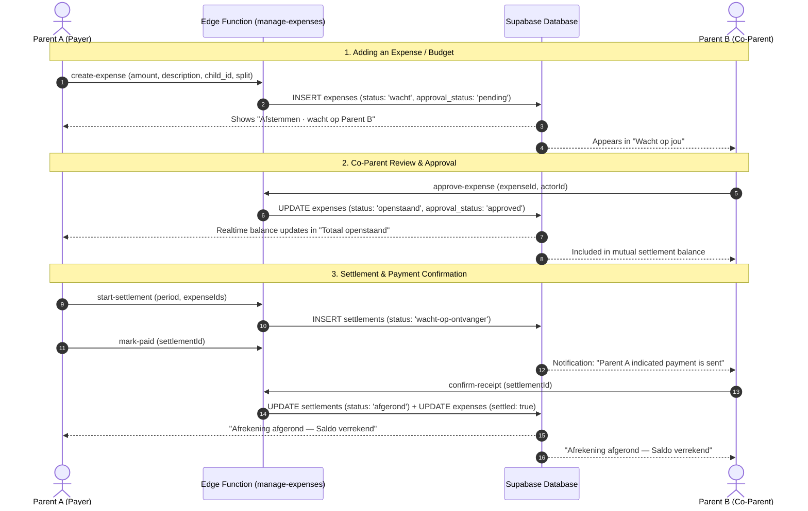

# Kosten (Expenses) & Financial Management — Lovable Parity & Dynamic Architecture Audit

**Document Version:** 1.0  
**Date:** October 31, 2026  
**Status:** Comprehensive Audit & Action Plan  
**Target File:** `src/routes/costs.jsx` and related components (`Afrekenen.jsx`, `BudgetVoorstel.jsx`, `VasteLasten.jsx`, `BonScanner.jsx`)

---

## 1. Domain Scope: Are Points 1–10 Related to Expenses?

**Yes, absolutely.** All 10 points submitted in the client feedback belong directly to the **Kosten & Saldo (Expenses, Budgets & Financial Settlements)** domain:

1. **Main Expenses Dashboard:** Real-time outstanding total (`Totaal openstaand`), directional debt statement, and settlement entry points.
2. **Quick Actions:** The 2x2 action grid (`Bonnetje scannen`, `Uitgave toevoegen`, `Budget voorstellen`, `Betaalverzoek`).
3. **Budget Proposals & Approvals:** Pre-purchase agreements with the 4-choice response flow (`Akkoord`, `Ander voorstel`, `Niet akkoord`, `Meer tijd nodig`), response tracking, and anti-tacit-approval rules.
4. **"Wacht op jou" Section:** The actionable attention hub for pending budgets, pending expense approvals, and agreed budget attachments.
5. **Budgets Overview:** The dedicated collapsible overview of planned and agreed budgets (`Schoolkamp groep 6`, `Sportkosten Noah`).
6. **Recurring Expenses & Savings Pots:** Fixed shared costs (`Vaste lasten`) and shared savings goals (`Spaarpotjes`), linked to children.
7. **Expense Distribution & Settlement:** Agreement splits (50/50, custom %), detailed calculation breakdown (`Bekijk berekening`), payment requests, and recipient confirmation.
8. **Expense History:** The expandable historical log (`Bekijk alle gemaakte kosten`) with multi-facet filters (Child, Category, Status, Period).
9. **Real Notifications & Dynamic Synchronization:** Live notifications and cross-account status updates between connected co-parents.
10. **Lovable UI & Component Preservation:** Reusing the proven Lovable component tree and visual structure instead of replacing it with a simplified or diverging layout.

---

## 2. Parity Audit: Client Screenshots vs. Current Code vs. Lovable Reference

| Section | Client Screenshot Reference (Lovable) | Current Implementation (`src/routes/costs.jsx`) | Gap / Action Required |
| :--- | :--- | :--- | :--- |
| **1. Header & Top Bar** | Circle back button `< Kosten`, dynamic subtitle `Uitgaven voor [Kind 1] & [Kind 2]`, Search icon, `...` dropdown menu. | Has page header, but missing the `...` menu with shortcuts to `Bekijk berekening`, `Historie van afrekeningen`, and `Verdeling & afrekenen`. | Restore Lovable header layout and dropdown menu. |
| **2. Totaal openstaand Card** | Clean card with green wallet icon, large bold amount `€ 106,95`, subtitle `Samen nog te verrekenen · 2 uitgaven`, explanation `Jij betaalt nog € 11,48 aan [Co-parent]`, and two side-by-side buttons: `Afrekenen` and `Bekijk berekening`. | Replaced by a gradient hero card with segmented pill switcher (`Deze maand / Dit jaar`), separate metric cards (`Totaal`, `Sanne (jij)`, `Joris`), and a percentage bar. | **High Priority:** Replace custom gradient card with the exact Lovable `Totaal openstaand` card. |
| **3. Quick Actions Grid** | 2x2 muted button grid: `Bonnetje scannen`, `Uitgave toevoegen`, `Budget voorstellen`, `Betaalverzoek`. | Action buttons exist, but manual entry opens a modal with heavy mandatory category fields. | **High Priority:** Connect `Uitgave toevoegen` to the streamlined Lovable bottom sheet (`Gemaakte kosten` vs `Nog nodig`). |
| **4. "Wacht op jou" Hub** | Unified attention section with items awaiting your action: 1) Budget proposals with 4 options (`Akkoord`, `Ander voorstel`, `Niet akkoord`, `Meer tijd nodig`); 2) Expenses awaiting agreement (`Extra zwemles`, `Schoolkamp Emma`). | Rendered inside an amber box with a custom layout and generic approval buttons. | **High Priority:** Implement the exact Lovable card structure and 4-button response group. |
| **5. Budgets Section** | Collapsible section with `-` toggle: `Budgetten` (`3 budgetten · 2 afgesproken`), description text, item rows with `Afgesproken >` tags, and a link to `Verdeling & afrekenen`. | Embedded at the bottom below all transactions, without collapsible toggle and status badges. | Position above Vaste lasten with exact collapsible UI and status badges. |
| **6. Vaste lasten** | Clean row: `Vaste lasten` (`3 vaste kosten · samen € 80,50 per maand >`). | Rendered as a heavy card with internal tables. | Replace with the clean summary row opening the details sheet. |
| **7. Spaarpotjes** | Clean row: `Spaarpotjes` (`Kinderpotje · € 100,00 van € 300,00 >`). | Completely missing from the main view. | Add the `Spaarpotjes` summary row and connect to database. |
| **8. Bekijk alle gemaakte kosten** | Single button at bottom: `Bekijk alle gemaakte kosten` with badge `7 · >` that expands to full filters & transaction list. | Currently renders search bar and transactions directly in the middle of the main screen, cluttering the view. | Move full transaction list to the bottom expandable card. |
| **9. Afrekenen & Settlement** | Multi-step settlement: 1) Payment link (Tikkie), 2) Bank transfer with reference, 3) Recipient confirmation ("Ik heb betaald" -> "Ik heb het bedrag ontvangen"). | Uses in-memory `kosten-store` fallback rather than Supabase `settlements` table. | Wire to Supabase Edge Function `manage-expenses` (action: `settle-expenses`). |
| **10. Berekening Scherm** | Exact breakdown: Total open, Your share, Co-parent share, Upfront paid by you, Upfront paid by co-parent, Net settlement calculation. | Exists in code, but needs verification with dynamic co-parent names and live numbers. | Verify and wire to live `berekenSaldo`. |

---

## 3. Co-Parent Dynamic Permissions & Data Flow

To ensure the co-parent permissions and confirmation flow works as required (*"if permission given to co-parent then show co-parent, coparent paid then confirmation"*):



### Key Business Rules Enforced:
1. **No Tacit / Automatic Approval:** A lack of response or an expired response date never counts as approval. Items remain open until explicitly acted upon.
2. **"Meer tijd nodig" (More Time Needed):** Records a postponement step in `budget_steps` without changing the agreement status. Both parents can see that more time was requested.
3. **Counterproposals:** If a parent chooses `Ander voorstel`, they can propose a different amount or arrangement. The turn to respond switches back to the proposing parent.
4. **Recipient-Confirmed Settlement:** A payer saying "I have paid" does not settle the debt. The payment is only marked as settled when the receiving parent confirms ("Ik heb het bedrag ontvangen").

---

## 4. Backend & Database Integration Matrix

All backend operations must comply with **Rule 1** (Supabase Edge Functions via `supabase.functions.invoke("manage-expenses", ...)`):

| Feature | Supabase Table | Edge Function Action | Status |
| :--- | :--- | :--- | :--- |
| **Fetch Expenses** | `expenses` | `list-expenses` | Exists in `cost-service.js` (enhance via Edge Function) |
| **Create Expense** | `expenses` | `create-expense` | Exists in `cost-service.js` (enhance via Edge Function) |
| **Approve Expense** | `expenses` | `approve-expense` | Implemented in `manage-expenses/index.ts` |
| **Reject / Counter Expense** | `expenses` | `reject-expense` | Implemented in `manage-expenses/index.ts` |
| **Save / List / Delete Drafts** | `expenses` | `save-draft`, `list-drafts`, `delete-draft` | Implemented in `manage-expenses/index.ts` |
| **Fetch Budget Proposals** | `budget_proposals` | `list-budget-proposals` | Exists in `cost-service.js` |
| **Create Budget Proposal** | `budget_proposals` | `create-budget-proposal` | Exists in `cost-service.js` |
| **Respond to Budget** | `budget_proposals` & `budget_steps` | `respond-budget-proposal` | Handles `agreed`, `rejected`, `more_time`, `counterproposal` |
| **Friendly Reminders** | `budget_proposals` & `budget_steps` | `send-reminder` | Max 1 before and max 1 after deadline enforced |
| **Start Settlement** | `settlements` | `start-settlement` | To be connected to Edge Function |
| **Confirm Settlement Receipt** | `settlements` & `expenses` | `confirm-settlement` | To be connected to Edge Function |
| **Recurring Expenses** | `recurring_expenses` | `list-recurring-expenses` | Table exists in `supabase/schema.sql` |
| **Savings Pots** | `savings_pots` | `list-savings-pots` | Table exists in `supabase/schema.sql` |

---

## 5. Step-by-Step Implementation Roadmap

### Step 1: Extend Edge Function `manage-expenses`
- Add handlers for `create-expense`, `settle-expenses`, `confirm-settlement`, `list-budget-proposals`, `create-budget-proposal`, `respond-budget-proposal`, `list-recurring-expenses`, `list-savings-pots`.
- Ensure strict service-role execution and RLS integrity.

### Step 2: Restructure `src/routes/costs.jsx` to Match Lovable Dashboard
- Replace the current gradient hero card with the **`Totaal openstaand`** card matching Screenshot 1.
- Place the **`Nieuw toevoegen`** 2x2 grid (`Bonnetje scannen`, `Uitgave toevoegen`, `Budget voorstellen`, `Betaalverzoek`).
- Re-order sections:
  1. `Totaal openstaand`
  2. `Nieuw toevoegen`
  3. `Wacht op jou` (with 4-action button response group)
  4. `Budgetten` (collapsible overview with status tags)
  5. `Vaste lasten` (summary row opening sheet)
  6. `Spaarpotjes` (summary row opening sheet)
  7. `Bekijk alle gemaakte kosten` (collapsible bottom card)

### Step 3: Implement Lovable `Nieuwe uitgave` Bottom Sheet
- Re-integrate the streamlined bottom sheet from `docs/client_latest_code/src/routes/kosten.tsx` (shown in `media_1793360268878_ec030ce0.png`):
  - Switch: `Gemaakte kosten` (Already bought) vs `Nog nodig` (To buy).
  - Clean inputs: Description, Amount, Paid by, Child selector, Split selector.
  - Optional receipt upload.
  - No mandatory category selection.

### Step 4: Wire Settlement & Recipient Confirmation
- Connect `Afrekenen.jsx` to Supabase `settlements` table.
- When payer pays -> marks `wacht-op-ontvanger`.
- When recipient logs in -> button "Ik heb het bedrag ontvangen" confirms settlement and archives expenses.

### Step 5: Verification & Production Build
- Verify English and Dutch translations in `src/locales/en/translation.json` and `src/locales/nl/translation.json`.
- Verify zero emojis (Lucide React icons only).
- Verify clean compilation with `npm run build`.

---

## 6. Budget Proposals & Response Flow: Step-by-Step Testing Guide

### How the Proposal & Approval Flow Works

1. **Creating a Budget Proposal (Father One)**:
   - Father One clicks **"Propose budget"** (`Budget voorstellen`) or `+ Proposal` in the Budgets section.
   - Enters: Title (e.g. *"test"*), Maximum amount (e.g. *€ 50,00*), Child (*Child 1*), Split (*25 / 75*), and optional notes.
   - System automatically sets:
     - `created_by = Father One's UUID`
     - `turn_to_respond = Mother's UUID` (auto-detected via connected co-parent)
     - `status = 'pending'`
     - Initial step recorded: `Father One: Proposal € 50,00`.

2. **What Father One Sees**:
   - Status tag: **"Awaiting response"** (`Wacht op antwoord`).
   - Friendly reminder action: **"Send friendly reminder"** (`Vriendelijke herinnering sturen`).
   - Father One does *not* see approval buttons because it is Mother's turn to respond.

3. **What Mother Sees**:
   - The proposal appears at the top under **"Waiting for you"** (`Wacht op jou`) with badge **"New budget proposal"** (`Nieuw budgetvoorstel`).
   - Mother sees the 4 action buttons:
     - **[ Agree ] (`Akkoord`)**: Accepts the proposed amount.
       - Status changes to **"Agreed budget"** (`Afgesproken budget`).
       - Unlocks the **"+ Add expense"** (`Uitgave toevoegen`) button so when the purchase is made, it can be linked directly.
     - **[ Counterproposal ] (`Ander voorstel`)**: Allows Mother to type an alternative amount (e.g. *€ 40,00*) and send it.
       - Proposal amount updates to *€ 40,00*.
       - `turn_to_respond` switches to Father One.
       - Now it appears in Father One's "Waiting for you" for Father One to accept, counter, or decline!
     - **[ Decline ] (`Niet akkoord`)**: Rejects the proposal.
       - Status updates to **"Declined"** (`Niet akkoord`).
     - **"Need more time" (`Meer tijd nodig`)**:
       - Adds a note to the step audit log: *"Mother: More time requested"*.
       - Proposal remains open without pressure.

4. **Recording the Actual Purchase for an Agreed Budget**:
   - Once a budget has status **"Agreed"**, either parent can click **"+ Add expense"** (`Uitgave toevoegen`) on that budget item.
   - The expense drawer opens pre-linked to that budget (`budget_id`).
   - Saving the expense saves it with `budget_id` and automatically updates the budget status to **"spent"** (`Uitgave geregistreerd`).

## 6. Feedback Audit & Resolution of User Screenshots (All Points)

### Issue A: Untranslated Dutch Strings in English Mode
- **Screenshot 1 (`media_1793453332242_fc1ae042.png`):** Moments modal milestone subtitle was hardcoded as `"Bijzondere herinnering of eerste keer"`.
  - **Fix:** Switched to `{t("momentjes.bijzondereHerinnering", "Bijzondere herinnering of eerste keer")}` which retrieves `"Special memory or first time"` in English.
- **Screenshots 2, 3, 4 (`media_1793453296313_60cf2f3b.png`, `media_1793453274444_c59505c8.png`, `media_1793452842009_a697002d.png`):**
  - Subtitle was displaying `Uitgaven voor Child 1, Child 2, Child 3 & Child 4`.
  - Budgets summary was displaying `0 budgetten · 0 afgesproken` even in English.
  - **Fix:** Added key `kosten.uitgavenVoorKinderen` (`"Expenses for {{names}}"`) and plural keys `kosten.budgettenSubtitel_other` (`"{{budgettenCount}} budgets · {{afsprakenCount}} agreed"`). Fallback is now dynamic (`isEn ? "Expenses for ..." : "Uitgaven voor ..."`).
- **Screenshot 5 (`media_1793452819219_f88ef0cf.png`):**
  - Filter dropdown options showed `Alle`.
  - Expense row status badge showed `→ Nog te verrekenen`.
  - **Fix:** Filter options now use `t("common.alle", "All")`. Status badge retrieves `t("kosten.nogTeVerrekenenStatus", "To be settled")`.

### Issue B: Child Selection Dropdown Rendering `& & &` (Screenshot 8 / `media_1793452586557_1035ea40.png`)
- **Root Cause:** In `FixedExpenses.jsx`, child objects from database or state can contain `.name` or `.naam`. The previous template mapped `c.name`, which was undefined for items using `naam`, producing empty strings and an option `& & &`.
- **Fix:** Updated child mapping across single options and combined option to `const cName = c.name || c.naam || "Child"`. Also guarded against empty combinations.

### Issue C: Settle Expenses (`Afrekenen`) Showing `€ 0,00` (Screenshot 6 / `media_1793451516743_4b693b63.png`)
- **Root Cause:** When clicking **"Settle up"** from the main dashboard, `<Afrekenen>` was rendered without receiving `customSaldo`, `user`, `coParents`, `dbSettlements`, or parent names. Consequently, it fell back to local memory costs where balance was 0.
- **Fix:** Passed `customSaldo={saldo}`, `userName`, `otherParentName`, `dbSettlements`, `openPosten`, `onReloadCosts` into `<Afrekenen>`. The calculation now properly presents the exact mutual amount (e.g. € 225,00) with dynamic payer/recipient labels.

### Issue D: Fixed Expenses (`Vaste lasten`) and Savings Jars (`Spaarpotjes`) Not Populated
- **Root Cause:** When `isLoggedIn = true`, the components filtered out mock demo entries but were not yet connected to the Supabase tables `recurring_expenses` and `savings_pots`.
- **Fix:** Wired `fetchRecurringExpenses`, `createRecurringExpense`, `deleteRecurringExpense`, `fetchSavingsPots`, `createSavingsPot`, and `contributeSavingsPot` in `costs.jsx` and `FixedExpenses.jsx`.

---

## 7. Step-by-Step Testing Guide: Accepting, Declining & Settling Payments

### Step 1: Adding & Approving an Expense
1. Log in as **Mother** (`moeder@ouderapp.nl` or demo Mother).
2. Go to **/costs** (`/kosten`).
3. Click **"Add expense"** (`Uitgave toevoegen`).
4. Enter Description: *"School supplies"*, Amount: *€ 50,00*, Child: *Child 1*, Split: *50 / 50*.
5. Save the expense.
   - For Mother: It shows under expenses with status **"Waiting for review"** (`Wacht op bevestiging`).
6. Log out and log in as **Father One** (`vader1@ouderapp.nl` or connected co-parent).
7. Go to **/costs**.
8. Notice the expense appears in the **"Waiting for you"** (`Wacht op jou`) section.
9. Click the expense item:
   - Click **"Agree"** (`Akkoord`) to confirm the expense.
   - Or click **"Disagree"** (`Niet akkoord`) if you do not agree.
10. Once **"Agree"** is clicked, the expense is officially confirmed:
    - Total outstanding balance updates to include Father's 50% share (€ 25,00).

### Step 2: Paying from Father to Mother & Settling the Debt
1. On **Father's** view, the dashboard banner says:
   `You pay € 225,00 to Mother` (or the updated balance).
2. Click the green button **"Settle up"** (`Afrekenen`).
3. The **"Settle expenses"** screen opens showing:
   - Amount: **€ 225,00**
   - Recipient: **Mother**
   - Status: **To be paid** (`Nog te betalen`)
4. Father chooses payment method:
   - **Method A (Payment Request):** If Mother shared a Tikkie / bank payment link, click **"Open payment request"** to pay directly.
   - **Method B (Bank transfer):** Father copies Mother's name and amount for his banking app.
   - **Method C (I have already paid):** Father clicks **"I have already paid"** (`Ik heb al betaald`).
     - This registers the payment and transitions the status to **"Payment reported by payer"** (`Wacht op bevestiging ontvanger`).
5. Log back in as **Mother**:
   - Mother sees the banner: *"Father indicated payment was made"*.
   - Mother clicks **"Settle up"** -> clicks **"I have received the amount"** (`Ik heb het bedrag ontvangen`).
   - The settlement status transitions to **"Completed"** (`Afgerond`), and all included expenses are marked as `settled = true`.
   - The outstanding balance returns to **€ 0,00**!

### Step 3: Fixed Expenses & Savings Jars
1. Go to **/costs** -> click **"Fixed expenses"** (`Vaste lasten`).
2. Click **"+ Add"**:
   - Enter *"Hockey membership"*, Amount: *€ 25,00*, Child: *Child 1*.
   - Click **"Save fixed expense"**.
   - It is saved to Supabase `public.recurring_expenses` and appears immediately.
   - Click the trash icon to delete whenever needed.
3. Click **"Savings jars"** (`Spaarpotjes`):
   - Click **"+ Add savings jar"**.
   - Enter *"Kids vacation"*, Target: *€ 300,00*.
   - Click **"Save savings jar"**.
   - Saved to Supabase `public.savings_pots`.
   - Click **"Record deposit"** (`Storting vastleggen`) to deposit funds.

---

## 8. New Lovable Feature: Linked Savings Account (`Spaarrekening koppelen`) for Savings Pots

From the latest Lovable design inspection (`localhost:8080/kosten` and `docs/client_latest_code/src/components/VasteLasten.tsx`), each savings pot now supports linking a dedicated savings account:

### UI & UX Flow:
1. Under each savings jar in **Piggy banks / Savings jars** (`Spaarpotjes`), an action button **"+ Link savings account"** (`+ Spaarrekening koppelen`) is displayed.
2. When clicked, an inline card opens:
   - **Account name:** `Account name, e.g. children's savings account` (`Naam rekening, bijv. Spaarrekening kinderen`).
   - **IBAN:** `IBAN, e.g. NL00 BANK 0123 4567 89` (`IBAN, bijv. NL00 BANK 0123 4567 89`), with real-time IBAN format validation.
   - **Safety disclaimer:** *"The app only stores account details as a reminder and does not move money itself."*
   - Buttons: **"Link account"** (`Rekening koppelen`) and **"Cancel"** (`Annuleren`).
3. Once linked:
   - Displays: `Linked savings account: [Account name] · [IBAN] [Disconnect]` (`Ontkoppelen`).
   - Clicking **"Disconnect"** unlinks the account and reverts to the `+ Link savings account` button.

### Database Schema & Edge Function:
- Database table: `public.savings_pots`
  - Added columns: `account_name TEXT`, `iban TEXT`.
- Edge Function `manage-expenses`:
  - Added action: `update-savings-pot-account` (`{ potId, account_name, iban }`).
- Service layer:
  - Added `updateSavingsPotAccount(potId, { account_name, iban })` in `cost-service.js`.

### SQL Query for Supabase SQL Editor:
```sql
ALTER TABLE public.savings_pots ADD COLUMN IF NOT EXISTS account_name TEXT;
ALTER TABLE public.savings_pots ADD COLUMN IF NOT EXISTS iban TEXT;
```

---

## 9. Layout, Chevron Icon Parity & Section Header Differentiation

### A. Full Desktop Width
- **Before:** The main costs dashboard container was constrained to `max-w-2xl lg:max-w-3xl`, creating an unnaturally narrow and cramped column on large screens.
- **After:** Expanded to `w-full max-w-5xl lg:max-w-6xl mx-auto space-y-6`, allowing cards and action grids to utilize the full desktop and tablet viewport comfortably.

### B. Unified Lucide Chevron Icons
- **Before:** `Budgets` and `View all expenses incurred` used raw text characters (`›` / `–`), while `Fixed expenses` used Lucide React `<ChevronRight />` / `<ChevronDown />`.
- **After:** All sections now uniformly use Lucide React `<ChevronRight className="size-4 text-ink-soft shrink-0" />` (when collapsed) and `<ChevronDown className="size-4 text-ink-soft shrink-0" />` (when expanded).

### C. Differentiated Header Section for Open Accordions / Tabs
- **Before:** When a section was opened, the header and list content shared the same background with no boundary line, making it hard to identify where the header ends and the list begins.
- **After:** When opened, each section is wrapped in a rounded card (`rounded-2xl border border-border bg-card shadow-2xs overflow-hidden`):
  - **Header Section:** Styled with a distinct background (`bg-muted/40 px-4 py-3 border-b border-border/80`) and active chevron indicator.
  - **List Content Section:** Framed cleanly below (`p-4 bg-card/40`), providing clear visual hierarchy and separation between section titles, controls, and list items.


