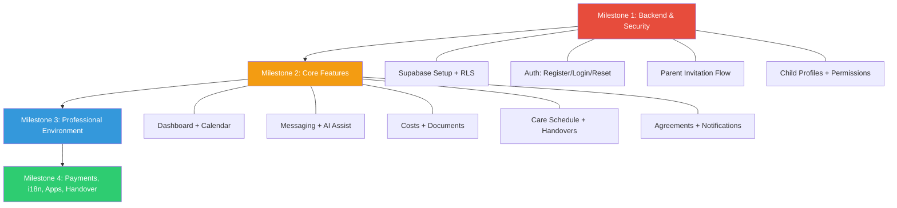

# Ouderschap & Co — Developer Implementation Brief Analysis

> Source: [`Ouderschap_Co_Developer_Brief_No_Costing_Timeline.docx`](file:///d:/ouderapp/docs/Ouderschap_Co_Developer_Brief_No_Costing_Timeline.docx)

---

## 1. What the Client Wants — Executive Summary

Ouderschap & Co is a **Dutch co-parenting web/mobile application** for separated parents who share responsibility for their children. The client wants to **continue development on the existing Lovable-built codebase** — not rebuild from scratch — and make all features operational with **real backend-backed data, proper security, and responsive design**.

### Core Vision
- **"Uit elkaar. Samen ouders."** — Apart. Together parents.
- A premium, warm, calming app for co-parenting — NOT a legal/institutional tool.
- Suitable for ALL separated parents, not only high-conflict situations.
- Mobile-first, responsive across mobile → tablet → desktop.

### Non-Negotiable Principles
| # | Principle | Detail |
|---|-----------|--------|
| 1 | **Preserve existing code** | Reuse screens, components, design, branding, colours, navigation — never replace with a simplified version |
| 2 | **Real data, real permissions** | No static/hardcoded demo behaviour treated as complete; everything backed by a database |
| 3 | **Privacy first** | Private parent information stays private; sharing is never automatic when parents connect |
| 4 | **Responsive design** | Mobile design preserved; desktop/tablet use available screen space (not just a narrow mobile column) |
| 5 | **Independent usage** | A parent can use the app fully without the other parent joining |

---

## 2. What Was Agreed — Conversation & Decisions

Based on the brief, the following decisions were made between the client and the development team (Kretoss Technology):

### Ownership & Infrastructure
| Decision | Detail |
|----------|--------|
| Code ownership | Client owns all source code and project materials |
| Repository | Client controls the private GitHub repository |
| Backend | Supabase (client's account) — with Row Level Security (RLS) |
| Hosting | Client controls hosting accounts |
| Developer access | Kretoss Technology receives developer access as needed |
| Commits | Source code committed regularly to client's GitHub repo |

### AI Integration Decisions
| Decision | Detail |
|----------|--------|
| AI provider | OpenAI API |
| Account | Client's own OpenAI account (client retains cost control) |
| Key storage | Backend secrets only — never in frontend/browser |
| Use cases | Constructive-tone rewriting, communication assistance |
| Cost controls | Per-user limits, monthly budget alerts, application-level usage caps |
| Scaling estimates | Must review costs at 100, 1,000, and 10,000 active users |
| Privacy | Send only required data; review logging, retention, consent |

### Explicit Exclusions (Not in Current Phase)
| Exclusion | Note |
|-----------|------|
| ❌ Audio/video calling | Not included |
| ❌ AI call transcriptions | Not included |
| ❌ AI-generated call summaries | Not included |
| ❌ Email sync into messaging | No automatic reading of personal email conversations (email *notifications/invitations* are fine) |

### Delivery & Acceptance Rules
- Each milestone must work with **real data and permissions** before client testing
- Never silently remove or simplify an in-scope feature — raise it with the client first
- **1-month post-delivery bug-fix period** (bugs in agreed functionality only; new features separate)
- Full source code and project handover at completion

---

## 3. Milestone Breakdown — What Needs to Be Implemented

### Milestone 1 — Backend, Security, Registration, Parent Linking, Shared Child Profiles

**Status: ⏳ Needs Implementation**

#### Developer Checklist

| # | Task | Status | Relevant Existing Code |
|---|------|--------|----------------------|
| 1 | Review existing Lovable codebase (frontend, routing, data models, auth, integrations) | ⏳ | [`src/routes/`](file:///d:/ouderapp/src/routes), [`src/lib/`](file:///d:/ouderapp/src/lib) |
| 2 | Set up / complete backend & database structure | ⏳ | Supabase — not yet connected |
| 3 | User registration, login, logout, password reset, secure sessions | ⏳ | Auth flow needed |
| 4 | Independent parent accounts (use app without connecting another parent) | ⏳ | [`start-store.ts`](file:///d:/ouderapp/src/lib/start-store.ts), [`solo.tsx`](file:///d:/ouderapp/src/routes/solo.tsx) |
| 5 | Parent invitation & connection flows (status, acceptance) | ⏳ | [`uitnodiging.tsx`](file:///d:/ouderapp/src/routes/uitnodiging.tsx) |
| 6 | Create/manage child profiles before other parent joins | ⏳ | [`kinderen.$kindId.tsx`](file:///d:/ouderapp/src/routes/kinderen.$kindId.tsx) |
| 7 | Multiple child profiles (no DB uniqueness errors) | ⏳ | [`kinderen.index.tsx`](file:///d:/ouderapp/src/routes/kinderen.index.tsx) |
| 8 | Explicit access permissions for shared child data | ⏳ | [`kring-store.ts`](file:///d:/ouderapp/src/lib/kring-store.ts), [`export-rechten.ts`](file:///d:/ouderapp/src/lib/export-rechten.ts) |
| 9 | Private notes/info separate — never auto-shared | ⏳ | Privacy model needed |
| 10 | Supabase RLS policies | ⏳ | Database layer |
| 11 | Full E2E test: register → create child → invite → accept → authorize → access | ⏳ | Test suite |
| 12 | Error states, refresh/re-login, duplicates, unauthorized access, multi-child tests | ⏳ | Edge case testing |

#### Acceptance Criteria (Milestone 1)
- [ ] Parent can register and use app independently
- [ ] Parent can create/manage child profiles without other parent
- [ ] Invitation & parent-connection flow works end-to-end
- [ ] After connection, each parent sees only authorized shared data
- [ ] Private notes/info remain private
- [ ] Multiple child profiles without DB errors
- [ ] Available for client testing with real persisted data

---

### Milestone 2 — Core Parent-Facing Functionality

**Status: ⏳ Needs Implementation (UI exists, needs backend connection)**

#### Developer Checklist

| # | Feature | Existing UI File | Status |
|---|---------|-----------------|--------|
| 1 | Home dashboard & overview | [`index.tsx`](file:///d:/ouderapp/src/routes/index.tsx) | UI exists → connect to backend |
| 2 | Calendar & parenting schedules | [`agenda.tsx`](file:///d:/ouderapp/src/routes/agenda.tsx) | UI exists → connect to backend |
| 3 | Parent-to-parent messaging | [`berichten.tsx`](file:///d:/ouderapp/src/routes/berichten.tsx) | UI exists → connect to backend |
| 4 | AI communication assistance | [`coach.functions.ts`](file:///d:/ouderapp/src/lib/coach.functions.ts), [`samenvatting.functions.ts`](file:///d:/ouderapp/src/lib/samenvatting.functions.ts) | Needs OpenAI integration |
| 5 | Child profiles & authorized shared info | [`kinderen.$kindId.tsx`](file:///d:/ouderapp/src/routes/kinderen.$kindId.tsx) | UI exists → connect to backend |
| 6 | Expenses, receipts, cost management | [`kosten.tsx`](file:///d:/ouderapp/src/routes/kosten.tsx) | UI exists → connect to backend |
| 7 | Tasks & shared responsibilities | [`taken.tsx`](file:///d:/ouderapp/src/routes/taken.tsx) | UI exists → connect to backend |
| 8 | Belongings/items for handovers | [`spullen.tsx`](file:///d:/ouderapp/src/routes/spullen.tsx) | UI exists → connect to backend |
| 9 | Handovers & agreements | [`overdracht.tsx`](file:///d:/ouderapp/src/routes/overdracht.tsx), [`wissel.tsx`](file:///d:/ouderapp/src/routes/wissel.tsx) | UI exists → connect to backend |
| 10 | Holidays & special occasions | [`bijzondere-dagen.ts`](file:///d:/ouderapp/src/lib/bijzondere-dagen.ts) | UI exists → connect to backend |
| 11 | Agreements, decisions, proposals | [`afspraken.tsx`](file:///d:/ouderapp/src/routes/afspraken.tsx), [`beslissingen.tsx`](file:///d:/ouderapp/src/routes/beslissingen.tsx) | UI exists → connect to backend |
| 12 | Documents & file management | [`documenten.tsx`](file:///d:/ouderapp/src/routes/documenten.tsx) | UI exists → connect to backend |
| 13 | Positive updates & shared moments | [`momentjes.tsx`](file:///d:/ouderapp/src/routes/momentjes.tsx) | UI exists → connect to backend |
| 14 | Family members & authorized caregivers | [`kring.$kindId.tsx`](file:///d:/ouderapp/src/routes/kring.$kindId.tsx) | UI exists → connect to backend |
| 15 | Notifications & reminders | Notification system needed | ⏳ |
| 16 | Solo-parent workflows | [`solo.tsx`](file:///d:/ouderapp/src/routes/solo.tsx) | UI exists → connect to backend |
| 17 | Care schedule (zorgregeling) | [`zorgregeling.tsx`](file:///d:/ouderapp/src/routes/zorgregeling.tsx) | UI exists → connect to backend |

#### Acceptance Criteria (Milestone 2)
- [ ] Every in-scope feature works with real data (full CRUD)
- [ ] Shared features respect parent-connection & child-sharing permissions
- [ ] Private/solo data not exposed without authorization
- [ ] Responsive on mobile, tablet, desktop (desktop uses available space)
- [ ] Loading / empty / error states tested
- [ ] Available for client testing before approval

---

### Milestone 3 — Professional Environment

**Status: ⏳ Future Phase**

| Feature | Existing UI | Notes |
|---------|------------|-------|
| Professional Dashboard | [`professionals.tsx`](file:///d:/ouderapp/src/routes/professionals.tsx) (84KB!) | Large existing UI |
| Super Admin Dashboard | — | Needs design + build |
| Professional case management | [`pro-journaal-store.ts`](file:///d:/ouderapp/src/lib/pro-journaal-store.ts) | Store exists |
| Professional dossier per family | [`exporteren.tsx`](file:///d:/ouderapp/src/routes/exporteren.tsx) | Export exists |

### Milestone 4 — Monetization, i18n, Final Delivery

**Status: ⏳ Future Phase**

| Feature | Notes |
|---------|-------|
| Stripe subscriptions (plans, payments, access management) | [`abonnement.ts`](file:///d:/ouderapp/src/lib/abonnement.ts) stub exists |
| Dutch & English language support | Currently Dutch only |
| AI functionality completion | Remaining AI features |
| iOS & Android apps | Web → native (Capacitor or similar) |
| Integration testing & bug fixing | Full test pass |
| Final client testing & handover | Documentation + accounts |

---

## 4. Current Codebase Mapping

### Architecture Overview
```
ouderapp/
├── src/
│   ├── routes/         # 46 route files (TanStack Router)
│   ├── lib/            # 55 store/utility files
│   ├── components/     # UI components
│   ├── hooks/          # React hooks
│   ├── assets/         # Static assets
│   ├── router.tsx      # Router config
│   ├── server.ts       # Server entry
│   └── styles.css      # Global styles
├── docs/               # This brief
├── roadmap.md          # Feature roadmap (120 items, mostly ✅)
├── AGENTS.md           # Development rules
└── package.json        # Dependencies
```

### Key Stores (State Management)
| Store | Purpose |
|-------|---------|
| [`start-store.ts`](file:///d:/ouderapp/src/lib/start-store.ts) | Onboarding, own-family state |
| [`kring-store.ts`](file:///d:/ouderapp/src/lib/kring-store.ts) | Circle (family/caregiver) access & permissions |
| [`zorg-store.ts`](file:///d:/ouderapp/src/lib/zorg-store.ts) | Care schedules & change proposals |
| [`kosten-store.ts`](file:///d:/ouderapp/src/lib/kosten-store.ts) | Expenses |
| [`taken-store.ts`](file:///d:/ouderapp/src/lib/taken-store.ts) | Tasks & items between homes |
| [`audit-store.ts`](file:///d:/ouderapp/src/lib/audit-store.ts) | Change history (append-only) |
| [`pro-journaal-store.ts`](file:///d:/ouderapp/src/lib/pro-journaal-store.ts) | Professional journal |
| [`afspraken-store.ts`](file:///d:/ouderapp/src/lib/afspraken-store.ts) | Agreements |
| [`vakantie-store.ts`](file:///d:/ouderapp/src/lib/vakantie-store.ts) | Holidays |
| [`gesprekken-store.ts`](file:///d:/ouderapp/src/lib/gesprekken-store.ts) | Conversations |
| [`nu-afstemmen-store.ts`](file:///d:/ouderapp/src/lib/nu-afstemmen-store.ts) | Time-sensitive coordination |
| [`export-rechten.ts`](file:///d:/ouderapp/src/lib/export-rechten.ts) | Export visibility rights |

---

## 5. Developer Working Rules (from Client Brief)

> [!CAUTION]
> These rules are contractual — violating them is a delivery risk.

1. **Inspect existing code first** — before refactoring or replacing components
2. **Preserve working functionality** and visual identity unless a change is needed for responsiveness or agreed functionality
3. **No hard-coded sample data as production** — never claim a feature is complete without E2E testing
4. **Never weaken access policies** to make a screen work — fix the underlying data relationships and authorization
5. **Document configuration** and integration steps for the client to manage their own accounts and costs
6. **Raise out-of-scope concerns** with the project lead — do not silently omit or simplify features

---

## 6. Priority Implementation Order



---

## 7. Gap Analysis — What Exists vs What's Needed

| Layer | Current State | What's Needed |
|-------|--------------|---------------|
| **Frontend UI** | ✅ Extensive (46 routes, 55 stores) | Minor responsive tweaks for desktop |
| **State Management** | ✅ In-memory stores with demo data | 🔴 Migrate to Supabase-backed persistence |
| **Authentication** | ❌ No real auth | 🔴 Supabase Auth (email/password, magic link) |
| **Database** | ❌ No real database | 🔴 Supabase PostgreSQL + RLS policies |
| **Parent Linking** | ❌ Simulated only | 🔴 Real invitation/acceptance flow |
| **Permissions** | ✅ Permission model in stores | 🟡 Enforce server-side with RLS |
| **AI Integration** | ✅ Function stubs exist | 🟡 Connect to OpenAI API on backend |
| **Professional Portal** | ✅ Large UI exists (84KB route) | 🟡 Connect to backend (Milestone 3) |
| **Payments** | ⚪ Stub exists | ⏳ Stripe integration (Milestone 4) |
| **i18n** | ⚪ Dutch only | ⏳ English support (Milestone 4) |
| **Native Apps** | ⚪ Web only | ⏳ iOS/Android (Milestone 4) |
