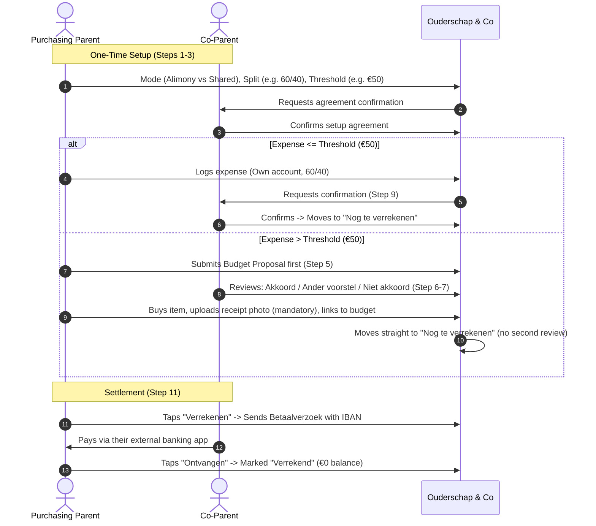

# Technical Analysis & Engineering Answers: `catootje11-attachments_2`

> **Target Package:** `docs/ouderapp_docs/catootje11-attachments_2/`  
> **Source Documents Analyzed:**
> 1. `Co-and-Lastige-momenten-for-Kretoss.pdf` (13 pages, Version 2)
> 2. `Kosten-workflow-Kretoss-v3.pdf` (15 pages, Version 3)
> 3. `Layout-and-style-guide-Kretoss.pdf` (14 pages, Version 1.3 - English)
> 4. `Wisselmoment-workflow-Kretoss-v2.pdf` (9 pages, Version 2)  
> **Date:** November 16, 2026  
> **Context:** Direct answers from client (@Tony) to Kretoss engineering questions (Questions 4, 5, Style & Handovers)

---

## Table of Contents

1. [Executive Summary: Why This Package Exists](#1-executive-summary-why-this-package-exists)
2. [Document 1: Co & Lastige Momenten (`Co-and-Lastige-momenten-for-Kretoss.pdf`)](#2-document-1-co--lastige-momenten-co-and-lastige-momenten-for-kretosspdf)
3. [Document 2: Costs Workflow v3 (`Kosten-workflow-Kretoss-v3.pdf`)](#3-document-2-costs-workflow-v3-kosten-workflow-kretoss-v3pdf)
4. [Document 3: Layout & Style Guide v1.3 (`Layout-and-style-guide-Kretoss.pdf`)](#4-document-3-layout--style-guide-v13-layout-and-style-guide-kretosspdf)
5. [Document 4: Handover Workflow v2 (`Wisselmoment-workflow-Kretoss-v2.pdf`)](#5-document-4-handover-workflow-v2-wisselmoment-workflow-kretoss-v2pdf)
6. [Critical Architecture Decisions for Kretoss](#6-critical-architecture-decisions-for-kretoss)
7. [Developer Implementation Checklist](#7-developer-implementation-checklist)

---

## 1. Executive Summary: Why This Package Exists

`catootje11-attachments_2` contains the **definitive engineering specifications** prepared specifically for the **Kretoss Technology** development team.

When Kretoss reviewed the initial brief, technical questions were raised regarding how costs should be split, how the AI features connect to the 40 situation cards, the exact design tokens for Style A6, and the end-to-end handover workflow. The client provided concrete answers in these 4 documents:

```mermaid
graph TD
    subgraph catootje11-attachments_2 (Final Engineering Specs)
        D1[Co-and-Lastige-momenten-for-Kretoss.pdf] -->|Answers Q5| AI[AI Grounding, 3 Time Horizons & Voice Pipeline]
        D2[Kosten-workflow-Kretoss-v3.pdf] -->|Answers Q4| FIN[16-Step Cost Workflow, Grensbedrag & External Pay]
        D3[Layout-and-style-guide-Kretoss.pdf] -->|Leading Guide| STYLE[Style A6 Tokens, Components & Child Palette]
        D4[Wisselmoment-workflow-Kretoss-v2.pdf] -->|Handover Flow| TRANS[11-Step Handover, 48h Checklist & Verification]
    end
```

---

## 2. Document 1: Co & Lastige Momenten (`Co-and-Lastige-momenten-for-Kretoss.pdf`)

Answers Kretoss's **Question 5** regarding the implementation of AI features and the help library.

### 2.1 Key Clarifications for Kretoss
- **Terminology:** In the user interface, **never show the word "kaart"** (card). It is always called a **"moment"** (*"Meer tips bij dit moment"*, *"Bewaarde momenten"*). The JSON key remains `cards`.
- **AI vs. Fixed Content Split:** The 40 moments are **100% fixed, pre-written text** (clinically reviewed). The AI **never invents new advice**. Co only acts as a search indexer (matching the parent's query to a moment) or a sounding board in chat.
- **Sensory Breathing (Pocket Haptics):** In addition to visual breathing, the app includes **"Voelen" (Feel)** mode:
  - 4s long continuous vibration (inhale through nose)
  - 6s intermittent soft pulses (exhale through mouth)
  - Allows a parent standing at the co-parent's front door to de-escalate with the phone inside their pocket, even with the screen off.

### 2.2 Three Time Horizons

```
[1. Het gebeurt nu]     -> 10-second readability at the door. 1 action step, 1 spoken sentence, 
                           child age toggle (Samen vs 4-8, 9-12, 13+), big Breathe button.
[2. Het komt eraan]     -> Evening before handover prep. Pick a grounding phrase, check packing list.
[3. Het is net gebeurd] -> Post-handover check-in (1h after). Rustig / Ging wel / Lastig / Heftig.
                           Private venting in 'Schrijf het van je af'.
```

### 2.3 Grounded Search & LLM Pipeline
1. On-device native Speech-to-Text.
2. Safety keyword check (violence/threats/self-harm -> route to hardcoded crisis UI).
3. Anger keyword check (`boos`, `woede`, `kwaad`, `schreeuw`, `ontplof`, `razend`) -> prepend *Even stoppen*.
4. Embeddings + keyword scoring over the 40 moments.
5. If top match $\ge$ threshold: call LLM (temperature 0.3) injecting the moment JSON, child names, and ages.
6. Validation: output strict JSON (`safety`, `source_card_ids`, `opening`, `do_now`, `say`, `kid_line`, `next_step`). `do_now` capped at max 2 items of max 25 words each; zero exclamation marks; zero occurrences of *"moet"*.
7. If validation fails: fallback to static quick tips from the JSON.

---

## 3. Document 2: Costs Workflow v3 (`Kosten-workflow-Kretoss-v3.pdf`)

Answers Kretoss's **Question 4** regarding expense logging, budget approvals, and settlements.

### 3.1 Strict Client Decision: Do NOT Build a Fixed 50/50 Split
> [!IMPORTANT]
> **Client Directive to Kretoss:**  
> *"About your suggestion to split everything equally: please do not build a fixed 50/50. Parents set their own fixed split once (for example 60/40). For each expense they can still choose 50/50 or 'fully my own' instead."*

### 3.2 Four Fundamental Invariants
1. **Child Account (`Kindrekening`):** Informational only; **never settled in-app**.
2. **Own Account (`Mijn eigen rekening`):** Settled based on chosen split, but **only if pre-approved or confirmed**.
3. **Threshold (`Grensbedrag`):** Above threshold (e.g., €50), a **budget proposal is mandatory in advance**—even when purchasing from the child account.
4. **No Agreement = Sole Liability:** If an expense lacks agreement or is rejected (*Niet akkoord*), it is 100% the purchaser's personal expense and cannot be settled.

### 3.3 The 16-Step Lifecycle Summary



- **Settlement Execution:** The app does not process credit cards or native bank debits. Tapping *"Betaalverzoek sturen"* generates a payment request with the creditor parent's IBAN and copy buttons. Parents execute the transfer in their own bank app.
- **Tab 2 — Nog Nodig:** Items can have pre-agreed budgets before purchase. Tapping *"Gekocht"* pre-fills the expense form. If actual spending exceeds budget, the reviewer can approve the difference or settle only the agreed amount.

---

## 4. Document 3: Layout & Style Guide v1.3 (`Layout-and-style-guide-Kretoss.pdf`)

The authoritative design reference. Every screen must follow **Style A6 ("Zacht verloop" / Soft Gradient)**.

### 4.1 Master Design Tokens

| Token | Value / Spec | Applied UI Elements |
| :--- | :--- | :--- |
| **Background Gradient** | Linear Gradient: `#DCE6D2` → `#F3EDE3` → `#EADBC7` (170°) | Full-screen background across all main screens |
| **Glass Card** | `rgba(255, 255, 255, 0.62)`, border `rgba(255, 255, 255, 0.80)`, blur 18 px | Containers, list rows, form cards |
| **Moss (Primary Action)** | `#4F6B58` | Primary button, round `+` button, active tab text |
| **Moss Dark** | `#3F5747` | High-contrast text on sage, today indicator ring, line icons |
| **Sage** | `#DCE3D3` | Active tab fill, handover status pills, "Zeg bijvoorbeeld" bubbles |
| **Oat** | `#E4D5C7` | Informational cards, soft callouts |
| **Lint Lines** | User: `#6E8A76` \| Co-parent: `#A88B72` | Handover timeline bar on Home screen |
| **Private Grey** | `#E3DBCF` (with lock icon) | Private calendar appointments |
| **Calendar Striping** | White with diagonal 135° stripes (`#F2ECE3`) | Days without children |

### 4.2 The 6 Fixed Earthy Child Colors
Parents assign one color per child during onboarding. Colors have uniform luminance:

| Child Color | Dot Hex | Pill Background | Text / Label Hex |
| :--- | :---: | :---: | :---: |
| **Old Rose (Oudroze)** | `#C77D8C` | `#F3E1E4` | `#7A3B48` |
| **Dusty Blue (Stoffig blauw)** | `#5A80A8` | `#DFE8F1` | `#2E4A68` |
| **Ochre (Oker)** | `#C99A3C` | `#F5EBD3` | `#6E5014` |
| **Sea Green (Zeegroen)** | `#3F8A80` | `#D9ECE8` | `#1F5049` |
| **Plum (Pruim)** | `#875A86` | `#EDE0EC` | `#4E2F4D` |
| **Terracotta** | `#C46A4C` | `#F5DFD6` | `#73341F` |

*Constraint: Disallow turquoise or neon primary colors.*

### 4.3 Typography Pairing
- **Nunito (Google Fonts):** Weights 400, 700, 800, 900 for all functional UI, headers, inputs, and navigation.
- **Lora Italic 500:** Strictly reserved for warm personal phrases:
  - Greetings: *"Goedemorgen, Sanne"* (27 px)
  - Co prompts: *"Vertel maar wat er speelt..."* (25–27 px)
  - Child perspective: *"Door de ogen van je kind"* (19 px)
  - Monthly encouragement: *"Je doet het goed."* (25 px)

### 4.4 Component Hierarchy
- **Single Primary Button Rule:** Exactly **one main button** (`#4F6B58`, height 54, pill) per screen, placed 104 px above screen bottom. Secondary actions use glass pills or text links.
- **Floating Navigation Bar:** Height 68 px, white 85% opacity, radius 999, elevated 16 px from screen perimeter.
- **Top-Right `+` Action:** 48 × 48 px round moss button opens a bottom sheet (*"Wat wil je toevoegen?"*).

---

## 5. Document 4: Handover Workflow v2 (`Wisselmoment-workflow-Kretoss-v2.pdf`)

Defines the 11-step end-to-end lifecycle for physical child transitions and packing checklists (*Mee met de wissel*).

### 5.1 Roles
- **Handing-Over Parent (*Overdragende ouder*):** Parent currently with the child; **packs the physical bag**.
- **Receiving Parent (*Ontvangende ouder*):** Parent receiving the child; **verifies items upon arrival**.

### 5.2 The 11-Step Lifecycle
1. **Step 1 – Fixed Moments in Agenda:** Day, time, location, brings/picks up, parent. Co-parent confirms (*Klopt / Klopt niet*).
2. **Step 2 – Fixed Items per Child:** Recurring essentials (comfort toy, pajamas, meds). Both parents can edit.
3. **Step 3 – Appointment Items:** When creating a calendar event (e.g. Saturday swimming lesson), parents fill the optional *Neem mee* field.
4. **Step 4 – Rescheduling (*Wissel verschuiven*):** Proposed date shifts dynamically rebuild the packing checklist window upon mutual agreement.
5. **Step 5 – 48-Hour Automated Assembly:** The system compiles the list from 3 sources: fixed items, upcoming appointment items, and items missed last time. Push: *"De lijst voor vrijdag staat klaar"*.
6. **Step 6 – Receiving Parent Ad-Hoc Request:** Receiving parent can add items (*"Verzoek van [naam]"*).
7. **Step 7 – Evening Reminder:** Push the evening before (*"Morgen wissel. Klopt de lijst?"*), suppressed during quiet hours.
8. **Step 8 – Packing Execution:** Parent ticks items as packed (*"2 van 5 ingepakt"*).
9. **Step 9 – The Handover Moment:** Displayed on Home via timeline lint.
10. **Step 10 – Post-Handover Verification:** 1 hour post-handover, the receiving parent receives: *"Is alles meegekomen?"*. Marks items *Ontvangen* or *Niet meegekomen*.  
    👉 **Critical Rule: Items marked "Niet meegekomen" are automatically queued onto the next handover checklist!**
11. **Step 11 – Archiving & Deletion:** Calendar moments stay forever; packing checklists are purged after 1 month.

---

## 6. Critical Architecture Decisions for Kretoss

The guide lists **10 final architectural decisions** that settle earlier ambiguities:

1. **Lastige Momenten Location:** Exists under Co, not as a top-level menu item. Cards are termed **"momenten"** (*"Meer tips bij dit moment"*).
2. **Universal Counter-Offer Naming:** Use **"Ander voorstel"** everywhere across calendar, costs, and proposals. The word *"Tegenvoorstel"* is banned.
3. **Settlement Mechanism:** Payment requests via IBAN external to the app. Zero native in-app payment card processing.
4. **Multiple Co-Parents:** Family structures support multiple co-parents; calendar displays exceptions to custody rules.
5. **No Truncation Ellipses:** Long names fade out softly with a gradient mask; never end with "...".
6. **Menu Structure:** Direct shortcuts removed. Care schedules live under Calendar `+`. *Nog nodig* is moved under *Kosten*. Historical photos retain the name **"Momentjes"**.
7. **Packing Checklist Access:** Displayed under *Nog te regelen* starting 48h before handover, and via the handover icon in the Home timeline lint. No separate card on Home.
8. **Co Access:** Co is on Home top-right and in Menu; in Messages as the inline *"Schrijf met Co"* button. **No persistent floating Co button over list views**.
9. **Warm Coach Voice:** Co speaks as a warm friend using *"ik"* and *"je"*. Input bar consistently says: *"Spreek maar in, ik luister."*.
10. **Child Palette:** Strictly limited to the 6 earthy tones. Turquoise is disallowed.

---

## 7. Developer Implementation Checklist

### For Mobile Frontend Developers
- [ ] Set up the Style A6 linear gradient background (`#DCE6D2` → `#F3EDE3` → `#EADBC7`).
- [ ] Implement the 68 px floating pill navigation bar with 16 px margins.
- [ ] Enforce the 6 fixed child colors and disallow turquoise.
- [ ] Build the 3-mode cost setup and default expense entries to *Kindrekening*.
- [ ] Build the 48-hour automated packing checklist engine with *Ontvangen* / *Niet meegekomen* verification.

### For Backend & Database Developers
- [ ] Create the `CostSettings` schema with `mode` (1 or 2), `split_parent_a`, `split_parent_b`, and `approval_threshold`.
- [ ] Enforce that expenses paid from `Kindrekening` have `is_settled: false` and are excluded from balance clearing.
- [ ] Implement automated carry-over: items flagged `received: false` in a handover checklist must automatically be inserted into the next handover's checklist.
- [ ] Implement checklist instance TTL deletion after 30 days while preserving parent calendar events permanently.

### For AI & Prompt Engineers
- [ ] Implement the grounded AI search pipeline: on-device speech-to-text $\rightarrow$ safety filter $\rightarrow$ anger trigger check $\rightarrow$ grounded JSON generation (temperature 0.3).
- [ ] Enforce JSON response validation (`safety`, `source_card_ids`, `opening`, `do_now`, `say`, `kid_line`, `next_step`).
- [ ] Dynamic child name injection: format kid lines with child names (`"Rust tussen jullie is rust voor Emma en Noah"`).
