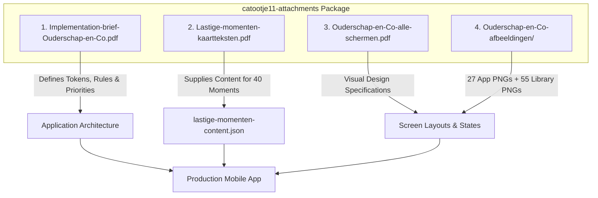
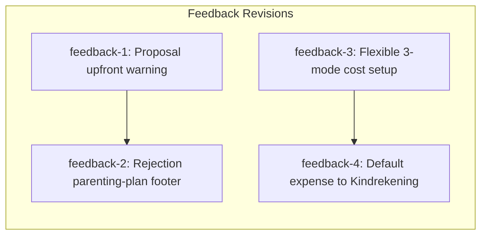

# Comprehensive Technical Analysis: Ouderschap & Co (`catootje11-attachments`)

> **Target Package:** `docs/ouderapp_docs/catootje11-attachments/`  
> **Source Documents Analyzed:**
> 1. `Implementation-brief-Ouderschap-en-Co.pdf` (10 pages)
> 2. `Lastige-momenten-kaartteksten.pdf` (25 pages)
> 3. `Ouderschap-en-Co-alle-schermen.pdf` (93 pages)
> 4. `Ouderschap-en-Co-afbeeldingen/` (82 high-resolution UI screen & card PNGs)  
> **Author:** @Tony  
> **Target Audience:** Engineering Team (Full-Stack, Mobile iOS/Android, UI/UX, QA)  
> **Status:** Foundational Product & Technical Specification

---

## Table of Contents

1. [Package Architecture & Hierarchy of Truth](#1-package-architecture--hierarchy-of-truth)
2. [Dutch-to-English Domain Dictionary](#2-dutch-to-english-domain-dictionary)
3. [Visual Style System & Design Tokens](#3-visual-style-system--design-tokens)
4. [The 10 Core Features (Must vs. Should Priorities)](#4-the-10-core-features-must-vs-should-priorities)
5. [Complete UI Screen Catalog (Part 1: Screens 001–025, 16b, 17b)](#5-complete-ui-screen-catalog-part-1-screens-001025-16b-17b)
6. [Lastige Momenten Architecture, Search & Data Model](#6-lastige-momenten-architecture-search--data-model)
7. [The 40 Cards Clinical Catalog & Stress-Event Mapping](#7-the-40-cards-clinical-catalog--stress-event-mapping)
8. [Feedback Revisions & Architectural Invariants](#8-feedback-revisions--architectural-invariants)
9. [Developer Action Plan & Implementation Sequence](#9-developer-action-plan--implementation-sequence)

---

## 1. Package Architecture & Hierarchy of Truth

The `catootje11-attachments` package constitutes the foundational baseline for the redesign and functional expansion of **Ouderschap & Co**. It introduces an earth-toned visual identity, a completely restructured Home dashboard, an on-device emotional first-aid library (*Lastige momenten*), a de-escalating messaging suite, and a legally grounded proposal workflow.



### Hierarchy of Precedence
When discrepancies arise between artifacts, the following hierarchy strictly governs:
1. **The Implementation Brief wins over design mockups:** If an image depicts a component or behavior differing from the brief, implement what the brief specifies.
2. **The Card Texts (`Lastige-momenten-kaartteksten.pdf`) win over the brief on wording:** Specific Dutch text and phrasing on situation cards take precedence over brief summaries.
3. **Language Invariant:** All in-app copy **must remain in Dutch**. English translations in the documentation are provided exclusively for engineering clarity.

### Critical Client Layout Directives
- **Screen 004 is Deprecated:** Screen `004-lastige-momenten.png` in the early screen numbering is an obsolete draft. It is **superseded by screens 023–025** and the cards in `2 Lastige momenten/`.
- **Layout Canonical Reference (Screens 001–012 vs. 013–025):** Screens 001–012 feature the new color palette but still use the older rectangular geometry. **Screens 013–025 are the canonical reference** for the target layout (floating pill navigation, floating Co button, 20–28 px corner radii, glass container styling). This modern layout must be applied consistently across all screens.

---

## 2. Dutch-to-English Domain Dictionary

The app is deployed entirely in Dutch. The table below provides the authoritative glossary for all domain concepts:

| Dutch Term | English Meaning | Architectural Role & Context |
| :--- | :--- | :--- |
| **Lastige momenten** | Difficult moments | Help library providing actionable micro-guidance in stressful situations |
| **Onderwerp / Moment (Kaart)** | Topic / Moment (Card) | Content taxonomy. In UI, always use *"moment"* (never show *"kaart"*) |
| **Waar loop je tegenaan?** | What are you struggling with? | Search bar placeholder text |
| **Vaak gezocht** | Frequently searched | Fast-tap search chips for frequent conflict situations |
| **Deze passen het best** | Best matches | Search results section header (capped at top 5 matches) |
| **Ik luister / Klaar** | I'm listening / Done | On-device voice input active listening state & completion action |
| **Bewaar / Bewaard** | Save / Saved | Bookmarking cards to *Mijn houvast* (stored locally on device) |
| **Kort antwoord** | Short answer | 1–2 sentence grounding summary at top of moment |
| **Wat je kunt doen** | What you can do | Numbered actionable steps (max 5) |
| **Zeg bijvoorbeeld** | Say, for example | Recommended verbatim sentences in green speech bubbles |
| **Zeg liever niet** | Better not say | Harmful escalatory sentences in sand blocks (never colored red) |
| **Onthoud** | Remember | Single grounding thought |
| **Hulp zoeken als** | Get help if | Escalation guidance to professional care |
| **Volgende vraag** | Next question | Navigation link to related moments |
| **Even stoppen** | Pause for a moment | Acute de-escalation intervention screen when angry |
| **Na een heftig moment** | After a heated moment | 3-step restorative reflection flow (Rust, Goedmaken, Voornemen) |
| **Avondmodus** | Evening mode | Warm dark theme (`#1F1D1A`) after 21:00 for heated moments |
| **Sparren met Co** | Talk it through with Co | AI-assisted coaching sheet / thinking partner |
| **Even praten** | Just talk | Open conversational coaching |
| **Een bericht schrijven** | Write a message | BIFF/EAR assisted message rewriting |
| **Houvast / Houvast instellen** | Support / Support settings | Personal coping mechanism & notification settings |
| **Overdracht / Wissel** | Handover between parents | Physical custody transition of children between households |
| **Mee met de wissel** | Take along at handover | Shared packing and item checklist per handover (replaces *Spullen*) |
| **Vaste spullen** | Fixed items | Baseline recurring items per child |
| **Nog kopen / Gekocht** | Still to buy / Bought | Items requiring purchase under *Kosten* (replaces *Nog nodig*) |
| **Kosten / Uitgaven** | Costs / Expenses | Financial module |
| **Betaald van** | Paid from | Payment origin selector (*Kindrekening* vs *Eigen rekening*) |
| **Kindrekening** | Child account | Joint bank account for children; never settled in-app |
| **Eigen rekening** | Own account | Personal account; eligible for settlement based on split |
| **Alimentatie / Ouderbijdrage** | Child support / Maintenance | Monthly recurring support payments |
| **Verrekenen** | Settle up | Clearing net balance between parents |
| **Budget voorstellen** | Propose a budget | Advance approval workflow for expenses above threshold |
| **Wijziging voorstellen** | Propose a schedule change | Requesting schedule adjustments |
| **Het ouderschapsplan blijft leidend** | Parenting plan remains leading | Fundamental legal invariant: proposals require mutual consent |
| **Ouderschapsplan** | Parenting plan | Legally binding parenting agreement |
| **Bij jou / Bij [Naam]** | With you / With [Name] | Custody allocation labels |
| **Rustmodus / Stille uren** | Quiet mode / Quiet hours | Do-not-disturb notification window |
| **Snel iets afstemmen** | Quick urgent message | High-priority message bypassing quiet hours |
| **Veiligheid & hulp** | Safety and help | Emergency contacts panel (112, Veilig Thuis 0800-2000, 113) |

---

## 3. Visual Style System & Design Tokens

The new style uses warm earthy tones, soft translucent surfaces, and generous corner radii to induce calmness.

### 3.1 Color Palette Tokens

| Token Name | Hex Code | Applied UI Elements |
| :--- | :--- | :--- |
| `linen` | `#F3EDE3` | Primary page background |
| `card` | `#FBF8F2` | Card surfaces, input containers, navigation background |
| `moss` | `#4F6B58` | Primary CTA buttons, active state indicators, Co button, checkmarks |
| `moss-dark` | `#3F5747` | High-contrast text on sage backgrounds, line icons, today indicator |
| `sage` | `#DCE3D3` | "With you" calendar days, highlighted cards, "Zeg bijvoorbeeld" speech bubbles |
| `taupe` | `#E4D5C7` | "With other parent" calendar days, "Onthoud" reminder block |
| `clay` | `#EBD3C4` | Small accent badges, notification and item counters |
| `stone` | `#E6DFD3` | Neutral information blocks, secondary filter chips |
| `text` | `#26211D` | Primary titles, body text |
| `muted` | `#5C5650` | Secondary metadata text, sub-labels, input placeholders |

### 3.2 Design Rules & Invariants
- **Zero Alarm Colors:** No yellow anywhere. No red or terracotta for the other parent's custody days (red triggers anxiety and reads as a danger warning).
- **Dark Green Balance:** Dark green (`moss` / `moss-dark`) is restricted to primary buttons, interactive active states, and small accents; never apply as solid background fills over large areas.
- **Typography:** **Nunito** (Google Fonts, weights 400 to 900) for all functional UI. Titles are 28–32 px at weight 900.
- **Corner Radii:** Cards: 20–28 px; Buttons, chips, and pills: 999 px (fully rounded).
- **Floating Navigation:** Pill-shaped floating bar elevated 16 px above the screen edge.
- **Floating Co Button:** Positioned bottom-right above the navigation bar. Must be hidden when Co is actively open or during the *Na een heftig moment* flow.
- **Evening Theme:** For *Na een heftig moment*, offer warm dark brown (`#1F1D1A`) with light sage accents after 21:00.
- **Tone & Copy Style:** Short, calm sentences. No exclamation marks, no emoji, and no diminutives.

---

## 4. The 10 Core Features (Must vs. Should Priorities)

The brief divides functionality into **Must** (immediate next release) and **Should** (subsequent release):

| # | Feature | Priority | Associated Screens | Functional Specification |
| :-: | :--- | :-: | :--- | :--- |
| **1** | **Lastige momenten (Redesign)** | **Must** | 023–025, 40 Cards | On-device voice input and text search at top; 6 *Vaak gezocht* chips; 6 topics; 40 cards; local bookmarking; anger word interception. |
| **2** | **Wijziging voorstellen + Status** | **Must** | 016, 16b | Pre-proposal notice stating changes require mutual consent, otherwise parenting plan applies. Optional reason field. On rejection, display expandable info banner *"Het ouderschapsplan blijft leidend"*. |
| **3** | **Kosten: Multi-Mode Handling** | **Must** | 017, 17b | 3 financial modes: (1) Child account & alimony only, (2) Child account + shared large expenses above threshold, (3) Share all extra costs. Adding expense defaults to *Kindrekening*. |
| **4** | **Co Button & Sparren met Co** | **Must** | 013, 014 | Floating button opening bottom sheet: large input field, large microphone, 4 shortcuts (*Even praten*, *Bericht schrijven*, *Na een heftig moment*, *Even stoppen*), AI privacy link. |
| **5** | **Na een heftig moment** | **Should** | 010–012 | 3-step restorative flow: Rust (4 thoughts), Goedmaken (child or co-parent scripts), Een klein voornemen (small goal with optional 3-day reminder). Evening mode support. |
| **6** | **Co & je privacy** | **Must** | 018 | Privacy screen: disclosures on data processing, 3 explicit toggles (use app data, keep local chats, tips from Co), hard deletion action (*"Alle gesprekken met Co verwijderen"*). |
| **7** | **Houvast instellen** | **Should** | 020 | Support configuration hub: 9 independent toggles in 4 groups (pause on sharp message, daily 18:00 bundle, handover prep, meeting prep, etc.). Strictly private. |
| **8** | **Mee met de wissel** | **Should** | 021 | Shared packing checklist per handover replacing *Spullen*: recurring items, one-off additions, return items. Linked directly to Home and Agenda. |
| **9** | **Nog kopen (Tab in Kosten)** | **Must** | 022 | Replaces *Nog nodig*. Specifies designated purchaser and budget proposals. Tapping *"Gekocht"* moves item to expenses or adds it to the next handover packing list. |
| **10** | **Agenda Colours, Home & Menu** | **Must** | 013, 015, 019 | "With you" = sage, "With other parent" = taupe. Retain handover timeline bar on Home. Redesigned Home dashboard and cleaned-up Menu. |

---

## 5. Complete UI Screen Catalog (Part 1: Screens 001–025, 16b, 17b)

The 27 core application screens are documented below, with direct links to high-resolution PNG assets in `docs/ouderapp_docs/catootje11-attachments/Ouderschap-en-Co-afbeeldingen/1 App-schermen/`:

```mermaid
graph TD
    subgraph Communication & Calming (001-012)
        S01[001 Berichten] --> S02[002 Even wachten]
        S01 --> S08[008 Schrijf met Co]
        S03[003 Co Mic] --> S07[007 Co antwoordt]
        S05[005 Even stoppen] --> S06[006 Ademhalen]
        S09[009 Veiligheid Crisis]
        S10[010 Rust] --> S11[011 Goedmaken] --> S12[012 Voornemen]
    end

    subgraph Canonical App Layout (013-025)
        S13[013 Home Hero] --> S14[014 Sparren Sheet]
        S13 --> S15[015 Agenda]
        S15 --> S16[016 Niet akkoord]
        S15 --> S16b[016b Voorstel doen]
        S13 --> S17[017 Uitgave toevoegen]
        S17 --> S17b[017b Kosten regelen]
        S17 --> S22[022 Nog kopen]
        S13 --> S19[019 Menu] --> S20[020 Houvast instellen]
        S19 --> S18[018 Co & Privacy]
        S13 --> S21[021 Mee met de wissel]
        S13 --> S23[023 Lastige mom. Overzicht] --> S24[024 Onderwerp] --> S25[025 Kaart detail]
    end
```

### Screen Details & Asset Links

1. **[001-berichten-twee-kleine-knoppen.png](file:///d:/ouderapp_new/docs/ouderapp_docs/catootje11-attachments/Ouderschap-en-Co-afbeeldingen/1%20App-schermen/001-berichten-twee-kleine-knoppen.png)**  
   *Messaging thread:* Houses two discreet helper pills below the text input: *"Even wachten"* and *"Schrijf met Co"*. Provides calm intervention without condescension.
2. **[002-even-wachten-voor-je-verstuurt.png](file:///d:/ouderapp_new/docs/ouderapp_docs/catootje11-attachments/Ouderschap-en-Co-afbeeldingen/1%20App-schermen/002-even-wachten-voor-je-verstuurt.png)**  
   *Cooling-off delay sheet:* Allows holding a drafted message for 15 minutes, until 20:00, or until 08:00 tomorrow morning. Can be cancelled or edited at any point.
3. **[003-co-met-microfoon.png](file:///d:/ouderapp_new/docs/ouderapp_docs/catootje11-attachments/Ouderschap-en-Co-afbeeldingen/1%20App-schermen/003-co-met-microfoon.png)**  
   *Voice input sheet:* Centered microphone button with status *"Ik luister, vertel maar wat er speelt..."*. Transcribes audio locally on-device.
4. **`004-lastige-momenten.png` [DEPRECATED]**  
   *Obsolete draft:* Replaced by screens 023–025.
5. **[005-even-stoppen.png](file:///d:/ouderapp_new/docs/ouderapp_docs/catootje11-attachments/Ouderschap-en-Co-afbeeldingen/1%20App-schermen/005-even-stoppen.png)**  
   *De-escalation pause screen:* Rendered when anger is detected. Grounding message: *"Je voelt je boos... Je hoeft nu niets te beslissen of te versturen"*. Actions: *Even ademhalen* and *Schrijf het van je af*.
6. **[006-even-ademhalen.png](file:///d:/ouderapp_new/docs/ouderapp_docs/catootje11-attachments/Ouderschap-en-Co-afbeeldingen/1%20App-schermen/006-even-ademhalen.png)**  
   *Guided breathing:* Full-screen expanding/contracting circle (4s inhale through nose, 6s exhale through mouth, 5 rounds). No navigation bar.
7. **[007-co-antwoordt.png](file:///d:/ouderapp_new/docs/ouderapp_docs/catootje11-attachments/Ouderschap-en-Co-afbeeldingen/1%20App-schermen/007-co-antwoordt.png)**  
   *Co conversational response:* Grounded reply following the 3-step anatomy (Reflect, 1 practical question, idea only when asked).
8. **[008-een-bericht-schrijven-met-co.png](file:///d:/ouderapp_new/docs/ouderapp_docs/catootje11-attachments/Ouderschap-en-Co-afbeeldingen/1%20App-schermen/008-een-bericht-schrijven-met-co.png)**  
   *BIFF message rewrite:* Shows original draft, calm 3–5 sentence revision, and summary of changes (*Wat is veranderd*). Parent reviews and approves.
9. **[009-veiligheid.png](file:///d:/ouderapp_new/docs/ouderapp_docs/catootje11-attachments/Ouderschap-en-Co-afbeeldingen/1%20App-schermen/009-veiligheid.png)**  
   *Emergency crisis screen:* Static non-AI screen with immediate one-tap calling buttons: **112** (Direct danger), **Veilig Thuis 0800-2000**, and **113 Zelfmoordpreventie**.
10. **[010-na-een-heftig-moment-rust.png](file:///d:/ouderapp_new/docs/ouderapp_docs/catootje11-attachments/Ouderschap-en-Co-afbeeldingen/1%20App-schermen/010-na-een-heftig-moment-rust.png)**  
    *Step 1 (Rust):* 4 calming reflection cards to help a parent ground themselves after conflict.
11. **[011-na-een-heftig-moment-goedmaken.png](file:///d:/ouderapp_new/docs/ouderapp_docs/catootje11-attachments/Ouderschap-en-Co-afbeeldingen/1%20App-schermen/011-na-een-heftig-moment-goedmaken.png)**  
    *Step 2 (Goedmaken):* Script options for repairing tension toward the child or co-parent (*Zeg bijvoorbeeld* / *Zeg liever niet*).
12. **[012-na-een-heftig-moment-een-klein-voornemen.png](file:///d:/ouderapp_new/docs/ouderapp_docs/catootje11-attachments/Ouderschap-en-Co-afbeeldingen/1%20App-schermen/012-na-een-heftig-moment-een-klein-voornemen.png)**  
    *Step 3 (Voornemen):* Commit to one small realistic intention for the next 3 days, with optional private reminder notification.
13. **[013-home-aardse-stijl-met-co-knop.png](file:///d:/ouderapp_new/docs/ouderapp_docs/catootje11-attachments/Ouderschap-en-Co-afbeeldingen/1%20App-schermen/013-home-aardse-stijl-met-co-knop.png)**  
    *Canonical Home screen:* 8 layers top to bottom:
    1. Header (Notification bell, profile avatar; no logo).
    2. Lora greeting (*"Fijne middag, Sanne"*).
    3. Child initial chips with assigned colors.
    4. *Vandaag* card with handover timeline lint (moss for user, taupe for co-parent, swap icon on handover day).
    5. *Mee met de wissel* progress pill (*"2 van 4 ingepakt"*).
    6. *Binnenkort* (next 2 calendar items side-by-side).
    7. *Nog te regelen* (pending tasks counter).
    8. Floating Co button & floating navigation bar.
14. **[014-sparren-met-co-vanuit-de-co-knop.png](file:///d:/ouderapp_new/docs/ouderapp_docs/catootje11-attachments/Ouderschap-en-Co-afbeeldingen/1%20App-schermen/014-sparren-met-co-vanuit-de-co-knop.png)**  
    *Co quick-launch sheet:* Large text field, large microphone, 4 shortcuts (*Even praten*, *Bericht schrijven*, *Na een heftig moment*, *Even stoppen*), and privacy link.
15. **[015-agenda-met-nieuwe-kleuren.png](file:///d:/ouderapp_new/docs/ouderapp_docs/catootje11-attachments/Ouderschap-en-Co-afbeeldingen/1%20App-schermen/015-agenda-met-nieuwe-kleuren.png)**  
    *Calendar:* Days with user = soft green fill (`#E9EFE3`) + moss border; days with co-parent = white with soft stripes (`#F2ECE3`). Handover day = dashed outline with `⇄ 14:30`.
16. **[016-wijziging-niet-akkoord-ouderschapsplan.png](file:///d:/ouderapp_new/docs/ouderapp_docs/catootje11-attachments/Ouderschap-en-Co-afbeeldingen/1%20App-schermen/016-wijziging-niet-akkoord-ouderschapsplan.png)**  
    *Schedule rejection view:* If co-parent rejects a change, display the grounding banner: *"Het ouderschapsplan blijft leidend"* with expandable `(i)` info.
17. **[16b-wijziging-voorstellen-vooraf-ouderschapsplan-leidend.png](file:///d:/ouderapp_new/docs/ouderapp_docs/catootje11-attachments/Ouderschap-en-Co-afbeeldingen/1%20App-schermen/16b-wijziging-voorstellen-vooraf-ouderschapsplan-leidend.png)**  
    *Schedule proposal creation:* Pre-proposal disclaimer managing expectations: *"Een wijziging geldt alleen als jullie het allebei eens zijn..."*. Optional reason field.
18. **[017-uitgave-toevoegen-betaald van.png](file:///d:/ouderapp_new/docs/ouderapp_docs/catootje11-attachments/Ouderschap-en-Co-afbeeldingen/1%20App-schermen/017-uitgave-toevoegen-betaald-van.png)**  
    *Add expense screen:* Clear account toggle between *Kindrekening* (never settled) and *Eigen rekening* (split-settled). Defaults to *Kindrekening*.
19. **[17b-hoe-regelen-jullie-de-kosten.png](file:///d:/ouderapp_new/docs/ouderapp_docs/catootje11-attachments/Ouderschap-en-Co-afbeeldingen/1%20App-schermen/17b-hoe-regelen-jullie-de-kosten.png)**  
    *Cost setup onboarding:* 3 handling modes: (1) Child account & alimony only, (2) Combination with threshold, (3) Share all extra costs.
20. **[018-co-je-privacy.png](file:///d:/ouderapp_new/docs/ouderapp_docs/catootje11-attachments/Ouderschap-en-Co-afbeeldingen/1%20App-schermen/018-co-je-privacy.png)**  
    *Privacy controls:* Transparent disclosures with 3 toggles (use app data, keep local chats, allow tips from Co) and a permanent deletion button (*"Alle gesprekken met Co verwijderen"*).
21. **[019-menu-opgeruimd.png](file:///d:/ouderapp_new/docs/ouderapp_docs/catootje11-attachments/Ouderschap-en-Co-afbeeldingen/1%20App-schermen/019-menu-opgeruimd.png)**  
    *Tidied Menu:* Search bar at top, 3 customizable shortcuts, clean grouping under *Samen regelen*, *Ons gezin*, and *Houvast*.
22. **[020-houvast-instellen-priv.png](file:///d:/ouderapp_new/docs/ouderapp_docs/catootje11-attachments/Ouderschap-en-Co-afbeeldingen/1%20App-schermen/020-houvast-instellen-priv.png)**  
    *Support settings (Private):* 9 independent feature toggles (message quiet pause, 18:00 daily bundle, handover check-in, etc.). Strictly invisible to co-parent.
23. **[021-mee-met-de-wissel-vanaf-home-en-agenda.png](file:///d:/ouderapp_new/docs/ouderapp_docs/catootje11-attachments/Ouderschap-en-Co-afbeeldingen/1%20App-schermen/021-mee-met-de-wissel-vanaf-home-en-agenda.png)**  
    *Handover packing checklist:* Replaces *Spullen*. Groups items into *Vaste dingen*, *Deze keer*, and *Terug naar jou*. Linked to Home and Agenda.
24. **[022-kosten-nog-kopen.png](file:///d:/ouderapp_new/docs/ouderapp_docs/catootje11-attachments/Ouderschap-en-Co-afbeeldingen/1%20App-schermen/022-kosten-nog-kopen.png)**  
    *Nog kopen tab in Kosten:* Replaces *Nog nodig*. Specifies designated buyer and budget proposal status.
25. **[023-lastige-momenten-overzicht-doorklikbaar.png](file:///d:/ouderapp_new/docs/ouderapp_docs/catootje11-attachments/Ouderschap-en-Co-afbeeldingen/1%20App-schermen/023-lastige-momenten-overzicht-doorklikbaar.png)**  
    *Help library master overview:* Search bar with mic, 6 *Vaak gezocht* chips, 6 topic cards with counters, and *Bewaarde momenten* bookmark shortcut.
26. **[024-lastige-momenten-onderwerp.png](file:///d:/ouderapp_new/docs/ouderapp_docs/catootje11-attachments/Ouderschap-en-Co-afbeeldingen/1%20App-schermen/024-lastige-momenten-onderwerp.png)**  
    *Topic category view:* Displays all questions belonging to a topic with saved bookmark indicators.
27. **[025-lastige-momenten-kaart.png](file:///d:/ouderapp_new/docs/ouderapp_docs/catootje11-attachments/Ouderschap-en-Co-afbeeldingen/1%20App-schermen/025-lastige-momenten-kaart.png)**  
    *Moment card detail:* Complete moment view with question, short answer, action steps, say bubbles, avoid blocks, grounding quote, and bottom action bar (*Adem*, *Denk mee met Co*, *Bewaar*).

---

## 6. Lastige Momenten Architecture, Search & Data Model

The objective of *Lastige momenten* is to give an upset parent the exact answer and sentence they need within seconds, without browsing through long lists.

### 6.1 Search & Speech Pipeline
1. **Search Bar:** Prominently positioned at the top in a moss-colored container with hint *"Typ of spreek in wat er speelt"*.
2. **On-Device Voice Transcription:** Tapping the microphone launches speech-to-text natively on-device. Raw audio never leaves the phone. While listening, the screen displays the *"Ik luister"* card with an example prompt and *"Klaar"* submit button.
3. **Anger Keyword Interception:** If the input contains anger words (`boos`, `woede`, `kwaad`, `schreeuw`, `ontplof`, `razend`), the system **must render the "Eerst even stoppen" card at the very top**, above all search results.
4. **Scoring & Ranking Algorithm:**
   - Full query match in card `question` or `short_answer`: **6 points**
   - Word match in `question`: **3 points**
   - Word match in `short_answer`: **1 point**
   - Synonym table match by position: **[5, 4, 3, 2] points**
   - Display at most **5 results**, labeled *"Deze passen het best"*.
5. **Zero Results Fallback:** Renders *"Niets gevonden"* and offers a direct CTA button: *"Vertel het aan Co"*.
6. **Quick Chips (*Vaak gezocht*):** 6 configurable chips that populate the search field in one tap:
   - *"Ik ben heel boos"*
   - *"Scherp bericht"*
   - *"Kind wil niet mee"*
   - *"Te laat bij de wissel"*
   - *"Nieuwe partner"*
   - *"Discussie over geld"*

### 6.2 Moment Entity Data Schema

All 40 cards must be loaded from `lastige-momenten-content.json` conforming to this schema:

```typescript
interface MomentCard {
  id: number;                   // 1–40 (permanent and stable)
  topic: TopicEnum;             // Overdracht | Mijn kind vertelt iets | Als ik boos ben | 
                                // Praten met de ander | Voor mezelf | Bijzondere momenten
  question: string;             // Card title in parent's voice
  short_answer: string;         // 1–2 sentences core answer
  actions: string[];            // 'Wat je kunt doen' steps (max 5)
  say: string[];                // 'Zeg bijvoorbeeld' verbatim phrases
  avoid: string[];              // 'Zeg liever niet' escalation phrases
  remember: string;             // 'Onthoud' core grounding line
  get_help?: string;            // 'Hulp zoeken als' (null if not applicable)
  co_action: CoActionEnum;      // verhaal | doen | praten | bericht | afspraken | stoppen
  keywords: string[];           // Search synonyms
  reviewed_at: string;          // Professional clinical review date
}
```

---

## 7. The 40 Cards Clinical Catalog & Stress-Event Mapping

`Lastige-momenten-kaartteksten.pdf` contains the complete copy for all 40 cards across 6 topics. The cards are grounded in research from the Dutch Children's Ombudsman and the Dutch Youth Institute (NJi), which proves children suffer most from overt parental conflict, loyalty conflicts, and hearing negative remarks about the other parent.

### 7.1 Stress Event Mapping Matrix

| High-Conflict Scenario | When It Occurs | Cards Linked | UI Touchpoints |
| :--- | :--- | :---: | :--- |
| **Spanning of discussie bij de overdracht** | Every handover | **1, 2, 4, 17** | *Mee met de wissel*, *Home* |
| **Kind huilt of wil niet mee** | Young kids, post-holidays | **3, 8, 21** | *Mee met de wissel* |
| **De ander is te laat of komt niet opdagen** | Handover days | **17** | *Agenda*, *Wisselmoment* |
| **Nieuwe partner van de ander bij overdracht** | New relationship | **18, 34** | *Agenda*, *Wisselmoment* |
| **Belangrijke spullen of medicijnen vergeten** | Handover days, illness | **19** | *Mee met de wissel* |
| **Kind komt thuis met negatief verhaal over ander** | Returning from co-parent | **5, 6** | *Co* conversational sheet |
| **Kind vraagt wie er schuld heeft aan scheiding** | First months, milestones | **7** | *Co* conversational sheet |
| **Kind voelt zich schuldig als het gezellig is** | Ongoing | **20, 22** | *Co* conversational sheet |
| **Kind wil zelf kiezen waar het woont** | Adolescents (age 12+) | **23** | *Voorstellen*, *Ouderschapsplan* |
| **Kind speelt ouders tegen elkaar uit** | Older children | **24** | *Berichten* |
| **Boosheid over andere ouder als kind erbij is** | After conflict | **9, 10** | *Even stoppen* de-escalation |
| **Scherp bericht van de andere ouder** | Late evenings | **12, 25** | *Berichten*, *Verstuur later* |
| **Jaloezie of pijn om nieuwe partner van de ander** | New relationship | **26** | *Co* conversational sheet |
| **Geen reactie op een vraag / wachten** | Planning coordination | **14** | *Berichten* |
| **Wijziging gevraagd, ander niet akkoord** | Holidays, vacations | **27** | *Voorstellen*, *Ouderschapsplan* |
| **Discussie over kosten of alimentatie** | Large expenses, January | **28, 29** | *Kosten*, *Nog kopen* |
| **Grote beslissing (school, zorg, buitenland)** | Major life choices | **30, 35** | *Voorstellen*, *Documenten* |
| **Eenzaamheid / stil huis als kinderen weg zijn** | Alternating weekends | **31, 32** | *Voor mezelf* hub |
| **Ouder voelt zich overweldigd / trekt het niet** | Acute burnout | **16** | *Veiligheid & hulp* |

---

### 7.2 Catalog of All 40 Cards

High-resolution PNG cards are located in `Ouderschap-en-Co-afbeeldingen/2 Lastige momenten/` (`kaart-01.png` to `kaart-40.png`).

#### Deel 1: Overdracht (Handovers) — 7 Cards
- **[kaart-01.png](file:///d:/ouderapp_new/docs/ouderapp_docs/catootje11-attachments/Ouderschap-en-Co-afbeeldingen/2%20Lastige%20momenten/kaart-01.png) · Kaart 1:** *Hoe zet ik mijn frustratie opzij tijdens de overdracht?*  
  Focus on the few minutes at the door. Keep conversation brief and factual. Say: *"Fijn weekend, we zien elkaar zondag weer."* Avoid: *"Hopelijk gaat het deze keer wel goed."*
- **[kaart-02.png](file:///d:/ouderapp_new/docs/ouderapp_docs/catootje11-attachments/Ouderschap-en-Co-afbeeldingen/2%20Lastige%20momenten/kaart-02.png) · Kaart 2:** *Wat doe ik als de ander bij de overdracht een discussie begint?*  
  Do not engage at the door in front of the child. Say: *"Laten we dit niet nu doen waar de kinderen bij zijn. Ik stuur je vanavond een berichtje."*
- **[kaart-03.png](file:///d:/ouderapp_new/docs/ouderapp_docs/catootje11-attachments/Ouderschap-en-Co-afbeeldingen/2%20Lastige%20momenten/kaart-03.png) · Kaart 3:** *Mijn kind wil niet mee bij de overdracht, huilt of klampt zich vast. Wat doe ik?*  
  Transitions are tough. Acknowledge sadness briefly but keep farewell loving and short. Long goodbyes amplify anxiety.
- **[kaart-04.png](file:///d:/ouderapp_new/docs/ouderapp_docs/catootje11-attachments/Ouderschap-en-Co-afbeeldingen/2%20Lastige%20momenten/kaart-04.png) · Kaart 4:** *De overdracht ging mis en ik voel me kwaad. Wat nu?*  
  Do not message the co-parent immediately. Take 5 deep breaths, write thoughts in *Schrijf het van je af*, and wait until tomorrow.
- **[kaart-17.png](file:///d:/ouderapp_new/docs/ouderapp_docs/catootje11-attachments/Ouderschap-en-Co-afbeeldingen/2%20Lastige%20momenten/kaart-17.png) · Kaart 17 (Nieuw):** *De ander is te laat of komt niet opdagen. Wat doe ik?*  
  Stay calm for the child. Send a factual text after 15 minutes. Frame waiting positively to protect the child from feeling rejected.
- **[kaart-18.png](file:///d:/ouderapp_new/docs/ouderapp_docs/catootje11-attachments/Ouderschap-en-Co-afbeeldingen/2%20Lastige%20momenten/kaart-18.png) · Kaart 18 (Nieuw):** *De nieuwe partner van de ander is bij de overdracht. Hoe ga ik daarmee om?*  
  Greet politely; keep 100% of focus on the child. Your parental bond can never be replaced.
- **[kaart-19.png](file:///d:/ouderapp_new/docs/ouderapp_docs/catootje11-attachments/Ouderschap-en-Co-afbeeldingen/2%20Lastige%20momenten/kaart-19.png) · Kaart 19 (Nieuw):** *Er is iets belangrijks vergeten, zoals medicijnen of schoolspullen. Wat nu?*  
  Mistakes happen in two households. Coordinate practical pickup without blaming. Add it to *Mee met de wissel*.

#### Deel 2: Mijn kind vertelt iets (Child Tells Me Something) — 9 Cards
- **[kaart-05.png](file:///d:/ouderapp_new/docs/ouderapp_docs/catootje11-attachments/Ouderschap-en-Co-afbeeldingen/2%20Lastige%20momenten/kaart-05.png) · Kaart 5:** *Mijn kind komt thuis met een negatief verhaal over de andere ouder. Wat zeg ik?*  
  Listen without taking sides. Validate feelings without criticizing the co-parent: *"Dat klinkt niet fijn voor je. Heb je dat ook aan papa verteld?"*
- **[kaart-06.png](file:///d:/ouderapp_new/docs/ouderapp_docs/catootje11-attachments/Ouderschap-en-Co-afbeeldingen/2%20Lastige%20momenten/kaart-06.png) · Kaart 6:** *Mijn kind zegt iets negatiefs over mij, en zegt dat de ander dat zei. Wat doe ik?*  
  Do not get defensive. Reassure the child calmly of your love. Your steady behavior proves the story false.
- **[kaart-07.png](file:///d:/ouderapp_new/docs/ouderapp_docs/catootje11-attachments/Ouderschap-en-Co-afbeeldingen/2%20Lastige%20momenten/kaart-07.png) · Kaart 7:** *Mijn kind vraagt wie er schuld heeft aan de scheiding.*  
  Divorce is an adult decision. Reiterate: *"Het ligt nóóit aan jou. We konden als partners niet meer fijn samenwonen."*
- **[kaart-08.png](file:///d:/ouderapp_new/docs/ouderapp_docs/catootje11-attachments/Ouderschap-en-Co-afbeeldingen/2%20Lastige%20momenten/kaart-08.png) · Kaart 8:** *Mijn kind is verdrietig of boos na een wisseling. Is dat normaal?*  
  Decompressing after switching environments is normal. Give quiet space for the first hour without demanding cheerful conversation.
- **[kaart-20.png](file:///d:/ouderapp_new/docs/ouderapp_docs/catootje11-attachments/Ouderschap-en-Co-afbeeldingen/2%20Lastige%20momenten/kaart-20.png) · Kaart 20 (Nieuw):** *Mijn kind lijkt zich schuldig te voelen als het het fijn heeft bij de ander. Wat doe ik?*  
  Explicitly grant permission to enjoy time with the other parent. Share that you also enjoy your free time.
- **[kaart-21.png](file:///d:/ouderapp_new/docs/ouderapp_docs/catootje11-attachments/Ouderschap-en-Co-afbeeldingen/2%20Lastige%20momenten/kaart-21.png) · Kaart 21 (Nieuw):** *Mijn kind wil niet naar de andere ouder. Wat doe ik?*  
  Investigate gently (homesickness, homework, minor friction) while encouraging contact. Reassure the child that transitions are rewarding once arrived.
- **[kaart-22.png](file:///d:/ouderapp_new/docs/ouderapp_docs/catootje11-attachments/Ouderschap-en-Co-afbeeldingen/2%20Lastige%20momenten/kaart-22.png) · Kaart 22 (Nieuw):** *Mijn kind brengt berichten over tussen ons, of vraagt me iets geheim te houden.*  
  Never make a child a courier. Say: *"Lief dat je meedenkt, maar grote mensen bespreken dat zelf via de app."*
- **[kaart-23.png](file:///d:/ouderapp_new/docs/ouderapp_docs/catootje11-attachments/Ouderschap-en-Co-afbeeldingen/2%20Lastige%20momenten/kaart-23.png) · Kaart 23 (Nieuw):** *Mijn kind wil zelf kiezen waar het woont of anders verdeeld worden.*  
  Listen to their perspective, but relieve the child of the decision burden. Parents decide jointly within the parenting plan.
- **[kaart-24.png](file:///d:/ouderapp_new/docs/ouderapp_docs/catootje11-attachments/Ouderschap-en-Co-afbeeldingen/2%20Lastige%20momenten/kaart-24.png) · Kaart 24 (Nieuw):** *Mijn kind speelt ons tegen elkaar uit.*  
  Coordinate major boundaries (bedtime, screen time, allowance) with the co-parent via the app to maintain a unified front.

#### Deel 3: Als ik boos ben (When I Am Angry) — 6 Cards
- **[kaart-09.png](file:///d:/ouderapp_new/docs/ouderapp_docs/catootje11-attachments/Ouderschap-en-Co-afbeeldingen/2%20Lastige%20momenten/kaart-09.png) · Kaart 9:** *Ik voel me boos over de andere ouder als mijn kind bij mij is. Wat moet ik onthouden?*  
  Your child is half the other parent. Disparaging the co-parent feels to the child like an attack on their own identity.
- **[kaart-10.png](file:///d:/ouderapp_new/docs/ouderapp_docs/catootje11-attachments/Ouderschap-en-Co-afbeeldingen/2%20Lastige%20momenten/kaart-10.png) · Kaart 10:** *Hoe voorkom ik dat ik slecht over de andere ouder praat tegen mijn kind?*  
  Vent to adult friends or counselors, never to the child. Refraining from criticism is protecting your child.
- **[kaart-11.png](file:///d:/ouderapp_new/docs/ouderapp_docs/catootje11-attachments/Ouderschap-en-Co-afbeeldingen/2%20Lastige%20momenten/kaart-11.png) · Kaart 11:** *Ik wil alles uitschreeuwen. Wat kan ik nu doen?*  
  Stop immediately. Tap *Even stoppen*, follow the 4-in/6-out breathing circle, and step outside. You do not need to decide or send anything right now.
- **[kaart-12.png](file:///d:/ouderapp_new/docs/ouderapp_docs/catootje11-attachments/Ouderschap-en-Co-afbeeldingen/2%20Lastige%20momenten/kaart-12.png) · Kaart 12:** *Hoe ga ik om met een scherp bericht van de andere ouder?*  
  Do not counter-attack. Extract the logistical facts. Sleep on it and use *Schrijf met Co* for a neutral BIFF reply.
- **[kaart-25.png](file:///d:/ouderapp_new/docs/ouderapp_docs/catootje11-attachments/Ouderschap-en-Co-afbeeldingen/2%20Lastige%20momenten/kaart-25.png) · Kaart 25 (Nieuw):** *Ik krijg 's avonds of in het weekend steeds berichten. Moet ik reageren?*  
  No, unless it is a life-threatening crisis. Enable *Rustmodus* and set message delivery to the 18:00 daily digest.
- **[kaart-26.png](file:///d:/ouderapp_new/docs/ouderapp_docs/catootje11-attachments/Ouderschap-en-Co-afbeeldingen/2%20Lastige%20momenten/kaart-26.png) · Kaart 26 (Nieuw):** *De ander heeft een nieuwe partner en dat doet me pijn.*  
  Grief, jealousy, and fear of replacement are normal human emotions. Allow yourself to process feelings with trusted friends.

#### Deel 4: Praten met de ander (Talking with Co-Parent) — 7 Cards
- **[kaart-13.png](file:///d:/ouderapp_new/docs/ouderapp_docs/catootje11-attachments/Ouderschap-en-Co-afbeeldingen/2%20Lastige%20momenten/kaart-13.png) · Kaart 13:** *Hoe begin ik een lastig gesprek met de andere ouder?*  
  Pick a neutral time and focus on a single concrete child-related goal. Prepare one agenda item in *Gesprek voorbereiden*.
- **[kaart-14.png](file:///d:/ouderapp_new/docs/ouderapp_docs/catootje11-attachments/Ouderschap-en-Co-afbeeldingen/2%20Lastige%20momenten/kaart-14.png) · Kaart 14:** *De andere ouder reageert niet of laat me wachten. Wat kan ik doen?*  
  State a clear, reasonable response deadline with a factual fallback: *"Als ik vrijdag niets hoor, ga ik ervan uit dat de huidige afspraak blijft staan."*
- **[kaart-15.png](file:///d:/ouderapp_new/docs/ouderapp_docs/catootje11-attachments/Ouderschap-en-Co-afbeeldingen/2%20Lastige%20momenten/kaart-15.png) · Kaart 15:** *Ik voel me niet gehoord. Wat kan ik doen?*  
  If verbal discussions loop endlessly, shift to ultra-short written messages or suggest consulting a certified mediator.
- **[kaart-27.png](file:///d:/ouderapp_new/docs/ouderapp_docs/catootje11-attachments/Ouderschap-en-Co-afbeeldingen/2%20Lastige%20momenten/kaart-27.png) · Kaart 27 (Nieuw):** *Ik vroeg een wijziging en de ander gaat niet akkoord. Wat nu?*  
  Schedule changes require mutual consent. Without agreement, the parenting plan remains legally leading.
- **[kaart-28.png](file:///d:/ouderapp_new/docs/ouderapp_docs/catootje11-attachments/Ouderschap-en-Co-afbeeldingen/2%20Lastige%20momenten/kaart-28.png) · Kaart 28 (Nieuw):** *We krijgen steeds discussie over kosten. Hoe voorkom ik dat?*  
  Always submit a *Budgetvoorstel* before purchasing large items. Clarity in advance eliminates post-purchase mistrust.
- **[kaart-29.png](file:///d:/ouderapp_new/docs/ouderapp_docs/catootje11-attachments/Ouderschap-en-Co-afbeeldingen/2%20Lastige%20momenten/kaart-29.png) · Kaart 29 (Nieuw):** *De ouderbijdrage wordt niet of niet op tijd betaald.*  
  Keep maintenance and visitation strictly separate. Send a neutral reminder. If defaults persist, contact the LBIO.
- **[kaart-30.png](file:///d:/ouderapp_new/docs/ouderapp_docs/catootje11-attachments/Ouderschap-en-Co-afbeeldingen/2%20Lastige%20momenten/kaart-30.png) · Kaart 30 (Nieuw):** *Er moet iets groots besloten worden (school, behandeling, reis buitenland).*  
  Joint custody requires formal mutual consent. Provide clear written information months in advance.

#### Deel 5: Voor mezelf (For Myself) — 4 Cards
- **[kaart-16.png](file:///d:/ouderapp_new/docs/ouderapp_docs/catootje11-attachments/Ouderschap-en-Co-afbeeldingen/2%20Lastige%20momenten/kaart-16.png) · Kaart 16:** *Ik red het even niet. Waar kan ik terecht?*  
  Recognizing burnout is strength. Links directly to one-tap contact buttons for GP (*huisarts*), social support teams, or the anonymous *Luisterlijn* (088-0767000).
- **[kaart-31.png](file:///d:/ouderapp_new/docs/ouderapp_docs/catootje11-attachments/Ouderschap-en-Co-afbeeldingen/2%20Lastige%20momenten/kaart-31.png) · Kaart 31 (Nieuw):** *Het huis is zo stil als de kinderen bij de ander zijn.*  
  The physical silence after handovers can be jarring. Plan an engaging activity for your first evening alone.
- **[kaart-32.png](file:///d:/ouderapp_new/docs/ouderapp_docs/catootje11-attachments/Ouderschap-en-Co-afbeeldingen/2%20Lastige%20momenten/kaart-32.png) · Kaart 32 (Nieuw):** *De eerste feestdagen of vakantie zonder mijn kind.*  
  Celebrate your holiday on a different date. The date on the calendar does not define the memory you create together.
- **[kaart-33.png](file:///d:/ouderapp_new/docs/ouderapp_docs/catootje11-attachments/Ouderschap-en-Co-afbeeldingen/2%20Lastige%20momenten/kaart-33.png) · Kaart 33 (Nieuw):** *Ik voel me schuldig tegenover mijn kind door de scheiding.*  
  Children don't need perfect parents; they need parents who love them and maintain peace between households.

#### Deel 6: Bijzondere momenten en veranderingen — 7 Cards
- **[kaart-34.png](file:///d:/ouderapp_new/docs/ouderapp_docs/catootje11-attachments/Ouderschap-en-Co-afbeeldingen/2%20Lastige%20momenten/kaart-34.png) · Kaart 34 (Nieuw):** *Ik heb een nieuwe partner. Wanneer en hoe vertel ik dat mijn kind?*  
  Ensure the relationship is stable first, and inform the other parent before telling the children.
- **[kaart-35.png](file:///d:/ouderapp_new/docs/ouderapp_docs/catootje11-attachments/Ouderschap-en-Co-afbeeldingen/2%20Lastige%20momenten/kaart-35.png) · Kaart 35 (Nieuw):** *Mijn kind gaat met de andere ouder op vakantie. Hoe regel ik dat goed?*  
  Sign the international travel consent form (*Toestemming reizen met minderjarige*) well in advance. Allow the child to enjoy vacation without daily pressure to report back.
- **[kaart-36.png](file:///d:/ouderapp_new/docs/ouderapp_docs/catootje11-attachments/Ouderschap-en-Co-afbeeldingen/2%20Lastige%20momenten/kaart-36.png) · Kaart 36 (Nieuw):** *De verjaardag van mijn kind. Hoe vieren we dat?*  
  Only celebrate together if tension is zero. Otherwise, two separate relaxed parties are much better for the child than one tense joint party.
- **[kaart-37.png](file:///d:/ouderapp_new/docs/ouderapp_docs/catootje11-attachments/Ouderschap-en-Co-afbeeldingen/2%20Lastige%20momenten/kaart-37.png) · Kaart 37 (Nieuw):** *Moederdag, Vaderdag of de verjaardag van de andere ouder komt eraan.*  
  Help your child craft a gift or card for the other parent. This fosters empathy and relieves loyalty guilt.
- **[kaart-38.png](file:///d:/ouderapp_new/docs/ouderapp_docs/catootje11-attachments/Ouderschap-en-Co-afbeeldingen/2%20Lastige%20momenten/kaart-38.png) · Kaart 38 (Nieuw):** *De andere ouder of ik ga verhuizen.*  
  Relocating children requires formal legal consent from the joint guardian. Discuss early before committing.
- **[kaart-39.png](file:///d:/ouderapp_new/docs/ouderapp_docs/catootje11-attachments/Ouderschap-en-Co-afbeeldingen/2%20Lastige%20momenten/kaart-39.png) · Kaart 39 (Nieuw):** *We gaan allebei naar een ouderavond of optreden.*  
  Say hello politely. Do not force sitting together if uncomfortable; seeing both parents cordial is enough for the child.
- **[kaart-40.png](file:///d:/ouderapp_new/docs/ouderapp_docs/catootje11-attachments/Ouderschap-en-Co-afbeeldingen/2%20Lastige%20momenten/kaart-40.png) · Kaart 40 (Nieuw):** *Ik maak me zorgen over hoe het bij de andere ouder gaat.*  
  Different households have different rules. Differentiate between stylistic parenting differences and real safety concerns.

---

## 8. Feedback Revisions & Architectural Invariants

Pages 89–93 of the PDF (and matching PNGs in `2 Lastige momenten/feedback-1` through `feedback-4`) document critical adjustments made based on parent user testing:



1. **[feedback-1-wijziging-voorstellen.png](file:///d:/ouderapp_new/docs/ouderapp_docs/catootje11-attachments/Ouderschap-en-Co-afbeeldingen/2%20Lastige%20momenten/feedback-1-wijziging-voorstellen.png) (Screen 16b):**  
   Before dispatching a schedule change, an upfront banner informs parents that modifications only take effect upon mutual consent.
2. **[feedback-2-voorstel-niet-akkoord.png](file:///d:/ouderapp_new/docs/ouderapp_docs/catootje11-attachments/Ouderschap-en-Co-afbeeldingen/2%20Lastige%20momenten/feedback-2-voorstel-niet-akkoord.png) (Screen 16):**  
   If a proposal is rejected, an expandable `(i)` note reiterates: *"Het ouderschapsplan blijft leidend"*.
3. **[feedback-3-kosten-instellen.png](file:///d:/ouderapp_new/docs/ouderapp_docs/catootje11-attachments/Ouderschap-en-Co-afbeeldingen/2%20Lastige%20momenten/feedback-3-kosten-instellen.png) (Screen 17b):**  
   High-conflict parents requested avoiding in-app settlement. Added Mode 1 (*Via alimentatie en kindrekening*), eliminating settlement overhead.
4. **[feedback-4-uitgave-toevoegen.png](file:///d:/ouderapp_new/docs/ouderapp_docs/catootje11-attachments/Ouderschap-en-Co-afbeeldingen/2%20Lastige%20momenten/feedback-4-uitgave-toevoegen.png) (Screen 17):**  
   Default payment source is set to the joint *Kindrekening* to prevent accidental settlement claims.

### System-Wide Architectural Invariants
- **Parenting Plan Sovereignty:** The application cannot modify the legal agreement. The app offers no legal counsel and directs parents to mediation or legal counsel when contested.
- **Absolute Privacy Firewall:** Co-parents **never** have access to Co chats, saved cards, *Houvast* settings, or *Na een heftig moment* reflections.
- **Notification Quiet Hours:** Respect *Rustmodus* quiet hours for all background notifications. Messages marked *"Snel iets afstemmen"* bypass quiet mode for urgent coordination.
- **Fixed Crisis Contacts:** Every *Lastige momenten* view embeds hardcoded crisis helplines (**112**, **0800-2000**, **113**). This copy is static and **never generated by AI**.

---

## 9. Developer Action Plan & Implementation Sequence

Engineering should execute the build in the following sequence:

```
[Step 1] Setup Design Tokens (#F3EDE3, #4F6B58, #DCE3D3, #E4D5C7, Nunito 400-900)
    ↓
[Step 2] Build Floating Navigation Bar (68px height, 16px margins, pill shape)
    ↓
[Step 3] Implement Screen 013 (Home) as Canonical Layout Reference
    ↓
[Step 4] Build Lastige Momenten Engine (Search scoring, anger override, load JSON cards)
    ↓
[Step 5] Implement Co Floating Trigger & Sparren met Co Sheet (Screens 013, 014)
    ↓
[Step 6] Build Schedule Proposal Flow with Parenting Plan Guardrails (Screens 16, 16b)
    ↓
[Step 7] Build Kosten Multi-Mode Setup & Nog Kopen Tab (Screens 17, 17b, 22)
    ↓
[Step 8] Build Co & Privacy Screen with Data Purge CTA (Screen 018)
    ↓
[Step 9] Implement Phase 2 Features (Mee met de wissel, Na een heftig moment, Houvast instellen)
```
